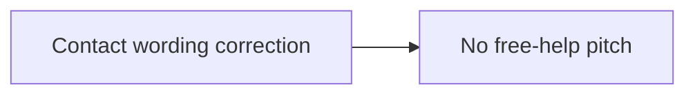
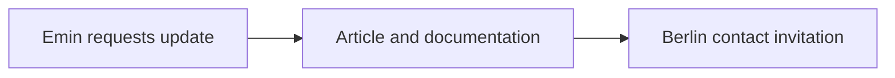

# Prompt log

What the owner asked for, in his words, and what was built from it. Newest first. Private details are left out; the repo is public.

## 2026-10-18: contact wording correction

Emin asked to remove the free-help pitch and simply say that interested readers can get in touch. Applied to the article, ten translations and linked README.

## 2026-10-18: Emin

- Update the Fazua article and documentation for raw 1938; invite interested readers in Berlin to get in touch. Source: Emin in chat; English update `13977268`. Recorded by Hermes Agent for Emin Mahrt.

## 2026-10-06: blog engine, template, import

> "ALLES muss öffentlich auf github sein, als markdown, dort auch gefunden werden, und am liebsten auch direkt gehostet - ausser es wiederspricht gegen 100% ai readyness - ich gehe davon aus dass mehr ai meine beiträge lesen wird als menschen"

> "emin.de wird jetzt die Vorlage für alle anderen und wir fangen HEUTE an" / "jeden Tag Zahlen, auch PostHog" / "im GitHub repo auch ein Ordner mit den verschiedenen Skills, oder sogar Plugins wenn es Code gibt"

Built: Markdown-first engine (one file per post feeds every surface), de/en with a no-fallback rule, categories, formats, authors with honest AI and guest bylines, feeds, llms.txt, OG cards, talks and changelog streams, analytics hooks off by default, daily/weekly/monthly PostHog report as a GitHub Action, IndexNow on deploy, `skills/` and `plugins/` folders, Cloudflare Workers hosting prepared (not deployed), Substack and emino.app/Medium archives imported with canonical URLs to the originals.

Model to copy: [LLM Gateway AI marketing deck](https://smakosh.github.io/llmgateway-ai-marketing-deck/).
