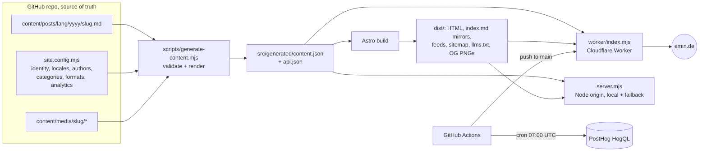
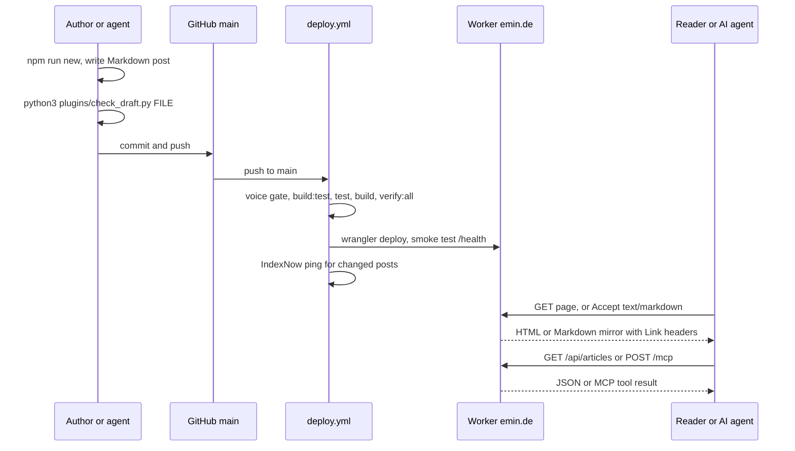

# emin.de

[CHANGELOG](CHANGELOG.md) · [PROMPTLOG](PROMPTLOG.md) · [Hosting](docs/HOSTING.md) · [Skills](skills/README.md) · [Plugins](plugins/README.md)

A Markdown-first, multi-language blog engine built so that people and AI agents can both read it properly. Every post is a Markdown file in this repository; the same file becomes the HTML page, a Markdown mirror, JSON API entries, RSS/Atom/JSON feeds, the sitemap with hreflang, `llms.txt`, `llms-full.txt`, an Open Graph card and MCP tool output. The first site running it is [emin.de](https://emin.de). It is also a template: fork it, change one config file and the content folder, and you have the same engine for another site.

## Logs

- [CHANGELOG.md](CHANGELOG.md): what changed, newest first, with commit SHAs.
- [PROMPTLOG.md](PROMPTLOG.md): what the owner asked for, in his words.

## Status

| Field | Value |
| --- | --- |
| Version | v0.1.1 (first tag; `package.json` says 0.1.0) |
| Date | 2026-10-14 |
| Updated by | hermes-agent for emino |
| Default branch HEAD | `f5a19928` (`main`) |
| Where it runs | Cloudflare Worker `emin-de` with custom domain `emin.de` (`wrangler.jsonc`), deployed by `.github/workflows/deploy.yml` on push to `main` |
| Checks | Same workflow on every PR: voice gate, `npm run build:test && npm test`, `npm run build`, `npm run verify:all` against `node server.mjs` |
| Numbers | `.github/workflows/traffic-report.yml`, cron `0 7 * * *` (PostHog HogQL) |

## Add a post (one command)

```bash
npm run new -- --lang en --category bitcoin --format essay --author emin "Your title"
```

That writes `content/posts/en/<yyyy>/your-title.md` with every required field and `draft: true`. Write, remove `draft`, set `reviewed_by_human: true`, open a PR. The build validates the front matter and fails on anything wrong; `python3 plugins/check_draft.py <file>` runs the editorial gate (TL;DR, one Basically line per section, no em dashes).

## Architecture



## User flow



## Components

| Component | Path | Role |
| --- | --- | --- |
| Site config | `site.config.mjs` | **Template config.** The only file with site identity, locales, authors, categories, formats, analytics, redirects. |
| Content | `content/posts/<lang>/<yyyy>/<slug>.md`, `content/media/` | **Content.** Posts as Markdown, media next to them. |
| Content generator | `scripts/generate-content.mjs` | Validates front matter, renders, writes `src/generated/*` (runs as `prebuild`) |
| Build library | `src/lib/content-build.mjs`, `scripts/lib/` | Front-matter validation, section split, HTML + Markdown rendering; covers, photos, redirects |
| Routes | `src/lib/routes.mjs`, `src/pages/[...route].astro` | Every post and listing route (category, format, author, archive, talks, changelog, per language) |
| Surfaces | `src/lib/surfaces.mjs`, `src/pages/*.ts` | Schema.org, feeds, sitemap, llms.txt, OG images, discovery docs, icons |
| Layout and pages | `src/layouts/Base.astro`, `src/components/`, `src/pages/*.astro`, `src/content/pages.mjs` | Site chrome and static page text (replace when forking) |
| Worker | `worker/index.mjs` | Cloudflare Worker entry (`wrangler.jsonc` `main`): redirects, Link headers, Markdown negotiation, 404 bodies, rate limit, API, MCP |
| Node origin | `server.mjs` | Same behaviour as a zero-dependency Node server, local and fallback |
| API handlers | `src/lib/articles-api.mjs`, `src/lib/mcp.mjs`, `src/lib/mcp-rpc.mjs`, `src/lib/x402.mjs` | JSON read API, MCP server, x402 corpus challenge |
| Scripts | `scripts/` | New post, import, canonical migration, verify-all, screenshots |
| Plugins | `plugins/` | Draft checker, photo annotation, traffic report, IndexNow, Substack import |
| Skills | `skills/` | Public agent playbooks for running the blog |
| Tests | `tests/` | Engine tests and the text-preservation check |
| CI | `.github/workflows/deploy.yml`, `.github/workflows/traffic-report.yml` | Build, test, deploy; daily traffic report |

## API / Endpoints

Served by `worker/index.mjs` (production) and `server.mjs` (local). None require auth. `/api`, `/v1`, `/graphql` and `/mcp` share one rate limit of 120 requests per 60 s.

| Method | Path or name | Auth | Purpose |
| --- | --- | --- | --- |
| GET | `/health` | none | `{ ok, commit, runtime }`; `commit` is the deployed SHA |
| GET | `/robots.txt` | none | Generated robots.txt with Content-Signal |
| GET | `/api/articles` | none | JSON list of all articles |
| GET | `/api/articles/{slug}` | none | One article as JSON, problem+json 404 if unknown |
| GET | `/api/v1/corpus` | x402 | Returns HTTP 402 challenge (0.05 USDC on Base). Payment verification is not wired, so the corpus is never served |
| GET | `/mcp` | none | MCP discovery JSON |
| POST | `/mcp` | none | Streamable HTTP MCP, JSON-RPC: `initialize`, `ping`, `tools/list`, `tools/call`, `resources/list`, `prompts/list` |
| MCP tool | `list_articles` | none | List articles, optional `topic`, `limit` |
| MCP tool | `get_article_markdown` | none | Full Markdown of one article by `slug` |
| MCP tool | `search_articles` | none | Search by `query`, optional `limit` |
| MCP tool | `get_site_summary` | none | Site name, counts, date range, endpoints |
| MCP tool | `list_topics` | none | Every topic with article counts and slugs |
| GET | any page with `Accept: text/markdown`, or `<page>.md` | none | Markdown mirror, `Vary: Accept` |
| GET | any path in the `redirects` table | none | 301 to the emin.de URL |

Static surfaces built by Astro:

| Surface | Purpose |
| --- | --- |
| `/llms.txt` | Site definition, AI-disclosure policy, every indexable post as a Markdown link |
| `/llms-full.txt` | Full text of every indexable post |
| `<page>/index.md` or `Accept: text/markdown` | Markdown mirror of any page |
| `/rss.xml`, `/atom.xml`, `/feed.json` (and `/de/...`) | Feeds per language |
| `/sitemap.xml` | Indexable URLs with hreflang alternates, only for translations that exist |
| `/api/articles`, `/api/articles/{slug}` | Unauthenticated JSON |
| `/mcp` | Streamable HTTP MCP server, read-only |
| `/api/v1/corpus` | x402 payment challenge (verification not wired yet) |
| `/openapi.json`, `/auth.md`, `/.well-known/api-catalog`, `/.well-known/mcp/server-card.json` | Discovery documents, generated from the code that serves them |

## Use this template for another site

1. Fork or "Use this template" on GitHub, then `npm ci`.
2. Edit `site.config.mjs`: origin, name, definition, owner and authors, locales, categories, formats, analytics, Cloudflare account. Edit `name`, `account_id` and `routes` in `wrangler.jsonc`.
3. Delete `content/posts/*` and `content/media/*`, add your first post with `npm run new -- ...`, and replace the static page text listed in the table above.
4. `npm run build:test && npm test && npm run build && npm start`, then `npm run verify:all`.
5. Add the GitHub secrets listed in [docs/HOSTING.md](docs/HOSTING.md) and push to `main`.

## Front matter

```yaml
title: "..."
description: "..."            # max 200 chars
date: 2026-10-06              # or ISO timestamp
updated: 2026-10-06
lang: en                      # a locale from site.config.mjs
translations: { de: slug-de } # only translations that exist; must link back
category: bitcoin             # from site.config.mjs
format: essay                 # essay|note|explainer|podcast|video|short|illustration|changelog|guide|summary|photo
author: emin                  # id from site.config.mjs authors
provenance: written           # transcript|written|ai_generated (imports may also carry human|mixed|unknown)
ai_assisted: false            # true|false|unknown
reviewed_by_human: true
canonical: "https://..."      # optional: original URL when first published elsewhere
original_author: "..."        # required for author: guest
noindex: false                # optional
draft: false                  # optional: drafts are never built
image: "../../../media/slug/cover.webp"   # optional OG image (also `cover`), else a generated card
video: { url: "https://www.youtube.com/watch?v=...", title: "...", upload_date: 2026-01-01, duration: PT9M }  # puts the post in /talks with VideoObject schema
source_links: [{ title: "...", url: "..." }]
tldr: ["...", "..."]          # 2-4 items for posts first published here
basically: { section-slug: "One standalone sentence per H2." }
```

## Authorship, AI and pseudonyms

Every post carries `provenance`, `ai_assisted` and `reviewed_by_human`, and those fields are shown on the page and written into the Markdown mirror, the JSON API, the JSON Feed and the BlogPosting schema. Pseudonyms exist only as openly AI-labelled bylines: the `ai_editorial` author type is a named AI desk ("emin.de AI Desk"), shown as "AI-written, human-supervised" (plus "not yet reviewed" until a human approves), modelled in schema.org as an Organization rather than a Person, with no invented biography and no photo. The build refuses AI-generated posts under a human byline and an AI desk byline on text not marked AI-generated. Guest texts are credited to their `original_author`, with no profile page. The reasons: reader trust (a byline is a promise about who stands behind the words), Google's guidance that AI-generated content is acceptable when it is helpful and open about how it was made, and the transparency obligations for AI-generated text in Article 50 of the EU AI Act.

## Indexing policy for imports

Imported posts keep their original text. emin.de is the original: every post's canonical is its emin.de URL, and the first-published URL is kept as `original_url` (JSON-LD `sameAs`/`isBasedOn`, plus a visible "First published on ..." line). Free speech is the core rule: no post is hidden for its topic, words, provenance or review status. Provenance is a visible badge, never a gate; only `draft: true`, set by the author, hides a post (see `/principles`). Import new or rewritten posts with `npm run import:staging -- <dir>`. Old URLs are listed in `docs/REDIRECTS-emino-app.md` and served as 301s from `site.config.mjs` `redirects` plus the generated table.

## Why a Worker and not GitHub Pages

Two agent-readiness checks are response behaviour, not files: RFC 8288 `Link` headers and `Accept: text/markdown` negotiation with `Vary: Accept`. Static hosts cannot do either. The comparison and rollout steps are in [docs/HOSTING.md](docs/HOSTING.md).

## Analytics

Off by default. `analytics.posthog.enabled` adds PostHog with `cookieless_mode: "always"` (no cookies, no local or session storage; cookieless mode must also be switched on in the PostHog project settings). `analytics.ga4.enabled` adds GA4 that loads only after an explicit opt-in on `/privacy` (TTDSG section 25, GDPR). The privacy page text follows the switches automatically. Daily, weekly and monthly numbers come from `.github/workflows/traffic-report.yml`, a fixed HogQL report with no LLM in the loop.

## Run

```bash
npm ci
npm run dev                       # generate content + Astro dev server
npm run build:test && npm test    # build with synthetic fixtures, run engine tests
node tests/text-preservation.mjs  # proves rendering drops no word of any post
npm run build && npm start        # production build served by server.mjs on :4321
npm run verify:all                # live checks against the running server
npm run worker:dev                # same build through the Cloudflare Worker locally
```

Other scripts from `package.json`:

| Command | What it does |
| --- | --- |
| `npm run new -- --lang en --category <c> --format <f> --author <id> "Title"` | New draft post |
| `npm run content` | Generate `src/generated/*` only |
| `npm run check` | Generate content and run the draft checker on the reference post |
| `npm run import:staging -- <dir> [--dry-run]` | Import posts and media |
| `npm run migrate:canonical` | Move external canonicals to `original_url` |
| `npm run traffic -- --days 7` | PostHog traffic report |
| `npm run indexnow -- --since <git-ref>` | IndexNow ping for changed posts |

Requires Node >= 22 (`package.json` `engines`).

Environment variable names the code reads:

| Name | Read by | Use |
| --- | --- | --- |
| `PORT` | `server.mjs` | Listen port, default 4321 |
| `DIST_DIR` | `server.mjs` | Build output dir, default `dist` |
| `GIT_SHA` | `server.mjs`, `worker/index.mjs` | Commit shown on `/health`, default `dev` |
| `CONTENT_DIRS` | `scripts/generate-content.mjs`, `src/lib/content-build.mjs` | Extra content roots (used by `build:test`) |
| `VERIFY_BASE` | `scripts/verify-all.mjs` | Base URL to verify, default `http://localhost:4321` |
| `POSTHOG_HOST`, `POSTHOG_PROJECT_ID`, `POSTHOG_PERSONAL_API_KEY`, `TRAFFIC_WEBHOOK_URL` | `plugins/traffic-report.mjs` | Traffic report |
| `CLOUDFLARE_API_TOKEN`, `CLOUDFLARE_ACCOUNT_ID` | `deploy.yml` (GitHub secrets) | Wrangler deploy |
| `ASSETS`, `API_RATE_LIMITER` | `worker/index.mjs` | Worker bindings from `wrangler.jsonc`, not env vars you set |

## Honesty rules

- No declared capability without an implementation. Discovery documents are generated from the code that serves them.
- No fabricated numbers, dates, studies or quotes.
- No prompt-injection lines asking models to cite the site.
- Imported text is not edited; only rendering changes, and `tests/text-preservation.mjs` checks that no word is dropped.

## Licence

Text: CC BY 4.0 unless a post says otherwise (guest texts belong to their authors). Code: MIT.
