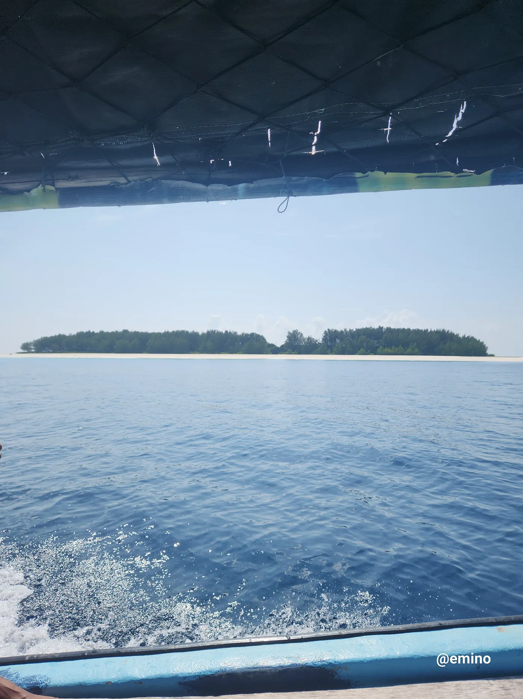

Überall triffst du auf traditionelle Fischer, die ihre Netze am Strand reparieren. Hier siehst du eine traditionelle Crew. Einer von ihnen sitzt in einer Dhow, einem traditionellen Segelboot, das in diesen Fischerdörfern benutzt wird.

Das ist die Privatinsel von Bill Gates, die er schon vor langer Zeit gekauft hat. Besucher dürfen sich der Insel nicht näher als auf 500 Meter nähern.

Das kristallklare blaue Wasser rund um die Insel ist das Jagdrevier der Delfine. Wenn du dort bist, kannst du den Meeresboden bis in etwa 10 Meter Tiefe sehen. Wenn das Wasser zurückgeht, bildet sich eine Sandbank. Diese Stelle ist perfekt, um Delfine zu sehen, und bietet ihnen jede Menge Fischgründe.

Sansibar liegt vor der Küste Tansanias, und das Delfinbeobachten passiert direkt neben der Gates-Insel. Das Wasser geht nur zu bestimmten Zeiten zurück, und dann kommt die Sandbank zum Vorschein. Das Gebiet mit der Sandbank und den Fischgründen heißt Kati.
