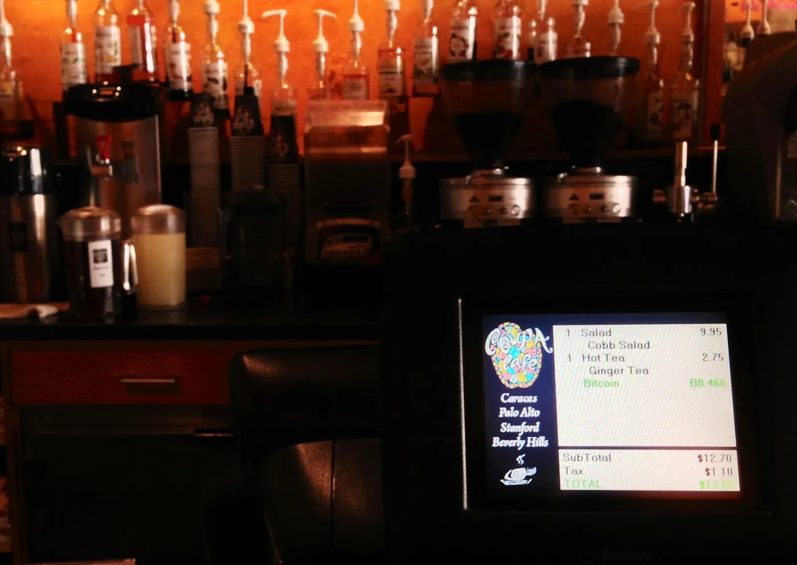

2012 habe ich mit meinem Freund Julian über Bitcoin und die Finanzmärkte gesprochen, und das hat mir echt die Augen geöffnet. Im selben Jahr habe ich meinen ersten Bitcoin im Room77 in Berlin gekauft, wo ich 1 Bitcoin für einen Burger bezahlt habe. Bitcoin war damals noch ziemlich neu, und wir haben über viele Dinge gesprochen, über die technische Seite des Tradings, aber auch über die größere Frage, ob man lieber eine Firma aufbauen oder die Märkte traden sollte. Wenn ich heute an dieses Gespräch denke, finde ich es interessant, wie viel sich verändert hat und wie viel gleich geblieben ist.

## Börsen und Arbitrage damals und heute

2012 hat mir Julian von Internetbörsen für digitale Währungen wie Bitcoin erzählt. Viele davon hatten JavaScript-APIs für automatisiertes Trading, und das war für die Zeit ziemlich fortschrittlich. 2023 haben sich diese Börsen stark verändert. Sie haben viel mehr Features, zum Beispiel Futures-Trading und Staking. Und Regulierung ist zu einem großen Faktor geworden, es gibt also eine Sicherheitsebene, die es in den frühen Tagen größtenteils nicht gab.

Julian hatte einige Erfahrung mit Arbitrage-Trading zwischen verschiedenen Bitcoin-Börsen. Er hat es mir so erklärt: Man kauft und verkauft auf verschiedenen Märkten, weil dasselbe Asset dort unterschiedliche Preise hat. Der Haken war, dass es nur funktioniert, bis mehr Leute davon erfahren. 2023 gibt es Arbitrage immer noch, aber sie kommt viel seltener vor und die Konkurrenz ist viel härter. Mit algorithmischem Trading und schnelleren Informationen ist es ein Spiel mit hohen Einsätzen geworden, und man braucht gute Tools und Strategien dafür.

## Risiko, und was mich meine Bitcoin-Käufe gekostet haben

An einen Teil unseres Gesprächs von 2012 erinnere ich mich gut, es ging um die Risiken des Bitcoin-Tradings. Ich habe gefragt, ob das überhaupt legal ist, und Julian meinte, es ist nicht illegal, aber es kann riskant sein. 2023 sind die Regeln für Bitcoin klarer, aber die Risiken sind nicht verschwunden. Der Preis bewegt sich immer noch stark, und Bitcoin hatte über die Jahre mehrere große Preissprünge. Im Dezember 2017 zum Beispiel erreichte er ein Allzeithoch von fast 20.000 Dollar.

Mein zweiter Bitcoin-Kauf war auch im Room77, da habe ich einen Salat und einen heißen Tee für 0,46 Bitcoin gekauft. Das Allzeithoch für Bitcoin, das ich kenne, sind diese fast 20.000 Dollar. Mein erster Burger hat mich also das gekostet, was 20.000 Dollar hätten sein können, und der Salat mit dem heißen Tee hätten auf dem Höhepunkt rund 9.200 Dollar wert sein können. Für mich zeigen diese Käufe, wie stark sich Bitcoin bewegt, und dass man damit viel gewinnen, aber auch viel verlieren kann.

## Traden oder eine Firma aufbauen

Am Ende des Gesprächs habe ich mich gefragt, ob es mehr Sinn ergibt, die Bitcoin-Märkte wirklich zu verstehen oder meine Energie in die Gründung eines Unternehmens zu stecken. Julian meinte, Trading profitabel zu machen ist schwer, besonders wenn man nicht viel Geld einsetzen kann. 2023, mit all den Blockchain-Startups und mit Crypto im Mainstream, sieht es so aus, als könnten beide Wege sich gut auszahlen, aber beide bringen ihre eigenen Probleme und Risiken mit.

Rückblickend war dieses Gespräch mit Julian 2012 eine Momentaufnahme von Bitcoin zu dieser Zeit. Es ging um Trading-Strategien wie Arbitrage und um die Risiken und die Unsicherheit dieses neuen digitalen Assets. Jetzt, 2023, haben viele dieser frühen Fragen Antworten, aber es gibt neue Probleme und neue Chancen. Traden oder eine Firma aufbauen, was zählt, ist, dass man sich anpassen kann und dass man wirklich versteht, wie der Markt funktioniert.
