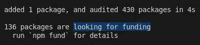
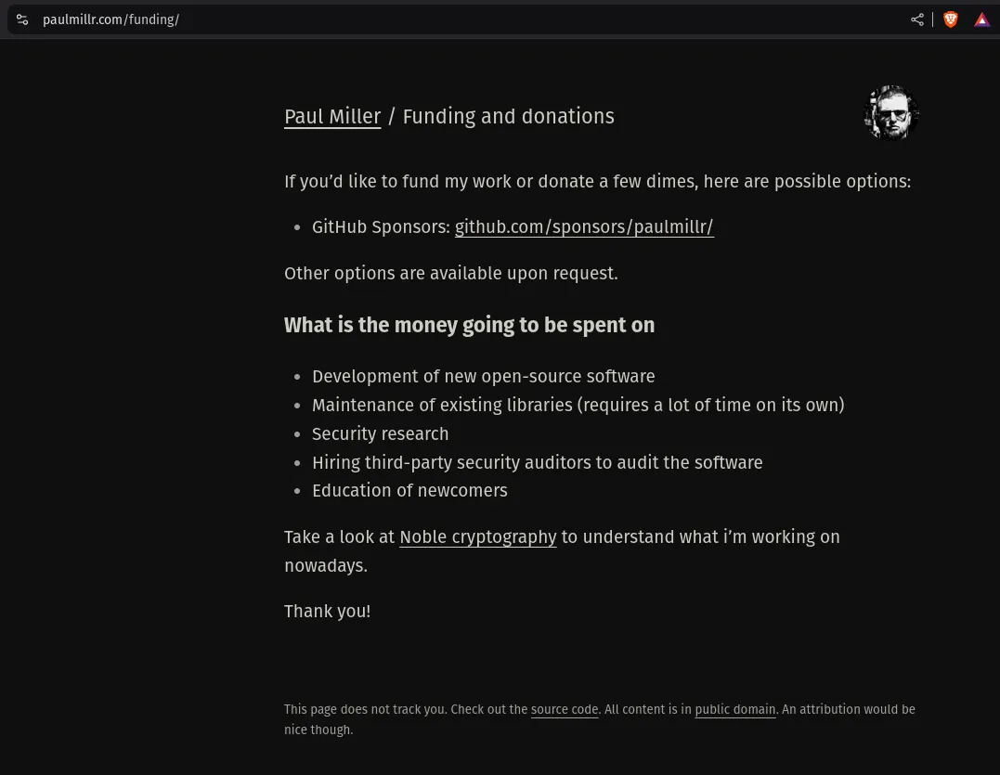
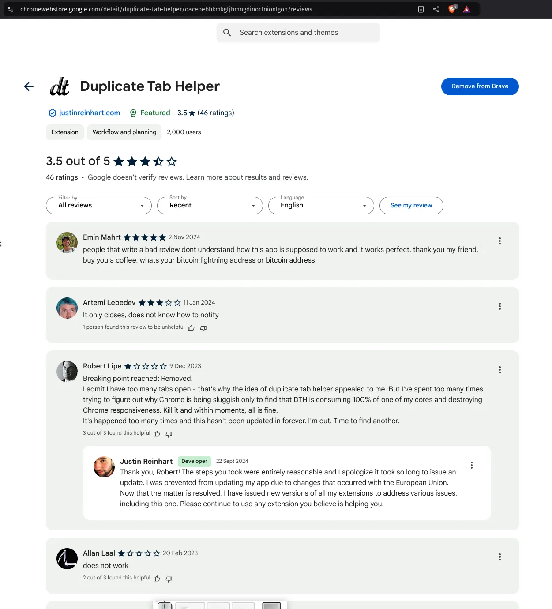

# 21 npm-Pakete suchen Finanzierung, führe `npm fund` aus für Details

npm.fund ist das pump.fun für die Finanzierung von npm-Paketen.

NPM Fund erstellt einen automatischen, kontinuierlichen Token-Markt für Open-Source-Pakete. Die Idee kommt aus drei Dingen. Curation Markets, wo Tokens den Wert von Content und Projekten zeigen. Bonding Curves, die den Preis automatisch finden und immer Liquidität bereitstellen. Und die Art, wie pump.fun Tokens launched, was fair ist und schwer für Bots zu gamen. Das Neue daran ist, das zusammenzubringen mit dem, was npm schon für Funding hat, `npm fund`, damit Open-Source-Maintainer Geld bekommen, das für immer weiter fließt.

## Wie es funktioniert

Jedes Paket hat seinen eigenen Token, und anders als bei einem normalen Token-Launch oder einem DEX-Markt kann der Token immer gemintet oder geburnt werden. Es gibt kein Maximum Supply, das System hört nie auf, Tokens anzubieten, du kannst immer kaufen und verkaufen, du brauchst keine externen Market Maker, und der Preis wird die ganze Zeit gefunden. Es ist eine endlose Kurve. Jeder kann jederzeit neue Tokens minten, jeder kann jederzeit Tokens für das Underlying burnen, der Preis ändert sich von selbst mit dem Supply, und die Liquidität ist durch Mathe garantiert.

Ein traditioneller Token-Launch hat ein festes Supply und eine kleine erste Verteilung, er braucht Liquidität auf einer DEX, er ist leicht zu manipulieren und Leute können ihn front-runnen. Der NPM-Fund-Markt hat kein Limit beim Supply, er ist immer verfügbar, die Liquidität ist eingebaut, er ist schwer zu manipulieren und der Preis ist vorhersehbar.

Drei ökonomische Dinge sorgen dafür, dass es funktioniert. Das erste ist Value Capture. Maintainer bekommen 21% von allen Token-Interaktionen, die Fees werden automatisch und die ganze Zeit ausgezahlt, und niemand muss Grant-Anträge schreiben oder Sponsoren suchen. Das zweite ist Price Discovery. Der Preis steigt mit dem Supply, also bekommen frühe Supporter bessere Preise, und wie der Markt über ein Paket denkt, zeigt sich direkt im Preis. Das dritte ist garantierte Liquidität. Die Bonding Curve hält immer Collateral, du kannst immer aussteigen, und du hängst nicht von externen Market Makern ab.

## Wer bekommt was

Maintainer bekommen einen Revenue-Stream, der nicht aufhört, sie müssen kein Token-Engineering machen, die Fees werden automatisch ausgezahlt, und die Token-Mechanik bringt die Community auf dieselbe Seite. Contributors können Tokens kaufen, bevor sie contributen, dann helfen, das Paket besser zu machen, und der Token kann mehr wert sein, wenn das Paket gut läuft. Sie können jederzeit über die Kurve aussteigen. Investoren bekommen Ein- und Ausstiegspreise, die sie berechnen können, garantierte Liquidität, einen Vorteil, wenn sie früh kommen, und direktes Exposure dazu, wie gut ein Paket läuft.

Was den Token-Wert bewegt, ist, wie viele Leute das Paket nutzen, wie aktiv die Contributors sind, wie viel Nachfrage es nach dem Token gibt, und wie das ganze Ökosystem wächst. Der Preis bildet sich kontinuierlich und automatisch aus dem aktuellen Supply, er zeigt, was im Markt passiert, und er springt nicht. Liquidität ist immer da, sie balanciert sich selbst, sie hängt von nichts außerhalb ab und sie ist durch Mathe garantiert.

## Das System

Die Daten fließen in 4 Schritten. Die Funding-Daten kommen von `npm fund`, der Maintainer wird über GitHub verifiziert, ein kontinuierlicher Token-Markt wird erstellt, und die Fees werden automatisch ausgezahlt. Für User ist es einfach. Du mintest Tokens, indem du Collateral schickst, der Preis ändert sich mit dem neuen Supply, der Maintainer bekommt einen Prozentsatz von jeder Interaktion, und du kannst deine Tokens jederzeit burnen.

Phase 1 ist der Kern, mit Support für einen einzelnen Maintainer, Basic-Token-Mechanik, GitHub-Verifizierung und wöchentlichen Daten-Updates. Phase 2 macht es besser, mit Support für mehr Maintainer, fortgeschrittenerer Fee-Verteilung, besseren Analytics und Echtzeit-Paketdaten. Phase 3 ist das Ökosystem, mit Governance, Incentives über Pakete hinweg, Contribution-Tracking und Tools für Marktanalyse.

## Was hier neu ist

Was hier neu ist, läuft auf drei Dinge runter. Märkte, die nie enden, wo Tokens immer verfügbar sind, es kein Maximum Supply gibt, es immer liquide ist und der Preis im System gefunden wird. Incentives, die zusammenpassen, damit Contributors früh dabei sein wollen, Maintainer die ganze Zeit Funding bekommen, User Pakete direkt supporten können, und der Wert, den du capturest, zum Wert passt, den du schaffst. Und ein effizienter Markt, ohne Token-Lockups, ohne externe Market Maker, ohne Liquidity Mining und ohne Yield Farming.

NPM Fund ist eine neue Art, Open Source zu finanzieren. Es nimmt Mechanismen aus Web3, die schon funktionieren, und steckt sie in das npm-Ökosystem, das schon existiert, damit Paket-Maintainer Funding bekommen, das hält.

## Idee in Entwicklung

das ist eine sich entwickelnde Story, komm in den nächsten Tagen wieder hierher, um mehr darüber zu sehen. Kurz gesagt: der npm-Paket-Installer pusht Awareness für Pakete, die Funding suchen, ich will es lohnend und einfach machen, diese Projekte zu finanzieren, indem ich einen pump.fun Meme Coin erstelle, den Leute für das Paket kaufen und traden können, damit der Entwickler bezahlt wird, und er/sie/es/oder AI in der Zukunft Fees bekommt oder einfach eine Fair-Launch-Allocation, und sie bekommen mehr, wenn das Paket mehr gehyped und gefeiert wird, und weniger, wenn niemand das Spiel spielen will oder sich damit assoziieren will.

*ein Entwickler, der über npm fund im Terminal um Hilfe für freie Software bittet*

*ein Free-Software-Entwickler, der sich bei einem wütenden User entschuldigt, der mit einer freien Software nicht zufrieden ist, für die er nichts bezahlt hat, aber sich trotzdem die Zeit nimmt, sich zu beschweren und ihm in die Eier zu treten. FUCK YOU.*
