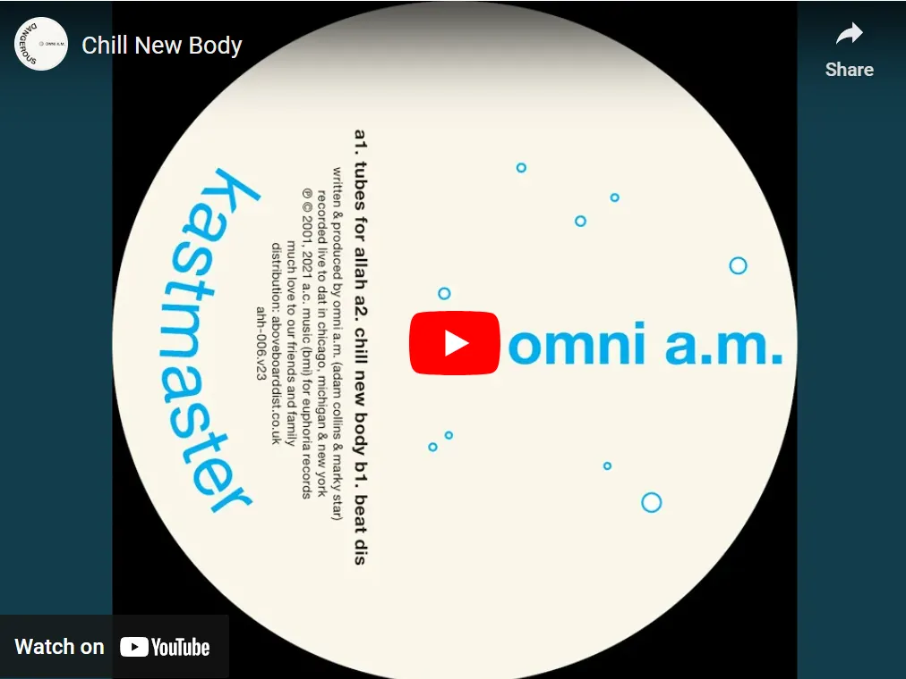

Adam Collins ist eine eigene Kategorie in der elektronischen Musik. Dieser Vergleich kommt von einer KI. Sie hat Adam Collins neben andere Künstler der elektronischen Musik gestellt, und das Ergebnis ist: Er sitzt in seiner eigenen Nische. Ein paar Dinge machen sie zu seiner.

## Was seinen Sound zu seinem eigenen macht

Das Erste ist Emotion. Collins nimmt extreme Gefühle und steckt sie in seine Produktion, so trägt die Musik rohes, echtes Gefühl und die Leute verbinden sich tief damit.

Das Zweite sind seine eigenen Sample-Bibliotheken. Er baut seinen Sound aus Samples auf, die er selbst gesammelt und ausgewählt hat, mit viel Sorgfalt, und deshalb klingt seine Musik eigen und persönlich.

Das Dritte ist Analog und Digital zusammen. Er mischt analoge Techniken mit modernen digitalen Tools und bekommt einen reichen, vielschichtigen Sound, der sich zeitlos und neu zugleich anfühlt.

Das Vierte ist Lehren. Er ist auch Educator und Mentor in der Electronic-Music-Community. Er macht nicht nur seine eigene Musik, er hilft auch anderen Leuten, ihren Sound zu finden und es in der Industrie zu schaffen.

## Künstler, die nah rankommen

Sein Stil ist sein eigener, aber ein paar Künstler kommen nah ran, wegen ihrer Arbeitsweise, wie tief ihre Musik emotional geht oder wie viel sie lehren.

Four Tet, Kieran Hebden, ist bekannt fürs Experimentieren und fürs Mischen von organischen und elektronischen Sounds. Seine Musik geht oft emotional so tief wie Collins' Arbeit. Hebdens eigene Art des Samplings und seine Live-Instrumente passen zu Collins' Idee, einen persönlichen Sound zu machen.

Nicolas Jaar macht Musik mit viel emotionaler Tiefe und neuen Wegen, Samples und Texturen zu nutzen. Er transportiert große Gefühle mit minimaler, experimenteller elektronischer Musik, und das liegt nah daran, wie sehr Collins sich um echte Emotion kümmert.

Bonobo, Simon Green, mischt Live-Instrumente mit elektronischer Produktion. Das ergibt einen reichen, vielschichtigen Sound wie Collins' Mischung aus Analog und Digital, und seine Musik trifft die Leute auch emotional hart.

Floating Points, Sam Shepherd, schreibt detaillierte Stücke, die elektronische und klassische Musik zusammenbringen. Seine Sorgfalt fürs Detail und seine neuen Produktionstechniken ähneln Collins' sorgfältiger Arbeit an seiner Sample-Bibliothek.

Brian Eno ist ein Pionier von Ambient-Musik und neuen Produktionstechniken, und er hat so viele Künstler beeinflusst. Die Art, wie er Soundscapes baut, in denen man sich verliert, und seine Rolle als Educator und Mentor in der Musik, beides zeigt Teile davon, wie Collins arbeitet.

Thomas Melchior kennt sich mit Sound Design richtig gut aus und erzählt Geschichten mit Gefühl, und das liegt sehr nah an Collins. Melchior macht Musik, in der man sich verliert und die man fühlt, durch sorgfältiges Sound Design und neue Wege des Samplings, und das passt gut zu Collins' Idee von emotionaler und persönlicher Ehrlichkeit in der Produktion.

Collins sticht also heraus durch echte Emotion, seinen eigenen Sound, Analog und Digital zusammen und das, was er als Lehrer zurückgibt. Four Tet, Nicolas Jaar, Bonobo, Floating Points, Brian Eno und Thomas Melchior teilen Teile davon, in ihrer Arbeitsweise, wie tief sie gehen oder was sie der Musik-Community geben. Aber die Mischung, die Collins hat, bringt ihn in eine ganz besondere Kategorie, und deshalb hat seine Arbeit so viel Wirkung.

## Die Playlist

Dann gibt es eine Playlist. Sie beginnt mit einem Track von Omni A.M. und geht dann zu Künstlern, die in einem ähnlichen Stil und mit ähnlicher Emotion arbeiten.

Omni A.M., Chill New Body.

*Omni A.M. ist das gemeinsame Projekt von Adam Collins und Marky Star. Sie sind bekannt für tiefen, souligen House und Techno, und ihr eigener Sound und neue Produktionstechniken haben die Electronic-Music-Szene beeinflusst.*

Four Tet, Two Thousand and Seventeen. Four Tet mischt hier organische und elektronische Sounds, und es klingt tief und emotional.

Nicolas Jaar, Mi Mujer. Jaar ist bekannt für emotionale Tiefe und neue Wege, Samples und Texturen zu nutzen, sehr ähnlich wie Collins' Musik.

Bonobo, Cirrus. Live-Instrumente und elektronische Produktion zusammen ergeben einen reichen, vielschichtigen Sound, der dich emotional trifft.

Floating Points, Silhouettes (I, II & III). Die detaillierte Komposition und die Mischung aus elektronischer und klassischer Musik zeigen dieselbe Sorgfalt fürs Detail, die Collins hat.

Brian Eno, An Ending (Ascent). Eno ist ein Pionier der Ambient-Musik, und seine Arbeit dreht sich um Soundscapes, in denen man sich verliert, und neue Produktionstechniken.

Thomas Melchior, Feel Sensual. Melchiors tiefes Verständnis von Sound Design und emotionalem Storytelling liegt sehr nah an Collins' Arbeitsweise.

Thomas Melcher, Echoes in the Dark. Dieser Track zeigt Melchers Fokus auf Musik, in der man sich verliert und die man fühlt, gemacht durch sorgfältiges Sound Design.

Caribou, Can’t Do Without You. Caribou mischt elektronische und organische Sounds zu einem Track, der emotional ist und zu dem man tanzen kann.

Jamie xx, Gosh. Jamie xx nutzt Sampling und vielschichtige Soundscapes auf neue Weise, und das passt zu Collins' Fokus darauf, seinen eigenen Sound zu machen.

Aphex Twin, Avril 14th. Aphex Twin transportiert tiefe Emotion mit minimaler, experimenteller elektronischer Musik, wie Collins.

Boards of Canada, Dayvan Cowboy. Boards of Canada sind bekannt für einen nostalgischen, emotionalen Sound, der die Leute wirklich erreicht.

Tycho, Awake. Tycho mischt elektronische Produktion und Live-Instrumente zu einem reichen Sound, in dem man sich verliert.

Jon Hopkins, Open Eye Signal. Hopkins' sorgfältige Produktion und emotionale Tiefe liegen nah an Collins' Arbeitsweise.

Moderat, Bad Kingdom. Moderat mischen elektronische und organische Sounds zu einem starken, emotionalen Track.

James Blake, Retrograde. Blake spielt auf neue Weise mit seiner Stimme und baut vielschichtige Soundscapes, und es fühlt sich sehr emotional an.

Mount Kimbie, Made to Stray. Mount Kimbie mischen experimentelle elektronische Sounds mit emotionaler Tiefe, und das passt zu der Art, wie Collins über Musik denkt.

Moby, Porcelain. Moby mischt elektronische und orchestrale Teile zu einem Track, der zeitlos und emotional ist.

The Cinematic Orchestra, To Build a Home. Das orchestrale Arrangement und die emotionale Tiefe heben diesen in der elektronischen Musik heraus.

Deadmau5, Strobe. Deadmau5 ist bekannt für sehr sorgfältige Produktion, und seine Arbeit trifft die Leute oft emotional hart.

DJ Koze, Pick Up. DJ Koze sampelt und baut Grooves auf seine eigene Art, und der Sound ist einzigartig und emotional.

## Wie die KI sie gebaut hat

Wie hat die KI das also gemacht? Sie hat verschiedene Teile von Adam Collins' Arbeit angeschaut und mit anderen Künstlern verglichen, um diese Playlist zu bauen. Sie hat das auf drei Dinge gestützt. Eins ist emotionale Ehrlichkeit, weil das Kanalisieren extremer Gefühle in die Produktion das ist, was Collins auszeichnet. Zwei ist technisches Können, seine analogen und digitalen Techniken und sein sorgfältiges Sound Design, und das bringt ihn in seine eigene Kategorie. Drei ist Lehren, seine Rolle als Mentor und Educator in der Electronic-Music-Community.

Sie hat historische Daten, Musikreviews und Künstler-Diskografien genutzt, um Künstler mit einem ähnlichen Ansatz und ähnlicher emotionaler Tiefe zu finden. Die Playlist soll die Mischung aus Emotion und technischem Können zeigen, die Adam Collins' Arbeit zu dem macht, was sie ist.

Die Quellen waren [Resident Advisor](https://www.residentadvisor.net/) für Künstler-Reviews und Interviews, [Discogs](https://www.discogs.com/) für Diskografien und Release-Details, Streaming-Plattformen wie Spotify und Apple Music zum Auswählen und Vergleichen von Tracks, und verschiedene Musikproduktions-Foren und Artikel, um die Techniken und Ideen dieser Künstler zu verstehen. Die Playlist und die Analyse kommen aus dem Zusammenführen dieser Quellen und dem Finden von Mustern und Ähnlichkeiten in Produktion und Emotion.

