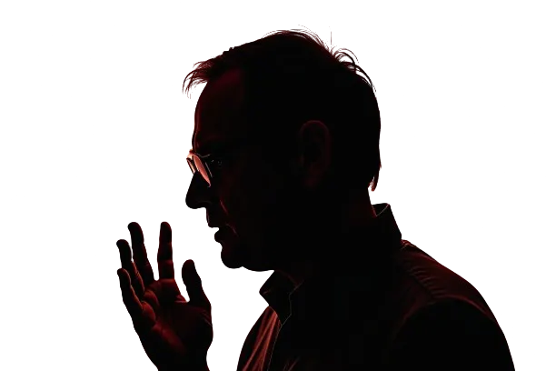

Eine Zusammenfassung eines Interviews mit Eric Schmidt, dem ehemaligen CEO von Google. Das komplette Transkript kannst du hier lesen [https://www.emino.ai/2024/08/18/ai-revolution-eric-schmidts-insights-on-the-future-of-technology-and-global-competition/](https://www.emino.ai/2024/08/18/ai-revolution-eric-schmidts-insights-on-the-future-of-technology-and-global-competition/) und das Interview hier anschauen.

<https://www.youtube.com/watch?v=33LcU8vfnR0>
*[https://youtu.be/33LcU8vfnR0?si=ow9WTS6823Q7hPLf](https://youtu.be/33LcU8vfnR0?si=ow9WTS6823Q7hPLf)*

## Agenten, Kapital, Chips und Energie

Schmidt sagt, KI entwickelt sich gerade extrem schnell, und er sieht drei große Dinge in den nächsten 1 bis 2 Jahren kommen. Sehr große Kontextfenster, KI-Agenten und Text zu Aktion, also Systeme, die aus dem, was du schreibst, ausführbaren Code machen. Er glaubt, das wird einen massiven Impact haben, vielleicht größer als Social Media.

Er sieht auch, wie die Lücke zwischen den Frontier-Modellen und allen anderen größer wird. Um diese Modelle zu bauen, braucht es enorme Mengen an Kapital und Compute, irgendwo zwischen 10 Milliarden und über 100 Milliarden Dollar für die Top-Systeme. Also können nur wenige Firmen und Länder da oben wirklich mitspielen.

Es geht nicht nur um Software. Es geht auch um Chips und Energie. NVIDIA dominiert gerade den KI-Chip-Markt wegen seiner CUDA-Architektur. Und Schmidt sagt, die USA müssen bei KI mit Kanada zusammenarbeiten, weil Kanada die saubere Energie hat, die die riesigen Rechenzentren brauchen. Dann ist da noch das Rennen zwischen den USA und China, das auch eine Frage der nationalen Sicherheit ist. Er glaubt, die USA sind China bei der Chip-Technologie ungefähr 10 Jahre voraus.

## Google, Jobs und Desinformation

Bei Firmen ist er sehr direkt. Er sagt, Google ist bei KI teilweise wegen seiner Arbeitsplatzkultur zurückgefallen. Startups und gründergeführte Firmen sind oft besser darin, Innovation voranzutreiben, weil sie hungriger sind und härter arbeiten.

Er spricht auch über die Schattenseiten. KI wird den Arbeitsmarkt wahrscheinlich treffen, vor allem Jobs mit geringen Qualifikationen, während hochqualifizierte Leute mit Hochschulabschluss mit diesen Systemen arbeiten und wahrscheinlich gut klarkommen werden. Und er macht sich Sorgen über Desinformation, besonders in sozialen Medien und während Wahlen. Er sieht das als große Bedrohung für die Demokratie, die KI noch schlimmer machen könnte, und er sagt, die Leute brauchen kritisches Denken, um damit umzugehen.

Noch ein paar Punkte aus dem Interview. Er will bessere KI-Ressourcen für Universitäten, damit die Forschung in den USA wettbewerbsfähig bleibt. Und sein Rat an Gründer ist, schnell zu prototypen und KI-Tools zu nutzen, um das Business aufzubauen.

## Zehn Zitate, Wort für Wort

Hier sind 10 Zitate von Eric Schmidt, Wort für Wort.

1. "In the next year, you're going to see very large context windows, agents, and text action."
2. "The gap between the frontier models, which there are now only three, I'll review who they are, and everybody else appears to me to be getting larger."
3. "Sam Altman is a close friend. He believes that it's going to take about $300 billion, maybe more."
4. "I like to think of CUDA as the C programming language for GPUs."
5. "Google decided that work-life balance and going home early and working from home was more important than winning."
6. "The most interesting country is India because the top AI people come from India to the US and we should let India keep some of its top talent."
7. "I fundamentally believe that the sort of college education high skills task will be fine because people will work with these systems."
8. "You really do need to understand how these systems work."
9. "The rich get richer, and the poor do the best they can."
10. "I'm telling you that the ability to prototype quickly, part of the problem with being an entrepreneur is everything happens faster."
