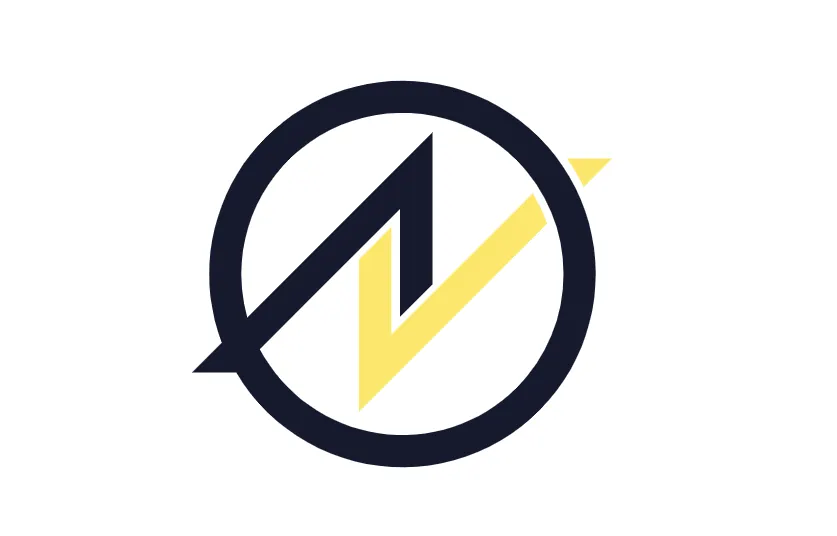

# Die Amoveo-Community über Futarchy, Dezentralisierung und echte Anwendungen

Das hier ist eine Zusammenfassung von Diskussionen in der Amoveo-Community und der Arbeit des Lead-Developers. Die Ideen stammen also von ihnen, nicht von mir.

Die Amoveo-Community ist eine kleine Gruppe von Leuten, die tief in die technische Seite von Blockchains einsteigen. Der Lead-Developer treibt das meiste davon voran, und in den Gesprächen geht es darum, wie man Blockchains einfacher benutzbar macht und für echte Dinge in der echten Welt nützlich.

## Was Amoveo ist

Amoveo ist eine Blockchain für Finanzderivate. Sie setzt Skalierbarkeit, Sicherheit und Dezentralisierung an erste Stelle. Das Oracle-System ist direkt in den Konsensmechanismus eingebaut, was es günstiger und sicherer macht. Die Amoveo-DEX ermöglicht Swaps über Chains hinweg, auch mit Privacy Coins, und kostet weniger als die üblichen Bridges.

Das Smart-Contract-System ist so gebaut, dass es skaliert und günstig bleibt. Es gibt also keinen gemeinsamen veränderbaren Zustand. Amoveo ist die einzige stateless Blockchain, und das heißt: Blöcke lassen sich schnell verifizieren, das Netzwerk kann dezentraler sein, und Blöcke lassen sich sogar rückwärts verifizieren. Genau deshalb passen Verkle Trees auch so gut dazu. Die Transaktionstypen sind nicht Turing-vollständig, aber man kann sie kombinieren, und sie ermöglichen unendliche Flash Loans in allen Währungen, sodass du eine komplexe Sache in einer einzigen Transaktion erledigen kannst. Und anders als bei Ethereum kostet eine fehlgeschlagene Transaktion dieser Art bei Amoveo kein Gas.

Das Team arbeitet an mehreren Dingen gleichzeitig. Es will den Verkle Tree einführen, für bessere Skalierung und kleinere Transaktionen. Es will eine DEX mit besserem Interface und mehr Liquidity Providern. Es hat sich von Futarchy als Hauptweg der Governance verabschiedet, wegen seiner Grenzen. Es schaut sich ein dezentrales Grundbuch mit Harberger Taxes an, und die Community redet weiter über die technische Seite, Use Cases und wie man wachsen kann.

## Futarchy

Futarchy ist eine Form der Governance, bei der Entscheidungen den Ergebnissen von Prediction Markets folgen. Sie war lange ein großes Thema bei Amoveo. Am Anfang war die Idee, sie für viele Dinge zu nutzen, etwa die Block Reward und Protocol Upgrades. Aber die Community hat nachgerechnet und es modelliert, und sie hat Fälle gefunden, in denen Futarchy manipuliert werden kann oder einfach nicht funktioniert. Also hat sie sich davon als Hauptweg für Entscheidungen verabschiedet, und der Fokus ging darauf, das Oracle-System besser zu machen und andere Wege der Governance anzuschauen.

Futarchy passt vielleicht nicht direkt zur Harberger Tax, könnte aber trotzdem drumherum helfen. Märkte könnten zeigen, was die Community von einem neuen Steuersatz hält, oder was verschiedene Steuermodelle mit der Landnutzung und der Wirtschaft drumherum machen würden. Die Community sieht auch andere Stellen, wo es in Amoveo funktionieren könnte. Leute könnten Märkte nutzen, um zu zeigen, welche Features und Verbesserungen sie am meisten wollen, sodass die Entwicklungsprioritäten dem folgen. Märkte könnten vorhersagen, welche Marketingkampagne mehr Nutzer und Wachstum bringt. Und vor einer großen Protokolländerung könnten Märkte schätzen, was sie mit der Netzwerksicherheit, den Fees und dem Gefühl für die Nutzer macht. Aber all das ergibt nur Sinn, wo Futarchy kryptoökonomisch sicher und schwer zu manipulieren ist.

## Zwölf Monate Futarchy-Diskussion

Die Diskussion der letzten zwölf Monate lief so. Am 5. November 2023 kam der Lead-Developer auf Futarchy zurück, weil Leuten aufgefallen war, dass Amoveo sich von Robin Hansons ursprünglichem Vorschlag entfernt hatte, und er wollte es nochmal für Amoveos Governance anschauen. Am 6. November 2023 sagte er, seine frühere Analyse habe vielleicht einen Fehler gehabt, und er sei wieder hoffnungsvoll. Am 7. November 2023 kündigte er einen Artikel über eine neue Art von Futarchy an, die zu funktionieren schien. Am 18. November 2023 teilte er einen Blogpost darüber, warum diese neue Form funktioniert, und fing an, sie für das nächste Hard Update zu bauen. Am 20. November 2023 sprach die Community darüber, wie man es on-chain macht, mit Order Books und LMSR-Märkten. Am 1. Dezember 2023 fragte Jehan Tremback, warum niemand Futarchy-Experimente auf Ethereum macht, und die Antwort war, dass Amoveo die bessere Plattform für diese Experimente ist.

Am 25. Februar 2024 gab es eine lange Debatte über Harberger Taxes für Landbesitz und was sie ökonomisch bedeuten, und der Lead-Developer sagte, er könnte Futarchy nutzen, um den Harberger-Steuersatz festzulegen. Am 1. März 2024 sprach die Community über die Grenzen der MetaDAO-Futarchy und wie sie manipuliert werden könnte, und er sagte, er wolle sich das MetaDAO-Design genauer anschauen. Am 5. Juli 2024 kam die Community wieder auf Futarchy zurück, akzeptierte ihre Grenzen, war aber immer noch hoffnungsvoll, sie in bestimmten Fällen zum Laufen zu bringen. Und am 15. Juli 2024 fragte Eric Arsenault, wie es mit Futarchy vorangeht und ob es für Governance funktionieren könnte, und er wies auf die Probleme hin, die Ethereum mit dem eigenen Governance-Modell hatte.

Die Community arbeitet also immer noch daran, was Futarchy für dezentrale Governance leisten kann. Es endet vielleicht mit besseren Versionen von dem, was sie haben, oder mit neuen Mechanismen, aber das Ziel bleibt dasselbe: einen Weg zu finden, Entscheidungen zu treffen und Ressourcen innerhalb von Amoveo zu verteilen.

## Verkle Trees

Ein Verkle Tree ist eine Datenstruktur, um viele Informationen zu speichern und schnell zu verifizieren. Er ist eine Verbesserung gegenüber dem klassischen Merkle Tree, weil Proofs schneller zu erstellen und zu prüfen sind, und das wird umso wichtiger, je größer die Daten werden.

Amoveo nutzt Verkle Trees, um seinen Konsenszustand zu speichern, also die Aufzeichnung aller Accounts, Balances und Smart Contracts auf der Chain. Das passt zu Amoveos Design: Skalierbarkeit und Effizienz zuerst. Mit Verkle Trees kann Amoveo stateless Full Nodes betreiben. Ein Node kann Blöcke verifizieren, ohne die ganze History der Chain zu speichern, braucht also viel weniger Speicher und synct schneller. Die Proofs sind auch kleiner als bei Merkle Trees, das Prüfen ist also schneller und verbraucht weniger Bandbreite. Das macht Verkle Trees gut für eine Chain mit vielen Transaktionen, und die Kryptografie dahinter hält die Daten der Chain sicher, sodass niemand sie ändern kann. Die Community schaut sich auch andere Wege an, es noch besser zu machen, etwa verschiedene elliptische Kurven und Kompression.

## Echte Anwendungen und was noch schwer ist

Bei Amoveo geht es nicht nur um Theorie. Die Community arbeitet an echten Dingen wie einem dezentralen Grundbuch und einem System für Arbeitsverträge. Das Grundbuch soll sichere und offene Aufzeichnungen darüber liefern, wem welches Land gehört, vor allem an Orten, wo das normale System langsam ist oder die Leute keinen Zugang dazu haben. Das Arbeitsvertragssystem nutzt Amoveos Smart Contracts, damit Leute Arbeitsvereinbarungen verwalten können, ohne jemandem dazwischen vertrauen zu müssen.

Vieles ist noch schwer. Adoption und User Experience sind die großen. Die Community will die DEX einfacher benutzbar machen und Liquidity Provider anziehen, also arbeitet sie an UI und UX. Und sie braucht immer noch einen Weg, die Entwicklung langfristig zu bezahlen, also schaut sie sich andere Finanzierungswege an.

Futarchy hat noch offene Probleme, aber Verkle Trees bringen schon echte Gewinne bei Skalierung und Effizienz. Beides ist Teil davon, wie Amoveo eine dezentrale und sichere Plattform für Finanzen werden will.
