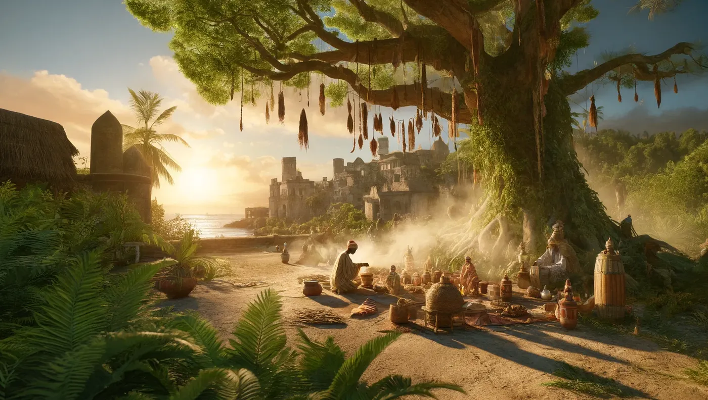

Sansibar und Pemba haben eine lange Geschichte mit schwarzer Magie und alten spirituellen Praktiken. Der Glaube an übernatürliche Wesen und traditionelle Medizin gehört auf beiden Inseln einfach zur Kultur dazu.

## Shetani und der Große Herr

Shetani sind Geister oder Dämonen, und die Menschen auf Sansibar und Pemba glauben, dass sie beeinflussen, was einem im Leben widerfährt. Der Mwinyi Mkuu, der Große Herr, sicherte seine Macht einst, indem er diese Geister kontrollierte und in die Zukunft sehen konnte.

Man sagt, die Ruinen seines Palastes in Dunga werden nachts von diesen Geistern heimgesucht, wie [Siyabona](https://www.siyabona.com/shetani-zanzibar.html) schreibt.

## Popobawa

Popobawa ist ein Geist mit einem wirklich üblen Ruf. Er terrorisierte zuerst die Menschen auf Pemba und später auf Sansibar.

Man sagt, er lähmt und vergewaltigt seine Opfer, und jedes Mal, wenn das Gerücht umgeht, er sei zurück, bricht Massenhysterie aus. Das stammt ebenfalls von [Siyabona](https://www.siyabona.com/shetani-zanzibar.html).

## Die Waganga-Heiler

Die Waganga, die traditionellen Heiler, sind diejenigen, zu denen die Menschen gehen, wenn Shetani und andere Geister Ärger machen. Sie kombinieren pflanzliche Heilmittel mit spirituellen Ritualen, um Krankheiten zu behandeln und böse Geister zu vertreiben.

Das ist tief in der lokalen Kultur verwurzelt und wird oft von einer Generation an die nächste weitergegeben. Mehr dazu bei [Siyabona](https://www.siyabona.com/shetani-zanzibar.html) und [Voices of Africa](https://voicesofafrica.co.za/believe-it-or-not-witchcraft-in-kenya/).

## Jinn und islamische Tradition

Wegen der islamischen Traditionen glauben viele Menschen auch an Dschinne, die Jinn. Man glaubt, dass Jinn Wünsche erfüllen und einen beschützen können, wenn man sie auf die richtige Weise beschwört und kontrolliert.

Diese Art von Magie nutzt Rituale, die oft islamische Gebete mit traditionellen Praktiken vermischen. Und es ist ganz normal, dass Menschen zu einem Mganga gehen, um mit Jinn und anderen übernatürlichen Wesen umzugehen, sagt [Voices of Africa](https://voicesofafrica.co.za/believe-it-or-not-witchcraft-in-kenya/).

## Eine Mischung aus vielen Kulturen

Die Kultur von Sansibar und Pemba ist eine Mischung aus afrikanischen, arabischen, persischen und indischen Einflüssen. Aus dieser Mischung sind spirituelle Praktiken entstanden, bei denen schwarze Magie und traditionelle Heilung neben dem islamischen Glauben existieren.

Schutzamulette, Rituale und das Anrufen von Geistern sind überall zu finden, und das zeigt, wie stark die Inseln verschiedene Glaubensvorstellungen miteinander verbinden. Mehr dazu kannst du bei [Indigo Safaris](https://www.indigosafaris.com/pemba_island_history_and_culture.html) und [Tanzania Odyssey](https://www.tanzaniaodyssey.com/blog/cadogan-guide-to-tanzania-the-indian-ocean-islands-pemba/) lesen.

All das ist ein großer Teil des lokalen Lebens. Es zieht Gläubige an, die nach Hilfe suchen, und auch Forscher, die sich für traditionelle afrikanische Spiritualität interessieren.

Und weil die Inseln abgelegen und weniger entwickelt sind, sind diese Traditionen über Jahrhunderte mehr oder weniger unverändert geblieben.

*Dieser Artikel wurde gemeinsam von Emin Mahrt, emino.ai, Bane und ChatGPT geschrieben.*
