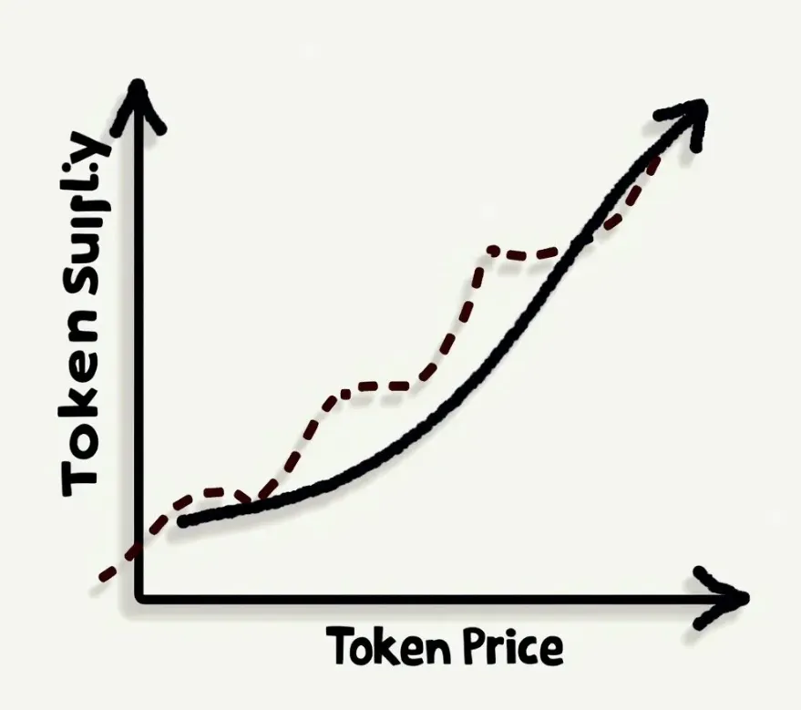

Das hier basiert auf einem Call aus 2019, hier ist die Aufnahme
[https://youtu.be/Y-QazkphlNA?si=NAQaHONIrTDgfNKt](https://youtu.be/Y-QazkphlNA?si=NAQaHONIrTDgfNKt)

## Was eine Bonding Curve ist

Wenn du in Crypto einen Token launchst, endet das oft mit
Preisen, die keiner vorhersagen kann, und einem ziemlich wilden
Markt. Bonding Curves sind ein anderer Weg, das anzugehen.

Sie geben dem Ganzen mehr Struktur, und das kann gut sein für
die Leute, die das Projekt bauen, und auch für die, die früh
einsteigen.

Stell dir eine Bonding Curve wie einen Smart Contract vor, der
als Market Maker für den Token deines Projekts arbeitet, immer
an und komplett automatisch. Der Preis des Tokens ist nicht
festgelegt.

Er folgt einer Formel, die vorher festgelegt wird, und der Preis
steigt, je mehr Tokens die Leute kaufen. Wenn jemand Tokens
zurückverkauft, fällt der Preis wieder. Und es gibt kein
Zeitlimit.

Du bist nicht auf ein einziges großes Sale-Event festgelegt, der
Smart Contract ist immer da und kauft oder verkauft Tokens zum
aktuellen Preis.

## Warum man eine nutzen sollte

Warum also überhaupt Bonding Curves anschauen. Wer zuerst kommt,
mahlt zuerst: Leute, die früh kaufen, bekommen einen besseren
Preis, und das gibt ihnen einen Grund, das Projekt zu
unterstützen, während es wächst.

Die langsamen Preisänderungen können auch für etwas Stabilität
sorgen und helfen, die plötzlichen Pump and Dumps zu vermeiden,
die man in Crypto manchmal sieht. Und du bekommst laufend
Funding, nicht nur in einem einzigen Sale, also passt es zu
Projekten, die über lange Zeit Unterstützung brauchen.

Bonding Curves sind nicht nur ein cleverer technischer Trick.
Sie lösen ein echtes wirtschaftliches Problem, nämlich wie du
die Interessen der Leute, die ein Projekt bauen, mit denen der
Leute in Einklang bringst, die es als Erste unterstützen.

## Im Vergleich zu ICOs und Festpreisen

Wenn du es mit ICOs vergleichst, die nutzen oft Auktionen, bei
denen der Preis schwer vorherzusagen ist, und eine Bonding Curve
gibt dir einen Preis aus einer Formel. Normale Tokens mit
Festpreis haben diese Preisanpassung nicht eingebaut, und mit
einer Bonding Curve reagiert das ganze System auf die
Nachfrage.

Eine Bonding Curve macht also Sinn, wenn du ein Funding-Modell
willst, das lange hält, wenn du die Leute belohnen willst, die
früh an dein Projekt geglaubt haben, mit besseren Preisen, und
wenn dir etwas Preisstabilität wichtiger ist als Gewinne, die
explodieren könnten, aber auch riskanter sind.

[https://youtu.be/Y-QazkphlNA?si=NAQaHONIrTDgfNKt](https://youtu.be/Y-QazkphlNA?si=NAQaHONIrTDgfNKt)
