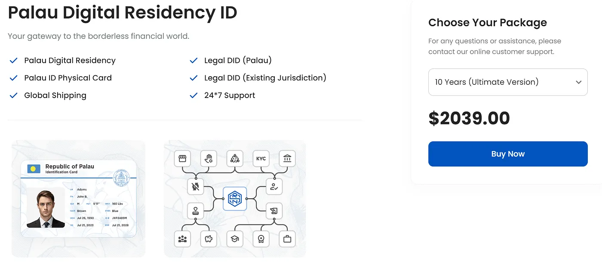

*[https://rns.id/app/palauidinfo](https://rns.id/app/palauidinfo)*

## Was die Palau ID ist

Die Palau ID heißt offiziell Sovereignty-Backed ID. Es ist ein Programm der Regierung von Palau, das dir einen legalen Ausweis gibt, den du für viele Dinge nutzen kannst. Es ist eine digitale Residency, also nicht nur für Leute aus Palau. Menschen aus vielen anderen Ländern können einen anerkannten Ausweis bekommen, ohne überhaupt in Palau zu wohnen.

Die Palau ID ist eine staatlich ausgestellte ID-Karte für jede Situation, in der du einen rechtlichen Nachweis deiner Identität brauchst. Sie ist Teil eines größeren Vorhabens, Regierungsdienste online zu bringen und internationale Geschäfte einfacher zu machen. Viele Unternehmen und Behörden akzeptieren sie für KYC (Know Your Customer). Damit kannst du Bankkonten an Orten wie Kalifornien und Nevada eröffnen. Und du kannst sie nutzen, um in Hotels auf der ganzen Welt einzuchecken, oft mit Rabatt für Inhaber.

## Wofür die Leute sie nutzen

Die ID kommt mit einer digitalen Residency, und Menschen aus 138 Ländern können sich bewerben, ohne in Palau zu leben. Digitale Nomaden finden sie super, und auch Leute, die einfach einen weiteren Ausweis wollen. Du kannst eine Gültigkeit von einem Jahr, 5 Jahren oder 10 Jahren wählen, danach verlängerst du sie. Leute sagen, sie haben sie genutzt, um Bankkonten zu eröffnen, KYC auf Krypto-Börsen zu bestehen, Alkohol zu kaufen und für andere Dinge in Geschäften, und um Unterkünfte zu buchen und sich an Flughäfen auszuweisen. Sie wird an vielen Orten anerkannt, also hilft sie, wenn du reist und im Ausland Geschäfte machst. Und verglichen damit, eine ähnliche ID aus einem anderen Land zu bekommen, ist die Beantragung einfach und günstig. Sie kostet etwa 248 Dollar.

Du kannst Konten bei Anbietern wie Wise eröffnen und sie nutzen, um Geld ins Ausland zu schicken und deine Finanzen zu verwalten. In Palau selbst erlaubt dir die ID, bis zu 180 Tage pro Einreise zu bleiben, also ist sie interessant für Reisende. Und sie ist eine Blockchain-basierte Identität, also kannst du sie für sichere Online-Transaktionen und mit vielen digitalen Plattformen nutzen.

## Wo sie noch nicht funktioniert

Die Akzeptanz hängt vom Ort und der Institution ab. Also ist es gut, sie in verschiedenen Situationen zu testen, um herauszufinden, wo sie als echter Ausweis gilt. Leute machen Feldforschung und schreiben auf, wo die Nutzung der ID funktioniert hat und wo nicht, und das ergibt langsam ein besseres Bild davon, wofür sie gut ist.

Die Palau ID ist ein neuer Weg, Identität zu machen, und immer mehr vom Leben ist digital. Sie ist ein legaler Ausweis, dem es egal ist, wo du wohnst, und das gibt den Leuten viel mehr Freiheit in ihrem Privat- und Arbeitsleben. Je mehr Leute sie ausprobieren, desto mehr Türen öffnen sich, und sie kann ein großer Teil der digitalen Identität in der Zukunft werden.

## Ist Palau ein echtes Land?

Palau ist ein kleiner Inselstaat im westlichen Pazifik, in der Region Mikronesien. Er hat etwa 340 Inseln und rund 18.000 Einwohner. Palau ist ein souveräner Staat und wurde 1994 Vollmitglied der Vereinten Nationen (UN). Es ist also eine unabhängige Nation mit eigener Regierung und eigenem Rechtssystem.

Die Palau ID wird auch Sovereignty-Backed Web3 ID genannt. Sie ist eine staatlich ausgestellte ID-Karte, die mit einem digitalen Residency-Programm kam, das 2022 gestartet wurde. Sie ist ein legaler Identitätsnachweis für Dinge wie Online-Transaktionen und Identitätsprüfungen bei Finanzdienstleistungen. Sie ist besonders nützlich für digitale Nomaden und Remote Worker, weil sie ihnen einen anerkannten Ausweis gibt, der ihnen hilft, Dienste in anderen Ländern zu nutzen. Und sie soll Identitätsprüfungen einfacher machen, vor allem in Krypto und Online-Banking.

## Kannst du damit Bankkonten eröffnen?

Die Palau ID ist eine legale Identität, aber Banken behandeln sie sehr unterschiedlich. Die Berichte über das Eröffnen von Bankkonten damit sind gemischt. Manche Leute haben sie genutzt, um sich auf bestimmten Plattformen zu verifizieren, und andere hatten Probleme. Ein Bericht sagt, eine Filiale der Chase Bank hat sie nicht als ausreichenden Ausweis akzeptiert, und nur von US-Bundesstaaten ausgestellte IDs oder Pässe waren dort gut genug [1].

Für KYC ist es anders. Leute berichten, dass es auf mehreren Krypto-Börsen und einigen Finanzplattformen funktioniert. Also selbst wenn traditionelle Banken sie nicht überall nehmen, kann sie dir trotzdem Zugang zu einigen Finanzdienstleistungen online verschaffen [2][4].

Wenn du damit ein Bankkonto eröffnen willst, such zuerst nach Banken, die klar sagen, dass sie die Palau ID akzeptieren. Hab andere Dokumente bereit, falls sie nach mehr fragen. Und geh in eine Filiale oder ruf den Kundenservice an, um zu prüfen, ob sie sie nehmen, bevor du dich darauf verlässt.

Die UN erkennt Palau als unabhängige Nation an, und Palau macht neue Dinge wie die Palau ID, um es einfacher zu machen, sich in der Welt zu bewegen und Dienste zu nutzen. Die ID hilft sehr bei digitalen Transaktionen und einigem Online-Banking, aber traditionelle Banken nehmen sie vielleicht nicht. Also wenn du sie fürs Banking nutzen willst, recherchier zuerst und rechne mit einigen Schwierigkeiten bei Identitätsprüfungen.

Quellen für den ersten Teil: [1] [https://docs.rns.id/support/faqs](https://docs.rns.id/support/faqs) [2] [https://www.biometricupdate.com/202407/rns-id-provides-decentralized-id-protocol-for-palau-on-solana](https://www.biometricupdate.com/202407/rns-id-provides-decentralized-id-protocol-for-palau-on-solana) [3] [https://www.reddit.com/r/PassportPorn/comments/1b1t38n/palau_digital_residency_id/](https://www.reddit.com/r/PassportPorn/comments/1b1t38n/palau_digital_residency_id/) [4] [https://www.malakoutilaw.com/what-can-you-do-with-palau-s-digital-residency-id](https://www.malakoutilaw.com/what-can-you-do-with-palau-s-digital-residency-id) [5] [https://rns.id/app/palauidinfo](https://rns.id/app/palauidinfo) [6] [https://www.justanswer.com/computer-programming/nqsxy-valid-palau-digital-id-digital-residency.html](https://www.justanswer.com/computer-programming/nqsxy-valid-palau-digital-id-digital-residency.html) [7] [https://www.binance.com/en/square/post/11925337932130](https://www.binance.com/en/square/post/11925337932130)

Quellen für den zweiten Teil: [1] [https://www.malakoutilaw.com/palau-digital-residency-id-to-verify-identity-at-chase-bank-branch-field-report-14](https://www.malakoutilaw.com/palau-digital-residency-id-to-verify-identity-at-chase-bank-branch-field-report-14) [2] [https://baselynk.com/palau-id-everything-you-need-to-know/](https://baselynk.com/palau-id-everything-you-need-to-know/) [3] [https://www.escapeartist.com/blog/palau-digital-residency-a-crypto-kyc-workaround/](https://www.escapeartist.com/blog/palau-digital-residency-a-crypto-kyc-workaround/) [4] [https://docs.rns.id/support/faqs](https://docs.rns.id/support/faqs) [5] [https://etradeforall.org/news/e-%E2%81%A0residency-of-estonia-vs-palau-digital-residency/](https://etradeforall.org/news/e-%E2%81%A0residency-of-estonia-vs-palau-digital-residency/) [6] [https://www.biometricupdate.com/202407/rns-id-provides-decentralized-id-protocol-for-palau-on-solana](https://www.biometricupdate.com/202407/rns-id-provides-decentralized-id-protocol-for-palau-on-solana) [7] [https://www.reddit.com/r/PassportPorn/comments/1b1t38n/palau_digital_residency_id/](https://www.reddit.com/r/PassportPorn/comments/1b1t38n/palau_digital_residency_id/) [8] [https://www.malakoutilaw.com/what-can-you-do-with-palau-s-digital-residency-id](https://www.malakoutilaw.com/what-can-you-do-with-palau-s-digital-residency-id)
