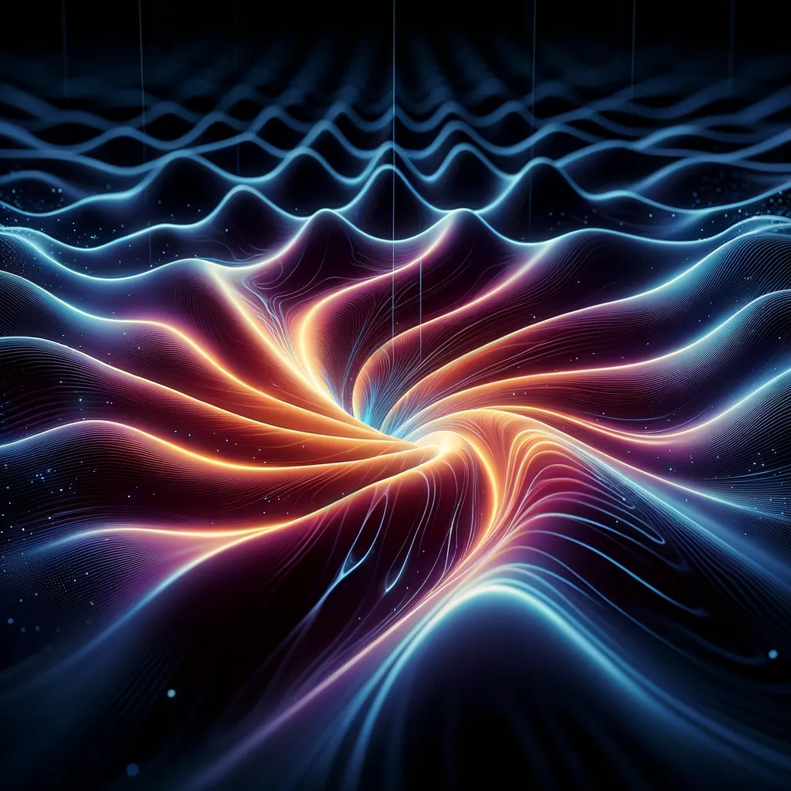

Gravitationswellen (GWs) haben die Astrophysik verändert. Mit ihnen können wir Dinge wie die Verschmelzung von Schwarzen Löchern und Neutronensternen auf eine Weise beobachten, die vorher unmöglich war. Sie haben Einsteins Allgemeine Relativitätstheorie bestätigt, und sie könnten uns auch beim Informationsparadoxon Schwarzer Löcher weiterhelfen. Das hier ist ein Überblick über die neuesten Erkenntnisse zu Gravitationswellen und dem Informationsparadoxon Schwarzer Löcher. Er fasst den aktuellen Forschungsstand zusammen und geht einer Idee nach: dass GWs Informationen über die Materie tragen, die ein Schwarzes Loch verschlingt, und dass sie damit ein Ausweg aus dem Paradoxon sein könnten.

## Das Paradoxon

Das Paradoxon entsteht aus einem Konflikt. Die Quantenmechanik sagt, Information bleibt erhalten, und die Allgemeine Relativitätstheorie sagt, Information, die in ein Schwarzes Loch fällt, ist für immer verloren. Das widerspricht unserem Verständnis davon, wie das Universum auf der grundlegendsten Ebene funktioniert. Jetzt, wo wir Gravitationswellen-Astronomie haben, gibt es einen neuen Blick darauf, denn Information könnte in den GWs kodiert sein, die entstehen, wenn Schwarze Löcher entstehen und sich verändern, und mit ihnen davongetragen werden.

## Was dafür spricht

Teil 2 handelt davon, was dafür spricht.

2.1 handelt von einer neuen Perspektive. LIGO und Virgo haben GWs nachgewiesen, und das hat eine neue Ära der Multi-Messenger-Astronomie eingeläutet. Diese Beobachtungen zeigen uns, wie sich kompakte Objekte verhalten, einschließlich der Masse, des Spins und der Umlaufbahnen von Schwarzen Löchern, die verschmelzen. Das konnten wir vorher aus Licht und anderen elektromagnetischen Beobachtungen nicht gewinnen, und wir brauchen es, um zu verstehen, wie diese Objekte entstehen und sich verändern.

2.2 handelt von besseren Detektoren. Die nächste Generation von Detektoren wird viel empfindlicher sein. Das heißt das Einstein-Teleskop, Cosmic Explorer und die Weltraummission LISA. Damit können wir schwächere Signale auffangen und tiefer ins Universum schauen. Wir können also erwarten, viel mehr Arten von Schwarzen-Löchern-Verschmelzungen zu sehen, auch solche aus dem frühen Universum, und vielleicht einen Blick darauf werfen, wie Schwarze Löcher überhaupt erst entstanden sind und wie sie sich über kosmische Zeiträume verändert haben.

2.3 handelt davon, Informationen aus den Signalen zurückzuholen. Neuere theoretische Arbeiten zeigen, dass ein großer Teil der Information über den Ausgangszustand eines kollabierenden Sterns, wie seine Masse, sein Drehmoment und seine Ladungsverteilung, in die GWs eingeprägt sein könnte, die er aussendet. Es wird an besserer Signalverarbeitung gearbeitet, um diese Information aus den komplexen Wellenformen herauszuholen, die die GW-Observatorien detektieren. Forscher haben zum Beispiel Wege vorgeschlagen, die vollständige klassische Information über einfallende Quellen, wie Massen, Einfallszeiten und -winkel, aus den GW-Signalen zurückzugewinnen [Zitat benötigt].

2.4 handelt von der theoretischen Seite. Einige Theorien, wie der Soft-Hair-Vorschlag und das Firewall-Paradoxon, sagen, Schwarze Löcher könnten ein subtiles Quantenhaar haben, das Information speichern kann. In diesen Theorien geht die Information nicht im Schwarzen Loch verloren. Sie ist in kleinen Korrelationen in der ausgehenden Hawking-Strahlung oder in der Struktur nahe dem Horizont kodiert. Der Nachweis und die Untersuchung von GWs könnten echte Belege für oder gegen diese Modelle liefern.

2.5 handelt vom Testen des No-Hair-Theorems. Das No-Hair-Theorem sagt, ein Schwarzes Loch wird nur durch seine Masse, seinen Spin und seine elektrische Ladung beschrieben. GWs von nachklingenden Schwarzen Löchern, die nach einer Verschmelzung entstehen, stützen dieses Theorem stark. Aber das No-Hair-Theorem betrifft klassische Schwarze Löcher, und niemand weiß noch, ob es auch in der Quantenwelt gilt. Sehr präzise GW-Beobachtungen in der Zukunft könnten kleine Abweichungen davon zeigen, und das könnte auf Quantenhaar und auf kodierte Information hindeuten.

## Was dagegen spricht

Teil 3 handelt davon, was dagegen spricht, oder es zumindest schwierig macht.

3.1 ist der Memory-Effekt, und er ist nicht bestätigt. Der Memory-Effekt sagt voraus, dass eine vorbeiziehende GW eine permanente Verzerrung der Raumzeit hinterlässt. Die Theorie sagt, er ist da, aber LIGO und Virgo haben ihn noch nicht direkt beobachtet. Wenn der Memory-Effekt bestätigt wird, wäre das mehr Unterstützung dafür, dass GWs Information tragen. Aber um ihn nachzuweisen, muss man viele GW-Ereignisse analysieren, um genug statistische Signifikanz zu bekommen.

3.2 sind die konkurrierenden Theorien. Es gibt auch viele andere Theorien zum Informationsparadoxon. Einige ändern die Quantenmechanik, einige sagen, es gibt Baby-Universen, und es gibt das holografische Prinzip. Bei so vielen konkurrierenden Theorien ist es schwer zu sagen, was eine GW-Beobachtung für das Paradoxon bedeutet, und deshalb brauchen wir einen gemeinsamen theoretischen Rahmen.

3.3 sind die Grenzen der Experimente. Die letzten Stadien der Verdampfung Schwarzer Löcher direkt zu beobachten, wo die kodierte Information herauskommen könnte, ist für uns heute nicht möglich. Die Hawking-Strahlung von astrophysikalischen Schwarzen Löchern ist extrem schwach und ihre Temperatur liegt weit unter dem, was heutige Detektoren sehen können.

3.4 ist, dass es Haar geben könnte, das wir noch nicht nachweisen können. Aktuelle Beobachtungen stützen das No-Hair-Theorem, aber wir können nicht ausschließen, dass Schwarze Löcher subtiles Quantenhaar haben. Empfindlichere GW-Detektoren in der Zukunft könnten Abweichungen vom Theorem finden, und das würde zeigen, dass Schwarze Löcher mehr Eigenschaften haben und Information speichern könnten.

3.5 ist das frühe Universum. Es ist undurchsichtig für elektromagnetische Strahlung, aber GWs gehen direkt hindurch. Wenn wir primordiale GWs aus dem Urknall nachweisen, lernen wir viel über die allerersten Momente des Universums. Aber diese Signale sind schwach, und wir brauchen Detektoren, die viel empfindlicher sind als die, die wir jetzt haben.

## Ein Aufruf an die Astrophysik-Community

Teil 4 ist ein Aufruf an die Astrophysik-Community. Um wirklich herauszufinden, ob GWs das Informationsparadoxon lösen können, muss die Astrophysik-Community bessere Signalverarbeitung entwickeln, um die subtile Information aus den GW-Wellenformen herauszuholen, und das braucht clevere Algorithmen und viel Rechenleistung. Sie muss helfen, die nächsten GW-Detektoren zu entwerfen und zu bauen, auf der Erde wie das Einstein-Teleskop und Cosmic Explorer und im Weltraum wie LISA, damit wir mehr Empfindlichkeit bekommen und mehr vom GW-Spektrum sehen. Sie muss theoretische Modelle entwickeln und verbessern, um GW-Beobachtungen im Licht des Informationsparadoxons zu lesen, und das braucht Astrophysiker, Teilchenphysiker und Quanteninformationsleute, die zusammenarbeiten. Und sie sollte auch nach anderen Anzeichen suchen. Neben dem direkten Nachweis von GWs könnten indirekte Anzeichen für ausströmende Information, wie Korrelationen in der Hawking-Strahlung oder Veränderungen an Schatten Schwarzer Löcher, uns auch viel sagen.

## Zusammenfassung

Und Teil 5, um es zusammenzufassen. Die Idee, dass GWs Information über Materie tragen, die in Schwarze Löcher fällt, ist ein vielversprechender Weg, um das Informationsparadoxon zu lösen. Wir sind mit dem Nachweis und der Analyse von GWs schon weit gekommen, aber wir brauchen mehr Forschung, bessere Technologie und neue Theorie, um wirklich zu verstehen, welche Rolle sie spielen. Es wird die ganze Astrophysik-Community brauchen, überall auf der Welt, die zusammenarbeitet, um zu lesen, was in GWs kodiert ist, und vielleicht eine der größten offenen Fragen der modernen Physik zu lösen.
