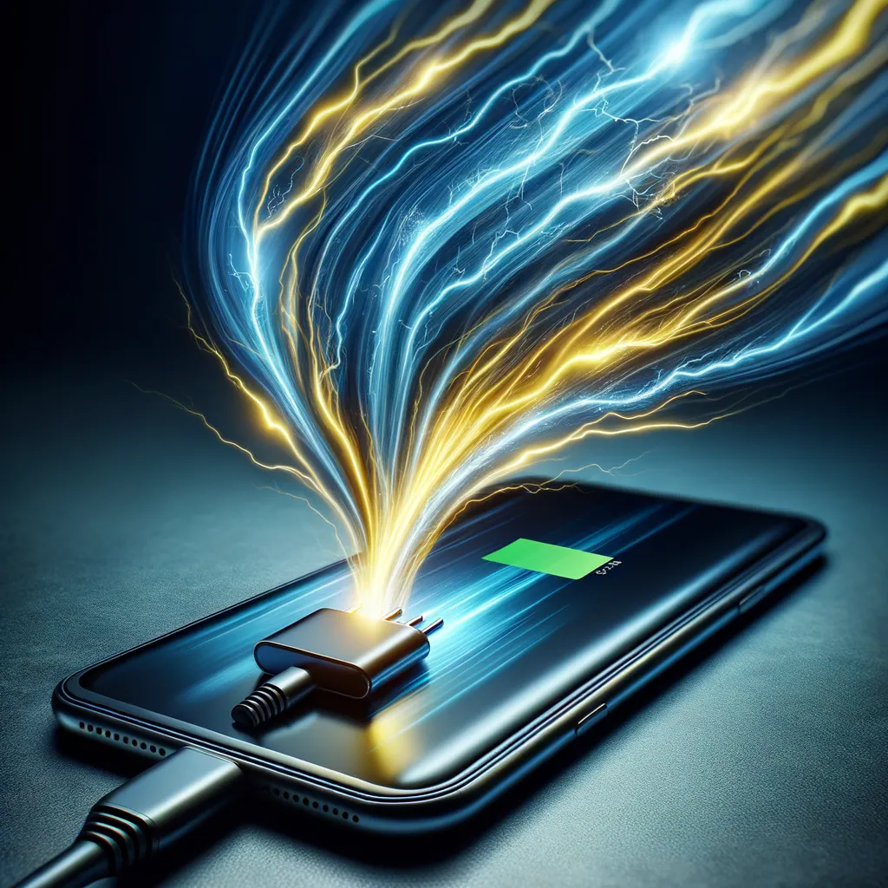

So lädst du dein Smartphone in 15 Minuten voll, und warum du gute Kabel, ein gutes Ladegerät und ein Handy brauchst, das Laden mit hoher Wattzahl unterstützt.

Alle wollen immer schnelleres Laden, und Handys sind darin auch viel besser geworden. Aber für die höchste Geschwindigkeit reicht ein Ladegerät mit hoher Wattzahl allein nicht. Du brauchst auch ein Type-C-Kabel, das das mitmacht, und ein Handy, das diese Geschwindigkeit unterstützt.

Also, hier sind die Handys mit dem schnellsten Laden 2024, warum das richtige Kabel und Ladegerät wichtig sind, und wie du die beste Ladegeschwindigkeit rausholst.

## Warum das Type-C-Kabel wichtig ist

Type-C-Laden heißt der USB-C-Anschluss. Der wird gerade der Standard für viele Geräte, weil er viele Dinge kann und mehr Power liefern kann als die älteren USB-Standards.

Nicht alle Type-C-Kabel sind gleich. Manche sind für höhere Wattzahlen gebaut und unterstützen Schnellladen, andere können nur weniger Power liefern. Wenn du die beste Ladegeschwindigkeit willst, brauchst du ein gutes Type-C-Kabel, das das aushält, was dein Ladegerät rausgibt.

## Warum das Ladegerät wichtig ist

Das Ladegerät selbst spielt eine große Rolle dabei, wie schnell dein Handy lädt. Ladegeräte gibt es in verschiedenen Wattzahlen, und ein Ladegerät mit höherer Wattzahl liefert mehr Power, also dauert das Laden weniger lang.

Aber dein Handy und dein Kabel müssen beide die Wattzahl deines Ladegeräts aushalten.

## Die Handys mit dem schnellsten Laden 2024

Also, welche Handys laden 2024 am schnellsten? Das Xiaomi 13 Pro unterstützt bis zu 120W Schnellladen. Es hat Flaggschiff-Performance und ein Top-Kamerasystem und kostet ungefähr 999 $.

Das OnePlus 10T unterstützt bis zu 150W Schnellladen. Es hat einen High-Performance-Chipsatz und ein großes Display und kostet ungefähr 749 $.

Das Realme GT Neo 3 unterstützt bis zu 150W Schnellladen. Das ist bezahlbares High-Speed-Laden mit Gaming-Performance, für ungefähr 499 $.

Das Oppo Find X5 Pro unterstützt bis zu 80W Schnellladen. Es hat ein Premium-Design und eine richtig gute Kamera und kostet ungefähr 1.199 $.

## Ladegerät, Kabel und Handy zusammen

Für das schnellste Laden brauchst du drei Dinge. Ein Ladegerät mit hoher Wattzahl, das zu dem passt, was dein Handy aufnehmen kann, oder drüber liegt, ein Type-C-Kabel, das die Leistung des Ladegeräts aushält, und ein Smartphone, das Laden mit hoher Wattzahl unterstützt.

So sieht das aus.

Das Xiaomi 13 Pro mit dem 120W-Xiaomi-Ladegerät und einem High-Speed-Type-C-Kabel für 120W ist in ungefähr 17 Minuten voll.

Das OnePlus 10T mit dem 150W-OnePlus-Ladegerät und einem High-Speed-Kabel für 150W ist in ungefähr 15 Minuten voll.

Das Realme GT Neo 3 mit dem 150W-Realme-Ladegerät und einem High-Speed-Kabel für 150W ist in ungefähr 16 Minuten voll.

Das Oppo Find X5 Pro mit dem 80W-Oppo-Ladegerät und einem High-Speed-Kabel für 80W ist in ungefähr 31 Minuten voll.

Beim Preis ist das Realme GT Neo 3 mit 499 $ das günstigste, dann das OnePlus 10T mit 749 $, das Xiaomi 13 Pro mit 999 $ und das Oppo Find X5 Pro mit 1.199 $. Jedes mit seinem eigenen Ladegerät und einem passenden Kabel.

## Das Beste rausholen

Schnellladen ist viel besser geworden, du kannst also schnell Saft tanken und verlierst weniger Zeit. Wenn du die richtige Mischung aus einem Ladegerät mit hoher Wattzahl, einem passenden Type-C-Kabel und einem Handy, das das unterstützt, nutzt, holst du das Beste raus.

Egal ob du das Xiaomi 13 Pro, das OnePlus 10T, das Realme GT Neo 3 oder das Oppo Find X5 Pro nimmst, hol dir das richtige Zubehör und du bekommst die schnellsten Ladegeschwindigkeiten, die es 2024 gibt. Dann lädt dein Handy mit voller Geschwindigkeit und du bleibst den ganzen Tag am Saft.
