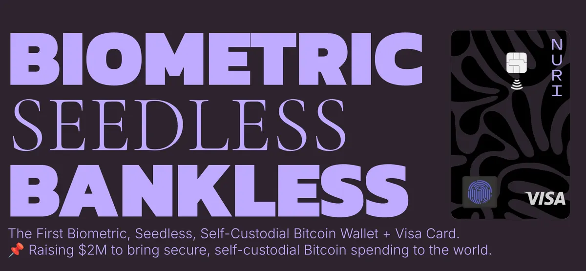

**UPDATE: Die NEUE Nuri Card ist viel einfacher und sicherer, ohne Batterie, ohne Display.**

Schau dir das Prototyp-Video an (alte Karte, wie ich auf die Idee kam):

[Video auf YouTube ansehen](https://www.youtube.com/watch?v=HsgYToy-1eI)

Es ist schon eine Weile her. Ich schreibe diesen Post auch aus Eigeninteresse, denn ich bringe eine Hardware-Wallet für Kryptowährungen (zuerst Bitcoin und Ethereum) im Kreditkartenformat auf den Markt, die gleichzeitig eine VISA-Karte ist.

Kurz gesagt: Du kannst deine Bitcoin (oder andere Kryptowährungen) mit einem sicheren Gerät schützen, das sich per NFC und Chip mit deinem Computer oder Smartphone verbindet.

Dieselbe Karte kannst du überall dort benutzen, wo Kreditkarten akzeptiert werden.

Nuri.com (www.nuri.fund, wenn du investieren möchtest) ist das erste Hardware-Wallet im Kreditkartenformat, das durch deinen Fingerabdruck geschützt ist (biometrischer Schutz).

## Wie du deine Bitcoin (und alles andere) vor Hackern schützt

Wir haben einen langen Weg hinter uns seit den frühen Tagen von Bitcoin. Damals hieß es, deine Kryptowährungen zu schützen, eine Seed-Phrase auf Papier zu schreiben und zu hoffen, dass sie nicht verloren geht. Heute haben wir fortschrittlichere Tools, aber mit dem Fortschritt kommt Komplexität – und neue Risiken.

Von gestohlenen Passwörtern bis hin zu Phishing-Angriffen entwickeln sich die Bedrohungen weiter, und unsere Herangehensweise an Sicherheit muss das auch. Deshalb habe ich die letzten Jahre damit verbracht, **NURI** zu entwickeln, eine biometrische Smart-Card, die dein digitales Leben vereinfachen und sichern soll.

---

## Ein Problem, das gelöst werden musste

Kryptowährungen zu besitzen gibt dir finanzielle Unabhängigkeit, aber damit kommt auch Verantwortung. Wenn du jemals:

- den Zugriff auf dein Wallet verloren hast, weil du deine Seed-Phrase verlegt hast,
- dir Sorgen gemacht hast, dass Hacker deine Private Keys stehlen, oder
- nach einem einfacheren Weg gesucht hast, deine Bitcoin auszugeben,

dann verstehst du die Herausforderungen, die mit der Nutzung von Krypto einhergehen.

Auch jenseits von Kryptowährungen sind Passwörter eine ständige Quelle der Frustration geworden. Sie sind unsicher, leicht zu vergessen und werden zu oft zum schwachen Glied in einem ansonsten soliden Sicherheitssystem.

Hier kommt NURI ins Spiel.

---

## Was ist NURI?

NURI ist eine **biometrische Smart-Card**, die Folgendes kombiniert:

1. **Ein sicheres Krypto-Wallet** zum Aufbewahren deiner Bitcoin und anderer digitaler Assets.
2. **Eine VISA-Debitkarte**, um Krypto überall auf der Welt auszugeben.
3. **Passwortfreie Authentifizierung** für deine Online-Konten, wie Gmail und deinen Laptop.

Im Kern ist NURI darauf ausgelegt, dein Leben einfacher und sicherer zu machen. Es stellt sicher, dass deine Kryptowährungen sicher sind, deine Konten geschützt sind und du deine Gelder jederzeit einfach nutzen kannst.

---

## Wie NURI funktioniert

NURI nutzt modernste **Multi-Party Computation (MPC)**-Technologie. Ohne zu technisch zu werden, hier ist, was das für dich bedeutet:

- **Keine Seed-Phrasen:** Deine Private Keys werden sicher an mehreren Orten gespeichert, sodass es keinen Single Point of Failure gibt.
- **Biometrischer Schutz:** Nur dein Fingerabdruck kann die Karte entsperren, was es für andere nahezu unmöglich macht, auf deine Gelder zuzugreifen.
- **Passwortfreier Zugriff:** Melde dich bei deinen Konten und Geräten mit FIDO-Passkey-Authentifizierung an – keine Passwörter erforderlich.

Und weil es auch eine VISA-Debitkarte ist, kannst du deine Kryptowährungen so einfach ausgeben wie eine normale Karte im Supermarkt zu ziehen.

---

## Warum NURI wichtig ist

Ich habe NURI gebaut, um die größten Schmerzpunkte beim Besitz und der Nutzung von Kryptowährungen zu lösen.

- **Schütze deine Bitcoin:** Mit unhackbarem Speicher und keinen Seed-Phrasen, die man verlieren kann, ist dein Krypto sicherer als je zuvor.
- **Überall ausgeben:** NURI kombiniert das Beste aus beiden Welten – ein sicheres Krypto-Wallet und eine klassische Debitkarte.
- **Passwörter ersetzen:** Vergiss schwache, hackbare Passwörter. Dein Fingerabdruck wird dein Schlüssel zu allem.

Es geht nicht nur um Sicherheit; es geht darum, Krypto und das digitale Leben für alle benutzerfreundlicher zu machen.

---

## Ein Name mit Bedeutung

Der Name NURI hat eine persönliche Bedeutung für mich – es ist der Name meines Vaters. Ihn für diese Karte zu verwenden, fühlte sich richtig an, denn wie mein Vater steht diese Karte für Stärke, Zuverlässigkeit und Vertrauen. Meine Mission ist es, sicherzustellen, dass jeder, der Bitcoin oder andere Kryptowährungen kauft, die Werkzeuge hat, um seine Gelder sicher und leicht zugänglich zu halten.

---

## Für wen ist NURI?

Ob du ein Krypto-Enthusiast bist oder gerade erst anfängst, NURI ist gebaut für:

- **Bitcoin-Besitzer:** Halte deine Gelder sicher, ohne dir Sorgen über den Verlust des Zugriffs machen zu müssen.
- **Alltagsnutzer:** Mache Krypto so einfach zu benutzen wie eine normale Debitkarte.
- **Digitale Nomaden:** Vereinfache dein Leben mit einem Tool für Zahlungen und Passwörter.

---

## Warum jetzt?

Die Akzeptanz von Kryptowährungen wächst rasant, aber auch die Risiken. Hacker werden schlauer, und traditionelle Wallets und Passwortsysteme reichen einfach nicht mehr aus.

Mit NURI schützt du nicht nur dein Krypto – du schützt dein gesamtes digitales Leben. Und du tust es auf eine Weise, die einfach, sicher und bequem ist.

---

## Was kommt als Nächstes?

Ich bin unglaublich aufgeregt über das Potenzial von NURI, die Art und Weise zu verändern, wie wir über Sicherheit denken. Meine Hoffnung ist, dass es Menschen dazu befähigt, die Kontrolle über ihre Finanzen und ihr digitales Leben zu übernehmen, ohne Angst vor Verlust oder Diebstahl.

Wenn du dich jemals von der Komplexität von Krypto überwältigt gefühlt hast oder dir Sorgen um die Sicherheit deiner Gelder gemacht hast, ist NURI hier, um zu helfen.

---

## Lass uns eine sicherere Zukunft bauen

NURI ist mehr als ein Produkt – es ist ein Werkzeug zur Ermächtigung. Es geht darum, dir das Vertrauen zu geben, dich ohne Angst in der digitalen Welt zu bewegen.

Bitte kontaktiere mich, wenn du möchtest, unter +13103408213 via Signal oder antworte auf diese E-Mail / emin@nuri.com
