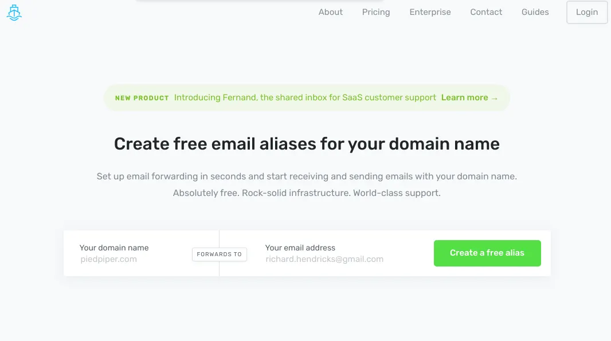

## Richte E-Mail-Weiterleitung in Sekunden ein und empfange und versende E-Mails mit deinem Domainnamen. Absolut kostenlos. Felsenfeste Infrastruktur. Weltklasse-Support.

Und es ist wahr, was sie sagen. Im nächsten Artikel erkläre ich, wie du deine Domain über GoDaddy.com registrierst (oldschool, ich weiß) und dann ImprovMX deine E-Mail-Weiterleitung übernehmen lässt, damit du einfach alle deine Mails in Gmail bekommst!

tbc

