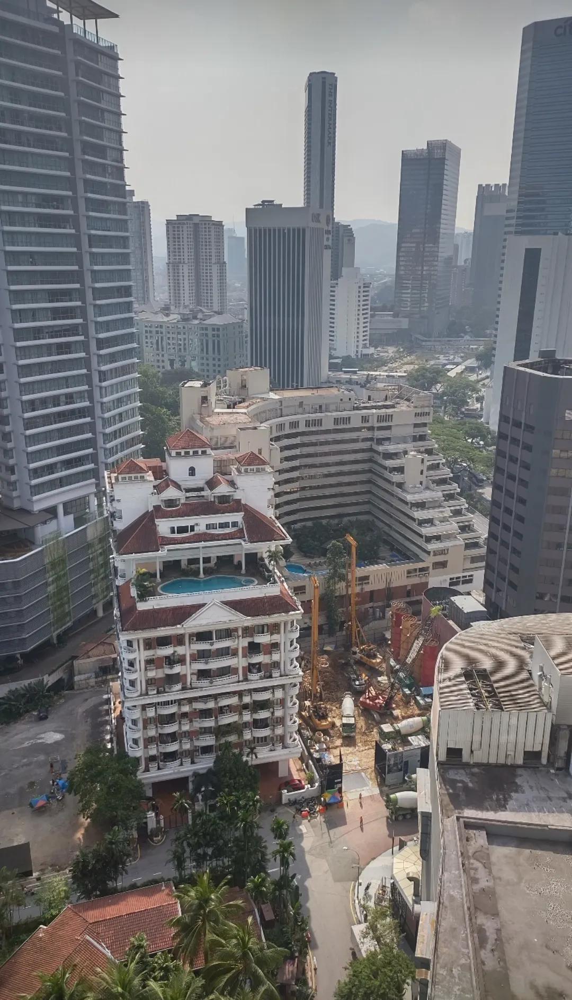

Das ist ein Foto aus Kuala Lumpur, von einer KI lyrisch und musikalisch interpretiert. Ich habe einer KI dieses Bild aus Kuala Lumpur gegeben und sonst nichts, keinen zusätzlichen Kontext. Sowohl der Text als auch die Musik wurden von der KI erstellt, nur auf Basis des Bildes. Das war mein Prompt.

*Was siehst du hier? Beschreib es so schön wie möglich und schau genau hin, ob dir etwas Besonderes auffällt und ob du erkennst, was und wo die Dinge sind, für ein paar Seiten in meinem Reisebuch.*

## Was die KI geschrieben hat

Und das hat die KI geschrieben, unverändert bis auf die Formatierung.

> Aus der Perspektive eines Hochhauses in Kuala Lumpur fängt dieses Foto eine atemberaubende Mischung aus moderner Architektur und historischem Charme ein, vor dem Hintergrund urbaner Lebendigkeit.
>
> Eine Symphonie aus Strukturen. Das Bild stellt die klaren Linien zeitgenössischer Wolkenkratzer wunderschön neben die verzierte Eleganz eines klassischen Gebäudes mit roten Ziegeldächern und geschwungenen Balkonen. Der Kontrast ist beeindruckend und zeigt das harmonische Nebeneinander von Kuala Lumpurs reichem historischem Erbe und seiner rasanten Modernisierung.
>
> Das Herz von Kuala Lumpur. Prominent im Bild strahlt das Gebäude mit den roten Dächern und mehreren Swimmingpools Luxus und den Charme der alten Welt aus. Das könnte ein historisches Hotel oder eine Wohnanlage sein, eine ruhige Oase mitten in der pulsierenden Stadt. Direkt dahinter ragen Giganten wie der OSK Tower und andere moderne Bürogebäude in den Himmel, Symbole der wirtschaftlichen Stärke der Stadt.
>
> Urbaner Puls. Die Baustelle in der unteren rechten Ecke des Bildes zeigt die laufende Entwicklung, ein Zeugnis für die ständige Veränderung der Stadt. Kräne und Maschinen sind fleißig am Werk und deuten auf künftige Ergänzungen dieser dynamischen Skyline hin.
>
> Üppiges Grün inmitten von Beton. Trotz der Betonwüste blitzen immer wieder grüne Flecken durch, mit Bäumen und kleinen Parks, die frische Luft bringen. Diese Grünflächen sind wichtig, sie schaffen ein Gleichgewicht zur urbanen Umgebung und machen die Stadt lebenswerter.
>
> Besondere Highlights.
>
> Ikonische Türme. In der Ferne kann man weitere ikonische Bauwerke erahnen, möglicherweise auch die berühmten Petronas Twin Towers, obwohl sie in dieser Aufnahme nicht deutlich zu sehen sind.
>
> Kulturelle Mischung. Die Vielfalt der Architekturstile spiegelt Kuala Lumpurs kulturelle Vielfalt wider und zeigt Einflüsse aus malaiischer, chinesischer, indischer und westlicher Baukunst.
>
> Lebendige Atmosphäre. Die gesamte Szene pulsiert vor Leben und Energie, ein charakteristisches Merkmal von Kuala Lumpurs immer lebendiger Stadtsilhouette.
>
> Kuala Lumpurs Skyline ist ein Teppich, gewebt aus Fäden der Geschichte und der Moderne. Von den luxuriösen Refugien zwischen den hoch aufragenden Wolkenkratzern bis zu den laufenden Bauprojekten, die noch größere Höhen versprechen: Die Stadt ist ein lebendiges, atmendes Wesen. Dieser Blick fängt die Essenz von Kuala Lumpur ein, eine Stadt, die ihre Vergangenheit respektiert und gleichzeitig unermüdlich ihre Zukunft gestaltet. Hier erzählt jedes Gebäude eine Geschichte, jede Ecke summt vor dem Versprechen neuer Anfänge. Ob du die majestätischen Türme bewunderst, die den Himmel berühren, oder Trost in den ruhigen grünen Flecken inmitten der urbanen Weite findest: Kuala Lumpur lädt dich ein, eine einzigartige Mischung aus Tradition und Innovation zu erleben.
