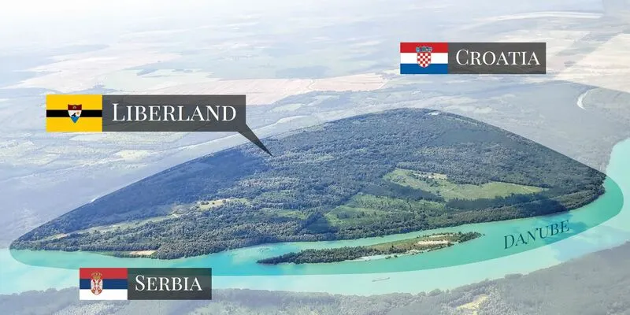
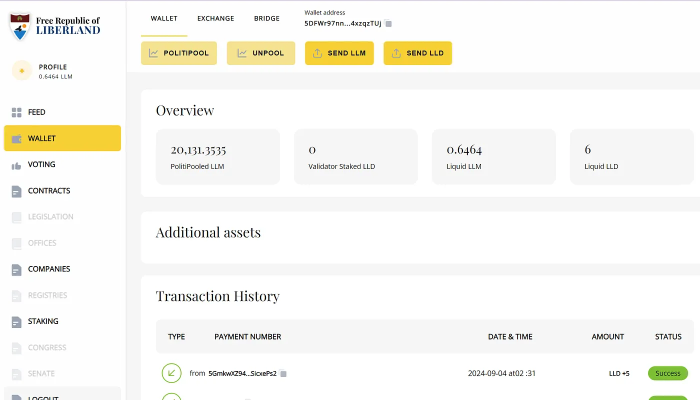
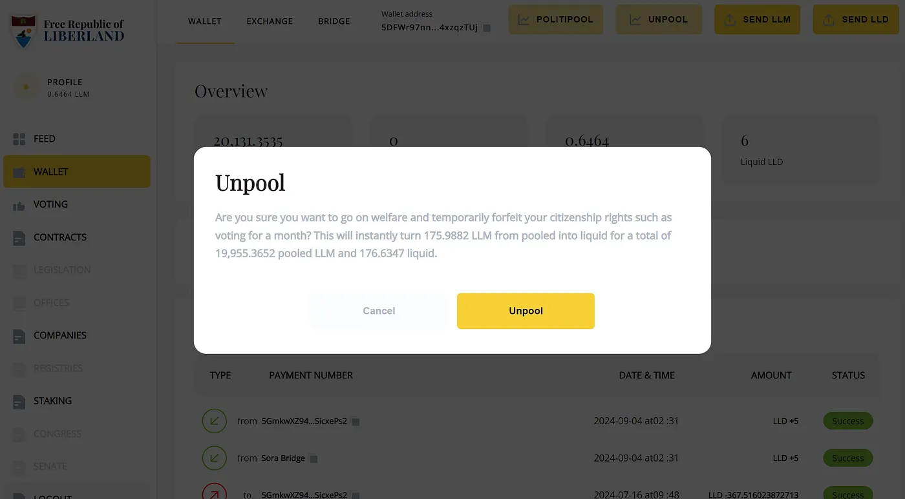
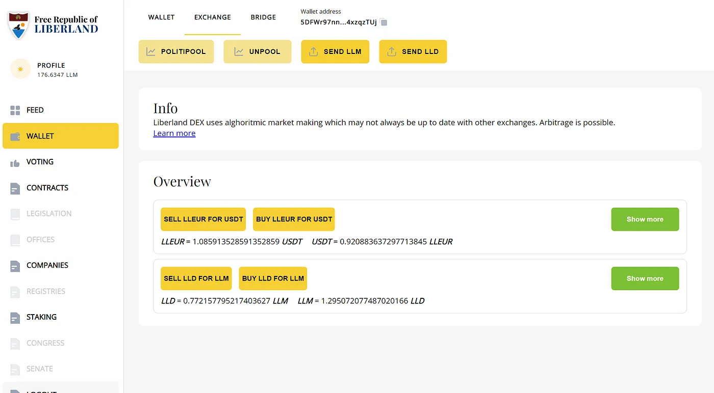
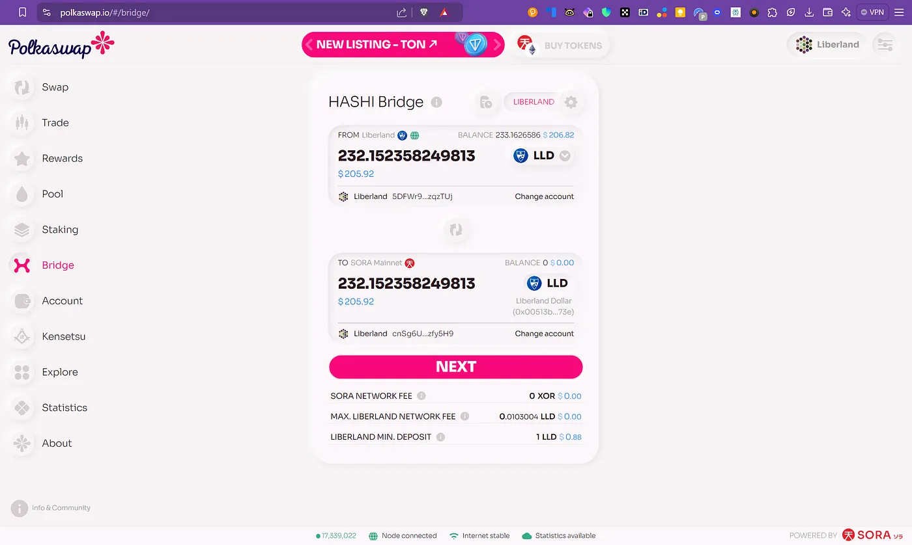
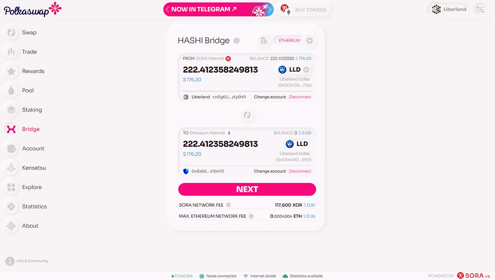
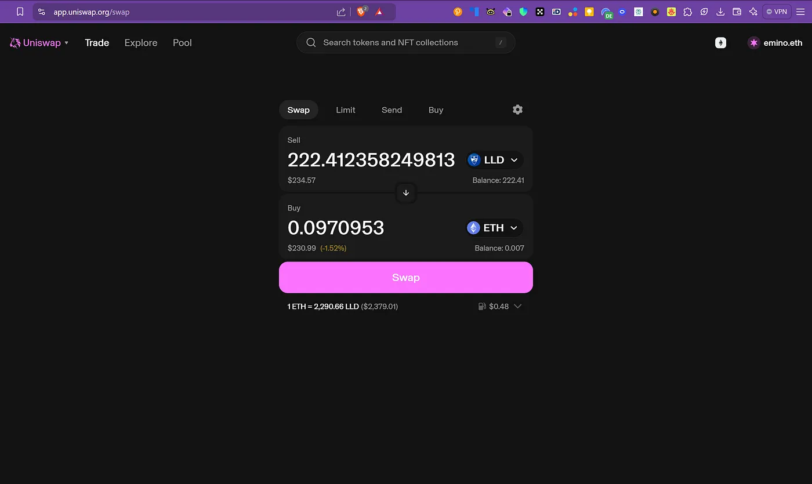
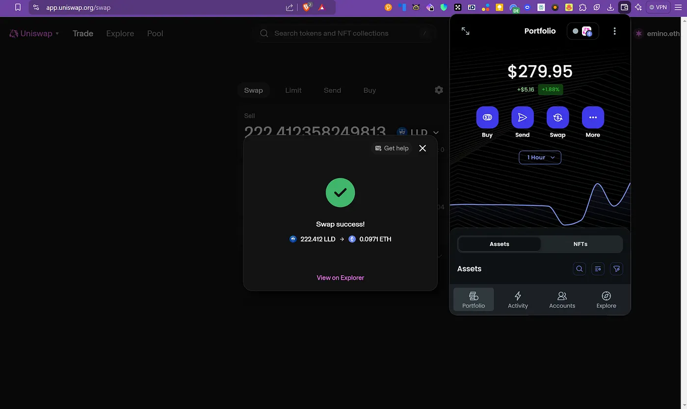

Die Liberland Blockchain ist eine öffentliche Blockchain, die für die Regierung und die Wirtschaft der Mikronation Liberland gebaut wurde. Sie basiert auf dem Substrate Framework, auf dem auch die Polkadot Blockchain läuft.

## Die Tokens

Es gibt zwei Tokens. Der Liberland Dollar (LLD) ist die native Währung der Liberland Blockchain. Du benutzt ihn für Transaktionen, um Gebühren zu bezahlen und das Netzwerk zu sichern. Er ist kein Stablecoin, der Preis wird also vom Markt bestimmt. Das initiale Angebot waren 3 Millionen LLD und ging an Liberland Bürger und LLM Halter.

Der Liberland Merit (LLM) ist der Governance Token und steht für Eigentum an Liberland. Wenn du ihn hältst, kannst du an Entscheidungen teilnehmen. Er hat ein maximales Angebot von 70 Millionen Tokens und ist deflationär.

Für die Governance gibt es PolitiPooling. Du musst LLM staken, um an der Governance teilzunehmen, und nur 10% der gestaketen LLM können pro Jahr freigegeben werden, damit die Leute langfristig dabei bleiben. LLD zu staken funktioniert anders. Du brauchst es, um Validator Nodes zu betreiben und das Netzwerk zu sichern, und Validatoren verdienen Belohnungen in LLD.

## LLD staken

Du hast zwei Möglichkeiten, LLD auf der Liberland Blockchain zu staken. Die erste ist, einen Validator Node zu betreiben. Du brauchst mindestens 200 LLD, um zu starten. Validatoren produzieren neue Blockkandidaten und finalisieren Blöcke, und sie müssen Liberland Bürger sein. Das System wählt Validatoren jede Epoche basierend auf der Größe ihres Stakes aus, und Validatoren, die sich schlecht benehmen, können "geslasht" werden.

Die zweite Option ist, einen bereits existierenden Validator zu nominieren. Das kann jeder machen, indem er etwas LLD stakt. Nominatoren betreiben selbst keinen Node, sie staken LLD in den Node eines Validators. Das gibt dem Validator eine bessere Chance, ausgewählt zu werden, und Nominatoren bekommen einen Anteil an den Belohnungen, die der Validator verdient.

Wenn du LLD stakst, bekommst du Liquid LLD (LLLD) Tokens zurück. LLLD ist ein proportionaler Anspruch auf den Pool von LLD, der bei einem Validator gestakt ist. LLLD Tokens sind vollständig liquide und du kannst sie sofort handeln, ohne die LLD dahinter zu unstaken. Du kannst also schnell in gestakte Positionen ein- und aussteigen, wenn du musst. Um die eigentlichen LLD zu unstaken, schickst du deine LLLD Tokens zurück zur Validator Komponente und wartest auf eine Cooldown Zeit von etwa 7 Tagen.

Staking Belohnungen kommen aus der Inflation, die auf maximal 10% pro Jahr programmiert ist, und die Governance kann sie senken. Die Inflation geht an Validatoren, Nominatoren und die Regierung. Sie ist da, um den Leuten einen Grund zu geben zu staken und die Validator Nodes am Laufen zu halten. Wenn mehr Leute die Chain benutzen, sollten Transaktionsgebühren irgendwann für die Validatoren bezahlen, und dann kann die Inflation auf 0% runtergehen und Burning macht LLD leicht deflationär. Also stakst du LLD, indem du einen Validator Node betreibst oder einen nominierst, die Belohnungen kommen aus der Inflation und bezahlen dich dafür, das Netzwerk zu sichern, und LLLD hält deine gestakte Position flexibel.

Wenn du mehr lesen willst, gibt es das [White Paper](https://liberland-1.gitbook.io/wiki/v/public-documents/blockchain/white-paper) im Liberland Wiki.

## Von Liberland zu SORA zu Ethereum bridgen mit Polkaswap

Es gibt zwei Fälle.

1. Du besitzt LLM und LLD und willst LLD zur Ethereum Blockchain bridgen und es auf [Uniswap](http://uniswap.org) tauschen
1. Du besitzt kein LLD und willst LLD auf Ethereum kaufen und es zur Liberland Blockchain bridgen

Fangen wir mit dem ersten an, das ist der einfachere Prozess. Du tauscht LLD auf Liberland in LLD auf Ethereum.

Wenn du es noch nicht gemacht hast, unpoole deine LLM zu liquiden LLM. Du brauchst dafür liquide LLD in deiner Wallet. Wenn du keine liquiden LLD hast, scrolle runter und ich erkläre, wie du LLD mit ETH bekommst und es mit [Polkaswap bridge](https://polkaswap.io/#/bridge/) zu Liberland bridgest.

Logge dich in deinen Liberland Account bei [https://blockchain.liberland.org/](https://blockchain.liberland.org/) ein und gehe zu Wallet.

Klicke auf PolitiPooled LLM und dann auf Unpool im Pop-up.

Wenn das fertig ist, gehe zum Exchange Tab und wähle Buy LLD for LLM.

*Exchange -> Buy LLD for LLM*

Dann gehe zu Polkaswap und öffne Bridge. Verbinde die Liberland Blockchain und bridge die LLD auf der Liberland Blockchain zu LLD auf SORA Mainnet. Du brauchst dafür XOR, um die Gebühren zu bezahlen.

Sobald deine LLD auf SORA sind, kannst du von SORA zu Ethereum Mainnet bridgen. Du brauchst dafür ETH, um die Gebühren zu bezahlen.

Wenn die Bridge fertig ist (du zahlst zuerst XOR und dann ETH, um sie abzuschließen), kannst du zu Uniswap gehen und die LLD für ETH swappen.

Du zahlst wieder Gebühren in ETH, um den Swap abzuschließen, weil er den Smart Contract auf der Ethereum Blockchain ausführt, und dann solltest du sehen, wie deine ETH reinkommen und deine LLD weggehen.

Danach kannst du deine ETH einfach zu Binance schicken und sie für jede andere Währung oder Kryptowährung oder Token verkaufen.

Es funktioniert auch andersherum. Du kannst LLD bekommen und es zu LLM swappen, und wenn du mehr als 5000 LLM hast, qualifizierst du dich für die Staatsbürgerschaft in Liberland.

Wenn du Fragen zu Liberland oder diesem Tutorial hast, melde dich einfach auf [whatsapp.emin.de](http://whatsapp.emin.de).
