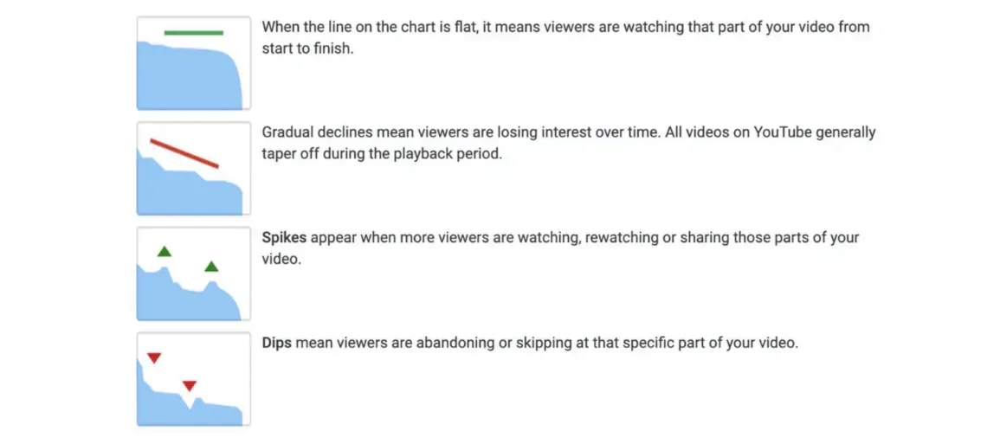

Eine Zusammenfassung von MrBeasts Guide für sein Produktionsteam. Die Quelle ist am Ende verlinkt.

Das Erste, was er sagt: Mach die besten YouTube-Videos. Nicht einfach Videos mit hoher Qualität oder guter Produktion, sondern die besten Videos für YouTube.

## Die drei Zahlen, die über ein Video entscheiden

Um zu verstehen, was viral geht, schaust du auf drei Zahlen: die Click-Through-Rate, also CTR, die Average View Duration, also AVD, und die Average View Percentage, also AVP. Diese drei entscheiden, ob ein Video funktioniert.

## Thumbnail, Titel und die ersten Minuten

Thumbnail und Titel sind eine Kunst, die du lernen musst. Sie müssen Leute zum Klicken bringen, und sie müssen zeigen, was wirklich im Video steckt. Dann bekommt der Zuschauer, was er erwartet, und die CTR steigt.

Die erste Minute ist am wichtigsten, damit Leute dranbleiben. Starte stark, mit gutem Licht, Inhalt, der Leute reinzieht, und einer klaren Idee davon, was kommt.

Dann hältst du das Momentum. Du nutzt die Minuten 1 bis 3, um vom Hype zum eigentlichen Machen zu kommen, und bei Minute 3 holst du die Leute mit was Großem und Einzigartigem zurück. Er nennt das das 3-Minuten-Re-Engagement. Das Aufregendste kommt in die Minuten 3 bis 6. Die zweite Hälfte ist für Sachen, die weniger wichtig sind, aber trotzdem Spaß machen.

Er will einen Wow-Faktor, etwas, das kein anderer YouTuber kopieren kann, damit das Video in den Köpfen bleibt.

## Wie man im Team arbeitet

Der Rest geht darum, wie man im Team arbeitet. Film alles Wichtige in der Produktion, damit das ganze Team weiß, was los ist und alle auf dem gleichen Stand sind. Sprich klar, halte es kurz und komm mit einer Lösung. Bei schwierigen Themen nutze höhere Kommunikationsformen.

Mach keine Ausreden. Steh zu deinen Fehlern, lern daraus und werd immer besser. Priorisiere hart, konzentrier dich auf die Aufgaben, die du bekommen hast, und lass dich nicht ablenken. Nutze Consultants, weil Expertenrat Zeit und Geld spart.

Sei kreativ und einfallsreich, und nutze diese Kreativität, um Probleme zu lösen und Geld zu sparen. Hab immer einen Backup-Plan, mit Backup-Optionen für den Fall, dass was schiefgeht. Hinterfrag alles. Nimm Informationen nicht einfach so hin, prüf sie und schau genauer hin, damit es stimmt und du Probleme vermeidest.

Sei ehrlich, respektvoll und unterstützend mit deinen Kollegen, damit der Ort ein guter Arbeitsplatz bleibt. Schau den Kanal viel, damit du verstehst, wofür die Marke MrBeast steht, ihren Stil und ihr Publikum. Und wachs weiter. Such nach Wegen, in deinem Job besser zu werden und deinen Wert für die Firma zu zeigen.

Quelle: [https://drive.google.com/file/d/1YaG9xpu-WQKBPUi8yQ4HaDYQLUSa7Y3J/view](https://drive.google.com/file/d/1YaG9xpu-WQKBPUi8yQ4HaDYQLUSa7Y3J/view)

## Ein Token-Launch-Skript von Gemini

Ich habe Gemini AI gebeten, mir ein Skript für Community-Funding durch einen fairen Token-Launch zu schreiben. Das ist das Ergebnis, so wie Gemini es geschrieben hat.

Klar! Hier ist ein überarbeitetes Skript, mit Fokus auf Funding, Vorteile für frühe Teilnehmer und einen neutralen Presenter.

Titel: Finanziere meine App und hol dir exklusive Rewards. Je früher du dabei bist, desto mehr bekommst du!

Thumbnail: Ein Smartphone, das ein App-Logo zeigt, mit einer steigenden Kurve im Hintergrund. Text „Early Funders Get MORE."

Intro (Minute 0:00 bis 1:00)

- Presenter: „Stell dir vor, du bist Teil der nächsten großen App, nicht nur als User, sondern als Unterstützer. Heute launchen wir eine revolutionäre Art, wie DU die Entwicklung meiner App finanzieren kannst und für deine frühe Unterstützung belohnt wirst."
- Erklärung der Tokenisierung: „Wir nutzen App-Tokens, ähnlich wie Kryptowährung, um Anteile am Erfolg der App darzustellen. Aber das ist nicht nur für technikaffine Investoren, es ist für alle, die an dieses Projekt glauben."
- Faire Bonding Curve: „Hier kommt der spannende Teil: Je früher du finanzierst, desto niedriger der Token-Preis. Wenn mehr Leute dazukommen, steigt der Preis. Es ist ein faires System, das frühe Unterstützer belohnt."

Die App (Minuten 1:00 bis 3:00)

- Presenter demonstriert die App (zeigt Gameplay, Features und das Problem, das sie löst).
- Community-Teilnehmer: „Wir haben 100 Leute, die bereit sind, die App jetzt zu finanzieren. Sie sehen das Potenzial, und sie warten nicht."
- Bonding Curve visualisiert: „Schau dir diesen Graphen an. Der Preis steigt, während Leute finanzieren. Das ist deine Chance, früh einzusteigen und dir einen größeren Anteil an App-Tokens zu sichern."

Funding-Frenzy (Minuten 3:00 bis 6:00)

- Live-Dashboard: Zeig den Funding-Fortschritt und die steigende Kurve in Echtzeit.
- Teilnehmer-Interviews: „Warum finanzierst du diese App? Was begeistert dich daran?"
- Knappheit und FOMO: „Tokens sind limitiert. Je länger du wartest, desto höher der Preis und desto weniger Tokens bekommst du. Verpass nicht, deine potenziellen Rewards zu maximieren."

Der „Wow-Faktor" (Minuten 6:00 bis 9:00)

- Exklusive Rewards: „Frühe Unterstützer bekommen exklusive Vorteile in der App: Early Access, Bonus-Features, limitiertes Merch und mehr. Das ist deine Chance, Teil von etwas Besonderem zu sein."
- Die Leidenschaft des Presenters: „Ich habe mein Herz in diese App gesteckt. Mit deiner Unterstützung können wir sie zum Leben erwecken und die Art revolutionieren, wie du (connectest, zockst, lernst, etc.)."

Erfolg und Dankbarkeit (Minuten 9:00 bis 13:00)

- Funding-Ziel erreicht: „Wir haben es geschafft! Dank eurer unglaublichen Unterstützung haben wir unser Funding-Ziel erreicht. Diese App wird Realität."
- Danke: „An alle, die finanziert haben, danke. Ihr seid nicht nur Unterstützer, ihr seid Partner auf dieser Reise. Ohne euch hätten wir das nicht geschafft."
- App-Launch-Hype: „Macht euch bereit für den App-Launch. Frühe Unterstützer, haltet Ausschau nach euren exklusiven Rewards. Das ist erst der Anfang."

Outro (Minuten 13:00 bis 13:59)

- Call to Action: „Wenn du die erste Funding-Runde verpasst hast, keine Sorge. Bleib dran für Updates zu zukünftigen Möglichkeiten, mitzumachen. Abonnier und sei Teil der App-Community."

Zusätzliche Tipps

- Klar und prägnant: Erklär die Bonding Curve und Tokenisierung einfach.
- Visuals: Nutze Grafiken, Animationen und Text, um die wichtigsten Punkte zu verstärken.
- Energie und Begeisterung: Die Leidenschaft des Presenters sollte ansteckend sein.
- Community-Fokus: Heb die Unterstützer und ihre Rolle im Projekt hervor.
- Dringlichkeit: Betone die Vorteile von frühem Funding und das limitierte Token-Angebot.
