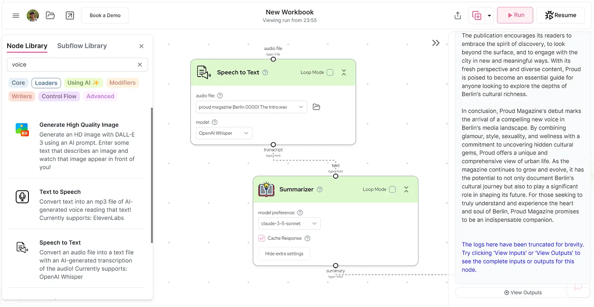

Ich experimentiere gerade mit AI-Flows, und eine meiner neuesten Entdeckungen ist [gumloop.com](http://gumloop.com). Damit kannst du ganz einfach einen Flow definieren, der eine Datei durch mehrere KI-gestützte Verarbeitungsschritte schickt. Das folgende Beispiel hat die erste Ausgabe des proud magazine Berlin (Issue #1) genommen, sie interpretiert und in Stichpunkten zusammengefasst, und diese Zusammenfassung dann an Claude Haiku weitergegeben, das daraus einen „Blogpost mit mindestens 444 Wörtern für medium.com“ geschrieben hat.

Hier ist das Ergebnis, geschrieben von Claude Haiku und nicht von mir.

## Proud Magazine: Berlins versteckte Juwelen enthüllen und urbane Kultur gestalten

In der pulsierenden Metropole Berlin ist eine neue Stimme aufgetaucht, die das Wesen der lebendigen, sich ständig wandelnden Kultur der Stadt einfängt. Das Proud Magazine ist mit seiner ersten Ausgabe auf der Bildfläche erschienen und verspricht, mehr zu sein als nur ein weiteres Stadtmagazin. Dieser kantige Newcomer will die Schichten von Berlins vielschichtiger Persönlichkeit abtragen und verborgene Seiten ans Licht bringen, die selbst langjährige Bewohner vielleicht übersehen haben.

Im Kern ist das Proud Magazine eine Feier von Vielfalt und Kreativität. Die Redaktion hat ein Team talentierter Menschen aus unterschiedlichsten Hintergründen zusammengestellt, von denen jeder seine eigene Perspektive einbringt. Diese Vielfalt ist für Proud nicht nur ein Schlagwort, sie ist das Fundament, auf dem das Magazin steht. Indem es ein breites Spektrum an Stimmen und Erfahrungen zeigt, will Proud ein genaueres und inklusiveres Bild von Berlins Kulturlandschaft zeichnen.

Einer der spannendsten Aspekte des Proud Magazine ist sein Anspruch, die weniger bekannten Facetten der Berliner Kultur aufzudecken. Die Stadt ist bekannt für ihre Geschichte, ihre Kunstszene und ihr Nachtleben, aber Proud will tiefer graben und ein Schlaglicht auf die Underground-Bewegungen, aufkommenden Trends und versteckten Juwelen werfen, die Berlin seinen unverwechselbaren Charakter geben. Dieser Ansatz hebt Proud von anderen Stadtmagazinen ab und bietet den Lesern eine frische, authentische Perspektive auf eine Stadt, die sie zu kennen glaubten.

## Glamour, Style, Sexualität und Wellness

Der Inhalt des Magazins ist eine sorgfältig kuratierte Mischung aus Glamour, Style, Sexualität und Wellness. Diese eklektische Mischung spiegelt die vielfältigen Interessen und Lebensstile der Berliner wider und erkennt an, dass Stadtbewohner komplexe Menschen mit vielschichtigen Leben sind. Indem Proud diese verschiedenen Aspekte anspricht, schafft es ein ganzheitliches Bild des Stadtlebens, das die Leser auf mehreren Ebenen anspricht.

Prouds Fokus auf Glamour und Style knüpft an Berlins Ruf als modische Stadt an. Das Magazin zeigt lokale Designer, Streetstyle und aufkommende Trends und feiert den einzigartigen Modegeschmack, der die Berliner auszeichnet. Proud geht aber über oberflächliche Ästhetik hinaus und taucht ein in die Geschichten hinter den Styles und die kulturelle Bedeutung von Mode im urbanen Kontext.

Die Aufnahme von Sexualität als zentrales Thema ist ein mutiger Schritt, der zu Berlins Ruf für Offenheit und Fortschrittlichkeit passt. Proud geht dieses Thema mit Feingefühl und Stil an und untersucht, wie Sexualität mit Stadtleben, Beziehungen und persönlicher Identität zusammenhängt. Damit trägt das Magazin zu wichtigen Gesprächen über sexuelle Gesundheit, Vielfalt und Empowerment bei.

Wellness ist ein weiterer entscheidender Bestandteil von Prouds redaktionellem Mix. In einem schnelllebigen urbanen Umfeld kann es eine Herausforderung sein, körperliches und mentales Wohlbefinden zu erhalten. Das Magazin bietet Einblicke, Tipps und Geschichten rund um Gesundheit und Wellness, speziell zugeschnitten auf Stadtbewohner. Dieser Fokus auf Wohlbefinden zeigt Prouds Anspruch, nicht nur die Kulturlandschaft Berlins zu pflegen, sondern auch die Menschen, die die Stadt ihr Zuhause nennen.

## Die Stadt gestalten

Vielleicht am wichtigsten: Das Proud Magazine versteht sich nicht nur als Beobachter der Berliner Kultur, es will aktiv an der Gestaltung der Zukunft der Stadt mitwirken. Indem es diversen Stimmen eine Plattform bietet und aufkommende Trends sichtbar macht, will Proud die Richtung von Berlins kultureller Entwicklung beeinflussen. Das Magazin lädt seine Leser ein, sich auf diese Reise zu begeben, und fördert ein Gefühl von Gemeinschaft und gemeinsamem Ziel unter seinem Publikum.

Während das Proud Magazine sich auf diese ambitionierte Mission begibt, spricht es eine offene Einladung an Berliner und Urban-Enthusiasten weltweit aus. Die Redaktion ermutigt ihre Leser, den Geist der Entdeckung anzunehmen, hinter die Oberfläche zu schauen und sich auf neue, bedeutungsvolle Weise mit der Stadt auseinanderzusetzen. Mit seiner frischen Perspektive und vielfältigen Inhalten ist Proud auf dem besten Weg, ein unverzichtbarer Guide für alle zu werden, die die Tiefen von Berlins kulturellem Reichtum erkunden wollen.

Das Debüt des Proud Magazine markiert die Ankunft einer überzeugenden neuen Stimme in Berlins Medienlandschaft. Indem es Glamour, Style, Sexualität und Wellness mit dem Anspruch verbindet, versteckte kulturelle Juwelen aufzudecken, bietet Proud einen einzigartigen und umfassenden Blick auf das urbane Leben. Während das Magazin weiter wächst und sich entwickelt, hat es das Potenzial, nicht nur Berlins kulturelle Reise zu dokumentieren, sondern auch eine bedeutende Rolle bei der Gestaltung seiner Zukunft zu spielen. Für alle, die das Herz und die Seele Berlins wirklich verstehen und erleben wollen, verspricht das Proud Magazine ein unverzichtbarer Begleiter zu sein.
