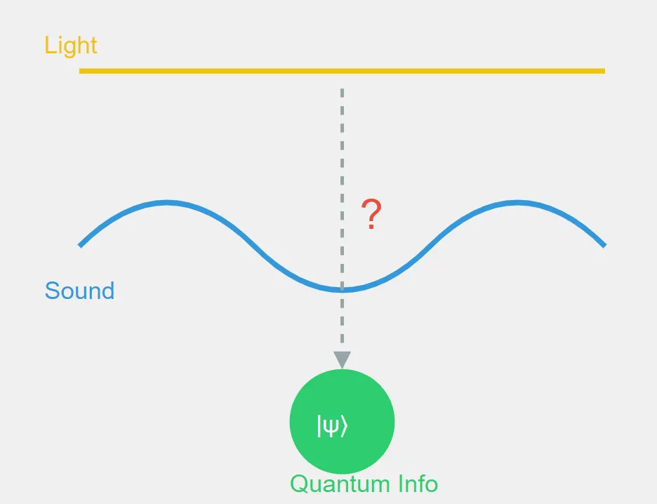

In der Physik stellt sich oft heraus, dass Dinge, die scheinbar nichts miteinander zu tun haben, eben doch zusammenhängen. Also, hier ist eine Frage, die ich mal durchdenken will. Könnten Schallwellen Quanteninformation tragen oder sie zumindest beeinflussen? Um das herauszufinden, schauen wir uns an, wo Akustik, Optik und Quantenmechanik zusammentreffen.

## Licht, Schall und die Frage

Fangen wir mit etwas Bekanntem an. Licht kann Quanteninformation tragen. In der Quantenoptik können Photonen, also die Teilchen des Lichts, in Quantenzuständen existieren. Diese Zustände können Quantenbits (Qubits) kodieren, und das ist die Grundlage für manche Ansätze im Quantencomputing und in der Quantenkommunikation.

Jetzt kommt Schall ins Spiel. Es gibt einen Effekt, den akusto-optischen Effekt, bei dem Schallwellen die Eigenschaften von Licht verändern, das durch bestimmte Materialien läuft. Den nutzt man in vielen Bereichen, von der Telekommunikation bis zur Lasertechnik.

Und hier beginnt das Gedankenexperiment. Wenn Licht Quanteninformation tragen kann und Schall Licht beeinflussen kann, könnten dann Schallwellen selbst Quanteninformation tragen oder beeinflussen?

## Warum es nicht so einfach ist

Auf den ersten Blick klingt das gut. Aber wie so oft in der Physik ist es komplizierter, aus vier Gründen.

Erstens, klassisch versus Quantenwelt. Der akusto-optische Effekt ist meist ein klassischer Effekt, und Quanteninformation lebt in der Quantenwelt. Von einem zum anderen zu kommen, ist nicht einfach.
Zweitens, das Medium ist wichtig. Schallwellen, so wie wir sie normalerweise verstehen, brauchen ein Medium, durch das sie sich ausbreiten. Das ist ein Problem, wenn man an Quantensysteme denkt oder an Orte wie das Vakuum des Weltalls.
Drittens, Quantenschall. Schall kann in manchen Fällen Quanteneigenschaften haben. In Festkörpern gibt es quantisierte Schwingungen, Phononen, und die sind die Quantenseite des Schalls. Aber sie unterscheiden sich stark von den großen Schallwellen, die wir jeden Tag hören.
Und viertens, Dekohärenz. Selbst wenn wir Quanteninformation in Schallwellen kodieren könnten, wäre es extrem schwer, sie in einem großen System kohärent zu halten, weil das System ständig mit seiner Umgebung wechselwirkt.

## Was trotzdem spannend bleibt

Dieses Gedankenexperiment liefert uns also keine direkte Verbindung zwischen Schallwellen und Quanteninformation, mit der man zum Beispiel das Informationsparadoxon schwarzer Löcher lösen könnte. Aber es zeigt, wie vernetzt die Physik ist.

Und es zeigt ein paar Dinge auf, die man sich genauer ansehen sollte. Die Quanteneigenschaften von Phononen und ob man sie zur Verarbeitung von Quanteninformation nutzen kann. Neue Wege, akusto-optische Wechselwirkungen in Quantensystemen zu nutzen. Und wie andere Arten von Wellen in extremen Umgebungen mit Quanteninformation wechselwirken könnten.

Der Weg von Schallwellen zu Quanteninformation ist nicht direkt, aber er bringt einen zum Nachdenken. In der Physik kann kreatives Denken zu Verbindungen führen, mit denen man nicht rechnet. Große alltägliche Schallwellen sind wahrscheinlich nicht der Schlüssel, um Quanteninformation zu halten, aber wie verschiedene Effekte in der Physik zusammenspielen, bleibt ein großartiges Forschungsfeld.

Je mehr wir über Quantenmechanik und Informationstheorie lernen, desto überraschendere Verbindungen könnten wir finden. Es gibt noch viel in der Quantenwelt, das wir noch nicht gehört haben.
