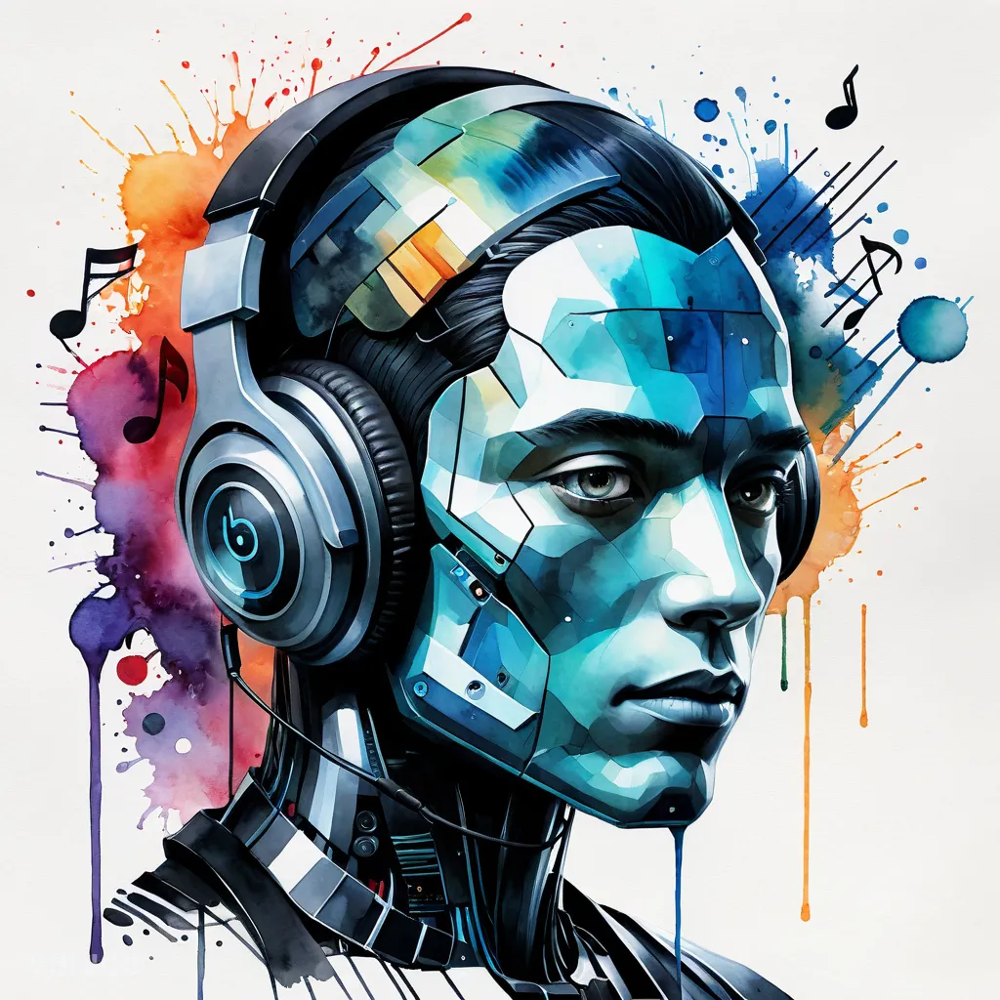

KI, Blockchain und das Internet verändern die Musikbranche enorm. Sie fordern die großen Labels heraus und den unfairen Vorteil von Leuten mit Geld und Ruhm. Sie machen den künstlerischen Raum demokratischer, und Künstler werden unabhängiger als je zuvor. Alles, was ein großes Label früher für den Großteil der Einnahmen des Künstlers gemacht hat, kann man heute von zu Hause aus erledigen.

*Ein Aquarellgemälde von The Future of Music: How AI, Blockchain, and the Internet Are Revolutionizing the Industry, erstellt mit [venice.ai](http://venice.ai)*

## Musik und Videos mit KI machen

Es fängt bei der Produktion an. Mit KI können Künstler Songs remixen oder komplett neue von zu Hause aus erstellen, und sie behalten die volle Kontrolle über die Royalties. So können sie ihre Fans immer wieder mit neuen Tracks überraschen, auch bei Gigs, und müssen keine Songs von anderen Künstlern mehr spielen. Musikvideos werden mit KI auch einfach, schnell und hochwertig. Ein Künstler kann schnell einzigartige Videos machen, und das ist eine weitere Einnahmequelle und Aufmerksamkeit auf Plattformen wie YouTube.

## Content ohne das Zeitproblem

Dann gibt es noch Content. Eines der größten Probleme für Künstler war schon immer, Content für Online-Marketing und Social Media zu machen, weil sie einfach keine Zeit dafür haben. Mit KI reicht eine einfache Sprachnachricht pro Tag. Die wird in Artikel, Bilder und Mediencontent für ihre Kanäle umgewandelt, und das hält Fans, Freunde und Familie über ihre Reise, ihre Ideen und ihre Entwicklung auf dem Laufenden, damit die Leute um sie herum engagiert bleiben.

## Veröffentlichen ohne Mittelsmann

Veröffentlichen ist auch einfach geworden. Mit Plattformen wie SoundCloud und DistroKid können Künstler ihre Musik selbst veröffentlichen und 100% ihrer Royalties bekommen. Es gibt keinen Mittelsmann mehr, und der Künstler behält die Kontrolle über die Arbeit und das Geld.

## Blockchain, NFTs und Werbeeinnahmen

Blockchain und NFTs verändern, wie Künstler mit ihrer Arbeit Geld verdienen. Plattformen wie Royal.io lassen Künstler ihre Tracks in NFTs aufteilen und Eigentum und Royalties mit ihren Fans und Unterstützern teilen. So können Fans in Musik investieren, ohne den Künstler zu "besitzen", und der Künstler bekommt ein stetiges Einkommen und mehr finanzielle Stabilität. Obendrauf haben Instagram, TikTok, YouTube und Twitter angefangen, Werbeeinnahmen mit erfolgreichen Publishern zu teilen. Wenn die Musik eines Künstlers trendet und viele Leute erreicht, wird der Künstler auch dafür bezahlt.

## Eine glänzende Zukunft für Künstler

Insgesamt sehe ich eine glänzende Zukunft für Künstler, und nicht nur Musiker, sondern digitale Publisher im Allgemeinen, um mit ihrer Kunst ihren Lebensunterhalt zu verdienen. Mit den richtigen Tools, besonders KI, können sie hochwertigen Content erstellen und Sichtbarkeit wie nie zuvor bekommen. Und ich sehe auch eine Chance für eine neue Art von Agentur und Künstlermanager, die großartige Künstler mit diesen Tools noch sichtbarer und erfolgreicher machen können.

## Originalnotizen

KI, Blockchain und das Internet verändern und fordern die Musikbranche heraus, große Labels und den unfairen Vorteil von Leuten mit Geld und Ruhm.

KI und digitale Distribution, Crypto NFTs und mehr demokratisieren den künstlerischen Raum und machen Künstler unabhängiger als je zuvor. Alles, was ein großes Label für den Großteil der Einnahmen des Künstlers gemacht hat, kann jetzt von zu Hause aus gemacht werden.

1. Musikproduktion mit KI ermöglicht es Künstlern, Songs zu remixen oder komplett neue zu erstellen, für die sie die Royalties besitzen. Sie können ihre Fans und bei Gigs mit immer neuen Tracks überraschen, nie aufhören kreativ und völlig einzigartig zu sein, statt nur Songs "von anderen" zu spielen
1. Musikvideoproduktion wird einfach, unkompliziert, hochwertig, einzigartig und schnell, sodass eine zusätzliche Einnahmequelle und Aufmerksamkeit das Veröffentlichen von Musikvideo-Content auf YouTube und anderen Plattformen sein kann.
1. Content-Produktion für Online-Marketing und Social Media ist oft ein großes Problem für Künstler, da sie begrenzte Zeit dafür haben, aber mit KI kann eine Sprachnachricht pro Tag genug sein, um Artikel, Bilder oder sogar Mediencontent für ihre Kanäle zu erstellen, um Fans, Freunde und Familie über ihre Reise, ihre Ideen, ihre Entwicklung und mehr zu informieren und ihr Umfeld engagiert zu halten
1. Self-Publishing und Distribution von Musik über Plattformen wie Soundcloud for Artists oder Distrokit [www.distrokit.com](http://www.distrokit.com) wird unkompliziert und einfach zu nutzen und ermöglicht es Künstlern, selbst zu veröffentlichen und automatisch 100% ihrer Royalties zu erhalten.
1. Blockchain, NFTs, Royalties und teilweises Eigentum an geistigem Eigentum wie [www.royal.io](http://www.royal.io), was es Künstlern ermöglicht, ihre Tracks in NFTs zu fraktionalisieren und Eigentum und Royalties von den Tracks mit ihren Fans und Unterstützern zu teilen, man kann jetzt "in Musik investieren" und Künstler ohne "den Künstler zu besitzen" und der Künstler kann langsam aber stetig seinen Lebensunterhalt verdienen und Einkommen auf kontinuierlicher Basis generieren.
1. Plattformen wie Instagram, TikTok, YouTube und Twitter fangen an, einen Werbeanteil an erfolgreiche Publisher auszuzahlen, sodass wenn ein Künstler oder seine Musik trendet und Leute erreicht, die Künstler auch dafür belohnt werden.

Insgesamt sehe ich eine glänzende Zukunft für Künstler (nicht nur Musiker, sondern digitale Publisher im Allgemeinen), um mit ihrer Kunst ihren Lebensunterhalt zu verdienen.

Ich sehe auch eine Chance für eine neue Form von Agentur und Künstlermanagern, die die Sichtbarkeit und den Erfolg großartiger Künstler mit Hilfe der richtigen Tools verstärken können, besonders KI, um einfach hochwertigen Content rund um die Künstler zu erstellen und ihnen Exposure wie nie zuvor zu geben.
