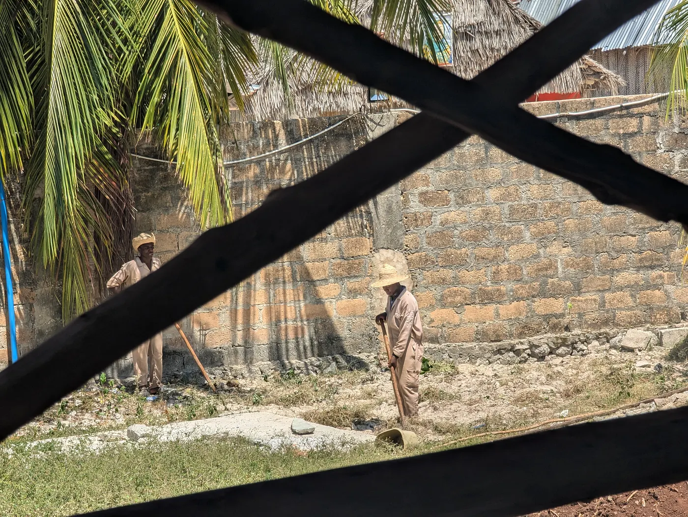

Das Label "Made in Italy" steht seit Langem für beste Handwerkskunst, Qualität und Luxus. Die Leute zahlen Premiumpreise, weil sie darauf vertrauen, dass es italienische Arbeit ist, und sie denken, das, was sie kaufen, ist nicht nur großartiges Handwerk, sondern auch ethisch hergestellt. Doch jüngste Erkenntnisse zeigen eine dunklere Realität hinter den Luxusgütern, die mit diesem Label verkauft werden. Ermittlungen in Mailand fanden Fälle von ausgebeuteten Arbeitern, und das wirft ernste Fragen zu den Lieferketten einiger der bekanntesten Modemarken der Welt auf, darunter Armani und Dior.

## Was die Staatsanwälte fanden

Italienische Staatsanwälte begannen, Zulieferer zu untersuchen, die mit den Luxusriesen Giorgio Armani und Christian Dior verbunden sind, nachdem Berichte über ausbeuterische Arbeitsbedingungen in ihrer ausgelagerten Produktion bekannt wurden. Diese Zulieferer, oft als "chinesisch geführte Werkstätten" bezeichnet, beschäftigten den Erkenntnissen zufolge Einwanderer aus China und Pakistan, und viele von ihnen hatten keine legalen Papiere. Die Arbeiter bekamen niedrige Löhne, arbeiteten viel zu viele Stunden und hatten kaum Sicherheit. Das ist sehr weit entfernt von dem, was die Luxusmarken öffentlich über hohe ethische Standards und sorgfältiges Handwerk sagen.

Genau um diese Kluft geht es bei den Ermittlungen. Armani und Dior reden viel über handwerkliche Qualität und echte italienische Arbeit, und das passte nicht zu der harten Realität in diesen Werkstätten. Die Behörden fanden heraus, dass die Zulieferer die Waren für einen kleinen Bruchteil des Endpreises im Geschäft herstellten, sodass es eine riesige Kluft gibt zwischen der Art, wie die Dinge gemacht wurden, und dem, wofür sie verkauft werden.

Die Werkstätten lagen am Stadtrand von Mailand, und sie zeigten, wie tief diese Praktiken in den Lieferketten der High-End-Mode steckten. Subunternehmer umgingen Berichten zufolge die ethischen Standards durch illegale Untervergabe, stellten Arbeiter ohne Papiere ein und zahlten ihnen nur ein paar Euro, um High-End-Produkte wie Lederhandtaschen und Accessoires herzustellen. Das rückte unethische Praktiken in der Luxusmode insgesamt ins Rampenlicht, und viele Leute fordern jetzt mehr Transparenz und Verantwortlichkeit in der Branche.

## Was Armani und Dior sagten

Armani und Dior bestritten beide jede direkte Beteiligung an unethischen Praktiken und sagten, sie seien fairer und legaler Arbeit verpflichtet. Giorgio Armani SpA sagte in einer öffentlichen Erklärung, dass das Unternehmen dem Ausgang der Ermittlungen zuversichtlich entgegensieht. Dior, das zum französischen Luxuskonzern LVMH gehört, verurteilte die Praktiken und versprach, keine neuen Aufträge an die beteiligten Zulieferer zu vergeben. Dennoch führte der Skandal zu einer größeren Untersuchung durch Italiens Wettbewerbsbehörde, die prüft, ob die Marken die Verbraucher über ihre soziale Verantwortung und ethische Standards getäuscht haben.

Die öffentliche Reaktion warf große Fragen dazu auf, wie Luxusmarken ihre Lieferketten überprüfen und wie echt ihre Made-in-Italy-Behauptungen sind. Erkenntnisse wie diese schaden dem Image dieser Modehäuser, und sie zeigen auch, dass die Branche strukturelle Veränderungen braucht. Die Verbraucher wollen strengere Kontrollen und mehr Transparenz dazu, ob Luxusgüter ethisch hergestellt werden.

## Was das Label jetzt wert ist

Der "Made in Italy"-Skandal ist eine Erinnerung daran, wie viel hinter dem Luxus-Branding verborgen ist. Jahrelang haben Marken die Verbindung zwischen italienischem Handwerk und Luxus genutzt und Produkte verkauft, die ein unausgesprochenes Versprechen von Qualität und Integrität tragen. Doch was in Mailand ans Licht kam, zeigt, wie dünn dieses Versprechen sein kann.

Armani und Dior stehen immer noch unter Beobachtung, und die Luxusmodebranche steht an einem Scheideweg. Der Skandal zeigte, dass sie echte Verpflichtungen zu fairer Arbeit und strenge Kontrollen in den Lieferketten braucht. Nur die Zeit wird zeigen, ob diese Marken das Vertrauen der Verbraucher zurückgewinnen und dem Made-in-Italy-Label wieder eine Bedeutung geben können.
