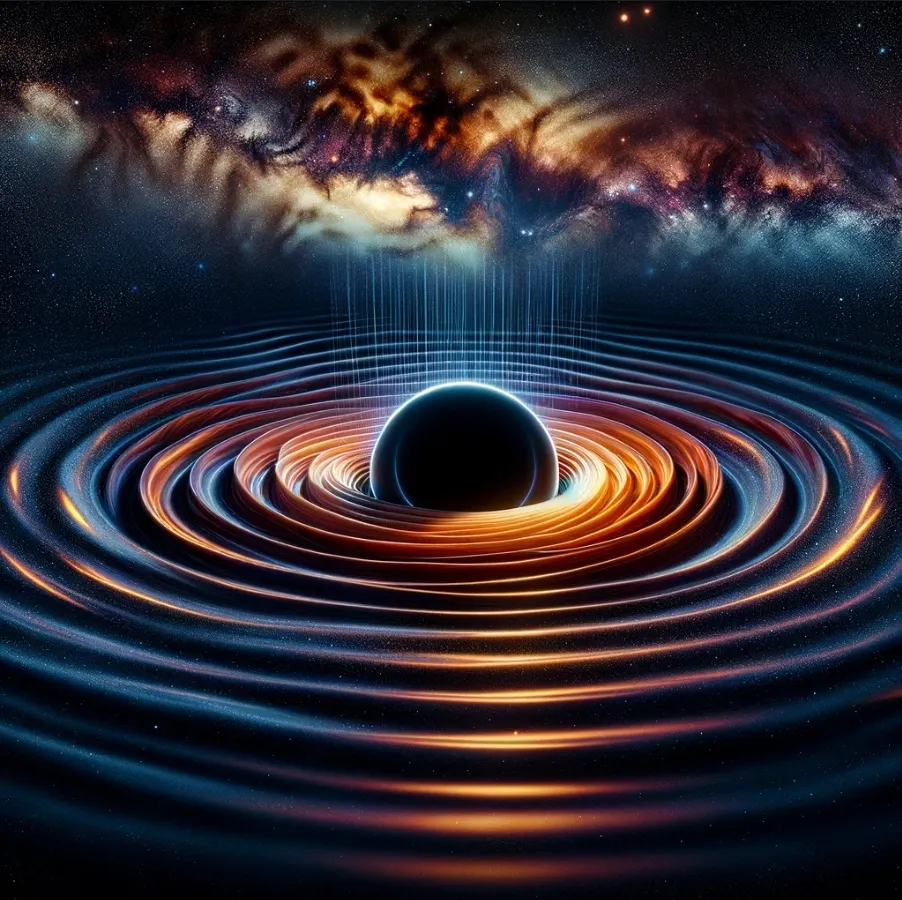

Ich habe die grobe Idee, dass Gravitationswellen die letzten Informationen von Materie enthalten könnten, bevor sie in ein Schwarzes Loch fällt. Das könnte das Informationsparadoxon lösen, indem es möglich wird, die fehlenden Informationen über Schall zu messen. Kannst du über diese Idee nachdenken und mir eine Pro- und Contra-Liste geben, mit Forschungspapieren, die diese Theorie stützen könnten, und einem Aufruf an Astrophysiker, mitzudenken oder Experimente zu entwickeln, die reproduzierbar und messbar sind, um meine Behauptung zu stützen?

Das war meine Frage. Das hier ist die Antwort, ein bisschen aufgeräumt.

Die Idee berührt einige der grundlegendsten Fragen der theoretischen Physik und Astrophysik. Schauen wir uns also an, was dafür spricht, was dagegen, welche Papers man lesen sollte und wie ein Aufruf an Astrophysiker aussehen könnte.

## Was dafür spricht

Zwei Dinge sprechen dafür. Das erste ist die Gravitationswellen-Astronomie selbst. Der Nachweis von Gravitationswellen hat eine neue Art eröffnet, das Universum zu betrachten, und direkte Belege für Dinge wie die Verschmelzung Schwarzer Löcher geliefert. Das Feld könnte uns also auch etwas über die Dynamik von Materie sagen, wenn sie in ein Schwarzes Loch spiralartig hineinfällt, und vielleicht Informationen über den Zustand dieser Materie kodieren, bevor sie den Ereignishorizont überquert. Die LIGO- und Virgo-Beobachtungen von Gravitationswellen aus der Verschmelzung binärer Schwarzer Löcher zeigen, dass der Nachweis solcher Wellen funktioniert (Abbott et al., Physical Review Letters, 2016).

Das zweite ist die Theorie. Die Idee, dass Gravitationswellen Informationen über Materie tragen, bevor sie ins Schwarze Loch fällt, passt zu Theorien, die sagen, Information geht nicht verloren, sondern wird in irgendeiner Form außerhalb des Schwarzen Lochs gespeichert. Stephen Hawking und andere haben Mechanismen wie die Hawking-Strahlung vorgeschlagen, bei der Information aus Schwarzen Löchern entweichen könnte. Es gibt also einen Präzedenzfall dafür, dass Information in extremer Gravitation überlebt (Hawking, Physical Review D, 1974).

## Was dagegen spricht

Und drei Dinge sprechen dagegen. Erstens: Die Quanteninformation von Materie, die in ein Schwarzes Loch fällt, in Gravitationswellen zu kodieren und später wieder zu dekodieren, ist komplex und nicht gut verstanden. Aktuelle Modelle von Gravitationswellen beschäftigen sich meist mit großen Eigenschaften wie Masse und Spin, und sie erfassen möglicherweise nicht die detaillierte Quanteninformation, die man braucht, um das Paradoxon zu lösen. Zweitens die Technologie. Im Moment können wir nur Gravitationswellen von großen Ereignissen nachweisen und analysieren, wie der Verschmelzung von Schwarzen Löchern oder Neutronensternen. Die Empfindlichkeit, die man braucht, um feine Informationen über in ein Schwarzes Loch fallende Materie aufzugreifen, liegt vielleicht jenseits dessen, was wir jetzt oder in naher Zukunft können. Drittens ist die Theorie noch offen. Das Informationsparadoxon Schwarzer Löcher selbst wird in der theoretischen Physik noch immer debattiert und erforscht, und jede Lösung mit Gravitationswellen muss sich mit harten Fragen zur Quantengravitation und zur Natur der Information auseinandersetzen, bei denen es noch keinen Konsens gibt.

## Was man lesen sollte und wer sich das ansehen sollte

Zum Weiterlesen: Fang mit den Beobachtungen der LIGO- und Virgo-Kollaborationen an, für die Grundlagenforschung zum Gravitationswellen-Nachweis und was er bedeutet. Dann Hawking, S. W. (1974), Black hole explosions? in Nature, seine Schlüsselarbeit zur Strahlung Schwarzer Löcher und zum Informationsparadoxon. Und für das aktuelle Denken zum Paradoxon und mögliche Lösungen: Such nach Übersichtsartikeln und Perspektiven in guten Journalen wie dem Annual Review of Nuclear and Particle Science.

Das hier ist also ein Aufruf an Astrophysiker, theoretische Physiker und Leute, die an Quanteninformation arbeiten: Lasst uns gemeinsam untersuchen, ob Gravitationswellen das Medium sein können, das das Informationsparadoxon Schwarzer Löcher löst. Es braucht Leute aus vielen Bereichen, aus der Gravitationswellen-Astronomie, der Quanteninformationstheorie und der Physik Schwarzer Löcher. Wir brauchen Vorschläge für Experimente, theoretische Modelle und Wege zur Datenanalyse, die helfen könnten, die Informationen zu detektieren und zu lesen, die von den Gravitationswellen getragen werden, welche Materie aussendet, wenn sie in ein Schwarzes Loch fällt. Wenn das funktioniert, könnte es verändern, wie wir Schwarze Löcher, Quantenmechanik und die Natur des Universums selbst verstehen.

Die Idee ist sehr spekulativ und steht vor großen wissenschaftlichen und technologischen Herausforderungen. Aber genau diese Art zu denken treibt die theoretische Physik und Astrophysik voran, und Wissenschaftler aus verschiedenen Bereichen, die zusammenarbeiten, sind der Weg, wie wir diese und andere mögliche Lösungen für das Informationsparadoxon Schwarzer Löcher testen können.
