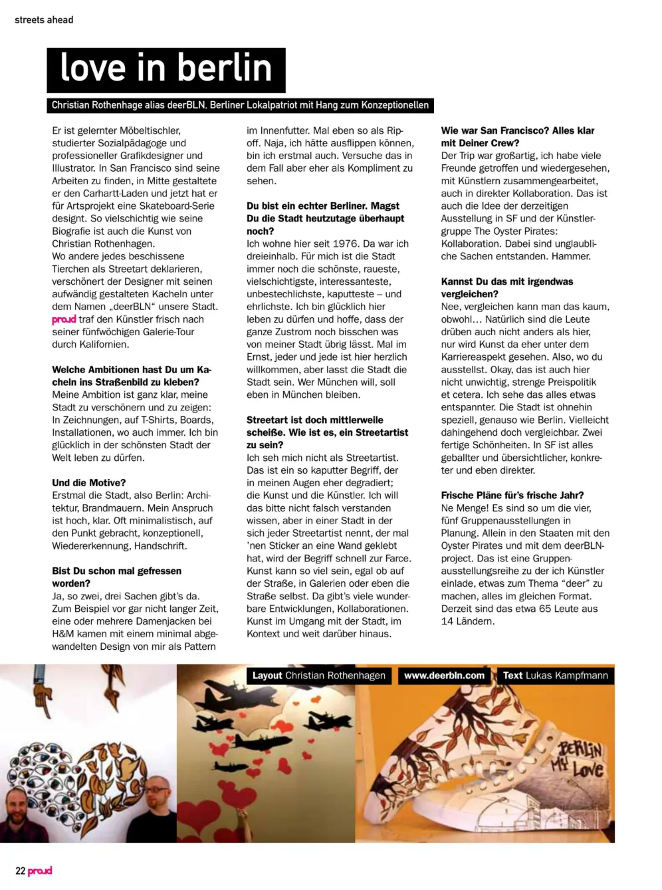
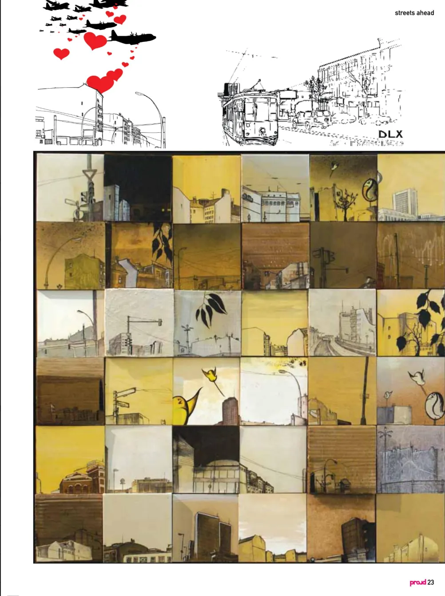

Er ist gelernter Tischler, ausgebildeter Sozialpädagoge und professioneller Grafikdesigner und Illustrator. Christian Rothenhagen, auch bekannt als deerBLN, ist ein Berlin-Patriot mit konzeptuellem Flair. proud magazine trifft den Künstler, um über seine Liebe zur Stadt, seine kreativen Ambitionen und darüber zu sprechen, was es bedeutet, ein echter Berliner zu sein.

## Tiles on the streets

proud: Was ist deine Ambition dahinter, Fliesen auf die Straßen der Stadt zu bringen?

deerBLN: Meine Ambition ist klar: meine Stadt zu verschönern und mich auszudrücken. In Zeichnungen, auf T-Shirts, auf Skateboards, in Installationen, wo auch immer. Ich bin glücklich, in der schönsten Stadt der Welt zu leben. Ich sehe mich als modernen Heimatforscher. Ich dokumentiere die Stadt durch meine Zeichnungen und gebe ihr durch meine Arbeit im öffentlichen Raum etwas zurück. Meine „Street Art“ ist größtenteils nicht illegal, sondern eher geduldete Eingriffe in die Stadtlandschaft. Sie ist ein Ausdruck meiner Liebe zu dieser Stadt.

## Still in love with Berlin

proud: Du bist ein echter Berliner. Magst du die Stadt heutzutage überhaupt noch?

deerBLN: Ich lebe hier seit 1976. Für mich ist die Stadt immer noch die schönste, die raueste, die vielfältigste, die interessanteste, die unbestechlichste, die kaputteste und die ehrlichste. Sie ist die Stadt, die dich nicht anlügt. Sie trägt ihre Narben offen, zeigt ihre Wunden und ist so direkt wie ein Schlag in die Magengrube. Aber sie ist auch die Stadt, die dich immer auffangen wird. Ich liebe Berlin, jetzt mehr als je zuvor!

## Skateboards and what's next

proud: Du hast gerade eine Skateboard-Serie für Artsprojekt designt. Bist du Skater?

deerBLN: Ich bin früher viel gefahren, aber ich war nicht besonders gut. Ich habe Mitte der 80er auf einem dieser Plastikboards vom Kaufhaus angefangen. Mit 15 habe ich mir mein erstes richtiges Board gekauft, ein Santa Cruz mit Independent-Achsen und OJ II-Rollen. Ein Klassiker! Dieses Board war mein ganzer Stolz und mein Ticket in eine Welt, die mich bis heute geprägt hat: Skateboarding, Punkrock und Hardcore. Die DIY-Ethik dieser Szene hat meine Arbeit von Anfang an beeinflusst. Deshalb ist es eine riesige Ehre für mich, jetzt eine Board-Serie zu designen. Ein Kindheitstraum, der wahr wird.

proud: Woran arbeitest du gerade?

deerBLN: Im Moment entwickle ich eine T-Shirt-Serie für ein Berliner Streetwear-Label und arbeite an ein paar Poster-Designs. Außerdem bereite ich meine nächste Einzelausstellung vor, die im Frühjahr 2009 in Friedrichshain stattfinden wird. Und daneben zeichne ich immer... meine Stadt... Berlin!

