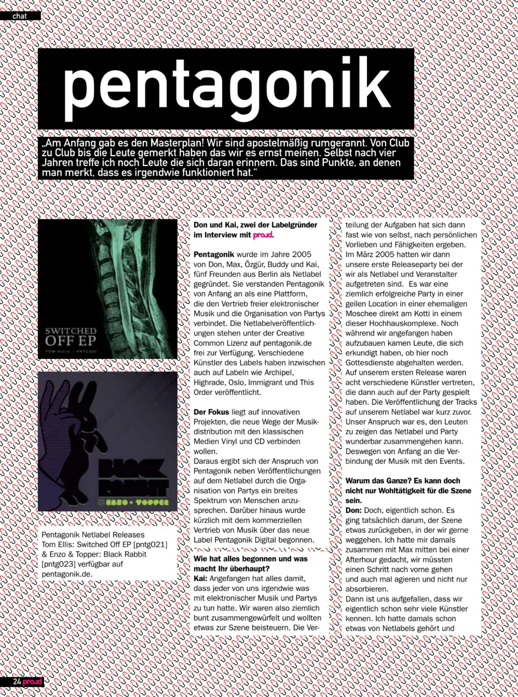
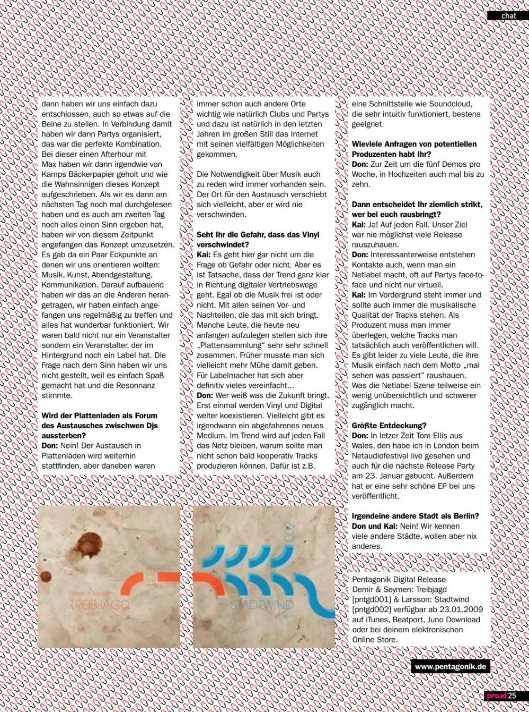

Das proud Magazin hat sich mit Don und Kai getroffen, zwei der Gründer von Pentagonik, dem Netlabel und der Veranstaltungsreihe aus Berlin, und hat mit ihnen darüber gesprochen, wie alles anfing, woran sie glauben und wie es um die Zukunft der Musik steht.

## Wie Pentagonik anfing

proud: Wie hat das Ganze angefangen und was macht ihr eigentlich?

Kai: Es fing damit an, dass jeder von uns irgendwie eine Verbindung zu elektronischer Musik und Partys hatte. Wir waren also eine ziemlich bunt gemischte Gruppe und wollten etwas zur Szene beitragen. Die Rollen haben sich fast von selbst verteilt, je nachdem, was jeder gerne machte und konnte. Im März 2005 hatten wir unsere erste Release-Party, bei der wir uns als Netlabel und Veranstalter vorgestellt haben. Es war eine sehr erfolgreiche Party in einer fantastischen Location, einer ehemaligen Moschee direkt am Kottbusser Tor in einem dieser Hochhauskomplexe. Schon beim Aufbau kamen Leute vorbei und fragten, ob hier noch Gottesdienste stattfinden würden. Auf unserem ersten Release waren acht verschiedene Künstler vertreten, die auch auf der Party aufgetreten sind. Die Tracks waren kurz zuvor auf unserem Netlabel erschienen. Unser Ziel war es, den Leuten zu zeigen, dass ein Netlabel und eine Party wunderbar zusammen funktionieren können, weshalb wir die Musik von Anfang an mit den Events verknüpft haben.

proud: Warum macht ihr das alles? Das kann doch nicht nur für die Szene sein.

Don: Doch, genau darum geht es. Es ging wirklich darum, der Szene, in der wir gerne sind, etwas zurückzugeben. Ich war auf einer Afterhour mit Max und dachte, wir müssten aktiver werden und nicht nur konsumieren. Uns wurde klar, dass wir schon viele Künstler kannten. Ich hatte von Netlabels gehört und wir haben einfach beschlossen, selbst eins zu gründen. In dem Zusammenhang haben wir Partys organisiert, was die perfekte Kombination war. Während dieser Afterhour haben Max und ich uns Papier von einer Bäckerei besorgt und wie verrückt das Konzept aufgeschrieben. Als wir es am nächsten Tag gelesen haben und es immer noch Sinn ergab, haben wir angefangen, es umzusetzen. Wir hatten ein paar Kernpunkte: Musik, Kunst, Eventgestaltung und Kommunikation. Darauf haben wir aufgebaut, uns regelmäßig mit den anderen getroffen und alles lief wunderbar. Wir waren nicht mehr nur ein Veranstalter, sondern ein Veranstalter mit einem Label im Rücken. Wir haben den Sinn nie hinterfragt, weil es Spaß gemacht hat und das Feedback großartig war.

## Plattenläden, Vinyl und Digital

proud: Wird der Plattenladen als Ort, an dem sich DJs austauschen, irgendwann aussterben?

Don: Nein! Der Austausch in Plattenläden wird weitergehen. Aber auch andere Orte waren schon immer wichtig, wie Clubs und Partys, und in den letzten Jahren ist das Internet mit seinen riesigen Möglichkeiten zu einem großen Faktor geworden. Das Bedürfnis, über Musik zu diskutieren, wird es immer geben. Der Ort für diesen Austausch mag sich verschieben, aber er wird niemals verschwinden.

proud: Siehst du die Gefahr, dass Vinyl verschwindet?

Kai: Es ist nicht wirklich eine Frage von Gefahr oder nicht. Aber es ist Fakt, dass der Trend klar in Richtung digitaler Vertrieb geht, egal ob die Musik kostenlos ist oder nicht, mit all den Vor- und Nachteilen, die das mit sich bringt. Manche Leute, die heute mit dem Auflegen anfangen, bauen sich ihre "Plattensammlung" sehr schnell auf. Früher musste man sich vielleicht mehr anstrengen. Aber für Labelbesitzer ist vieles sicherlich einfacher geworden...

Don: Wer weiß, was die Zukunft bringt. Vorerst werden Vinyl und Digital weiterhin nebeneinander existieren. Vielleicht gibt es eines Tages ein wildes neues Medium. Das Internet wird definitiv ein Trend bleiben; warum sollte es nicht bald möglich sein, Tracks gemeinsam zu produzieren? Eine Oberfläche wie Soundcloud, die sehr intuitiv ist, eignet sich dafür perfekt.

## Demos und wer veröffentlicht wird

proud: Wie viele Anfragen bekommt ihr von potenziellen Produzenten?

Don: Zurzeit etwa fünf Demos pro Woche, in Spitzenzeiten bis zu zehn.

proud: Ihr seid also ziemlich streng, wen ihr veröffentlicht?

Kai: Ja, absolut. Unser Ziel war es nie, so viele Releases wie möglich rauszuhauen.

Don: Interessanterweise entstehen Kontakte, selbst wenn man ein Netlabel betreibt, oft von Angesicht zu Angesicht auf Partys und nicht nur virtuell.

Kai: Der Fokus liegt immer und sollte immer auf der musikalischen Qualität der Tracks liegen. Als Produzent muss man sich immer überlegen, welche Tracks man wirklich veröffentlichen will. Leider gibt es zu viele Leute, die ihre Musik einfach mit einer "mal sehen was passiert"-Einstellung rauswerfen. Das kann die Netlabel-Szene etwas überwältigend und schwerer zu durchblicken machen.

## Entdeckungen und Berlin

proud: Eure größte Entdeckung?

Don: Kürzlich Tom Ellis aus Wales. Ich habe ihn live auf dem Netaudio Festival in London gesehen und ihn für unsere nächste Release-Party am 23. Januar gebucht. Er hat auch eine sehr schöne EP bei uns veröffentlicht.

proud: Irgendeine andere Stadt außer Berlin?

Don und Kai: Nein! Wir kennen viele andere Städte, aber wir wollen nichts anderes.

[proud.de](http://www.proud.de)

