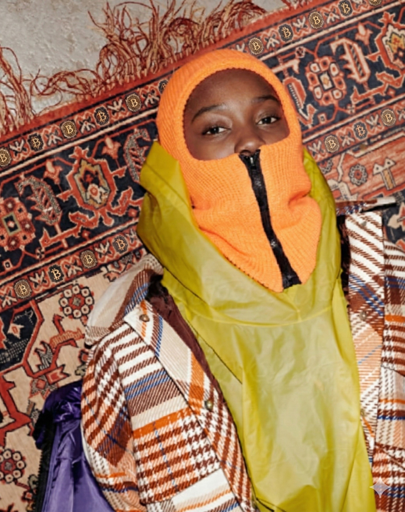

Ich sollte ein Bild bearbeiten, also habe ich das Originalfoto von dem Mädchen mit Balaclava und Teppich genommen. Zuerst habe ich die orangefarbene Strick-Balaclava in ein tiefes Gold geändert. Dann habe ich große goldene Bitcoin-Logos auf die gelbe Jacke gesetzt und die Logos, die schon auf dem Teppich waren, vergrößert, damit man sie besser sieht. Das fertige Bild zeigt all diese Änderungen.

