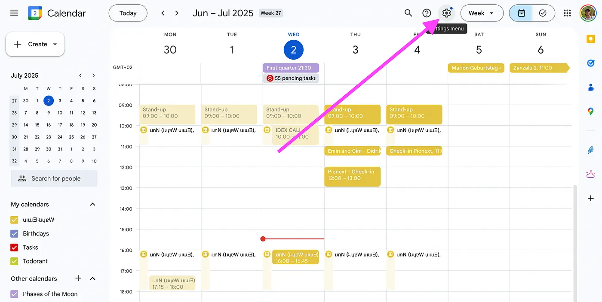
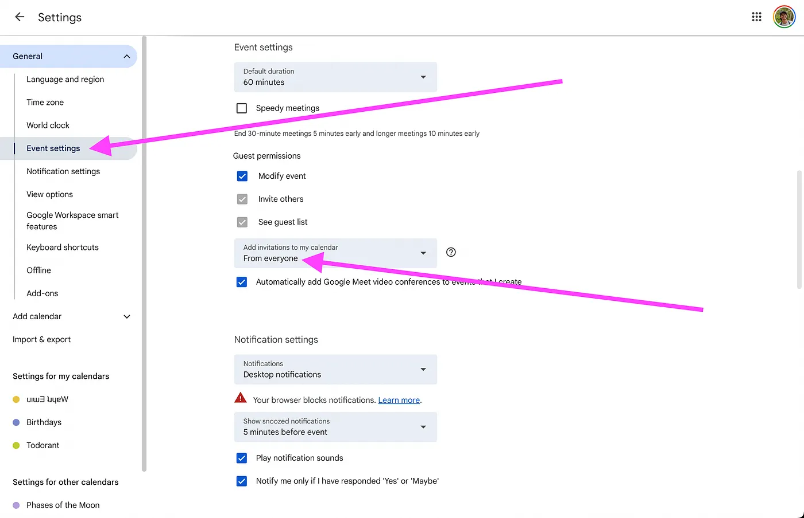
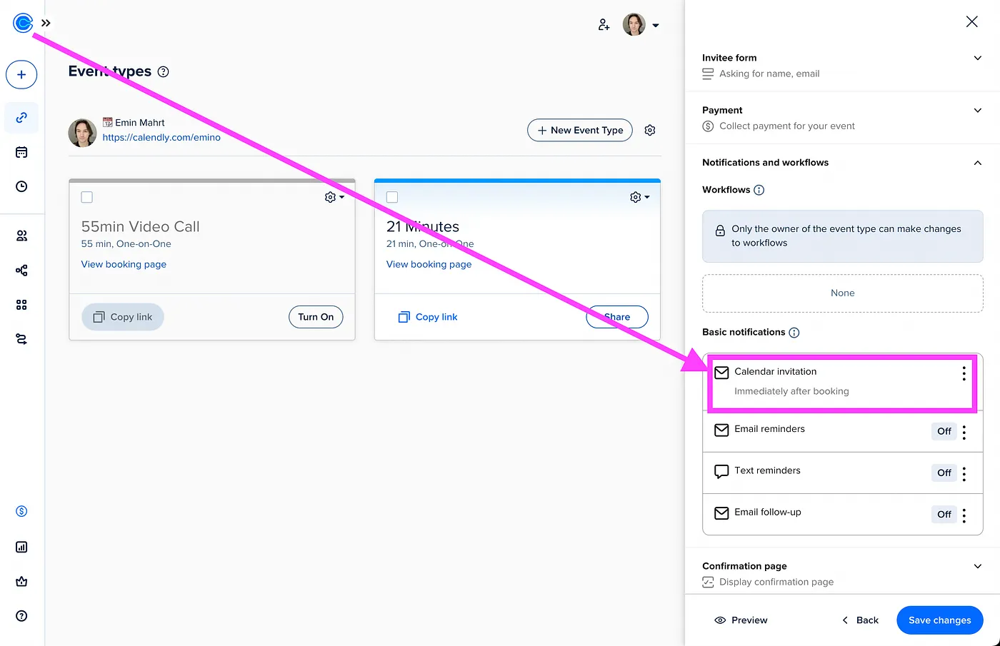

Du hast über den Calendly-Link von jemandem ein Meeting gebucht, und die Einladung taucht einfach nicht in deinem Google Kalender auf. Das passiert öfter. Es kann eine simple Einstellung sein, oder es liegt an Änderungen, wie Google Einladungen aus anderen Apps behandelt. So findest du heraus, was es ist, und behebst es.

## Die Google-Kalender-Einstellung reparieren

*Geh in die Google Kalender-Einstellungen im Web.*

Meistens ist es eine Einstellung in deinem eigenen Google Kalender, die Spam-Einladungen stoppen soll. Standardmäßig fügt Google oft nur Einladungen von Leuten hinzu, die du kennst.

*Geh zu den Termineinstellungen und aktiviere "Einladungen von allen"*

1. Öffne Google Kalender in einem Webbrowser, nicht in der App.
1. Klick oben rechts auf das Zahnrad-Icon für das Einstellungsmenü und wähl Einstellungen.
1. Geh im Menü links zu den Termineinstellungen.
1. Unter "Einladungen zu meinem Kalender hinzufügen" gibt es ein Dropdown. Ändere es von "Nur wenn der Absender bekannt ist" auf "Von allen".

Danach werden alle Einladungen automatisch zu deinem Kalender hinzugefügt, auch die, die von Calendlys Benachrichtigungssystem kommen.

## E-Mail-Bestätigung oder Kalendereinladung

Die Person, deren Calendly-Link du benutzt hast, kann entweder eine "E-Mail-Bestätigung" oder eine "Kalendereinladung" schicken.

Eine E-Mail-Bestätigung ist einfach eine E-Mail mit den Meeting-Details. Vielleicht ist eine ".ics"-Datei angehängt, die du selbst anklicken musst, um das Meeting zu deinem Kalender hinzuzufügen. Eine Kalendereinladung ist eine echte Termineinladung, die dein Kalender, wie Google Kalender, lesen und selbst hinzufügen kann.

Wenn das Meeting nie automatisch hinzugefügt wird, hat der Gastgeber seinen Calendly-Termintyp wahrscheinlich auf "E-Mail-Bestätigung" eingestellt. Das kannst du auf deiner Seite nicht ändern, aber du kannst den Termin trotzdem selbst aus der Bestätigungs-E-Mail hinzufügen.

## Wenn du selbst Calendly-Links verschickst

Wenn du derjenige bist, der selbst Calendly-Links verschickt, und die Leute, die bei dir buchen, dieses Problem haben, check deine Termineinstellungen in Calendly.

*Es funktioniert nur, wenn du Kalendereinladungen aktiviert hast, nicht E-Mail-Erinnerungen.*

1. Log dich in deinen Calendly-Account ein.
1. Geh zu dem Termintyp, der das Problem hat.
1. Stell unter "Benachrichtigungen" oder einem ähnlichen Bereich sicher, dass du "Kalendereinladungen" gewählt hast und nicht "E-Mail-Bestätigungen".

## Warum Google strenger geworden ist

Google hat seine Spam-Regeln für Google Kalender verschärft, und das ändert manchmal, wie Einladungen aus anderen Apps wie Calendly behandelt werden. Für dich als Nutzer ist die Lösung immer noch die Google-Kalender-Einstellung aus dem ersten Schritt. Wenn du Einladungen von allen erlaubst, sagst du Google, dass es diesen Terminen vertrauen soll.

Wenn du diese Schritte durchgehst, sollten deine Calendly-Einladungen wieder in Google Kalender auftauchen, und du verpasst keine Meetings mehr.
