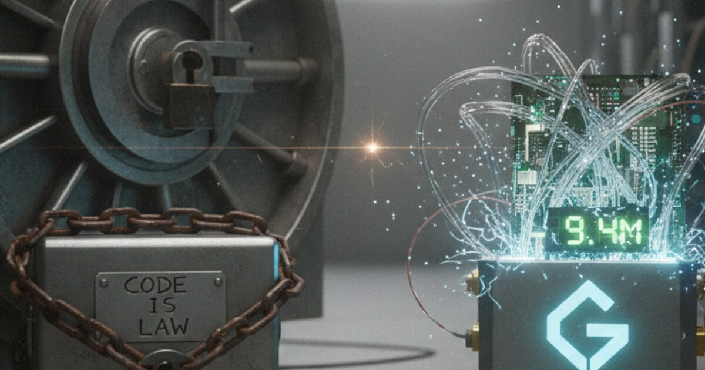

Im Dezember 2025 hat die Gnosis Chain einen umstrittenen Hard Fork durchgeführt, um 9,4 Millionen Dollar zurückzuholen, die beim Balancer-Hack gestohlen wurden. Der Streit lief zwischen den Pragmatikern, denen es vor allem um die Entschädigung der Opfer und um Massenadoption geht, und den Puristen, die fürchten, dass die Chain ihre glaubwürdige Neutralität und Zensurresistenz verliert.

Die Chain hat das Geld des Hackers zurückbekommen, aber der Prozess hat die DAO-Abstimmung übersprungen. Das zeigt: In der Krise schlägt technische Governance gerade die Community-Governance. Ein neues Interventions-Framework wird gerade entworfen, damit zukünftige Entscheidungen weniger willkürlich sind.

## Was passiert ist

Ende 2025 wurde das Balancer-Protokoll von einem globalen Exploit getroffen. Der Hack betraf mehrere Chains, und 9,4 Millionen Dollar davon wurden auf der Gnosis Chain gestohlen.

Ethereum hat nur einmal geforkt, beim großen DAO-Hack, und andere L1s bleiben vielleicht einfach passiv. Die Validatoren der Gnosis Chain sind eingeschritten, in zwei Schritten.

Schritt 1 war ein Soft Fork. Die Validatoren haben ihre Clients aktualisiert, um die Adresse des Hackers zu zensieren, und das hat die Gelder eingefroren.

Schritt 2 war ein Hard Fork. Eine Zustandsänderung hat die eingefrorenen Gelder zwangsweise in ein DAO-kontrolliertes Multisig verschoben, damit sie zurück zu den Opfern können.

Das hat eine heftige Debatte im Gnosis Forum über die Seele der Chain ausgelöst.

## Die Pragmatiker

Die Pragmatiker haben vier Argumente. Das erste ist Verantwortung als Neofinance. Wenn Gnosis eine Layer für Real-World-Assets und Payments sein will, kann es keinen Diebstahl stehen lassen, wenn es einen technischen Fix gibt. 9,4 Millionen in einer eingefrorenen Wallet zu lassen hilft niemandem.

Das zweite ist, dass die Neutralität schon versenkt war. Die Neutralität der Chain war technisch gebrochen, sobald die Validatoren dem Soft Fork zugestimmt und die Gelder eingefroren haben. Nein zu dem Hard Fork zu sagen, der sie zurückgibt, wäre Show, nicht Prinzip.

Das dritte ist Abschreckung. Den Hack rückgängig zu machen funktioniert wie ein Security-Feature. Es sagt zukünftigen Angreifern, dass die Gnosis Chain kein leichtes Ziel ist, wo sich Diebstahl lohnt.

Das vierte ist Konsens-Realität. Code is law wird ersetzt durch Konsens is law. Wenn die meisten Validatoren zustimmen, den Patch zu fahren, ist das der legitime Zustand der Chain.

## Die Puristen

Die Puristen sehen das anders. Erstens frisst es die glaubwürdige Neutralität auf. Kritiker warnen, dass das einen gefährlichen Präzedenzfall setzt. Wenn Validatoren sich koordinieren können, um die Gelder eines Hackers zu beschlagnahmen, könnten Regierungen sie theoretisch zwingen, die Gelder von jedem zu beschlagnahmen.

Zweitens, Moral Hazard. Wenn Protokolle glauben, dass der Layer-1 sie raushaut, geben sie vielleicht weniger für Security-Audits aus. Die Haftung wandert von den App-Entwicklern zu den Netzwerk-Validatoren.

Drittens, willkürliche Gerechtigkeit. Die Community hat auf die Inkonsistenz gezeigt. Bei einem früheren Vorfall, dem sDAI-EURe-Pool-Leak, haben User Gelder wegen einer Schwachstelle verloren und keinen Bailout bekommen. Warum war der 9,4-Millionen-Balancer-Hack einen Fork wert und kleinere Verluste nicht?

Viertens, rechtliche Haftung. Indem sie eingreifen, werden Validatoren von neutralen Infrastruktur-Anbietern zu aktiven Entscheidern, und das kann ihre rechtliche Angriffsfläche erhöhen.

## Wer hat eigentlich entschieden

Also, wer hat eigentlich entschieden? Der Vorfall hat eine Technokratie unter der Demokratie gezeigt.

Das Gnosis-Core-Team hatte den meisten Einfluss. Sie haben die Hard-Fork-Binaries vorbereitet und allein entschieden, eine formelle DAO-Abstimmung zu überspringen, weil die Zeit knapp war und die Feiertage kamen. Ein Core-Mitglied gab zu: „Ich habe einfach vergessen, dass ich gesagt habe [dass es eine Abstimmung geben würde]."

Client-Entwickler, die Teams, die Validator-Software wie Lodestar und Nethermind betreiben, haben zensierende Images an Validatoren verteilt, manchmal über private Kanäle. Diese Hinterzimmer-Koordination ging an der üblichen Open-Source-Transparenz vorbei.

Die DAO hatte fast keinen Einfluss. Validatoren haben ihre Nodes aktualisiert und so die Entscheidung ausgeführt, bevor eine Token-Holder-Abstimmung stattfinden konnte.

Wie ein Forum-Mitglied sagte: „DAOs haben hier kein Mitspracherecht... alles andere ist nur Theater."

## Was als Nächstes kommt

Der Hard Fork ist durch und die Gelder sitzen in einem Gnosis-DAO-Multisig. Um den Vertrauensschaden zu reparieren und auf die Bedenken wegen willkürlicher Gerechtigkeit zu antworten, entwirft die Community jetzt ein Crisis Intervention Framework.

Es schlägt ein Scoring-System für Bailouts vor, und zukünftige Interventionen müssen vielleicht strikte Schwellen erfüllen.

Beim Impact muss der Diebstahl mehr als 1% der Chain-TVL sein. Beim Protokoll-Status bekommen Blue-Chip-Protokolle, also auditiert und mit langer Historie, Vorrang vor experimentellem Code. Bei der User-Basis zählen Hacks, die Retail- und Mainstream-User treffen, mehr als Degen-Strategien.

Wenn du mehr lesen willst, die Original-Diskussion ist auf [Gnosis Forum: Balancer Hack Hard Fork Debate](#), der Balancer-Vorfallbericht ist auf [Balancer Security Updates](#), und Gnosis DAO Governance ist auf [Gnosis Snapshot & Forum](#).
