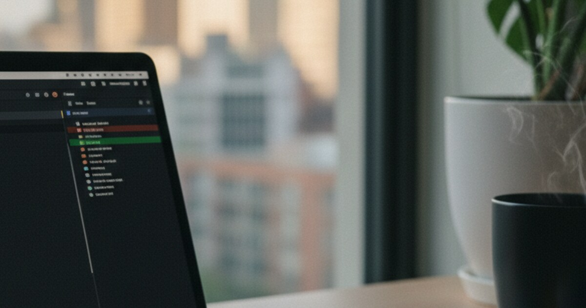

Das ist die komplette Schritt-für-Schritt-Anleitung, um einen neuen iOS-Entwickler mit EAS Build einzurichten. Du brauchst dafür keinen Mac. Alles läuft auf Windows oder Linux über den EAS Build Cloud Service.

Bevor ihr anfangt, tauscht ihr ein paar Dinge aus. Der Entwickler braucht von dir die Repository-URL, den Projektnamen, welchen Branch er nutzen soll und alle ENV-Variablen oder Secrets. Du brauchst seine E-Mail-Adresse, die UDID seines iPhones und eine kurze Nachricht, sobald er die Einladungen angenommen hat. EAS kümmert sich dann automatisch um alle Zertifikate, Provisioning Profiles, das Code Signing und die Bundle-ID-Konfiguration.

## Was du zuerst machst, als Company-Admin

1. Füge den Entwickler zum Apple Developer Account hinzu. Geh auf https://developer.apple.com, klick auf „Users and Access", klick auf den „+"-Button, gib die E-Mail des Entwicklers ein, wähl die Rolle „Admin" oder „Developer" und klick auf „Invite".
2. Füge ihn zu App Store Connect hinzu. Geh auf https://appstoreconnect.apple.com/access/users, klick auf „+", gib dieselbe E-Mail ein, wähl die passende Rolle (Developer, Admin oder App Manager) und klick auf „Invite".
3. Füge ihn zur Expo-Organisation hinzu. Geh auf https://expo.dev, öffne Settings → Members, klick auf „Invite Member", gib seine E-Mail ein, wähl „Developer" oder „Admin" und schick die Einladung ab.
4. Besorg dir die UDID von seinem Gerät. Sag ihm, er soll zu Settings → General → About gehen und auf „Serial Number" tippen und halten, bis „UDID" auftaucht, und dir dann diesen String schicken.
5. Registriere das Gerät im Apple Developer Portal. Geh auf https://developer.apple.com, öffne „Devices", klick auf „+", gib einen Namen ein (z. B. „Johns iPhone 14"), gib die UDID ein und speichere.
6. Gib ihm Zugriff aufs Repository. Füge ihn auf GitHub, GitLab oder Bitbucket hinzu, gib ihm die richtigen Berechtigungen und schick ihm die Repository-URL.

## Was der Entwickler macht

7. Nimm die Apple Developer Einladung an. Sie kommt per E-Mail. Klick auf den Link, melde dich mit einer persönlichen Apple-ID an (oder erstelle eine) und akzeptiere die Terms and Conditions.
8. Nimm die App Store Connect Einladung genauso an, mit derselben Apple-ID, und akzeptiere die Terms.
9. Erstelle einen Expo-Account. Geh auf https://expo.dev, melde dich mit derselben E-Mail an, verifiziere sie und nimm die Organisations-Einladung aus der E-Mail an.
10. Richte deinen Computer ein. Installiere Node.js (v16 oder höher), Git und VS Code oder einen Editor deiner Wahl, und öffne ein Terminal.
11. Installiere die CLI-Tools.
```bash
npm install -g expo-cli
npm install -g eas-cli
```

12. Logge dich bei Expo und EAS mit deinem eigenen Expo-Account ein, nicht mit dem der Firma.
```bash
eas login
# Enter personal Expo credentials (not company's)
```

13. Klone das Projekt und installiere die Abhängigkeiten.
```bash
git clone [repository-url]
cd [project-name]
npm install
```

## Der erste Development Build

14. Check, ob eas.json vorhanden ist und ein Development-Profil hat.
```bash
# Check that eas.json exists and has development profile
cat eas.json
```

15. Starte den Development Build.
```bash
eas build --profile development --platform ios
```
EAS nutzt einfach die gespeicherten Credentials der Firma. Der Build dauert 10–20 Minuten und taucht dann im Expo Dashboard auf.

## Auf dem iPhone

16. Schalte den Developer Mode ein (iOS 16+). Den findest du unter Settings → Privacy & Security, aber „Developer Mode" taucht dort erst auf, nachdem Schritt 17 einmal fehlgeschlagen ist. Schalte ihn ein, das Handy startet neu, dann bestätige „Turn On Developer Mode" und gib deinen Passcode ein.
17. Installiere den Build. Öffne das EAS Dashboard in Safari auf dem iPhone oder nutze den direkten Link, den dir das Terminal gibt, wenn der Build fertig ist, und tippe auf „Install". Wenn der Developer Mode noch nicht an ist, schlägt das fehl, also zurück zu Schritt 16.
18. Vertraue dem Entwicklerzertifikat. Geh zu Settings → General → VPN & Device Management, finde das Profil unter „Developer App", tippe auf das Profil mit dem Firmennamen, tippe auf „Trust [Company Name]" und bestätige.
19. Öffne die App. Das Icon ist jetzt auf dem Homescreen, tippe drauf und sie sollte einfach laufen.

## Jeden Tag danach

20. Starte den Development Server.
```bash
# In project directory
npx expo start --dev-client
```

21. Verbinde das Handy. iPhone und Computer müssen im selben WLAN sein. Öffne die installierte App, sie verbindet sich mit dem Metro Bundler, und du siehst deine Änderungen live, während du codest.
22. Erstelle neue Builds, wenn du sie brauchst.
```bash
# Development build (for testing)
eas build --profile development --platform ios

# Preview build (for internal testing)
eas build --profile preview --platform ios

# Production build (for App Store)
eas build --profile production --platform ios
```

23. Schick es zu TestFlight.
```bash
# After production build completes
eas submit -p ios
```

## Wenn was schiefgeht

24. Wenn sich der Build nicht installieren lässt, check, ob die UDID im Apple Developer Portal registriert ist, ob der Developer Mode an ist und ob das Device Management Trust gesetzt ist, und baue neu mit dem `--clear-cache` Flag.
25. Wenn du nicht ins Expo-Projekt reinkommst, check, ob du im richtigen Expo-Account eingeloggt bist und ob die Organisations-Einladung angenommen wurde, und führe `eas whoami` aus, um zu sehen, wer du bist.
26. Wenn der Build fehlschlägt, check, ob der Apple Developer Zugang noch aktiv ist, schau dir eas.json nochmal an, check, ob die Bundle-ID zu den Apple-Einstellungen passt, und lies die Build-Logs im EAS Dashboard.
