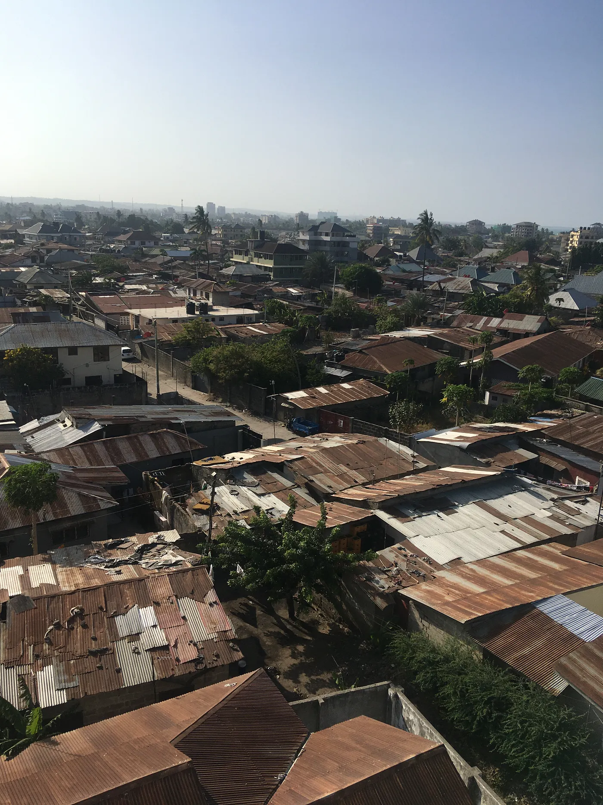

## Eine Stadt, die 5 % pro Jahr wächst

Dar es Salaam hat etwa 8 Millionen Einwohner (2024). 1950 waren es noch ungefähr 84.000, also fast eine Verhundertfachung. Es ist eine der am schnellsten wachsenden Städte, auf Platz 3 in Afrika und Platz 9 weltweit, und wächst jedes Jahr um etwa 5 %. Die Prognosen sagen ungefähr 13,4 Millionen bis 2035 und 76 Millionen bis 2100. Das würde sie bis dahin vielleicht zur zweitgrößten Stadt der Welt machen.

Sie ist das wirtschaftliche Zentrum Tansanias und hat das höchste regionale BIP des Landes, etwa 25,3 Billionen TZS im Jahr 2020, also rund 11 Milliarden Dollar. Das BIP des ganzen Landes liegt bei etwa 78 Milliarden Dollar, Dar allein macht also einen großen Teil davon aus. Die wichtigsten Bereiche hier sind Hafenlogistik, Produktion und Dienstleistungen. Der Hafen von Dar es Salaam wickelt etwa 90 % des internationalen Handels Tansanias ab und versorgt außerdem 6 Binnenstaaten, und genau deshalb ist die Stadt so wichtig für Ostafrika.

## Verkehr, Wasser und Strom

Die Infrastruktur kommt kaum hinterher. Der Verkehr ist wirklich katastrophal, die Leute verlieren jeden Tag etwa 2,5 Stunden im Stau. Nur ungefähr 30 % der Haushalte haben direkten Anschluss an die Wasserleitung, und etwa 85 % der Menschen in Dar bekommen Strom, was weit über dem Landesdurchschnitt liegt, aber der Strom fällt trotzdem ständig aus. 2016 hat die Stadt das erste BRT-System Ostafrikas eröffnet. Es transportiert inzwischen etwa 200.000 Fahrgäste pro Tag und verkürzt eine Hin- und Rückfahrt auf dem Hauptkorridor um ungefähr 90 Minuten. Trotzdem hinken öffentlicher Nahverkehr und Versorgung anderen Großstädten dieser Größe hinterher, und das schnelle Wachstum setzt sie stark unter Druck.

## Überschwemmungen und Müll

Dann ist da noch die Umwelt. Dar wird oft überschwemmt. Die Fluten im April 2018 trafen schätzungsweise 0,9 bis 1,7 Millionen Menschen und kosteten 2–4 % des BIP der Stadt, also etwa 100 bis 230 Millionen Dollar. Müll ist ein weiteres großes Problem. Die Stadt produziert ungefähr 5.600 Tonnen Abfall pro Tag, und nur etwa 20 % davon werden abgeholt. Der Rest landet oft auf den Straßen, auf wilden Müllkippen, oder er wird einfach verbrannt. Auch die Luftverschmutzung steigt. Feinstaub (PM₂.₅) liegt im Durchschnitt bei etwa 15–16 µg/m³, das ist mehr als das 3-Fache des WHO-Richtwerts von 5 µg/m³, und das ist schlecht für die Gesundheit und für die Umwelt.

## Kriminalität

Etwa ein Viertel aller gemeldeten Straftaten in Tansania passiert in Dar es Salaam. Straßenkriminalität wie Überfälle, Taschendiebstahl, Autoaufbrüche und Einbrüche ist an der Tagesordnung. Aber die Gewaltkriminalität ist moderat. Tansanias Mordrate liegt bei etwa 4,7 pro 100.000 Einwohner, deutlich niedriger als in vielen großen afrikanischen Städten. Dars Kriminalitätsindex liegt bei ungefähr 58/100, was als moderat gilt, ungefähr auf dem Niveau von Nairobi und deutlich sicherer als Johannesburg, das bei etwa 80–90/100 liegt.

## Lebenshaltungskosten

Das Leben hier ist teuer im Vergleich zu dem, was die Leute verdienen. Eine Person braucht etwa 720 Dollar im Monat inklusive Miete, aber das mittlere Monatsgehalt liegt nur bei ungefähr 274 Dollar. Die Lebenshaltungskosten sind also etwa das 2,6-Fache dessen, was der Durchschnittsmensch verdient, und deshalb leben viele Menschen in informellen Unterkünften oder haben mehr als eine Einkommensquelle. Im Vergleich zu Nairobi ist Dar etwas günstiger, etwa 15–18 %, aber im Verhältnis zu den Löhnen ist es immer noch eine der teuersten Städte Ostafrikas.

## Was Dar besonders macht

Und ein paar Fakten, die Dar besonders machen. Die Stadt ist von einem kleinen Hafen mit etwa 84.000 Einwohnern im Jahr 1950 zur größten Stadt Ostafrikas von heute gewachsen. Sie ist nicht die Hauptstadt, das ist Dodoma, aber Dar ist immer noch mit Abstand die größte Stadt Tansanias, und Prognosen zufolge wird sie bis 2100 die zweitbevölkerungsreichste Stadt der Welt sein. Der Hafen ist ein echtes Tor zur Welt und wickelt 90 % des Handels des Landes ab. Es ist also eine der am schnellsten wachsenden Städte auf dem Planeten, mit viel wirtschaftlichem Gewicht in der Region.
