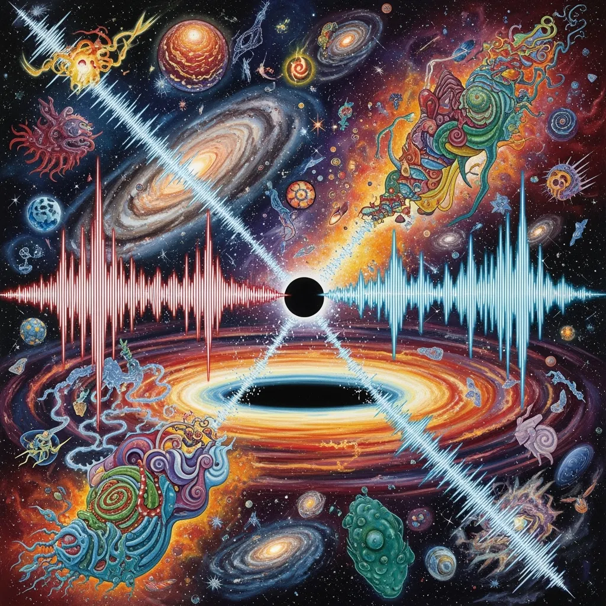

Meine Reise begann mit einer einfachen Frage. Könnten Schallwellen, oder irgendwelche Wellen wie elektromagnetische Wellen, die sich in Schall verwandeln, die fehlenden Informationen aus Schwarzen Löchern enthalten? Das war nicht nur Neugier. Das Informationsparadoxon Schwarzer Löcher beschäftigt die Physik seit Jahrzehnten, und ich fragte mich, ob wir vielleicht an den falschen Stellen gesucht haben.

Mein erster Gedanke war einfach. Wenn Information nicht zerstört werden kann, und die Quantenmechanik besteht darauf, dass sie es nicht kann, dann entkommt sie vielleicht in Formen, die wir noch nicht wirklich in Betracht gezogen haben. Schallwellen, elektromagnetische Strahlung, sogar die Quantenvibrationen der Raumzeit selbst. Könnten diese die Informationen tragen, die wir vermisst haben?

## Fragen, die sich vervielfachten

Und dann vervielfachten sich die Fragen. Könnte ich das zuerst mathematisch beweisen, bevor ich irgendein Experiment versuche? Was, wenn Schallwellen allein nicht ausreichen und wir elektromagnetische Wellen hinzufügen müssen, um das vollständige Bild zu bekommen? Könnten wir Tricks aus der Datenwiederherstellung ausleihen und Rekonstruktionsanleitungen in der Strahlung verstecken, die entkommt?

Was, wenn photonische und elektromagnetische Wellen Quantenfehlerkorrektureigenschaften teilen? Synthetische KI-generierte Daten können absichtlich Redundanz eingebaut haben, damit man sie identifizieren kann, und vielleicht nutzt die Natur dieselbe Art von Redundanz, um Informationen zu bewahren. Das brachte mich zum Nachdenken über Komprimierungsalgorithmen, die fehlerkorrigierende Redundanz enthalten. Über Fingerprinting-Algorithmen, die beweisen, dass zwei Datenstücke gleich sind, ohne alles wiederherzustellen. Und was, wenn wir nur beweisen müssen, dass *irgendeine* Information entkommen ist, nicht alle?

## Ein KI-Modell als digitales Schwarzes Loch

Dann wurde mir klar, dass ich kein echtes Schwarzes Loch brauche, um das zu testen. Was, wenn ich ein LLM oder ein anderes KI-Modell als digitales Schwarzes Loch verwende? Ich füttere Daten hinein, schaue mir an, was herauskommt, und teste, ob Informationen erhalten bleiben, ohne die Erde zu verlassen. Also wuchs mein Denken, um KI-generierten Sound und Soundmodelle als Testumgebungen einzubeziehen, die besten Fehlerkorrektur- und Fingerprinting-Methoden, die wir heute haben, und Werkzeuge, die beweisen können, wie Input und Output verbunden sind. Und diese Werkzeuge sind auch außerhalb der Physik nützlich, zum Beispiel um Urheberschaft oder geistiges Eigentum zu beweisen.

## Zwei Welten

Je mehr die Idee wuchs, desto mehr stand ich in zwei Welten. Eine ist das Physikproblem, und das Informationsparadoxon zu lösen ist immer noch die oberste Priorität. Die andere ist die praktische Seite, Werkzeuge für Kreative und Wissenschaftler zu bauen, damit sie beweisen können, dass eine Idee ihnen gehört.

## Teilübereinstimmungen und Beweise

Ich begann über Teilübereinstimmungen nachzudenken. Was, wenn wir eine 50% oder 75% Übereinstimmung mit etwas wie Blake3-Hashing erkennen können? Könnte Fehlerkorrektur diese Teilübereinstimmungen auf ein höheres Vertrauensniveau bringen?

Und das ließ mich einige grundlegende Annahmen hinterfragen. Warum wird ein mathematischer Beweis als gültiger angesehen als eine computergestützte Demonstration? Könnten wir bestehende analoge Beweise digital reproduzieren, mit neuen Methoden? Und wenn wir immer mehr Coding-LLMs verwenden, könnte ein privater Schlüssel, den jemand versehentlich eingefügt hat, rekonstruiert werden?

## Wo es endete

Also wurde aus einer Frage über Schallwellen und Schwarze Löcher jetzt ein Ansatz, der Wellenphysik (Schall und elektromagnetisch), Quantenfehlerkorrektur, Informationstheorie und Kryptographie, KI- und ML-Modelle als Labore und praktische Anwendungen für IP-Schutz zusammenbringt.

Was mir daran gefällt, ist, dass jede Frage mir neue Ideen gab, und jede Idee gab mir neue Fragen. Ich begann damit, mich zu fragen, ob Schall aus Schwarzen Löchern entkommen könnte, und jetzt habe ich einen Rahmen, der Informationserhaltung digital testen könnte, neue Werkzeuge bauen, um zu beweisen, wem Daten gehören, theoretische Physik mit praktischen Anwendungen verbinden, und vielleicht, nur vielleicht, das Informationsparadoxon Schwarzer Löcher aufbrechen.

## Was als Nächstes kommt

Von hier aus ist mein Plan, digitale Testumgebungen mit LLMs und Soundmodellen zu bauen und Fehlerkorrektur- und Fingerprinting-Algorithmen zu implementieren. Dann teste ich, wie gut partielle Informationen wiederhergestellt und verbessert werden können, und ich verwandle die funktionierenden computergestützten Ergebnisse zurück in mathematische Beweise. Und ich behalte das Informationsparadoxon als Nordstern, während ich die praktischen Werkzeuge baue.

Ich ging von einer einfachen Frage über Schallwellen zu einem ganzen Rahmenwerk zum Testen, ob Informationen erhalten bleiben, und es zeigt, wie weit Neugier einen bringen kann, wenn man verschiedene Felder mischt. Ich weiß noch nicht, ob das das Informationsparadoxon löst. Aber die Reise gab mir bereits Ideen, die Physik, Informatik und praktische Dinge verbinden, die Menschen nutzen können.
