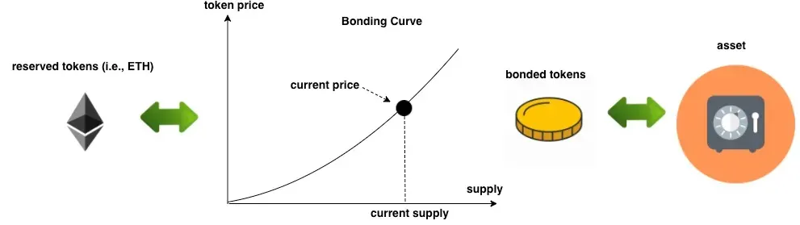

*via [https://blog.oceanprotocol.com/enabling-short-selling-in-bonding-curves-part-1-af871ad75d40](https://blog.oceanprotocol.com/enabling-short-selling-in-bonding-curves-part-1-af871ad75d40)*

Die Idee ist, das Finanzierungsproblem von Open-Source-Projekten mit einem Wirtschaftsmodell zu lösen, das sich selbst trägt, und das läuft über eine Token Bonding Curve. Jedes Mal, wenn jemand Tokens kauft oder verkauft, geht ein Teil der Transaktion an die Projekt-Maintainer, zum Beispiel 21%. So bekommen die Entwickler ein verlässliches Einkommen, und das wird direkt von der Community bezahlt. Frühe Unterstützer kaufen Tokens zu einem niedrigeren Preis, und das bringt dem Projekt das erste Geld. Wenn mehr Leute dazukommen, steigt der Preis, und das belohnt die frühen Unterstützer und finanziert das Projekt noch mehr.

Wenn du Tokens hältst, gibst du der Bonding Curve automatisch Liquidität. Du bekommst einen Anteil an den Transaction Fees, zum Beispiel 3%, und du musst selbst keinen Liquidity Pool verwalten. Es gibt keine Zwischenhändler, und du brauchst auch keine dezentrale Börse, kein DEX, weil die Bonding Curve selbst der Markt ist und immer Liquidität hat. Das Design der Curve bremst große Sell-offs, also hält es den Preis stabil und schützt das Projekt vor Whales und Pump and Dump.

Es gibt auch zwei Arten von NFTs. Ein Maintainer NFT beweist das offizielle Eigentum am Projekt, also können nur verifizierte Maintainer die Fees verdienen. Ein Supporter NFT gibt frühen Unterstützern einen dauerhaften Beweis, dass sie geholfen haben.

## Wie es die Open-Source-Finanzierung löst

Ich sehe vier Probleme, die das löst. Das erste ist das Einkommen. Open-Source-Maintainer leben heute meist von Spenden oder mal einem Sponsorship, und darauf kannst du dich nicht verlassen. Die Bonding Curve schafft kontinuierliche Finanzierung durch Transaction Fees. Jedes Mal, wenn jemand Tokens kauft oder verkauft, verdienen die Maintainer einen Prozentsatz, zum Beispiel 21%, und so ist das Einkommen vorhersehbar und wächst mit dem Projekt.

Das zweite Problem ist, dass traditionelle Finanzierung wie Grants und Spenden zentralisiert und begrenzt ist. Mit der Bonding Curve kann jeder einfach durch den Kauf von Tokens beitragen. Frühe Unterstützer bekommen Tokens zu einem niedrigeren Preis und spätere zahlen mehr, und das ist ein faires Modell, das auch skaliert.

Das dritte Problem ist Unterstützung über lange Zeit. Viele Open-Source-Projekte haben Mühe, Contributors und Unterstützer zu halten. Token-Holder verdienen passives Einkommen aus den Transaction Fees, also haben sie einen Grund, die Tokens zu halten und beim Projekt zu bleiben. Maintainer können auch Tools wie das Drips Network nutzen, um Einnahmen an Contributors weiterzugeben.

Das letzte Problem ist Vertrauen. Traditionelle Finanzierung ist oft nicht transparent, und deshalb vertrauen die Leute ihr nicht. Die Bonding Curve läuft komplett on-chain, also ist jede Transaktion und jede Fee-Verteilung öffentlich und jeder kann sie prüfen.

## Die Mathematik

Wenn du Tokens kaufst, mintest du sie. Du schickst ETH an den Contract, und der Contract berechnet, wie viele Tokens du bekommst, basierend auf dem aktuellen Supply. Wenn der Supply niedrig ist, bekommst du mehr Tokens für dein ETH, und wenn der Supply hoch ist, bekommst du weniger.

Wenn du Tokens verkaufst, burnst du sie. Du schickst die Tokens zurück an den Contract, und er berechnet, wie viel ETH du bekommst, wieder basierend auf dem aktuellen Supply. Wenn der Supply hoch ist, bekommst du weniger ETH pro Token, und wenn er niedrig ist, bekommst du mehr ETH pro Token.

Bei jeder Transaktion wird ein Prozentsatz als Fee genommen. Sagen wir, jemand kauft Tokens im Wert von 10 ETH. Dann gehen 21% an den Maintainer, das sind 2.1 ETH, 3% werden unter den Token-Holdern geteilt, das sind 0.3 ETH, und 1% geht an die Plattform, also 0.1 ETH. Die Holder bekommen ihren Teil des 3% Fee Pools, je nachdem, wie viel vom Gesamt-Supply sie besitzen. Wenn du 10% der Tokens besitzt, bekommst du 10% des 0.3 ETH Fee Pools.

## Warum das Geld weiter fließt

Frühe Unterstützer bringen das erste Geld, das ein Projekt braucht, um die Entwicklung in Gang zu bringen. Wenn das Projekt wächst, steigt der Token-Preis, und das belohnt die frühen Unterstützer und bringt mehr Supporter rein. Danach halten die Transaction Fees das Geld am Fließen, also können Maintainer am Projekt arbeiten und nicht am Fundraising. Token-Holder haben einen Grund, das Projekt lange zu unterstützen, und das baut eine starke Community, in der die Leute wirklich mitmachen. Und weil alles on-chain läuft, ist jede Transaktion und jede Fee-Verteilung offen, und du kannst sie prüfen.

Also gibt die Bonding Curve Open-Source-Projekten ein dezentrales Finanzierungsmodell, das jeder prüfen kann und das weiter zahlt. Es bringt Maintainer, Supporter und Token-Holder dazu, dasselbe zu wollen, und so löst es das Finanzierungsproblem und lässt das Projekt und seine Community wachsen.

Mehr Infos gibt es auf [paymentrequired.com](http://paymentrequired.com).
