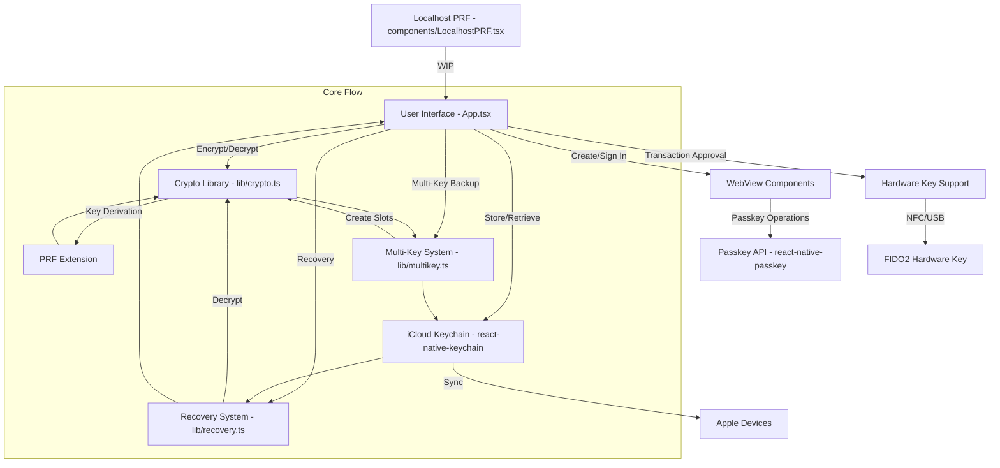

Das hier ist ein Blick auf den Code der Nuri Wallet, basierend auf der
README.md und der Hauptdatei App.tsx. Erst, was der Code macht, und
dann ein Mermaid-Diagramm der Architektur.

## Was die App macht

Nuri ist eine React Native Expo App, die auf passkey-basierter
Bitcoin-Seed-Verschlüsselung aufbaut. Sie nutzt WebAuthn Passkeys
mit der PRF-Erweiterung, PRF steht für Pseudo-Random Function, um
Bitcoin Seeds zu verschlüsseln, im iCloud Keychain zu speichern und
mit mehr als einem Passkey wiederherzustellen. Die App läuft auf
iOS 16+ Geräten mit Face ID oder Touch ID und aktiviertem iCloud
Keychain.

Du erstellst einen Passkey und meldest dich damit an, und die App
leitet daraus über PRF Verschlüsselungsschlüssel ab. Mit diesen
Schlüsseln verschlüsselt sie den Bitcoin Seed mit XChaCha20-Poly1305.
Ein Backup kann von mehreren Passkeys entschlüsselt werden, das ist
das Format Version 3. Die verschlüsselten Backups landen im iCloud
Keychain, mit einem Namespace pro Nutzer.

Es gibt auch Unterstützung für Hardware-Sicherheitsschlüssel wie
einen YubiKey, um Transaktionen freizugeben, aber iOS schränkt PRF
auf Hardware-Keys ein. Die Wiederherstellung funktioniert mit jedem
Passkey, der zum Backup gehört, oder mit Guardian-DEKs.

## Wie der Code organisiert ist

Im Root findest du die Config und die Einstiegspunkte, also `App.tsx`
mit der Haupt-UI und Logik, `index.js` als React Native Einstieg,
`package.json`, `tsconfig.json` und so weiter. Die zentralen
Utilities liegen in `lib/`. Dort übernimmt `crypto.ts` die
Schlüsselableitung mit HKDF-SHA256, die Verschlüsselung mit
XChaCha20-Poly1305 und die PRF-Normalisierung.

`multikey.ts` kümmert sich um Multi-Key-Backups mit Key-Slots für
weitere Passkeys, `recovery.ts` erkennt die Backup-Version und
stellt Seeds wieder her, und `inAppLocalhostServer.ts` ist wohl für
einen In-App-Server und noch WIP. In `components/` gibt es
`LocalhostPRF.tsx` für einen Localhost-PRF-Server, ebenfalls noch
Work in Progress.

Dann gibt es die WebView-Komponenten, `EmbeddedPRF.tsx` für
domain-gebundene Passkey-Authentifizierung und
`CreatePasskeyWebView.tsx` zum Erstellen neuer Passkeys. `docs/` hat
jede Menge Dokumentation und Server-Beispiele, etwa HTML-Dateien zum
Testen von PRF und der PWA. `scripts/` enthält Dinge wie
`guardian-server.mjs` für die Guardian-Features, und `assets/` hat
die App-Icons und Splash-Screens.

## App.tsx, Sicherheit und Abhängigkeiten

Das Herz der App ist `App.tsx`. Sie hält die UI und den
Wallet-State, also den State für PRF, den DEK (den Data Encryption
Key), Guardians, Hardware-Keys und Backups. Die UI führt dich durch
die Schritte. Passkey erstellen, anmelden, Seed verschlüsseln, in
iCloud speichern, Recovery-Keys hinzufügen und den Seed
wiederherstellen.

Passkey-Operationen laufen über WebViews, die domain-gebunden an
`passkey.nuri.com` sind. Hardware-Keys geben Transaktionen über NFC
oder USB frei. Der Recovery-Flow behandelt Single-Key-Backups (v1)
und Multi-Key-Backups (v3) und bittet dich, den Schlüssel
auszuwählen.

Zur Sicherheit: Die Verschlüsselung nutzt einen Master Key, der für
jeden Passkey in einen Slot verschlüsselt wird. Backups werden pro
Nutzer im iCloud Keychain mit eigenem Service-Namen gespeichert, zum
Beispiel `com.nuri.seed.backup.Alice`. Es gibt auch Grenzen. PRF ist
ans Gerät gebunden, also braucht die Wiederherstellung auf einem
anderen Gerät manuelles Teilen des DEK, und iOS schränkt PRF auf
Hardware-Keys ein.

Die wichtigsten Abhängigkeiten sind `react-native-passkey` für
WebAuthn, `react-native-keychain` für iCloud, `@noble/hashes` für
die Krypto-Primitive und andere wie `expo-random` und
`react-native-webview`. Das Ganze ist ein Proof of Concept mit
einigen WIP-Features, wie Localhost-PRF und Guardian-Recovery. Es
steht unter MIT-Lizenz und legt viel Wert auf Sicherheitshinweise.

## Das Architektur-Diagramm

Dieses Mermaid-Flowchart zeigt die High-Level-Architektur und den
Flow, also die Hauptteile und wie sie zusammenarbeiten, wenn du
verschlüsselst und wiederherstellst.

Es beginnt mit dem, was der Nutzer in der Haupt-App tut, zeigt dann
die Flows für Passkeys, Verschlüsselung, Backup und Recovery, und
auch die Verbindungen zu externen Systemen wie Hardware-Keys und
iCloud.

