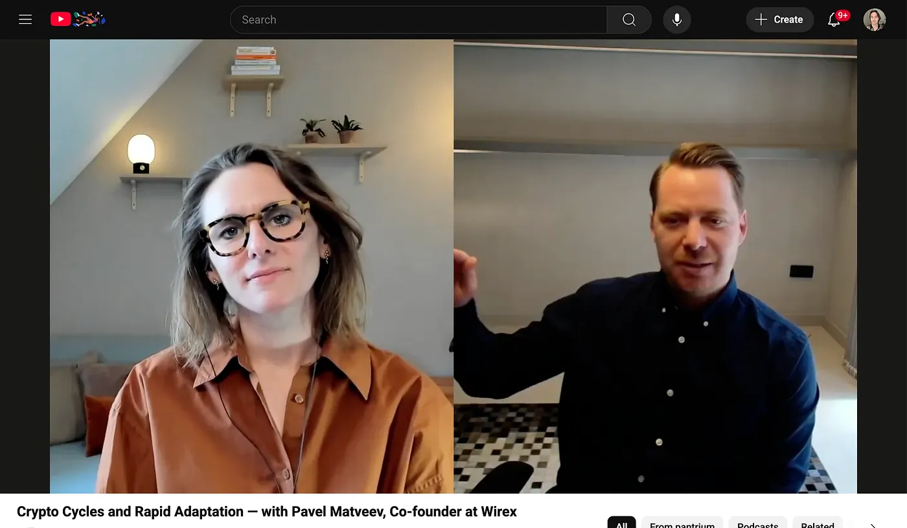

Eine Zusammenfassung eines Vortrags von Pavel Matveev, Mitgründer von Wirex. Jeder Punkt verlinkt auf die Stelle im Video, an der er das sagt.

## Die wichtigsten Empfehlungen

Seine wichtigsten Empfehlungen sind diese: Such dir einen Mentor und lerne von Leuten mit mehr Erfahrung, denn Gründer laufen oft in dieselben Probleme [00:00](http://www.youtube.com/watch?v=VyGUQ3QBsRQ&t=0). Sei vorsichtig beim Wachstum, stell nicht zu schnell Leute ein und expandiere nicht zu schnell, auch wenn der erste Erfolg da ist, denn das kann dir richtig wehtun [00:15](http://www.youtube.com/watch?v=VyGUQ3QBsRQ&t=15). Qualität und eine gute Unternehmenskultur gehen vor schnellem Skalieren [00:32](http://www.youtube.com/watch?v=VyGUQ3QBsRQ&t=32). Sieh jedes Problem als Chance, eine Lösung zu finden [00:46](http://www.youtube.com/watch?v=VyGUQ3QBsRQ&t=46). Verteile die Fokusbereiche auf die Mitgründer, so schaffst du mehr und streitest weniger [12:26](http://www.youtube.com/watch?v=VyGUQ3QBsRQ&t=746), und redet offen miteinander, damit ihr Probleme gemeinsam löst [11:12](http://www.youtube.com/watch?v=VyGUQ3QBsRQ&t=672). Ein Mitgründer mit technischem Hintergrund ist heute ein riesiger Vorteil [15:12](http://www.youtube.com/watch?v=VyGUQ3QBsRQ&t=912). Such nach Persönlichkeiten, die sich ergänzen, nicht nach zwei Leuten, die auf dieselbe Art führen wollen [16:00](http://www.youtube.com/watch?v=VyGUQ3QBsRQ&t=960). Stell sorgfältig ein, denn es geht um die Qualität der Leute, nicht um die Anzahl [25:19](http://www.youtube.com/watch?v=VyGUQ3QBsRQ&t=1519). Lass mehrere Leute aus deinem Team einen Kandidaten kennenlernen, dann siehst du besser, ob er passt [28:11](http://www.youtube.com/watch?v=VyGUQ3QBsRQ&t=1691). Schau über den Lebenslauf hinaus: auf Motivation, Begeisterung und wie gut jemand lernt, nicht nur auf Erfahrung [30:04](http://www.youtube.com/watch?v=VyGUQ3QBsRQ&t=1804). Und fang an, KI-Tools wie GPT zu nutzen, um zu verstehen, was sie können und wo sie in dein Business passen [38:13](http://www.youtube.com/watch?v=VyGUQ3QBsRQ&t=2293), und probier verschiedene KI-Modelle aus, um Aufgaben zu finden, die du automatisieren kannst, und Arbeit, die du schneller erledigen kannst [39:29](http://www.youtube.com/watch?v=VyGUQ3QBsRQ&t=2369).

## Wie Wirex in Japan groß wurde

Die spannende Geschichte im Vortrag ist, wie Wirex plötzlich in Japan groß wurde. Es fing mit einer unerwarteten E-Mail an, die sie zum ersten Fintech-Festival in Tokio einlud, Fininsome [02:46](http://www.youtube.com/watch?v=VyGUQ3QBsRQ&t=166). Sie waren ein auf UK fokussiertes Unternehmen und zuerst unsicher, ob sie hinfahren sollten [02:55](http://www.youtube.com/watch?v=VyGUQ3QBsRQ&t=175), aber die Organisatoren boten an, alle Kosten zu übernehmen, und sagten, es sei wirklich wichtig, dass sie kommen [03:10](http://www.youtube.com/watch?v=VyGUQ3QBsRQ&t=190). Auf dem Event trat Wirex bei einem Startup-Wettbewerb an und gewann den ersten Platz [03:49](http://www.youtube.com/watch?v=VyGUQ3QBsRQ&t=229). Das brachte sie enorm nach vorn. Sie bekamen Funding von einer strategischen Venture-Capital-Firma in Japan [04:07](http://www.youtube.com/watch?v=VyGUQ3QBsRQ&t=247), und Japan wurde damals Wirex' zweitgrößter Markt [04:16](http://www.youtube.com/watch?v=VyGUQ3QBsRQ&t=256). Die Organisatoren wollten unbedingt ausländische Firmen wie Wirex nach Japan holen [04:51](http://www.youtube.com/watch?v=VyGUQ3QBsRQ&t=291).

## Harte Lektionen und stressige Zeiten

Ein paar der härtesten Lektionen, die er gelernt hat: Der Weg als Gründer verläuft nicht geradlinig, und Erfolg hängt davon ab, wie du durch die harten Zeiten kommst [06:39](http://www.youtube.com/watch?v=VyGUQ3QBsRQ&t=399). Zu viele Leute einzustellen oder zu schnell zu expandieren kann einer Firma richtig wehtun [23:37](http://www.youtube.com/watch?v=VyGUQ3QBsRQ&t=1417). Die Qualität des Teams und die Kultur sind wichtiger als schnelles Wachstum [00:32](http://www.youtube.com/watch?v=VyGUQ3QBsRQ&t=32). Jede Herausforderung ist eine Chance, eine Lösung zu finden [00:46](http://www.youtube.com/watch?v=VyGUQ3QBsRQ&t=46). Und es ist wichtig, einen Mentor zu haben, der dir Ratschläge und Orientierung gibt [00:08](http://www.youtube.com/watch?v=VyGUQ3QBsRQ&t=8).

Für stressige Zeiten, und das ist nur das, was Pavel im Video sagt, nennt er ein paar Dinge, die ihm geholfen haben. Ein Geschäftspartner gibt dir Halt, wenn es hart wird [08:39](http://www.youtube.com/watch?v=VyGUQ3QBsRQ&t=519). Sprich Probleme und unterschiedliche Meinungen mit deinen Partnern durch, denn so findest du bessere Lösungen [11:22](http://www.youtube.com/watch?v=VyGUQ3QBsRQ&t=682). Mach klar, wer was macht, so vermeidest du Streit und arbeitest schneller [12:26](http://www.youtube.com/watch?v=VyGUQ3QBsRQ&t=746). Lern aus deinen Fehlern, wie seinem eigenen zu schnellen Einstellen und Expandieren, damit du beim nächsten Mal besser planst [23:37](http://www.youtube.com/watch?v=VyGUQ3QBsRQ&t=1417). Bau ein starkes Team mit den richtigen Fähigkeiten und der richtigen Passung auf, nicht einfach ein großes [25:19](http://www.youtube.com/watch?v=VyGUQ3QBsRQ&t=1519). Er bereut, dass er nicht früher einen Mentor hatte, und sagt, wie viel es bringt, sich von Leuten mit mehr Erfahrung leiten zu lassen [32:42](http://www.youtube.com/watch?v=VyGUQ3QBsRQ&t=1962). Und er nutzt Tools wie KI, um schneller zu arbeiten und Aufgaben zu automatisieren, was bei der Arbeitslast hilft, wenn es stressig wird [35:04](http://www.youtube.com/watch?v=VyGUQ3QBsRQ&t=2104).

## Mitgründer

Über Mitgründer sagt er viel. Ein Mitgründer ist dein Support-System, und harte Zeiten sind leichter, weil du jemanden hast, auf den du dich verlassen kannst [08:39](http://www.youtube.com/watch?v=VyGUQ3QBsRQ&t=519). Offene Kommunikation ist das, was die Arbeitsbeziehung gesund hält [11:12](http://www.youtube.com/watch?v=VyGUQ3QBsRQ&t=672). Verteile die Verantwortungsbereiche klar, damit die Beziehung gut bleibt, du mehr schaffst und Konflikte vermeidest [12:26](http://www.youtube.com/watch?v=VyGUQ3QBsRQ&t=746). Es ist besser, wenn sich eure Fähigkeiten ergänzen, denn wenn sie sich überschneiden, kann das in Konkurrenz umschlagen [16:20](http://www.youtube.com/watch?v=VyGUQ3QBsRQ&t=980). Im heutigen Business ist ein Mitgründer mit technischem Hintergrund ein echter Vorteil [15:12](http://www.youtube.com/watch?v=VyGUQ3QBsRQ&t=912). Es ist normal, dass es zwischen Mitgründern Reibung gibt und man manchmal heftig unterschiedlicher Meinung ist [14:58](http://www.youtube.com/watch?v=VyGUQ3QBsRQ&t=898). Und Mitgründer durchlaufen auf dem Weg meist dieselben persönlichen und geschäftlichen Herausforderungen zusammen [32:29](http://www.youtube.com/watch?v=VyGUQ3QBsRQ&t=1949).

## Zyklen, Einstellung und Motivation

Er spricht auch über Zyklen. Branchen wie Crypto durchlaufen Zyklen. Die Aufwärtsphasen beschleunigen das Wachstum [20:08](http://www.youtube.com/watch?v=VyGUQ3QBsRQ&t=1208), aber jeder Zyklus hat auch einen Abschwung, und der kann hart sein oder, in seinem Wort, "schmerzhaft" [21:09](http://www.youtube.com/watch?v=VyGUQ3QBsRQ&t=1269). Gründer zu sein ist auch kein gerader Weg nach oben, und Erfolg hängt stark davon ab, wie du mit den "Down-Momenten" umgehst [06:58](http://www.youtube.com/watch?v=VyGUQ3QBsRQ&t=418). Bei Wirex haben sie in dem, was er den "ersten Wachstumszyklus" nennt, Fehler gemacht. Sie haben zu schnell eingestellt und sind an zu viele Orte expandiert [23:37](http://www.youtube.com/watch?v=VyGUQ3QBsRQ&t=1417). Als der Markt nach unten drehte, bedeutete das Entlassungen und Büroschließungen [24:32](http://www.youtube.com/watch?v=VyGUQ3QBsRQ&t=1472). In den späteren Zyklen haben sie daraus gelernt und sich mehr auf die Qualität der Leute und die Unternehmenskultur konzentriert und weniger auf schnelles Wachstum [25:19](http://www.youtube.com/watch?v=VyGUQ3QBsRQ&t=1519), [25:37](http://www.youtube.com/watch?v=VyGUQ3QBsRQ&t=1537).

Und zu Einstellung, Motivation und Lernbereitschaft. Fähigkeiten sind nicht das Einzige, was zählt, wenn du einstellst [30:14](http://www.youtube.com/watch?v=VyGUQ3QBsRQ&t=1814). Die Motivation eines Kandidaten, zu wachsen und voranzukommen, ist sehr wichtig, und die Begeisterung auch [30:14](http://www.youtube.com/watch?v=VyGUQ3QBsRQ&t=1814). Er sagt nochmal, dass Fähigkeiten wertvoll sind, aber jeder kann sie lernen [30:39](http://www.youtube.com/watch?v=VyGUQ3QBsRQ&t=1839), also schaut er darauf, ob jemand lernen kann und lernen will [30:39](http://www.youtube.com/watch?v=VyGUQ3QBsRQ&t=1839).
