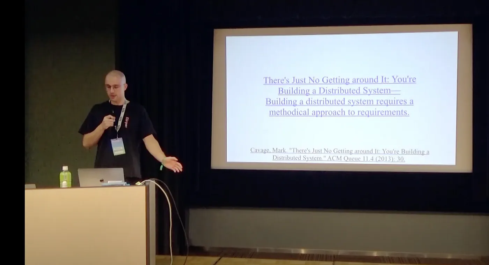

Eine Zusammenfassung eines Videovortrags von Sascha Hanse.

Sascha Hanse erklärt, warum Protokolle in dezentralen Netzwerken so wichtig sind. Protokolle legen fest, wie die verschiedenen Teile eines Systems miteinander interagieren. Mit ihnen lässt sich gutes Verhalten belohnen und schlechtes unterbinden.

Er betont, wie wichtig es ist, Protokolle so zu gestalten, dass sie einfach, leicht verständlich und schwer angreifbar sind. Außerdem sollten sie in den unterschiedlichsten Situationen funktionieren.

Er spricht auch darüber, dass man die langfristigen Auswirkungen eines Protokolls bedenken muss. Protokolle können stark beeinflussen, wer die Macht hat und wie Menschen miteinander umgehen. Darüber muss man sich im Klaren sein, wenn man eines entwirft.

Zum Schluss sagt er, dass man beim Entwerfen von Protokollen andere respektieren sollte. Protokolle sollten Menschen einbeziehen und ihnen helfen, zusammenzuarbeiten.
