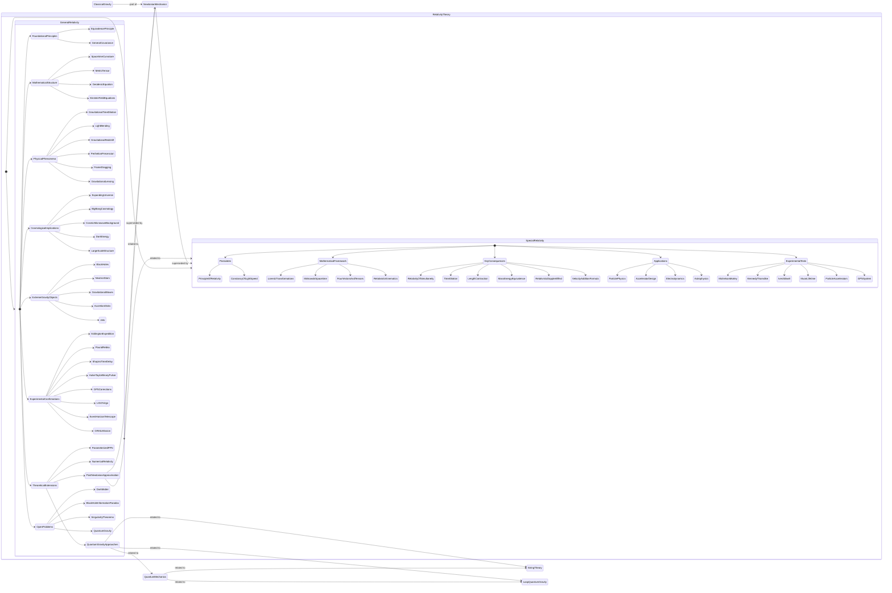

Notiz an mich selbst: Das Diagramm vertikal machen, nicht horizontal.

Es ist ein Zustandsdiagramm der Relativitätstheorie. Spezielle und allgemeine Relativität, woraus sie bestehen, wie sie die Newtonsche Mechanik ersetzt haben und wie die Ansätze zur Quantengravitation damit zusammenhängen.

Ich hab's mit Mermaid Share gemacht. Chart-ID chart_1756354351463_48ybl32fi, Version 1, erstellt und zuletzt aktualisiert am 28.8.2025, 7:12:31 Uhr (2025-08-28T04:12:31.464Z erstellt, 2025-08-28T04:12:31.465Z aktualisiert). Du kannst es dir [hier live ansehen](https://mermaid.emino.app/?chart=chart_1756354351463_48ybl32fi) https://mermaid.emino.app/?chart=chart_1756354351463_48ybl32fi
