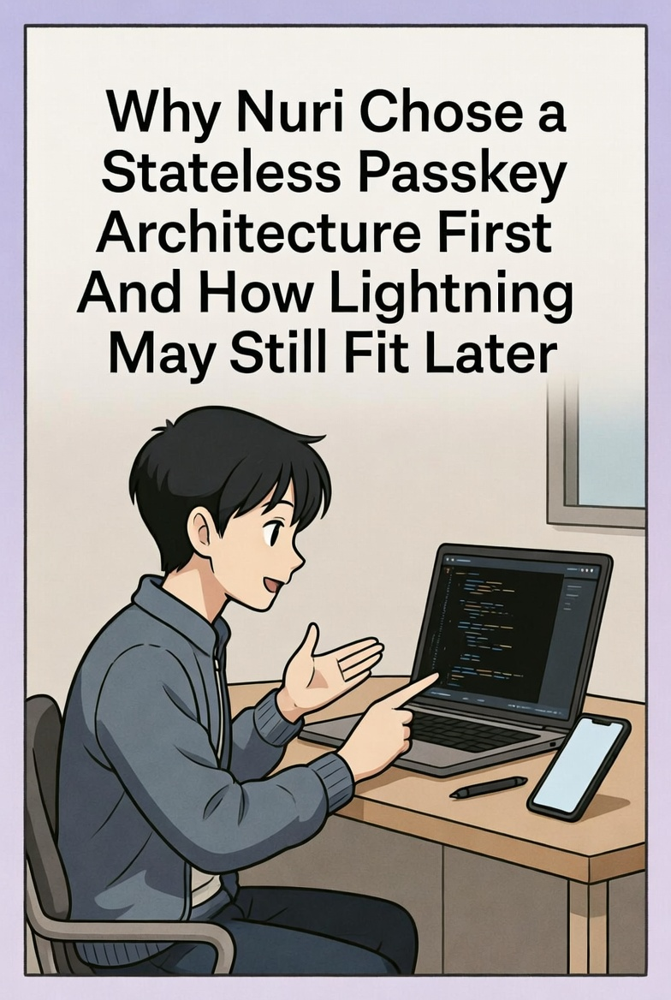

# Warum Nuri zuerst auf eine zustandslose Passkey-Architektur setzt und wie Lightning später trotzdem passen könnte

In den letzten Monaten hatten wir großartige Gespräche mit dem Breez-Team über Spark, Nodeless und ihre größere Vision von Lightning as a Service. Breez ist eines der sorgfältigsten Engineering-Teams im Lightning-Bereich, und ihre Arbeit hat Lightning für Entwickler nutzbar gemacht, die keine Full Nodes betreiben oder selbst Liquidität verwalten wollen. Sie haben uns zum Spark Early Access Program und zu den Q3- und Q4-Cohort-Promotions eingeladen. Die Ansprache und der Support von Breez waren fantastisch, und wir wissen das wirklich zu schätzen.

Aber nach viel Prototyping und Recherche sind wir für unseren ersten Release in eine andere Richtung gegangen. Dieser Post erklärt, warum wir uns so entschieden haben, wie das mit den Prinzipien zusammenhängt, auf denen wir Nuri aufgebaut haben, und wie Lightning später trotzdem eine Rolle spielen kann.

## 1. Unser Kernprinzip ist zustandslose Self-Custody

Die meisten Wallets, die sich selbst als self-custodial bezeichnen, speichern trotzdem irgendwo Schlüssel. Der Schlüssel liegt verschlüsselt auf dem Gerät, oder verschlüsselt auf einem Server, oder als Seed Phrase im Backup. Und das bringt die Risiken mit sich, die jeder kennt. Das Gerät wird kompromittiert, das Backup geht verloren, der Server wird angegriffen, die UX wird kompliziert und der ganze Betrieb kostet viel Arbeit.

Unser Ziel mit Nuri war es, überhaupt keinen Private Key zu speichern, nirgendwo, und trotzdem mehr Sicherheit und ein besseres Recovery-Erlebnis zu bekommen. So sind wir zu den nächsten beiden Bausteinen gekommen.

### 1.1 Ein zustandsloser Passkey-Signer für Bitcoin
https://emino.app/posts/a-stateless-passkey-signer-for-bitcoin/

Wir speichern nie einen Private Key. Wir nutzen Passkeys, die die Plattform absichert (FIDO2 WebAuthn), und leiten daraus kurzlebiges Signing-Material ab, jedes Mal auf die gleiche Weise und nur dann, wenn wir es brauchen. Es gibt keine verschlüsselten Blobs, keine Seeds und keine ruhenden Secrets, also gibt es nichts zu stehlen.

### 1.2 Ein per Passkey abgeleitetes 2-of-2 Taproot Wallet
https://emino.app/posts/a-passkey-derived-2-of-2-taproot-wallet-architecture-elimina/

Wir erweitern den Signer zu einem 2-of-2 Taproot Multisig. Ein Schlüssel wird lokal mit einem Passkey abgeleitet, der andere remote mit einem separaten Passkey. Keine Seite hält einen langfristigen Private Key, und das Recovery kommt mit der Passkey-Identität selbst.

Für Nuri ist Zustandslosigkeit kein Implementierungsdetail. Sie ist die Basis, auf der alles steht, und jede Architektur im ersten Release muss ihr folgen.

## 2. Warum Spark und gehostetes Lightning sich heute schwer mit Zustandslosigkeit verbinden lassen

Lightning braucht dauerhaften State. Es braucht Channel Commitments, HTLC-Updates, Liquiditätsreservierungen, Revocation Secrets, Channel-Backup-Material, Channel-Monitoring über lange Zeit und Absicherung durch Justice Transactions. So funktioniert das Lightning-Protokoll. Es hängt von State ab, der sich ständig ändert und niemals verloren gehen darf, und das widerspricht der Idee "keine Secrets, kein State", hinter der Nuri steht.

Wir hatten also im Grunde zwei Optionen. Option A war, unser zustandsloses Modell zu brechen und Channel State lokal oder remote zu speichern, was die Garantien schwächt, um die wir Nuri herum designed haben. Option B war, den langlebigen State an eine gehostete Node wie Spark abzugeben. Das ist das Spark-Modell, bei dem der Nutzer die Signing Keys behält und die gehostete Infrastruktur Channel State, Gossip, Liquidität und HTLCs verwaltet.

Spark ist gut designed. Aber es so früh zu übernehmen würde bedeuten, dass wir um eine Abhängigkeit herum bauen, die nicht ganz zu der Richtung passt, in die unsere Architektur geht. Wir wollen, dass das Nuri-Sicherheitsmodell so klein, so deterministisch und so nah an der Plattform wie möglich ist, bevor wir zustandsbehaftete Protokolle daraufsetzen.

## 3. Warum wir uns zuerst für Submarine Swaps entschieden haben

Man kann Lightning auch nutzen, ohne eine Lightning Node zu betreiben oder Channel State zu halten. Submarine Swaps lassen dich über Lightning empfangen und on-chain settlen, und on-chain senden und über Lightning zahlen. Du managst keine Channels, du brauchst keine Channel-Backups, du hältst keine persistenten Secrets und du bindest dich nicht an einen einzigen LSP oder gehosteten Service. Für Nuri heißt das, wir können mit Lightning reden, die Architektur bleibt einfach, wir hängen nicht an einem Anbieter und alles passt weiterhin zum zustandslosen Signing-Prinzip. Es ist der richtige Schritt, bevor wir uns auf etwas Zustandsbehafteteres wie gehostete Channels festlegen.

## 4. Eine Anmerkung an Breez, warum es hier nicht um euch geht

Diese Entscheidung ist keine Kritik an Breez oder Spark. Breez liefert immer wieder einige der besten Engineering-Arbeiten im Lightning-Bereich. Spark ist eine saubere und moderne Hosted-Node-Architektur. Nodeless plus Spark gibt Entwicklern eine wirklich gute Experience, und das Breez SDK macht Lightning für mobile Apps deutlich einfacher.

Wir sind nur wegen der Architektur einen anderen Weg gegangen, nicht wegen der Qualität. Lightning braucht heute persistenten State, und Nuri ist heute auf zustandslosen Bausteinen aufgebaut. Sobald unsere Basis stabil ist, können wir uns Spark oder Hybridmodelle wieder anschauen, die unsere zustandslosen Garantien erhalten. Die Tür bleibt offen.

## 5. Was Nuri jetzt ausliefert

Nuri hat gerade das Apple Review bestanden (TestFlight https://testflight.nuri.com). Die ersten Features sind diese. Du kannst Bitcoin ohne KYC bis zu 700 € mit Apple Pay kaufen (über Mercuryo). Es gibt eine self-custodial Visa Debitkarte mit GnosisPay und eine IBAN mit Instant SEPA On- und Off-Ramp von Monerium. Bitcoin Signing ist zustandslos und basiert auf Passkeys, auf einer 2-of-2 Taproot Architektur ohne gespeicherte Private Keys, und wir speichern null Secrets auf dem Client und auf dem Server. Es ist eine Cross-Platform Expo App für iOS, Android und Web. Und alle Teile werden vollständig Open Source sein, auch der Signer und die Wallet UI.

Unsere Priorität ist es, das zustandslose Modell zuerst perfekt zu machen. Lightning kommt, sobald es sauber in diese Architektur passt.

## 6. Kann Lightning zustandslos werden?

Das ist ein offenes Forschungsfeld und es liegt uns sehr am Herzen. Es gibt vielversprechende Richtungen wie Taproot-basierte Channel-Designs, eltoo-ähnliche Update-Schemes, State Commitment Trees, kurzlebige Channel-Konstruktionen, per Passkey gesteuerte Lightning-Signing-Rollen und gehostete Channels von mehreren Anbietern ohne Lock-in. Wenn diese Dinge vorankommen, erwarten wir, dass Lightning besser mit zustandslosen Clients funktioniert. Wenn das passiert, kann Spark oder etwas Ähnliches eine natürliche Ergänzung werden.

## 7. Danke, Breez

An das Breez-Team. Danke, dass ihr immer wieder auf uns zugekommen seid, dass ihr uns zu Spark und euren Cohort-Programmen eingeladen habt und dass ihr immer offen für Gespräche wart. Eure Arbeit ist sehr wichtig für die Zukunft von Lightning. Unsere Architektur geht im Moment einen anderen Weg, aber wir haben großen Respekt vor dem, was ihr baut. Wenn unsere zustandslosen Bausteine voll ausgereift sind, kommt die Lightning-Integration zurück auf die Roadmap, und Spark wird definitiv eine Option bleiben.

⚡️

