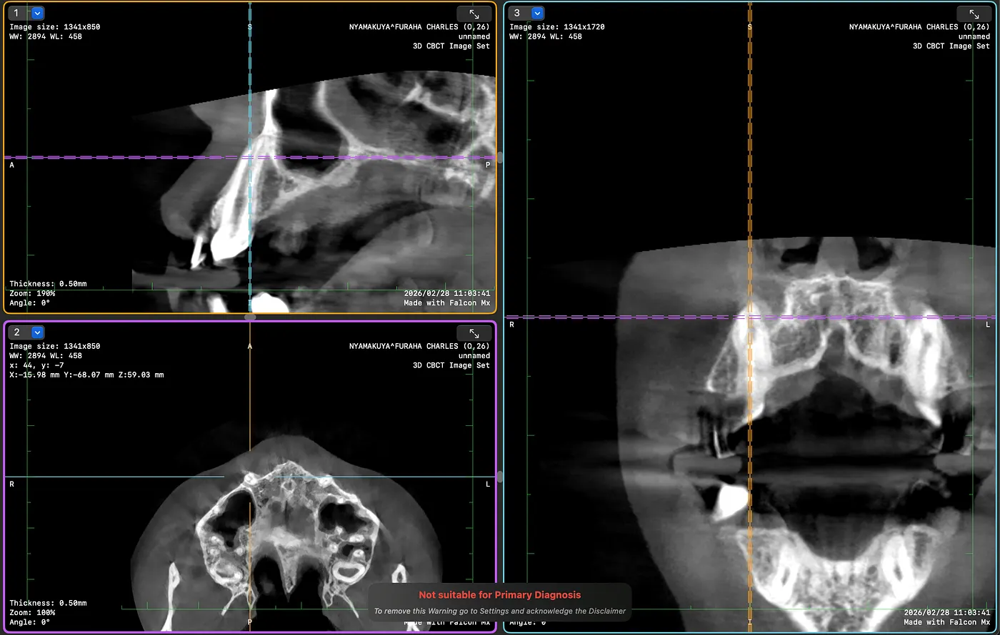

So habe ich Claude benutzt, um dentale CBCT-Scans anzuschauen, kieferorthopädische Anbieter zu prüfen, mich auf die Beratung vorzubereiten und eine Behandlungsentscheidung zu treffen, die wir wirklich verstanden haben, von Arusha in Tansania bis Nairobi in Kenia.

Bei meiner Partnerin, dachten wir jedenfalls, lagen beidseitig ektopische Oberkiefer-Eckzähne vor, dazu vier Prämolaren-Extraktionen aus einer abgebrochenen kieferorthopädischen Behandlung und 13 Monate unkontrollierte Zahnwanderung. Zwei Allgemeinzahnärzte in Arusha, Tansania, hatten es mit Zahnspangen versucht. Beide sind gescheitert. Die Zähne standen schlimmer als vorher. Wir hatten keinen Behandlungsplan, keinen Spezialisten und keine Ahnung, wie es weitergehen sollte.

Wir hatten ein OPG (Orthopantomogramm) aus Berlin, einen digitalen iTero-Scan und eine Invisalign-Simulation, die ein Zahnarzt vorgeschlagen hatte. Was wir nicht hatten, war jemand, der qualifiziert war, das alles zu interpretieren und uns ehrlich zu sagen, was wirklich los war.

Also fing ich an, mit Claude zu reden.

## Die Fallakte aufbauen

Zuerst brachte die KI alles, was wir wussten, in ein klinisches Gesamtbild. Aus den Fotos, die ich hochgeladen hatte, dem Berliner OPG und meiner Schilderung der Behandlungsgeschichte schrieb sie eine Fallzusammenfassung mit dem Extraktionszeitplan (September und Oktober 2024), den 7 Monaten Zahnspange bei zwei Anbietern, den Symptomen, also lockere Frontzähne und Schmerzen beim Kauen an den Extraktionsstellen, und den 13 Monaten ganz ohne Behandlung.

Sie wies auch sofort auf ein paar Dinge hin, die die Zahnärzte vorher übersehen oder ignoriert hatten. Das Berliner OPG schien Eckzähne zu zeigen, die nicht in den Zahnbogen heruntergewachsen waren. Wenn das stimmte, war der Fall viel zu komplex für Allgemeinzahnärzte. Er würde eine chirurgische Freilegung und angeklebte Traktion mit festsitzenden Apparaturen brauchen, und Aligner oder einfache Zahnspangen würden nicht reichen.

Die KI war direkt und sagte: „Invisalign allein reicht für diesen Fall nicht. Du brauchst einen CBCT-Scan, um die Eckzähne in 3D zu sehen, und du brauchst einen Fachkieferorthopäden, keinen Allgemeinzahnarzt."

## Einen Spezialisten finden

Wir brauchten einen Kieferorthopäden in Ostafrika, der einen komplexen Fall mit retinierten Eckzähnen und Extraktionslücken-Management behandeln konnte, für eine Patientin, die sechs Stunden mit dem Bus entfernt wohnt. Die KI suchte nach Spezialisten in Nairobi und schaute sich deren Qualifikationen an, nicht nur die Google-Bewertungen.

Sie fand Kenya Orthodontics und Dr. Wandia Mwangi-Evans. Sie hat ein Fellowship vom Royal College of Surgeons of England, einen MSc in Kieferorthopädie von der Cardiff University mit Auszeichnung, über 8.000 Fälle und mehr als 20 Jahre Erfahrung. Die Klinik arbeitet mit Shared Care. Der Spezialist macht den Plan und sieht die Patientin alle 6 bis 8 Wochen, und ein lokaler Zahnarzt macht die Anpassungen zwischendurch. Das passt wirklich gut für Leute, die aus Tansania kommen.

Die KI schrieb ein vollständiges Briefing für die Beratung, neun Abschnitte mit der klinischen Vorgeschichte, den radiologischen Befunden, Fragen an den Spezialisten und Warnsignalen, auf die man achten sollte. Sie entwarf auch ein Überweisungsschreiben, das wir zum Termin mitbringen konnten.

## Den CBCT-Scan machen lassen

Wir waren in Nairobi und wohnten in der Nähe von Karen, also half die KI dabei, die Karen Dental Clinic im Zamani Business Park zu finden. Sie hatten ein Carestream CS 8200 3D CBCT-Gerät. Wir bestätigten die Ausstattung anhand von Fotos, die ich schickte, und die KI erklärte mir, wonach ich fragen sollte: ein vollständiges CBCT von Ober- und Unterkiefer, DICOM-Dateiexport und E-Mail-Versand sowohl an uns als auch an den Kieferorthopäden.

Der Scan erzeugte 651 DICOM-Schichten in zwei Serien (Standardvolumen und Metallartefakt-Reduktion). Die Klinik sagte, wir würden eine spezielle Software brauchen, um sie anzuschauen. Die KI empfahl Falcon (früher Horos Mobile) fürs iPhone, einen kostenlosen DICOM-Viewer. Ich installierte ihn, importierte alle 651 Schichten, und plötzlich konnte ich auf meinem Handy durch Querschnitte des Schädels meiner Partnerin scrollen.

## Den Scan von einem Handy-Video lesen

Hier wurde es interessant, und hier lag die KI falsch. Das hat uns genauso viel gelehrt wie die Dinge, die sie richtig gemacht hat.

Ich nahm per Bildschirmaufnahme auf, wie ich in Falcon durch die CBCT-Schichten scrollte, und lud das Video hoch. Die KI extrahierte 192 Frames und ging sie einzeln durch, auf der Suche nach anatomischen Orientierungspunkten in den axialen Schichten.

Sie meldete, was sie für bilaterale ektopische Eckzähne hielt, die hoch im Gaumen saßen, weit über dem Zahnbogen. Sie maß den vertikalen Abstand über die Schichten hinweg und kam zu dem Schluss, dass die Eckzähne tief retiniert waren und eine chirurgische Freilegung brauchten. Das passte zu dem, was das Berliner OPG vermuten ließ.

Aber die KI war vorsichtig und sagte noch einmal, dass dies nur ein erster Blick war. „Ich lese komprimierte Videoframes von einer Handy-Bildschirmaufnahme. Das ist nur eine vorläufige Orientierung. Der Spezialist mit den echten DICOM-Dateien auf richtiger Software wird zehnmal mehr Details sehen."

Dieser Vorbehalt stellte sich als entscheidend heraus.

## Die Beratung bei Kenya Orthodontics

Wir gingen mit all unseren Unterlagen zu Kenya Orthodontics. Dr. Wandias Team, mehrere Ärzte einschließlich der Kieferorthopädin, machte eine gründliche klinische Untersuchung. Sie erfassten jeden Zahn, maßen die Extraktionslücken (4,5 mm rechts, 5 mm links), notierten die Fluorose aus Arushas Wasserversorgung, prüften auf Kiefergelenkprobleme, schauten sich den Biss an und überprüften das CBCT auf ihrer professionellen Software.

Sie sagten, der Fall sei „ziemlich unkompliziert". Etwa 18 Monate mit festsitzender Zahnspange. Kein Wort über chirurgische Freilegung oder retinierte Eckzähne.

Das widersprach der CBCT-Lesart der KI. Entweder hatte das Spezialistenteam bilaterale retinierte Eckzähne übersehen, was unwahrscheinlich war, weil sie die Patientin im Stuhl und die DICOM-Dateien auf richtiger Software hatten, oder die erste Lesart der KI aus komprimierten Videoframes war falsch.

## Überprüfung mit MPR-Ansichten

Ich wollte nicht einfach einer der beiden Seiten glauben. Also nutzte ich die KI, um mich auf diagnostischere Weise durch das CBCT führen zu lassen. Falcon hat einen 2D-MPR-Modus, der axiale, sagittale und koronale Schichten gleichzeitig mit verknüpften Fadenkreuzen zeigt, und in diesem Modus klickte ich direkt auf die Eckzahnpositionen im Oberkiefer.

Die KI leitete mich an. „Klick auf den Bereich des oberen rechten Eckzahns in der axialen Ansicht. Mach einen Screenshot. Jetzt klick auf den linken Eckzahn. Screenshot." Jeder Klick zeigte denselben anatomischen Punkt aus drei Winkeln gleichzeitig.

Das Ergebnis war eindeutig. Beide sagittalen Ansichten zeigten Zähne mit langen Wurzeln, die in den Oberkieferknochen hinaufreichten, und genau so sehen durchgebrochene Eckzähne aus. Kronen unten im Bogen, Wurzeln nach oben. Normale Position. Nicht retiniert.

Was die KI im komprimierten Video für retinierte Eckzahnkronen gehalten hatte, waren tatsächlich Eckzahnwurzeln, im axialen Querschnitt auf höheren Schichtebenen gesehen. Eckzähne haben die längsten Wurzeln aller Zähne, deshalb erscheinen sie auf axialen Schichten weit über der Okklusionsebene als dichte runde Strukturen. Auf komprimiertem Handy-Video sehen sie genau wie retinierte Kronen aus.

Die KI gab den Fehler sofort zu. „Meine frühere CBCT-Video-Lesart war falsch. Der Spezialist mit der Patientin im Stuhl plus richtiger DICOM-Software hatte recht."

## Der Behandlungsplan

Nachdem die Eckzahnfrage geklärt war, stand der Plan fest. Festsitzende Zahnspange und keine Aligner, weil Spangen bei diesem Komplexitätsgrad vorhersehbarer sind. Die Fluorose macht die Bracket-Adhäsion schwierig, deshalb bekommen die Molaren stattdessen Bänder. Etwa 18 Monate aktive Behandlung, mit Terminen alle 6 bis 8 Wochen zur Anpassung. Danach geklebte Retainer und herausnehmbare Retainer, und Retainer-Kontrollen für ein Jahr nach der Behandlung. Die Kosten liegen bei etwa 483.000 KES (rund 3.700 USD), pay as you go. Am 13. März gibt es Reinigung und Separatoren, und am 24. März wird die Spange eingesetzt.

Das Team erklärte offen sowohl Spangen als auch Invisalign, sprach darüber, was die Fluorose bedeutet, und empfahl Spangen, weil Zahnbewegung, die der Kieferorthopäde kontrolliert, vorhersehbarer ist als Aligner, die vom Patienten abhängen, bei einem Fall mit dieser Vorgeschichte.

## Wann die KI geholfen hat und wann nicht

Die KI hat viel geholfen. Sie hat eine verstreute Krankengeschichte in ein klares klinisches Bild gebracht und erkannt, dass der Fall einen Spezialisten braucht und keine allgemeine Zahnheilkunde. Sie hat Anbieter recherchiert und nach echten Qualifikationen geprüft, nicht nach Marketing. Sie hat die Unterlagen für die Beratung vorbereitet, sodass wir informiert reingegangen sind, und sie hat die ganze Zeit die Fachbegriffe in einfacher Sprache erklärt. Sie hat mich durch eine CBCT-Software geführt, die ich noch nie benutzt hatte, mir gezeigt, wie man MPR-Ansichten nutzt, um eine bestimmte anatomische Frage zu prüfen, und mir die Fragen gegeben, die ich stellen sollte, und die Warnsignale, auf die ich achten musste.

Wo sie falsch lag, war das Lesen des CBCT aus komprimierten Handy-Videoframes. Sie hat Eckzahnwurzeln für retinierte Kronen gehalten, und sie war sich bei dieser ersten radiologischen Lesart zu sicher, auch wenn sie den Vorbehalt immer wieder dazugesagt hat.

Die Lektion für mich: KI, die medizinische Bilder aus indirekten Quellen liest, wie Bildschirmaufnahmen oder komprimierte Exporte, ist gut, um sich zu orientieren, aber man kann sich für eine Diagnose nicht darauf verlassen. Der Spezialist mit dem Patienten auf dem Stuhl, den Händen im Mund und den DICOM-Dateien auf kalibrierter Software schlägt immer eine KI, die ein Handy-Video liest. Nutz KI zum Vorbereiten, zum Lernen und um bessere Fragen zu stellen, aber lass die Diagnose von einem qualifizierten Menschen machen.

## Was für uns funktioniert hat

Wenn du eine komplexe zahnärztliche oder kieferorthopädische Situation hast, besonders irgendwo, wo es schwer ist, zu einem Spezialisten zu kommen, das ist, was für uns funktioniert hat.

Sammle alles. OPG, Fotos, digitale Scans, Behandlungshistorie mit Daten. Lade alles hoch und lass die KI es ordnen.

Verstehe deinen Fall vor der Beratung. KI kann erklären, was verlagerte Eckzähne sind, was Prämolaren-Extraktionen für die Platzverwaltung bedeuten, warum CBCT wichtig ist und was man fragen sollte. Die Beratung wird so viel besser, wenn du informiert reingehst.

Besorge die richtige Bildgebung. Ein 2D-OPG reicht für komplexe Fälle nicht. CBCT gibt dir dreidimensionale Informationen. Bestehe auf DICOM-Dateiexport, damit du deine Daten besitzt.

Prüfe Anbieter nach Qualifikationen, nicht nach Bequemlichkeit. Fellowship-Ausbildung, Facharztregistrierung, Fallzahlen. KI kann dir bei der Recherche helfen. Und wenn zwei allgemeine Zahnärzte am selben Fall scheitern, sollte dir das was sagen.

Bereite Unterlagen für die Beratung vor. Ein strukturiertes Briefing spart Zeit und stellt sicher, dass im Termin nichts vergessen wird. Der Spezialist sieht Hunderte Patienten, also mach es ihm leicht, deine Geschichte schnell zu verstehen.

Prüfe nach, vertraue nicht einfach. Als die erste Lesart der KI der des Spezialisten widersprach, haben wir keine der beiden Antworten einfach akzeptiert. Wir haben den MPR-Viewer benutzt, um genau diesen Punkt zu prüfen. Der Spezialist hatte recht, aber das Nachprüfen hat uns mehr über den Fall gelehrt als beide Meinungen allein.

Besitze deine Dateien. CBCT-DICOM-Dateien, intraorale STL-Scans, OPG-Bilder, behalte Kopien von allem. Es sind deine medizinischen Daten und du brauchst sie vielleicht für Zweitmeinungen, Versicherungen oder zukünftige Behandler.

## Worauf es hinauslief

Vom ersten KI-Gespräch bis zur Behandlungsentscheidung dauerte es 2 Tage. Wir haben uns mehrere Anbieter angesehen und einen nach Qualifikationen ausgewählt. Die KI hat 651 CBCT-Schichten und 192 Videoframes durchgesehen, und ich habe 6 MPR-Screenshots zur Überprüfung gemacht. Das CBCT und die Beratung kosteten zusammen etwa 60 US-Dollar. Die Behandlung kostet etwa 3.700 US-Dollar über 18 Monate. Davor gab es 2 gescheiterte Behandlungen, und 4 Prämolaren sind für immer verloren. Sie wurden gezogen und können nicht ersetzt werden.

Gerade jetzt kann jeder mit einem Smartphone eine informierte Zweitmeinung bekommen, seine eigenen medizinischen Bilder verstehen, Spezialisten über Grenzen hinweg prüfen und vorbereitet in eine Beratung gehen. Es wird die Hände und die Ausbildung des Kieferorthopäden nicht ersetzen. Aber es schließt eine Informationslücke, die Patienten schon immer, besonders in Regionen mit wenigen Spezialisten, der Gnade dessen ausgeliefert hat, der gerade am nächsten war.

Wir sind in 48 Stunden von „Ich weiß nicht, was los ist, und ich weiß nicht, wem ich vertrauen kann" zu „Ich verstehe meinen Fall, ich habe die Diagnose überprüft, und ich bin sicher im Behandlungsplan" gekommen. Für mich ist das nicht KI, die Medizin ersetzt. Es ist KI, die Patienten zu besseren Partnern in ihrer eigenen Versorgung macht.
