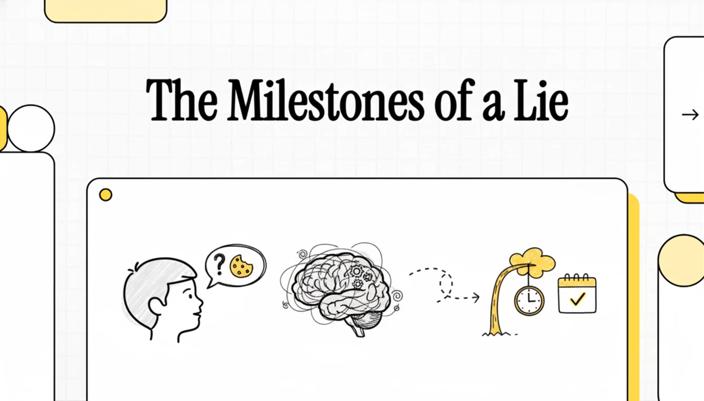

https://youtu.be/bcu9MpjV3yE

Wenn du mich zwingst, ein einziges Alter zu nennen, in dem Lügen zu einem stabilen, bewussten Werkzeug wird und nicht nur zu Lärm, Fehlern oder Wunschdenken, dann sage ich: 4 Jahre.

Das klingt wie ein moralisches Urteil über Kinder. Ist es aber nicht.

Es geht um einen Schritt in der Art, wie Kinder denken. Es ist der Moment, in dem ein Kind anfängt, deinen Geist als etwas zu behandeln, das von seinem eigenen Geist getrennt ist. Ein privates Universum mit eigenen Inhalten, und diese Inhalte können verändert, in die Irre geführt und manchmal benutzt werden.

Ein Kind, das lügen kann, ist nicht automatisch schlecht. Und ein Kind, das nicht lügen kann, ist nicht automatisch gut. Es macht mehr Sinn, Lügen als soziales Werkzeug zu sehen, das möglich wird, sobald zwei Dinge im Kopf zusammenarbeiten. Das erste ist Theory of Mind (ToM), also zu wissen, was jemand anderes glaubt, selbst wenn es falsch ist. Das zweite ist exekutive Funktion (EF), also die Wahrheit zurückzuhalten, die Geschichte im Arbeitsgedächtnis zu behalten und sie nicht rausrutschen zu lassen.

Das Schwierige ist, dass beides nicht über Nacht wächst. Warum also vier?

Weil um die 4 herum viele verschiedene Studien auf denselben praktischen Punkt kommen. Kinder fangen an, falsche Überzeugungen zuverlässig zu verstehen, selbstschützende Lügen werden in den klassischen Labortests häufig, und die Fähigkeit, eine Lüge zu erzählen und dann durchzuhalten, zeigt sich als Unterschied zwischen Kindern, und dieser Unterschied hängt mit ToM und EF zusammen.

Unten ist die Evidenz, die vier zur besten Antwort macht, wenn man eine Zahl nennen muss, auch wenn es in Wirklichkeit ein langsamer, kontinuierlicher Wandel ist.

## Was als Lüge zählt

Viel Verwirrung kommt daher, dass man alles, was nicht wahr ist, eine Lüge nennt.

In der Entwicklungspsychologie bedeutet Lügen normalerweise absichtliche verbale Täuschung. Keine Fehler, keine Missverständnisse, kein Fantasiespiel und kein zufälliges Ja. Eine oft zitierte Definition bringt es sehr klar auf den Punkt. "Lying involves a speaker making a false statement with the intention to deceive the recepient." Das ist von Talwar und Lee, und der Volltext ist offen auf PMC.

Also "Ich hab's nicht kaputt gemacht", während das Kind das kaputte Ding in der Hand hält, ist eine Lüge. "Ich habe einen Drachen in meinem Zimmer" beim Spielen ist nicht unbedingt eine Lüge. Und zu jeder Frage Nein zu sagen ist auch kein Lügen. Sehr oft ist das einfach Antworttendenz, Angst oder Verwirrung.

## Zu wissen, was du glaubst

Die Schlüsselidee hinter all dem ist, dass ein Kind irgendwann versteht, dass die andere Person ihre eigene innere Welt hat.

Um gut zu lügen, muss das Kind drei Dinge im Kopf behalten. Was wirklich passiert ist, was du gerade glaubst, und was du glauben wirst, nachdem du ihre Geschichte gehört hast.

Deshalb ist der False-Belief-Test das Hauptwerkzeug zur Messung von ToM. Und wenn Forscher darüber streiten, wann ToM beginnt, streiten sie meist darüber, wann Kinder False-Belief-Aufgaben zuverlässig bestehen.

Eine klassische Meta-Analyse von Wellman, Cross und Watson (2001) hat die unübersichtliche Forschung zusammengefasst. In ihren Worten: "A meta-analysis was conducted (N = 178 separate studies) to address the empirical inconsistencies and theoretical controversies." Und sie fanden, dass die Leistung einem klaren Entwicklungsmuster folgt. Ihr Modell "yielded a multiple R of .74 and an R2 of .55; thus, the model accounts for 55% of the variance".

Man muss False-Belief-Aufgaben nicht für perfekt halten, um die große Botschaft zu verstehen. Vorschulkinder gehen davon, diese Aufgaben immer wieder zu vermasseln, dazu über, sie zuverlässig zu bestehen. Genau dieser Wandel ist das Upgrade fürs andere Universum, das strategisches Lügen möglich macht.

## Die Lügenfalle im Labor

Die saubersten Daten zu Kindern und Lügen kommen aus einem sehr einfachen Aufbau. Du sagst dem Kind, es soll nicht auf ein Spielzeug gucken, während du den Raum verlässt. Du lässt es allein, und viele gucken doch. Dann kommst du zurück und fragst, ob sie geguckt haben. Und du kannst ein paar Nachfragen stellen, um zu testen, ob sie die Lüge aufrechterhalten können, ohne sich selbst zu verraten, was Forscher semantisches Durchsickern nennen.

Es heißt das Temptation Resistance Paradigm (TRP).

In einer Open-Access-Studie mit 150 Kindern im Alter von 3 bis 8 berichten Talwar und Lee: "Overall, 82% of the children (123) peeked at the toy in the experimenter's absence". Und von denen, die geguckt haben: "Of the 123 children who peeked, 79 (64%) children lied about their transgression."

Das ist schon ein großer Punkt. Lügen ist häufig, sobald die Situation ein Kind dazu drängt, sich selbst zu schützen.

Aber es sagt uns immer noch nicht das Schalter-Alter. Dafür schauen wir auf das Entwicklungsmodell im selben Paper.

## Warum ich vier wähle

Talwar und Lee beschreiben, wie sich Lügen in Stufen entwickelt. Was hier zählt, ist, was sie über den Zeitraum zwischen 3 und 4 sagen. "The second level, 'secondary lies', reflects a significant shift that takes place between 3 and 4 years of age."

Und dann sagen sie das Praktische, worum es bei der ganzen Frage geht. "At and after 4 years of age, the majority of children will readily tell a lie to conceal their own transgression."

Dieser Satz ist der Grund, warum vier die beste einzelne Zahl ist.

Nicht weil jedes Vierjährige ständig lügt. Sondern weil Lügen vor 4 existiert, es ist nur weniger zuverlässig, weniger strategisch und die Wahrheit rutscht leichter raus. Nach 4 wird Lügen, um zu verstecken, was man falsch gemacht hat, zur häufigsten Antwort in diesen Tests.

## Warum nicht 2,5

Eltern reden oft über erste Lügen, wenn Kinder noch Kleinkinder sind. Experimente sehen so etwas auch, aber das Muster sagt, dass es noch keine volle Täuschung ist, bei der das Kind wirklich mit dem spielt, was du glaubst.

Eine große Längsschnittstudie von Białecka-Pikul et al. (2022) mit N=252 testete 2,5-Jährige in einem modifizierten TRP. "Results showed that 35% of 2.5-year-olds peeked, 27% of peekers lied and 40% of non-peekers falsely confessed they had peeked."

Schau dir an, wie seltsam das ist. 40% falsche Geständnisse bei den Kindern, die nicht geguckt haben. So sieht erwachsene Täuschung nicht aus. Es sieht eher nach einer Mischung aus Mitläufigkeit, Verwirrung und schwacher Selbstkontrolle aus.

Und die Autoren sagen es direkt. "These results suggested that the first, or so-called primary, lies of 2.5-year-olds are probably spontaneous, rather than deliberate."

Wenn du also 2,5 wählst, riskierst du, Lärm für einen Schalter zu halten.

## Eine Lüge am Laufen halten, und was man dafür braucht

Es gibt noch einen weiteren Schritt, der später kommt, und das ist die Fähigkeit, eine Lüge konsistent zu halten, wenn jemand Nachfragen stellt.

Talwar und Lee stellen fest, dass das Aufrechterhalten einer Lüge mit dem Verständnis von Überzeugungen höherer Ordnung zusammenhängt, also damit, darüber nachzudenken, was jemand über die Überzeugungen eines anderen denkt. Mit anderen Worten: Wie gut Kinder das können, entwickelt sich über Jahre weiter.

Aber wenn du das erste Alter suchst, in dem Lügen zu einer gängigen, bewussten Methode wird, Dinge zu verstecken, musst du nicht auf 7-8 warten. Vier ist früher und erfasst den Anfang der sekundären Lügen.

Wenn es beim Lügen nur um Theory of Mind ginge, würden wir riesige Korrelationen erwarten. Die sehen wir nicht.

Was wir sehen, sind kleine, aber konsistente Zusammenhänge über Tausende von Kindern hinweg. Das ist genau das, was man erwarten würde, wenn ToM nötig ist, aber allein nicht ausreicht.

Eine Meta-Analyse zu Lügen und ToM von Lee und Imuta (2021) umfasst „81 Studien mit 7.826 Kindern im Alter von 2 bis 14 Jahren". Sie fanden „eine kleine, signifikante positive Assoziation (r = .23)." Und der Zusammenhang ist am stärksten dort, wo man erwarten würde, dass ToM am wichtigsten ist. „ToM war positiv mit allen Facetten des Lügens verbunden, aber am stärksten mit dem Aufrechterhalten von Lügen."

Eine zweite Meta-Analyse von Sai et al. (2021) untersucht auch die exekutiven Funktionen. „Insgesamt wurden 47 Arbeiten mit 5.099 Teilnehmern im Alter von 2 bis 19 Jahren eingeschlossen." Und sie fanden: „Statistisch signifikante, aber relativ kleine Effekte wurden zwischen dem Lügen von Kindern und ToM (r = .17) sowie zwischen Lügen und EF (r = .13) gefunden."

Sie fanden auch etwas, das zum Unterschied passt zwischen dem Lügen anfangen können und gut darin sein. „Die Korrelation von EF mit den anfänglichen Lügen von Kindern war signifikant kleiner als ihre Korrelation mit der Fähigkeit der Kinder, Lügen aufrechtzuerhalten."

Also: Um die 4 kommt die Maschinerie in Gang. Danach unterscheiden sich Kinder darin, wie gut sie darin sind, und vor allem darin, eine Lüge am Laufen zu halten.

## Bleibt es?

Selbst wenn das Lügen im Vorschulalter beginnt, gibt es eine tiefere Frage. Wann wird es zu stabilem Verhalten und nicht nur zu einem einmaligen Ding?

Eine kurzfristige Längsschnittstudie von Wang, Gao und Shao (2024), Open Access, testete 104 Vorschulkinder dreimal, im Abstand von 4 Monaten. „Wir testeten das False-Belief-Verständnis und das Lügenverhalten von 104 sich normal entwickelnden Kindern (64 Jungen, M = 54,0 Monate) dreimal in Abständen von 4 Monaten."

Sie berichten, dass „das Lügenverhalten über die drei Messzeitpunkte hinweg eine moderate Stabilität zeigte".

Und das ist wichtig für die Idee mit dem anderen Universum, denn die Vorhersage geht von ToM zum Lügen und nicht umgekehrt. „Früheres False-Belief-Verständnis sagte signifikant das spätere Lügenverhalten der Kinder voraus", aber „früheres Lügen sagte kein späteres False-Belief-Verständnis voraus."

Wenn du wissen willst, wann es bleibt, ist diese Art von Stabilität das Nächste, was wir an einer Zahl haben. Sobald das Verhalten verbreitet ist, also nach 4, kann man schon messen, dass es über Monate stabil ist.

## Erwachsene: Die meisten sind ehrlich, ein paar lügen viel

Wenn man dem Lügen ins Erwachsenenleben folgt, wird die Geschichte weniger zu „alle lügen ständig" und mehr zu „die meisten Menschen lügen selten und ein paar Menschen lügen viel".

Eine klassische Tagebuchstudie von DePaulo et al. (1996) fand, dass „77 College-Studenten berichteten, 2 Lügen pro Tag zu erzählen, und 70 Mitglieder der Allgemeinbevölkerung erzählten 1."

Und eine große britische Umfrage von Serota und Levine (2014) fasst die neuere Long-Tail-Sicht zusammen. „Die meisten Menschen sind die meiste Zeit ehrlich, und die Mehrheit der Lügen wird von ein paar wenigen produktiven Lügnern erzählt." Sie geben die Stichprobe auch klar an. „Die Teilnehmer (N = 2.980) wurden im Vereinigten Königreich befragt."

Also ja, Lügen bleibt als menschliches Verhalten. Aber es bleibt nicht bei jedem in der gleichen Häufigkeit.

## Also ist es vier

Wenn ich ein Alter wählen muss, wähle ich 4 Jahre, und hier ist das Argument in fünf Schritten.

Erstens: Vor 4 gibt es Täuschung, aber sie sieht oft wie primäres Verhalten aus. Kleinkinder leugnen Dinge, gehen auf die Frage ein und gestehen fälschlicherweise auf eine Weise, die zeigt, dass sie noch nicht wirklich mit dem spielen, was du glaubst. Bei den 2,5-Jährigen logen 27% der Gucker, und 40% der Nicht-Gucker gestanden fälschlicherweise.

Zweitens: Um die 4 werden bewusste Lügen, um etwas zu verstecken, zur Hauptantwort in den klassischen Tests. Talwar und Lee beschreiben einen Wandel zwischen 3 und 4 und sagen, dass ab 4 die Mehrheit bereitwillig lügt, um ein Vergehen zu verstecken.

Drittens: Um die 4 werden andere Köpfe zu etwas, mit dem ein Kind tatsächlich arbeiten kann. Die False-Belief-Leistung zeigt in einer großen Meta-Analyse einen echten Wandel im Vorschulalter, und die Meta-Analysen zeigen, dass ToM zuverlässig mit Lügen verbunden ist, auch wenn der Zusammenhang bescheiden ist, und vor allem mit dem Aufrechterhalten einer Lüge.

Viertens: Nach 4 können Kontext und Anreize die Ehrlichkeit stark beeinflussen. Bei 4- bis 8-Jährigen bewegt das Ändern der Appelle und der erwarteten Bestrafung die Lügenraten in einem Datensatz von ~46% auf ~87%. Das Verhalten ist jetzt also eine strategische Antwort und nicht nur Entwicklungsrauschen.

Und fünftens: Nach 4 kann man schon Stabilität über die Zeit sehen. Kurzfristige Längsschnittdaten finden moderate Stabilität im Lügenverhalten über mehrere Messzeitpunkte und zeigen, dass ToM späteres Lügen vorhersagt.

Wenn du ein Alter willst, das den Wechsel von Wahrheit als Standard zu Wahrheit als Strategie am besten einfängt, dann ist es vier.

## Die wichtigsten Studien als CSV

Du kannst das kopieren und als `.csv`-Datei speichern.

```csv
Study,Year,Design,N,Age range,Paradigm / Measures,Key quantitative
findings,Open link
Wellman Cross Watson,"2001",Meta-analysis,"178 studies
(meta)",Preschool focus,False-belief tasks,"Model multiple R=.74;
R2=.55; consistent developmental shift in false-belief
performance",https://pubmed.ncbi.nlm.nih.gov/11405571/
Talwar Lee,"2008",Cross-sectional,"150",3–8 years,TRP + ToM + EF +
moral eval,"82% peeked; of peekers 64% lied; ToM/EF relate to initial
lie vs maintenance; 'shift between 3 and 4'
described",https://pmc.ncbi.nlm.nih.gov/articles/PMC3483871/
Talwar Arruda Yachison,"2015",Experiment,"372",4–8 years,TRP with
appeals + punishment,"No-appeal 87.1% lied vs External 46.4% vs
Internal 65.9%; punishment × internal appeal: 86% lied vs
45%",https://ggsc.berkeley.edu/images/uploads/Talwar_et_al_2015_The_effects_of_punishment_and_appeals_for_honesty_on_children%E2%80%99s_truth-telling_behavior.pdf
Białecka-Pikul et al.,"2022",Longitudinal,"252",2.5 years (IC at
1.5/2/2.5),Modified TRP + inhibitory control,"35% peeked; 27% of
peekers lied; 40% of non-peekers falsely confessed; authors suggest
'primary' lies often
spontaneous",https://journals.plos.org/plosone/article?id=10.1371/journal.pone.0278099
Lee Imuta,"2021",Meta-analysis,"81 studies; 7,826 children",2–14
years,Lying facets × ToM,"Overall r=.23; ToM strongest for lie
maintenance, weakest for spontaneous
production",https://pubmed.ncbi.nlm.nih.gov/33462865/
Sai et al.,"2021",Meta-analysis,"47 papers; 5,099 participants",2–19
years,Lying × ToM × EF,"ToM r=.17; EF r=.13; EF stronger for lie
maintenance than initial
lies",https://pubmed.ncbi.nlm.nih.gov/33544950/
Wang Gao Shao,"2024",Short-term longitudinal,"104",~46–64 months
(M=54),Cross-lagged ToM ↔ lying,"Lie-telling stability (β=.526 T1→T2;
β=.337 T2→T3); ToM predicts later lying (β≈.24–.26); lying does not
predict later ToM",https://mro.massey.ac.nz/bitstreams/129fd5cb-7464-4182-bd73-77de1b4ce386/download
DePaulo et al.,"1996",Diary studies,"77 + 70",Adults,Daily lie
diaries,"77 students ~2 lies/day; 70 community ~1
lie/day",https://pubmed.ncbi.nlm.nih.gov/8656340/
Serota Levine,"2014",Survey,"2,980",Adults,Self-reported daily lying
prevalence,"Most people honest most of the time; majority of lies from
a few 'prolific
liars'",https://www.oakland.edu/Assets/upload/docs/News/2014/Serota-Levine-Prolific-Liars-2014.pdf
```


