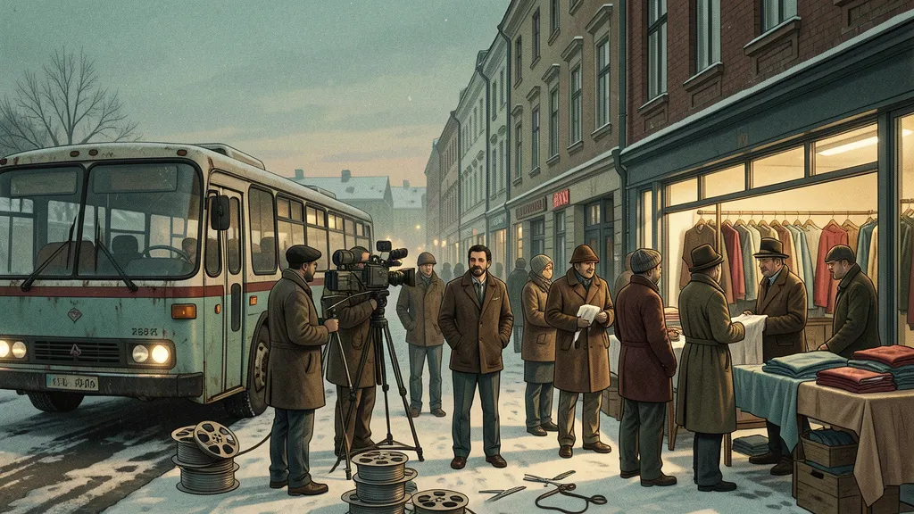

Hasan Gül erinnert sich an *Otobüs*, *Gül Hasan* und den Kreis türkischer Migranten, der eine Schneiderwerkstatt in ein Produktionsbüro verwandelte.

*Originalillustration, eigens für diesen Artikel angefertigt. Sie beschwört die Welt herauf, die Hasan Gül in seinem Interview beschreibt, und zeigt kein konkretes fotografiertes Ereignis.*

Mein Vater, Nurettin „Nuri“ Sezer, passte nie in eine einzige Rolle. Er spielte, produzierte, schrieb Drehbücher, arbeitete hinter der Bühne und war oft derjenige, der Dinge möglich machte. Geboren 1938 in Kandıra, arbeitete er in Istanbul am Theater und wurde später Teil der türkischen Kulturszene in Berlin.[3][4]

Das Kapitel, das ich besser verstehen wollte, spielte in Schweden. Dort wurden türkische Gastarbeiter ohne formale Filmausbildung zu Schauspielern, Geldgebern, Fahrern, Location-Scouts und Crew-Mitgliedern. Gemeinsam mit Filmemachern wie Tunç Okan und Tuncel Kurtiz halfen sie, Filme zu drehen, die auch ein halbes Jahrhundert später noch für Streit sorgen.

Hasan Gül war einer dieser Arbeiter. Er spielte in *Otobüs* mit und finanzierte später *Gül Hasan*, in dem er auch die Hauptrolle übernahm. Außerdem war er Nuris Freund und Geschäftspartner. Sein langes, auf Türkisch geführtes Interview ist lustig, verletzt, widersprüchlich und ungewöhnlich direkt.[1] Es ist kein neutraler Bericht. Das ist Oral History selten.

Ich habe Hasans Worte ins Englische übersetzt und redaktionell bearbeitet, Namen korrigiert, die im Roh-Transkript verzerrt waren, Wiederholungen gekürzt und die Chronologie geordnet. Behauptungen über umstrittene Ereignisse bleiben klar Hasan zugeschrieben. Wo andere Beteiligte sich anders erinnerten, sage ich das.

## Hasan kommt in Stockholm an

Hasan kam am 12. Juni 1966 aus Kulu, Konya, in Schweden an. Er war sechzehn. Er reiste mit einem Visum ein, aber ohne Arbeitserlaubnis, und teilte sich ein Zimmer mit drei anderen Männern. Sie kauften heißes Wasser, um Tee zu kochen. Essen war schwer zu identifizieren, wenn niemand Schwedisch lesen konnte. Hasan erinnert sich, wie ein Freund stolz Dosenfleisch servierte, bevor sie merkten, dass es Tierfutter war.

Sein erster Job war das Abräumen von Geschirr in einem Stockholmer Restaurant. Er hatte nicht vor, dabei zu bleiben.

*„Ich hatte schon vier Jahre als Schneider gearbeitet. Ich sagte: ‚Ich bin nicht hergekommen, um Geschirr zu spülen.‘“*

Er fand Arbeit in einer Schneiderei, lernte Schwedisch von seinen schwedischen Kollegen und besuchte eine Schnitt-Akademie. Der Unterricht kostete Geld, also lernte er tagsüber und spülte nachts Geschirr. Später eröffnete er sein eigenes Bekleidungsgeschäft. Auf dem Höhepunkt, sagt er, beschäftigte die Werkstatt etwa vierzig Leute auf 650 Quadratmetern, mit eigener Kantine und Sauna.[1][2]

## Nuri, die Werkstatt und ein Versprechen

Dann trat Nuri in die Geschichte ein.

Nuri kannte Tuncel Kurtiz seit einer Theater-Tournee durch Anatolien im Jahr 1969. Später zog er als Arbeiter nach Schweden und freundete sich mit Hasan an. Önder Özdemirs Geschichte von *Gül Hasan* beschreibt die Kette klar: Tuncel kannte Nuri, Nuri kannte Hasan, und Nuri brachte die Filmemacher mit den Arbeitern und den Mitteln zusammen, die sie in Stockholm brauchten.[2][6]

Hasan erinnert sich an den Satz, der ihn überzeugte, Nuri zum Partner in seiner Schneiderwerkstatt zu machen:

*„Mit dem Geld, das wir verdienen, werden wir Kino machen.“*

Das war zumindest der Plan. Die Werkstatt sollte das Geld verdienen, und das Geld sollte die Filme bezahlen.

## Otobüs begann mit einem Haarschnitt

Tunç Okans *Otobüs* folgt einer Gruppe undokumentierter türkischer Arbeiter, die in Stockholm zurückgelassen werden. Die Stadt um sie herum ist kalt, fremd, reich und schwer zu lesen. Für Hasan begann der Film ohne Drehbuch und mit einem Haarschnitt auf einer Toilette.

Er sagt, Nuri habe ihn vorgeschlagen, nachdem sich eine frühere Gruppe um die Produktion aufgelöst hatte. Okan zögerte. Hasan wirkte zu selbstsicher, um einen der verängstigten, erschöpften Arbeiter des Films zu spielen.

*„Tunç sagte: ‚Wir filmen unterdrückte Menschen. Schau dir Hasan an. Was ist an dem unterdrückt?‘ Aber er hatte keine andere Wahl. Er sagte: ‚Schneidet ihm die Haare.‘ Wir gingen und schnitten sie auf der Toilette. So begann *Otobüs*.“*

Hasan sagt, er habe nie ein Drehbuch bekommen. Okan sagte den Laiendarstellern, wo sie stehen, wann sie schauen und wie langsam sie sich bewegen sollten. Hasan hatte noch nie in einem Film mitgespielt. Den meisten der Arbeiter ging es genauso.

Dieser Mangel an Erfahrung machte die Arbeit nicht weniger ernsthaft. Hasan nannte *Otobüs* später einen der besten türkischen Filme und lobte Okans Regie und Güneş Karabudas Kameraarbeit. Er erinnerte sich daran, den fertigen Film in Ankara gesehen zu haben, nachdem er Ende der 1970er Jahre in die Türkei zurückgekehrt war. Ein Kinoangestellter warnte ihn, ja nicht zu verraten, dass er einer der Darsteller sei, weil das Publikum so gespalten reagierte.

Die Produktionsgeschichte des Films ist umstritten. Das Rohmaterial hatte technische Probleme, und einige Szenen mussten neu gedreht werden. Politische Gerüchte verunsicherten die Beteiligten. Es folgten Streitigkeiten über Geld, Eigentum und den Besitz der Filmrollen.[1][2]

Hasan besteht darauf, dass er nicht zu der Gruppe gehörte, die die Rollen zurückhielt. Er weist auch die spätere Behauptung zurück, Tunç Okan habe die Arbeiter getäuscht:

*„Tunç Okan hat uns nie betrogen. Er nahm uns mit, ernährte die Leute, die keine Arbeit hatten, und versprach, dass sie bezahlt würden. Als das Geld kam, zahlte er alle aus.“*

Andere Beteiligte erinnerten sich anders an den Konflikt. Tuncel Kurtiz beschrieb einen ernsten Bruch mit Okan. Okan bezeichnete *Gül Hasan* später als Rachefilm, der gegen ihn gerichtet war.[2][6] Hasans Bericht sollte nicht zum endgültigen Urteil erhoben werden. Sein Wert liegt darin, dass er die Perspektive eines Beteiligten in einem Streit bewahrt, der die Filme selbst geprägt hat.

## Der Verbinder

Nuris Rolle ging über seine Film-Credits hinaus. Er brachte Menschen zusammen, die sich sonst vielleicht nie begegnet wären.

Er hatte Theatererfahrung aus der Türkei. Er kannte Tuncel Kurtiz. In Schweden kannte er Hasan und die Arbeitergemeinschaft rund um die Schneiderwerkstatt. Durch diese Beziehungen bekamen Filmemacher Zugang zu Darstellern, Locations, Transport, Arbeitskraft und Geld. Die Arbeiter bekamen Zugang zu einem Medium, das sie bis dahin meist nur von außen dargestellt hatte.

Hasans Erinnerungen an Nuri sind nicht sentimental. Er beschreibt Vertrauen, Freundschaft, Geschäfte, Schulden und Enttäuschung. Er sagt, er habe Nuri in die Werkstatt aufgenommen, weil er ihm vertraute und weil Nuri älter war. Er hat nicht jede Anfrage hinterfragt. Die Partnerschaft zerbrach schließlich, und Hasan blieb wütend über das, was aus dem Geschäft geworden war.

*„Wenn ich jemandem vertraute, und ich vertraute Nurettin, dann habe ich ihn nicht hinterfragt. Er war älter als ich.“*

Hasan beschreibt Nurettin auch als eine Art älteren Bruder. Er sagt, er sei dazwischengegangen, wenn er das Gefühl hatte, Tuncel behandle Nurettin respektlos.[1] Das macht die spätere Wut in seinem Bericht verständlicher. Für Hasan war das nicht nur eine gescheiterte Geschäftsbeziehung. Die Freundschaft hatte das Gewicht von Familie angenommen.

Eine polierte Hommage würde die eigentliche Textur ihrer Beziehung verdecken. Sie waren Migranten, die versuchten, gleichzeitig eine Fabrik zu leiten und Filme zu drehen. Freundschaft, Geld, Politik und Kino ließen sich nie trennen.

## Kandıra, Mahmure und die Schwestern

Nuris Angewohnheit, Menschen zusammenzubringen, begann nicht in Schweden. Tuncel Kurtiz erinnerte sich an einen früheren Moment, als sechs arbeitslose Freunde ihre eigene Theatergruppe gründeten und versuchten, durch Anatolien zu touren. Ihre erste Aufführung von *Yağmurcu* in İzmit lockte zwölf Leute in ein Kino, das für tausend gebaut war. Die Truppe war praktisch am Ende, bevor sie überhaupt angefangen hatte. Nuri schlug vor, es in seiner Heimatstadt Kandıra zu versuchen. Sie wohnten als Gäste in den Häusern von Einheimischen, spielten in verrauchten Räumen, mieteten einen Jeep und hielten die Tournee noch fünf oder sechs Monate am Laufen.[6]

Seine Schwester Mahmure war Teil dieses mobilen Künstlerlebens. In einem veröffentlichten Familieninterview sagte sie, Nuri habe sein Elektrotechnik-Studium in Istanbul für Theater und Kino abgebrochen. Bevor sie heiratete, reiste sie mit ihm durch einen Großteil Europas und blieb lange in Schweden.[7]

Hasans Aufnahme fügt ein konkreteres Familiendetail hinzu. Vier Minuten und neununddreißig Sekunden nach Beginn des Interviews sagt er:

*„Zwei von Nurettins Schwestern kamen hierher. Sie haben für mich gearbeitet.“*

Er nennt die beiden Schwestern nicht beim Namen. Mahmures separater Bericht bestätigt, dass sie lange Zeit in Schweden verbrachte, aber die erhaltenen Belege lassen nicht erkennen, welche zwei Schwestern Hasan meinte oder wann genau sie in seiner Werkstatt arbeiteten.[1][7]

*„Weil mein Bruder Nurettin vor dem Abschluss seines Elektrotechnik-Studiums in Istanbul zum Theater und Kino ging, hatte ich die Gelegenheit, mit ihm durch fast jedes Land Europas zu reisen, und ich blieb lange in Schweden.“*

Mahmure erinnerte sich daran, in dieser Zeit Seden Kızıltunç, Haldun Dormen, Yıldız Kenter und Tuncel Kurtiz kennengelernt zu haben. Später wurde sie die erste Frau in Kandıra, die ein offiziell registriertes Schneidergeschäft eröffnete. Sie brachte es sich selbst bei, indem sie Hosen und Hemden auseinandernahm, daraus Schnittmuster machte und neue Stücke nach Maß nähte.[7]

Dieses Detail verändert, wie ich die Stockholm-Geschichte sehe. Das Schneidern zog sich durch beide Seiten von Nuris Leben. Seine Schwester baute sich damit eine Existenz in Kandıra auf. Hasan baute damit eine Fabrik in Schweden. Zwischen diesen beiden Werkstätten stand Nuri, überzeugt davon, dass Geld, das durch gewöhnliche Arbeit verdient wurde, in Kino verwandelt werden könnte.

## Gül Hasan

Nach dem Konflikt um *Otobüs* führte Tuncel Kurtiz in Schweden Regie bei *Gül Hasan*. Der Film wurde 1978 gedreht und 1979 veröffentlicht. Nuri arbeitete als Produzent, Co-Drehbuchautor und Schauspieler. Hasan finanzierte einen Teil der Produktion und spielte die Titelrolle. Öffentliche Filmdaten weisen Nuris Arbeit an dem Film aus, und *Gül Hasan* erhielt später einen Drehbuchpreis beim Antalya Film Festival.[2][3]

Die Handlung folgt einem türkischen Filmregisseur, gespielt von Kurtiz, der nach Schweden kommt und Gastarbeiter ausbeutet, während er behauptet, einen Film über sie zu machen. Der Regisseur heißt Bay Okan, eine klare Anspielung auf Tunç Okan. Diese Entscheidung machte den privaten Konflikt um *Otobüs* zum Teil der öffentlichen Geschichte des neuen Films.

Hasan sagt, er habe wieder gearbeitet, ohne ein Drehbuch gesehen zu haben. Er stellte Geld, Autos, Drehorte, Kontakte und praktische Unterstützung zur Verfügung. Doch als er den fertigen Film schließlich sah, missfiel er ihm.

*„Sie haben mir nicht mal ein Drehbuch für *Gül Hasan* gegeben. Tuncel hat uns nicht gesagt, was wir tun sollen. Er hat den Film durch Dialoge getragen.“*

Er wies auch die Unterstellung des Films zurück, Okan habe die Arbeiter betrogen. In Hasans Version warf der Film Okan das vor, was Hasan glaubte, dass andere ihm angetan hatten.

Hier schützt Hasan Nuri oder Tuncel nicht, nur weil sie Freunde waren. Er sagt, was er für falsch hält. Gleichzeitig wurde sein ganzer Einstieg ins Kino durch diesen Kreis erst möglich.

Hasan löst diesen Widerspruch nie auf, und ich will ihn auch nicht für ihn auflösen.

## Wurden die Arbeiter gedemütigt?

Einige türkische Kritiker argumentierten, *Otobüs* demütige Gastarbeiter, indem er sie als verängstigt, verwirrt und unfähig zeigte, die moderne Stadt um sie herum zu verstehen. Hasan weist diese Lesart zurück.

Er erzählt Geschichten, die fast zu extrem klingen, um wahr zu sein, weil die Migration selbst extrem sein konnte. Ein Cousin verbrachte einmal einen ganzen Tag damit, nicht aus dem Stockholmer Hauptbahnhof herauszufinden. Manche Neuankömmlinge ließen monatelang denselben Krawattenknoten, weil sie fürchteten, ihn nie wieder binden zu können. Männer aus Dörfern sahen Großstädte zum ersten Mal nur auf der Reise ins Ausland zur Arbeit.

Hasan erzählt diese Geschichten nicht, um sich über sie lustig zu machen.

*„Sie waren die ehrlichsten Menschen der Welt. Sie haben gearbeitet und gekämpft. Sie haben ihr Leben für ihre Frauen und Kinder geopfert. Ich hoffe, ihre Kinder sind weitergekommen.“*

Für ihn erfand *Otobüs* die Angst oder Verwirrung nicht. Schlimmere Geschichten, sagt er, blieben unerzählt. Der Film fing die erste Etappe einer Reise ein. Er zeigte nicht alles, was diese Arbeiter später aufbauten.

Hasan selbst ist der Beweis. Er kam mit sechzehn an, spülte Geschirr, lernte Sprachen, ließ sich zum Schneider ausbilden und baute eine Fabrik auf. Er verlor auch einen Großteil davon.

## Die, die nicht zurückkehren konnten

Hasan versuchte später, einen Film namens *Dönemeyenler* zu machen, „Die, die nicht zurückkehren konnten“. Er war als Fortsetzung der Migrationsgeschichte konzipiert, über sechs Arbeiter in Schweden, die planen, in die Türkei zurückzukehren, aber im Ausland bleiben, weil das Leben dazwischenkommt.

Er entwickelte die Geschichte mit dem Autor Selim İleri und wandte sich an etablierte türkische Schauspieler. Das Projekt blieb in Streitigkeiten über Regie, Rechte, Geld und Filmmaterial stecken. Dann reiste Hasan in die Türkei. Nach dem Militärputsch von 1980 und Problemen um seinen Militärdienst konnte er jahrelang nicht nach Schweden zurückkehren. Seine Werkstatt schloss. Maschinen verschwanden. Der Film wurde nie fertiggestellt.[1][2]

Der Titel wurde autobiografisch. Hasan wollte einen Film über Menschen machen, die nicht zurückkehren konnten, und dann wurde er selbst zu einem von ihnen.

Als er schließlich nach Schweden zurückkehrte, waren die Fabrik und der Umfang seines früheren Geschäfts verschwunden. Er versuchte andere Unternehmungen. Manche funktionierten, andere scheiterten. Er spricht über diese Jahre, ohne darum zu bitten, zum Opfer oder zum Helden gemacht zu werden.

*„Wenn ich zurückblicke und frage, wo ich Fehler gemacht habe, war fast alles, was ich tat, ein Fehler. Das Beste, was ich tat, war mein Beruf. Meine Arbeit gab mir Respekt, Sauberkeit und ein Einkommen. Geld kam und ging.“*

## Was die Credits auslassen

Eine Standardbiografie gibt den Umriss. Nurettin Sezer wurde am 10. Oktober 1938 in Kandıra geboren und starb am 14. April 2014 in Berlin. Er arbeitete im Theater, Film, in der Produktion und als Drehbuchautor. Zu seinen Credits gehören *Otobüs*, *Gül Hasan*, *Bereketli Topraklar Üzerinde*, *Kardeşim Benim*, *Polizei* und *Evet, ich will!*.[3][5]

Die Credits zeigen nicht die Arbeit, die Hasan beschreibt.

Nuri stellte Kontakte her. Er blieb über Grenzen hinweg in Verbindung. Er half, türkische Theaterleute in die Welt der Arbeiter in Schweden zu bringen und brachte Arbeiter ins Kino. Er bewegte sich zwischen Kunst und gewöhnlicher Arbeit, ohne sie als getrennte Leben zu behandeln. Das Geld aus einer Konfektionswerkstatt konnte einen Film finanzieren. Ein Arbeiter konnte Schauspieler werden. Eine Freundschaft konnte zu einer Produktionsfirma werden und dann zu einem Streit.

Er war auch mein Vater.

Ich brauche Hasans Bericht nicht, um schmeichelhaft zu sein. Ich brauche ihn, um ehrlich darüber zu sein, wie diese Menschen sich aneinander erinnerten. Nuri erscheint hier als Verbinder, Organisator, Träumer, schwieriger Geschäftspartner und als Mann, der glaubte, Kino könne aus dem gemacht werden, was die Leute gerade zur Hand hatten.

Hasan erinnert sich, dass Nuri sagte: „Wir werden Kino machen mit dem Geld, das wir verdienen.“ Das taten sie, und das Ergebnis war chaotisch, teuer, politisch aufgeladen und persönlich.

Hasan beendet seine Geschichte mit einem Satz, den ich nicht vergessen kann:

*„Die Öffentlichkeit hat mich bemerkt, aber ich habe nicht verstanden, was die Öffentlichkeit von mir wollte.“*

Zwischen diesem Satz und Nuris Versprechen liegt ihre Version des Migrantenkinos, gemacht von Menschen, die Geld mit ihren Händen verdienten, es in Film steckten, darüber stritten, was der Film bedeutete, und Filme hinterließen, die immer noch kursieren, während die Streitigkeiten ungelöst bleiben.

Das vollständige türkischsprachige Interview mit Hasan Gül dauert 1 Stunde und 49 Minuten und kann auf Vimeo angesehen werden.[1] Das automatische Transkript enthält wiederholte Fragmente und falsch verstandene Namen, daher wird es hier nicht so wiedergegeben, als wäre es eine zuverlässige wörtliche Aufzeichnung. Die obigen Zitate wurden übersetzt und zur Klarheit leicht bearbeitet, ohne Hasans Position zu verändern.

## Redaktioneller Hinweis

Dieser Artikel ist die englische Adaption eines türkischen Oral-History-Interviews mit Hasan Gül, aufgezeichnet in Stockholm von Tayfun Luxembourgeus. Ich habe das Transkript übersetzt und für mehr Klarheit und Struktur bearbeitet. Das Original enthält Wiederholungen, unvollständige Sätze und Namen, die durch die automatische Transkription verzerrt wurden. Strittige Behauptungen gebe ich als Hasans Erinnerungen wieder, nicht als unabhängig belegte Fakten. Zusätzlicher Kontext stammt aus Önder Özdemirs Sinematek-Recherchen und veröffentlichten Filmunterlagen.

Das Titelbild ist eine eigens für diesen Artikel erstellte redaktionelle Illustration. Es evoziert die Welt, die im Interview beschrieben wird, und stellt kein konkretes fotografiertes Ereignis dar.

## Quellen

[1] [Hasan Gül Video-Interview, aufgezeichnet von Tayfun Luxembourgeus](https://vimeo.com/358666132/12ea9dd799)

[2] [Önder Özdemir: Tuncel Kurtiz’in Gül Hasan filmi ve Hasan Gül’ün öyküsü](https://sinematek.tv/tuncel-kurtizin-gul-hasan-filmi-ve-hasan-gulun-oykusu)

[3] [Nuri Sezer Biografie und Filmografie](https://de.wikipedia.org/wiki/Nuri_Sezer)

[4] [Ballhaus Naunynstraße: Nuri Sezer](https://ballhausnaunynstrasse.de/person/nuri_sezer)

[5] [IMDb: Nuri Sezer](https://www.imdb.com/name/nm0786917)

[6] [Tuncel Kurtiz Interview, 2010](https://www.sacitaslan.com/tuncel-kurtizden-samimi-aciklamalar-haberi-47339)

[7] [Mahmure Sezer Interview: Nurettin, Europareisen und Schweden](https://kandiraninsesi.com/2021/05/07/sarkilara-konu-olan-kandirali-mahmure)
