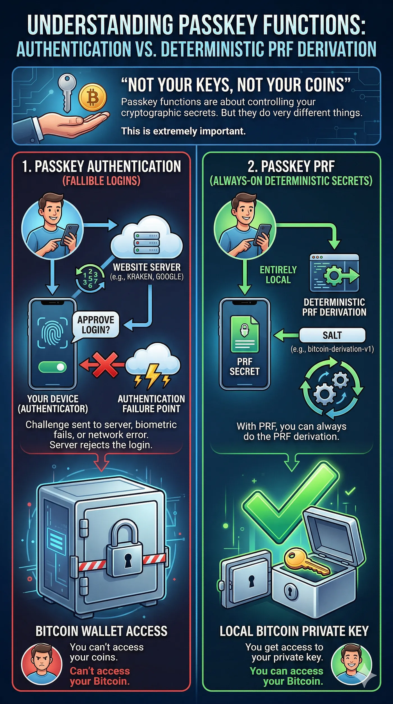

Microsoft hat gerade das Signaturzertifikat des VeraCrypt-Entwicklers gekillt. Keine Warnung, keine E-Mail, kein Mensch, mit dem man reden könnte. Eines Tages loggt er sich ein und sein Account ist weg. In der Nachricht steht, er kann nicht mal Widerspruch einlegen.

Der Typ hat VeraCrypt über zehn Jahre lang gepflegt. Millionen Nutzer. Egal. Das automatisierte System bei Microsoft hat entschieden, dass er fertig ist, und das war's.

Der WireGuard-Entwickler? Dasselbe, genau jetzt. Account gesperrt, 60 Tage Einspruchsfrist, keine Erklärung.

Und genau das wird auch mit deiner „selbstverwahrten" Passkey-Wallet passieren. Nicht ob, sondern wann.

## Passkey-Auth ist nicht dein Schlüssel

Passkey-Auth ist nicht dein Schlüssel. Lass uns das klarstellen, denn die ganze Branche versteht es falsch.

Wenn du dich mit einem Passkey bei Privy, Dynamic, Turnkey oder sonst wo einloggst, authentifizierst du dich. Das ist alles. Der Passkey beweist, dass du du bist.

Er gibt dir nicht deinen privaten Schlüssel. Er gibt dir Zugang zu einer Infrastruktur, die deinen privaten Schlüssel hält, oder Teile davon.

Privy teilt deinen Schlüssel mit Shamirs Secret Sharing in Shards auf und verteilt sie auf ihre Server. Dein Passkey ist der Haustürschlüssel zum Tresor von Privy. Aber es ist immer noch ihr Tresor.

Privy geht down? Shards weg. Privy wird von Stripe gekauft, was schon passiert ist, und das neue Management stellt das Produkt ein? Shards weg. Der Auth-Server von Privy hat einen schlechten Tag? Du kannst nicht signieren.

Ja, sie haben einen Export-Button. Versteckt in den Settings. Wie viele der 75 Millionen Accounts bei Privy haben ihren privaten Schlüssel wirklich exportiert? Ich wette, weniger als 1%.

Und die anderen 99%? Die denken, sie verwahren selbst. Tun sie nicht. Sie sind eine Unternehmensentscheidung davon entfernt, alles zu verlieren.

## PRF ist nicht Auth

PRF ist nicht Auth. Niemand redet über diesen Teil, und alle müssen ihn verstehen.

Die WebAuthn PRF-Erweiterung ist etwas komplett anderes als Passkey-Authentifizierung. Es geht nicht darum zu beweisen, wer du bist. Es geht darum, Schlüsselmaterial direkt aus deiner Hardware zu bekommen.

So funktioniert PRF. Dein Authenticator, also die Secure Enclave, ein TPM, ein YubiKey oder was auch immer, hält ein Geheimnis, das an deine Credential gebunden ist. Dieses Geheimnis verlässt niemals die Hardware.

Niemals. Wenn du dich mit eingeschaltetem PRF authentifizierst, nimmt der Authenticator einen Salt, den du ihm gibst, und berechnet HMAC(credential_secret, salt). Er gibt dir jedes Mal dieselbe 32-Byte-Ausgabe zurück.

Gleiche Credential und gleicher Salt bedeuten gleiche Ausgabe. Immer, für immer. Nur Mathe, kein Server.

Diese 32-Byte-Ausgabe ist dein Eingabeschlüsselmaterial. Jag es durch HKDF und du bekommst deinen privaten Bitcoin-Schlüssel. Immer denselben, auf deinem Gerät, offline, wenn du willst.

Genau das macht Nuri. Dein Passkey entsperrt keinen Tresor. Dein Passkey ist der Tresor. Das Schlüsselmaterial kommt direkt aus Hardware, die du in der Hand hältst. Kein Shard auf irgendeinem Server, keine Firma dazwischen, nichts, von dem du abhängst.

## Was, wenn nuri.com verschwindet

„Aber was, wenn nuri.com verschwindet?" Gute Frage, und die Antwort ist, dass es egal ist.

WebAuthn-Credentials sind an eine Relying Party ID gebunden, das ist im Grunde ein Domainname. Dein Passkey für Nuri ist an nuri.com gebunden. Der Authenticator prüft den SHA-256-Hash dieses Namens, wenn er die Credential auswählt.

Aber hier ist, was er nicht prüft. DNS, die Zertifizierungsstelle oder ob die Domain überhaupt live im Internet ist.

Wenn nuri.com morgen verschwindet, machst du Folgendes. Du bearbeitest /etc/hosts und zeigst nuri.com auf 127.0.0.1. Du startest einen lokalen HTTPS-Server mit einem selbstsignierten Zertifikat für nuri.com.

Du öffnest [https://nuri.com](https://nuri.com) in deinem Browser. Du triggerst den Passkey und fragst PRF mit dem dokumentierten Salt ab. Du bekommst dieselben 32 Bytes wie immer und leitest deinen privaten Schlüssel ab.

Kein Internet, kein Server, keine Erlaubnis von irgendjemandem.

Oder du lässt den Browser weg und benutzt libfido2, um direkt über CTAP2 mit deinem Authenticator zu sprechen. Du setzt rpId = „nuri.com", gibst ihm deine Credential-ID und den Salt.

Dem Authenticator ist es egal, woher die Anfrage kommt. Er führt einfach den HMAC aus und gibt dir die Ausgabe.

Das funktioniert, weil PRF auf der Hardware läuft. Die Domain wird nur benutzt, um auszuwählen, welche Credential benutzt wird, nicht für die Mathe selbst.

Der Authenticator weiß nicht und es interessiert ihn nicht, ob nuri.com ein Fortune-500-Unternehmen ist oder eine Localhost-Seite, die du in 30 Sekunden gestartet hast.

Mit Privy ist das schlicht unmöglich. Wenn ihre Server weg sind, sind die Shards weg. Es gibt keine lokale Wiederherstellung, keinen Offline-Weg, um deinen Schlüssel zurückzubekommen, nichts.

## Auth vs. PRF

Hier ist also der wirkliche Unterschied zwischen Auth und PRF.

Passkey-Auth, wie bei Privy, Turnkey und Dynamic, funktioniert so. Der Passkey beweist einem Server, wer du bist, und der Server gibt dir Zugang zu Schlüsselmaterial, das er kontrolliert.

Server down heißt kein Zugang. Domain tot heißt kein Zugang. Du musst deinen Schlüssel exportieren, solange der Dienst noch lebt, oder du verlierst ihn.

Passkey-PRF, wie bei Nuri, funktioniert so. Der Passkey holt das Schlüsselmaterial direkt aus deiner Hardware, und kein Server hält irgendeinen Teil deines Schlüssels. Server down ist egal, du leitest ihn lokal ab.

Domain tot, du startest eine Localhost-Seite und leitest denselben Schlüssel ab. Es gibt nichts zu exportieren, weil du den Schlüssel jederzeit aus deinem Passkey bekommen kannst.

Das eine ist Authentifizierung, das andere ist, mit Kryptografie einen Schlüssel aus deiner Hardware zu holen. Beide benutzen Passkeys. Sie sind überhaupt nicht dasselbe.

## Was ist mit Smart Accounts

Und was ist mit Smart Accounts? ZeroDev und andere ERC-4337-Anbieter sind besser als Privy. Dein Passkey signiert direkt und es gibt kein Key-Sharding. Aber du brauchst immer noch ihren Bundler, um deine Transaktionen zu senden, und dein Passkey ist immer noch an ihre Domain gebunden.

Den Domain-Teil kannst du genauso lösen, der Localhost-Trick funktioniert. Aber du brauchst auch einen Bundler, und den ZeroDev-Bundler kannst du nicht selbst hosten. Du bist also darauf angewiesen, einen anderen zu finden. Du kannst wiederherstellen, aber es ist nicht souverän.

Mit Nuri und PRF hängst du von keiner Infrastruktur ab. Null. Du leitest deinen Schlüssel ab, du hast einen normalen privaten Bitcoin-Schlüssel, und du kannst ihn mit jeder Wallet-Software benutzen, die es gibt.

Electrum, Sparrow, Core, was auch immer. Denn was aus PRF und HKDF herauskommt, ist einfach ein privater Schlüssel. Es ist ihm egal, welche Wallet ihn liest.

## Die VeraCrypt-Lektion

Das ist die VeraCrypt-Lektion. Microsoft hat den Entwickler nicht gewarnt, nichts erklärt und ihm keine Möglichkeit gegeben, dagegen vorzugehen. Ein automatisiertes System hat eine Entscheidung getroffen, und ein Jahrzehnt Vertrauen war mit einem Login weg.

Jeder zentrale Auth-Anbieter, jede Firma, die zwischen deinem Passkey und deinem privaten Schlüssel sitzt, ist eine automatisierte Entscheidung davon entfernt, dir dasselbe anzutun.

Das Einzige, was dich schützt, ist, wie das System gebaut ist. Nicht Versprechen, nicht Export-Buttons, nicht „wir würden das nie tun". Wie es gebaut ist.

Wenn dein Schlüssel existiert, weil ein Server ihn berechnet, gespeichert oder ein Stück davon hält, verwahrst du nicht selbst. Du mietest Zugang zu deinem eigenen Geld, und der Vermieter kann die Schlösser austauschen, wann immer er will.

PRF fragt nicht um Erlaubnis. PRF telefoniert nicht nach Hause. PRF ist Mathe, die auf Hardware läuft, die du in der Hand hältst.

Nicht deine Schlüssel, nicht deine Coins. Immer noch wahr, wahrer denn je.

Nuri ist eine selbstverwahrende Bitcoin- und Stablecoin-Wallet. Sie benutzt Passkeys mit der WebAuthn-PRF-Erweiterung, um immer denselben Schlüssel abzuleiten. Kein Server hält deine Schlüssel und keine Firma kann dich aussperren. nuri.com

