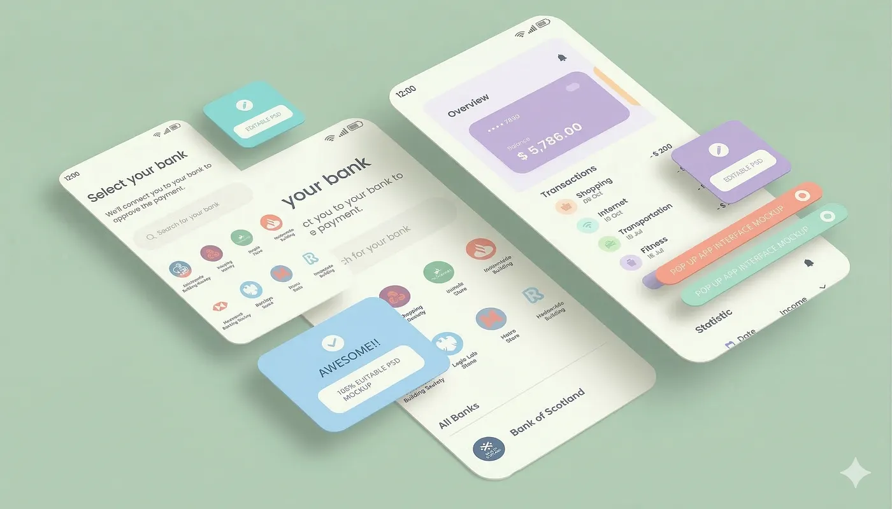

## Die IBAN ist eine Brücke

Die IBAN ist eine Brücke, kein Feature.

[Nuri.com](https://nuri.com) ist ein selbstverwalteter Bitcoin- und Stablecoin-E-Geld-Cash-Wallet. Keine Bank, keine Neobank. Ein Wallet.

Jeder verifizierte Nutzer bekommt eine IBAN. Und diese IBAN ist kein Konto. Sie ist eine Brücke zwischen dem alten Bankensystem und der Blockchain. Wenn jemand eine SEPA-Instant-Überweisung an deine IBAN schickt, wird E-Geld direkt als Stablecoins in dein Wallet gemintet.

Wenn du Geld rausschicken willst, werden Stablecoins geburnt und eine SEPA-Instant-Überweisung geht über die IBAN an den Empfänger raus. Mint rein, Burn raus. Die IBAN ist nur das Rohr.

Es gibt also keinen Bankkontostand. Es gibt keinen Datenbankeintrag, der irgendwo bei irgendeiner Bank rumliegt. Dein Geld lebt on-chain, in einem Wallet, das nur du kontrollierst.

Die IBAN ist nur der Weg rein und der Weg raus. Wenn Nuri morgen verschwindet, verschwindet dein Geld nicht. Genau darum geht es.

## Was fehlt

Was also fehlt.

IBANs funktionieren. Aber IBANs nerven. Du kopierst über 20 Zeichen, wechselst die App, fügst sie in deine Banking-App ein, bestätigst mit 2FA, wartest und hoffst, dass du dich nicht vertippt hast.

Es ist 2025 und wir machen das immer noch so. Die Leute wollen das nicht. Sie wollen einen Knopf drücken und fertig sein.

Genau das löst Open Banking. Nicht als Produkt, als Unterbau.

Es gibt zwei Anwendungsfälle.

## Aufladen per Bank

Der erste ist Aufladen per Bank. Du öffnest die Nuri-App und klickst auf „Geld hinzufügen". Du wirst zu deiner Mobile-Banking-App geschickt, bestätigst den Betrag, fertig. Das Geld landet als Stablecoins im Wallet.

Kein IBAN-Kopieren, nichts zu tippen, kein Hin- und Herspringen zwischen Apps. Ein Knopf, eine Bestätigung, und das Geld ist da.

Die SEPA-Instant-Überweisung läuft im Hintergrund, genau wie vorher, aber du siehst die IBAN nie. Open Banking startet die Zahlung und die Blockchain rechnet sie ab.

Jedes moderne Fintech macht Aufladungen so. Nala macht es für Überweisungen. Revolut pusht es hart. Wir wissen, dass die Leute es mögen. Der Unterschied hier ist, dass das Geld nicht auf einem Bankkonto landet. Es wird in ein selbstverwaltetes Wallet gemintet. Das ist neu.

## Pay by Bank beim Checkout

Der zweite ist Pay by Bank beim Checkout. Immer mehr Händler bieten „Pay by Bank" an, wenn du bezahlst. Es hat niedrigere Gebühren als Visa, es wird sofort abgerechnet und es gibt keine Rückbuchungen. Es wächst schnell, und das aus guten Gründen.

Wir wollen, dass Nuri-Nutzer das nutzen können.

Du shoppst online, wählst „Pay by Bank", der Link öffnet die Nuri-App, du bestätigst die Zahlung, und eine SEPA-Instant-Überweisung geht von deiner IBAN zum Händler. Stablecoins werden geburnt, der Händler bekommt Euro. Fertig.

Du verlässt den Flow nie. Kein IBAN-Nachschlagen, keine manuelle Überweisung, keine Reibung. Für den Händler sieht es aus wie jede andere Open-Banking-Zahlung.

Für dich sieht es aus wie Bezahlen von einer Bank, nur dass es keine Bank gibt. Nur ein Wallet, das dieselbe Sprache spricht.

## Unterbau, nicht das Produkt

Was das wirklich ist, ist Deep Linking zwischen Wallets und Banken. Nichts mehr.

Open Banking ist nicht das Produkt. Das Wallet ist das Produkt. Open Banking ist die Schicht, die ein Wallet, das auf der Blockchain lebt, überall wie ein Bankkonto verhalten lässt, wo die Leute eine Bank erwarten. Aufladungen, Checkouts, Zahlungslinks, alles davon.

Die IBAN sorgt schon dafür, dass Nuri mit Banken auf Protokollebene funktioniert. Open Banking sorgt dafür, dass es mit Banken auf UX-Ebene funktioniert. Zusammen bekommst du ein Wallet, das sich im Alltag genau wie ein Bankkonto anfühlt, aber unter der Haube komplett anders ist.

Keine Bank, keine Verwahrung, kein Gegenparteirisiko. Nur eine Brücke, die in beide Richtungen funktioniert, und ein Knopf, der sie unsichtbar macht.

## Drei Stufen

Wir wollen es in drei Stufen ausrollen.

Stufe eins ist Aufladen per Bank. Ein Knopf, Geld rein. Das allein beseitigt die größte Reibung für neue Nutzer, wenn sie ihr Wallet aufladen.

Stufe zwei ist Pay by Bank bei Zahlungslinks. Nuri macht schon Zahlungslinks, bei denen der Zahler wählen kann, wie er zahlt, mit Krypto, Stablecoin oder Banküberweisung.

Wenn wir hier einen „Pay by Bank"-Knopf hinzufügen, muss der Sender nicht mal ein Nuri-Nutzer sein. Er klickt, sagt ja in seiner eigenen Banking-App, und die Zahlung kommt als Stablecoins im Wallet des Händlers an.

Stufe drei ist voller Open-Banking-Checkout. Nuri-Nutzer können überall zahlen, wo Pay by Bank akzeptiert wird. Das braucht eine tiefere Integration, weil das Wallet als gültiger Ausgangspunkt für eine Zahlung in der Open-Banking-Welt akzeptiert werden muss.

Technisch funktioniert es, ein Knopf löst eine SEPA-Instant-Überweisung von deiner IBAN aus. Ob die Banken und Anbieter ein Wallet akzeptieren, das keine Bank ist, das ist die offene Frage.

## Warum das wichtig ist

Warum das wichtig ist. Niemand hat gesagt, dass kontaktloses Bezahlen groß wird. Jetzt gibt es nichts anderes mehr.

Die Leute wählen Komfort und Geschwindigkeit über alles. Jedes Mal. Eine IBAN zu kopieren ist nicht bequem. Einen Knopf zu drücken schon.

Die Nutzer werden es uns sagen, aber die Wette ist einfach. Wenn die Leute zwischen 22 Zeichen kopieren und einem Knopfdruck wählen können, drücken sie den Knopf.

Open Banking ändert nicht, was Nuri ist. Es ändert, wie unsichtbar die Brücke wird.

## Unter der Haube

Und so funktioniert es unter der Haube. Nuri ist keine Bank. Nuri ist ein selbstverwaltetes Wallet für Stablecoins und Bitcoin.

Die Bankenschienen sind da wegen Monerium, einem regulierten E-Geld-Institut, und Monerium verbindet sich mit der LHV Bank für die IBANs und für SEPA Instant.

Nuri steckt in Monerium, Monerium steckt in LHV. Du hast nie ein Bankkonto. Du hast ein Wallet mit einem angeschlossenen Rohr.

Wenn eine SEPA-Instant-Überweisung bei deiner IBAN ankommt, mintet Monerium EURe-Stablecoins direkt ins Wallet. Wenn du Geld rausschickst, wird EURe geburnt und Monerium startet eine SEPA-Instant-Überweisung von der IBAN an die Person, die du bezahlst.

Wenn eine Transaktion fehlschlägt oder rückgängig gemacht wird, gehen die Stablecoins einfach zurück ins Wallet, gleicher Weg, andersherum. Es gibt keinen Zustand dazwischen.

Dein Geld ist entweder on-chain in deinem Wallet oder auf dem Weg durch die IBAN. Die Brücke funktioniert in beide Richtungen, immer.
