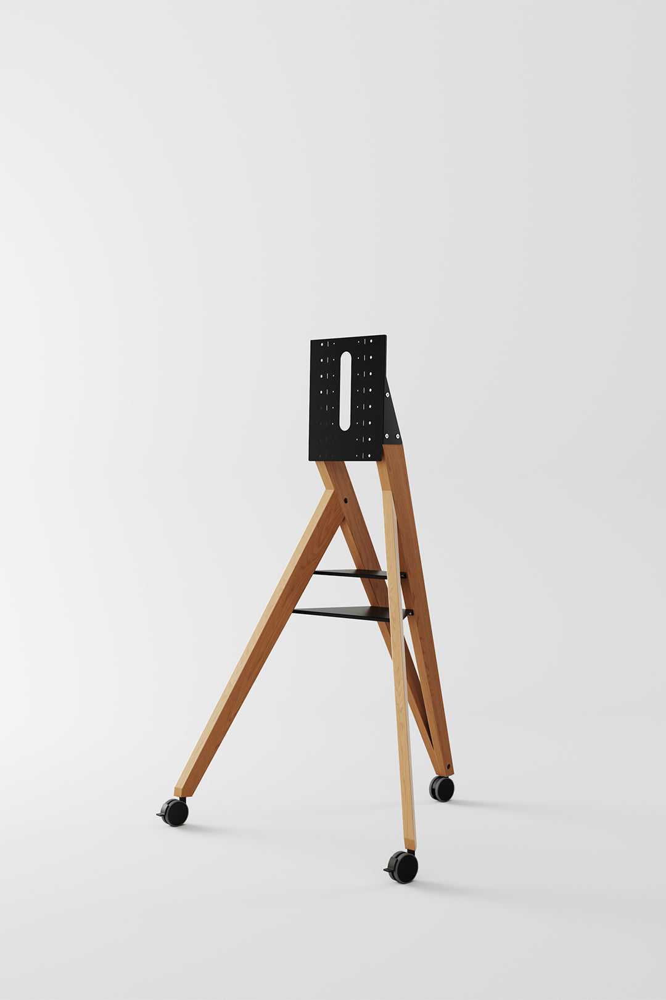

Das hier ist eine Zusammenfassung eines Videos, das Paul Johnsons Essay über Pablo Picasso durchgeht, das Video ist unten verlinkt. Picassos Leben ist ein hartes Paradox. Er war ein Mann mit einem kreativen Output und einem finanziellen Erfolg wie niemand vor ihm, und vielen Berichten zufolge war er auch ein „Monster aus abgesichertem Egoismus“. Basierend auf der Videoanalyse des Essays gibt es hier ein Ranking der „schlimmen und verrückten“ Fakten über ihn, von seinem verstörendsten Verhalten bis zu seinen beeindruckendsten Leistungen.

## Das negativste und verstörendste Verhalten

Picasso soll seine talentierteste Geliebte geschlagen und bewusstlos auf dem Boden liegen gelassen haben. Er hatte Freude daran, Frauen wehzutun, und inszenierte absichtlich Situationen, in denen seine Geliebten aufeinandertrafen. Einmal sah er zu, wie zwei von ihnen sich auf dem Boden prügelten, während er ruhig weitermalte. Er sagte offen, dass Frauen für ihn entweder „Göttinnen oder Fußabtreter“ waren, und sein eigenes Ziel war es, eine „Göttin“ Schritt für Schritt in einen „Fußabtreter“ zu verwandeln. Er stahl die Frauen seiner Freunde und sagte dem Ehemann dann, er „ehre“ ihn damit, dass er mit ihr schlief. Johnson beschreibt ihn als jemanden, dem die grundlegende menschliche Fähigkeit fehlte, richtig von falsch oder Wahrheit von Lüge zu unterscheiden, und der Freundlichkeit und Großzügigkeit als Schwächen ansah, die man ausnutzen konnte. Und seine Grausamkeit hinterließ eine dunkle Spur in seiner Familie. Nach seinem Tod brachte sich seine Witwe durch einen Schuss um, und sein ältester Sohn starb am Alkoholismus.

## Die verrückte und arrogante Seite

Die Leute hörten ihn oft „Ich bin Gott, ich bin Gott“ vor sich hin wiederholen. Und trotz all seines Ruhms gab er hin und wieder zu: „Ich bin nichts als ein Clown“, was darauf hindeutet, dass er seinen riesigen Erfolg manchmal für einen „Betrug“ hielt.

## Die beeindruckende Seite, Genie und Reichtum

Zwischen seinem 20. und 91. Lebensjahr schuf Picasso im Schnitt jeden einzelnen Tag ein neues Kunstwerk, das macht in 71 Jahren 26.075 veröffentlichte Werke. Er war ein Meister des Marketings, der „immer wusste, was sich verkaufen würde“. Er war schon 1914 Millionär und starb als reichster Künstler der Geschichte. Sein enormer Egoismus zerstörte sein Privatleben, gab ihm aber auch eine Fokussierung, die ihm half, das visuelle Erleben des 20. Jahrhunderts zu verändern.

## Ein paar weitere Dinge, die man wissen sollte

Picasso änderte seinen Stil immer wieder und brach seine eigenen Regeln, und das ist ein Grund, warum er jahrzehntelang an der Spitze der Kultur blieb. Er behandelte das Schaffen wie einen Zwang, und für ihn war das Kreieren näher am Atmen als an „Inspiration“. Er baute seine Persona so sorgfältig auf wie seine Gemälde, weil er Ruhm als Medium verstand. Außerdem hob er alles auf, eine riesige Menge an Arbeit und Material, und das stärkte seinen Platz in der Geschichte und speiste später einen riesigen Nachlass. Und dieselben Eigenschaften, die ihn in der Kunst unaufhaltsam machten, machten ihn in Beziehungen brutal.

Das Quellvideo ist https://www.youtube.com/watch?v=9_QO_zYjvro

