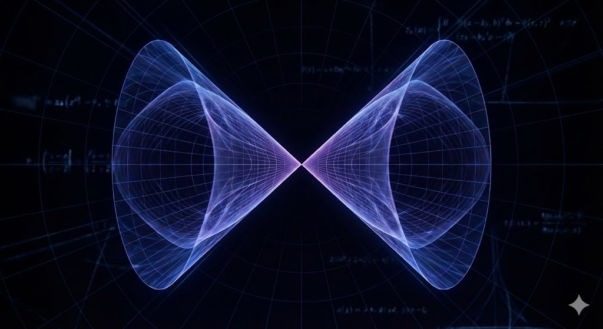

Das ist eine Zusammenfassung von Jim Simons' Vortrag im MoMath, [Jim Simons at MoMath: My Life in Mathematics](https://www.youtube.com/watch?v=QUTaQvnwLzM).

In diesem Vortrag erzählt Simons die Geschichte eines der großen Durchbrüche in der modernen Mathematik. Es geht darum, wie er und ein paar brillante Kollegen einen Riss im Universum der Geometrie fanden und zeigten, dass die effizientesten Formen in höheren Dimensionen nicht immer glatt sind.

## Seifenfilme und glatte Oberflächen

Um den Simons-Kegel zu verstehen, muss man sich erstmal anschauen, wie sich die Natur verhält. Simons erklärt es am Plateau-Problem, benannt nach einem Wissenschaftler, der mit Seifenfilmen experimentiert hat. Wenn du einen Drahtrahmen in Seifenwasser tauchst, bildet sich ein Seifenfilm, der eine Minimalfläche ist. Er spannt sich über den Rahmen mit der kleinstmöglichen Fläche. Hunderte von Jahren dachten Mathematiker, diese effizienten Oberflächen seien immer glatt, also perfekt gerundet wie eine Kugel oder eine Welle, ohne scharfe Ecken oder Spitzen.

In der Welt, die wir sehen können, in 3D, sind diese Seifenfilme immer glatt. Und Mathematiker haben bewiesen, dass diese Regel auch in Dimensionen gilt, die wir nicht sehen können. In 2D, 3D, 4D, 5D und 6D ist jede Minimalfläche perfekt glatt, und schließlich wurde es auch für die 7. Dimension bewiesen. An diesem Punkt dachten die meisten Mathematiker, das sei ein universelles Gesetz: Egal wie viele Dimensionen man hat, die effizienteste Form ist immer glatt.

## Die achte Dimension

Simons hat sich angeschaut, was passiert, wenn man in die 8. Dimension geht, und er hat etwas gefunden, das die mathematische Welt schockiert hat. Eine Form, die heute Simons-Kegel heißt, die perfekt effizient ist und die kleinstmögliche Fläche nutzt, aber nicht glatt ist. Sie hat eine Singularität genau in der Mitte. Stell dir zwei unendlich scharfe Kegel vor, die sich genau an ihren Spitzen treffen. In seinen eigenen Worten: "It turned out that seven was the magic number. Up to seven dimensions, the area-minimizing variety is smooth. But in eight dimensions, there's a thing called the Simons Cone... it has a singularity at the origin, and it is area-minimizing." [00:05:10]

## Warum das wichtig ist

Das war mehr als nur eine mathematische Tatsache. Es war ein Gegenbeispiel, das eine 50 Jahre alte Annahme zerstört hat, und es ist aus drei Gründen wichtig. Erstens hat es gezeigt, dass bei zunehmender Komplexität, mit mehr Dimensionen oder Variablen, Effizienz keine Glätte mehr braucht. Im hochdimensionalen Raum kann die perfekteste und effizienteste Form scharf und gezackt sein. Zweitens hat er eine Klippe in der Mathematik gefunden. Bis zu 7 Dimensionen funktioniert alles auf eine bestimmte Weise, und in der 8. Dimension ändern sich die Spielregeln komplett. Drittens hat es Mathematikern und Physikern eine neue Möglichkeit gegeben, Singularitäten zu untersuchen, also Punkte, an denen die Mathematik bricht oder unendlich wird. Das erwies sich als sehr wichtig für Dinge wie Schwarze-Löcher-Physik und Stringtheorie.

## Was Simons daraus mitgenommen hat

Simons sieht das als einen Moment reiner ästhetischer Entdeckung. Er hat nicht versucht, Geld zu verdienen oder einen Code zu knacken, er hat nach einer schönen Wahrheit in der Geometrie gesucht. Er spricht über die Aufregung, als er herausfand, dass sieben die magische Zahl war, und er sagt, die Natur hat diese seltsamen versteckten Grenzen. Und er liest es als eine Lektion darin, nicht der Masse zu folgen. Während andere versucht haben zu beweisen, dass Glätte ewig anhält, hat Simons dorthin geschaut, wo niemand sonst hingeschaut hat, und hat den genauen Punkt gefunden, an dem die Theorie auseinanderfiel.

Der Simons-Kegel ist immer noch eines der berühmtesten Objekte in der Geometrie. Er steht für den Moment, in dem wir gesehen haben, dass der hochdimensionale Raum viel seltsamer ist, als wir je dachten. Für Simons war es der Beweis, dass man, wenn man tief genug in die Mathematik gräbt, Strukturen findet, die erschreckend komplex und auch wunderschön sind.

