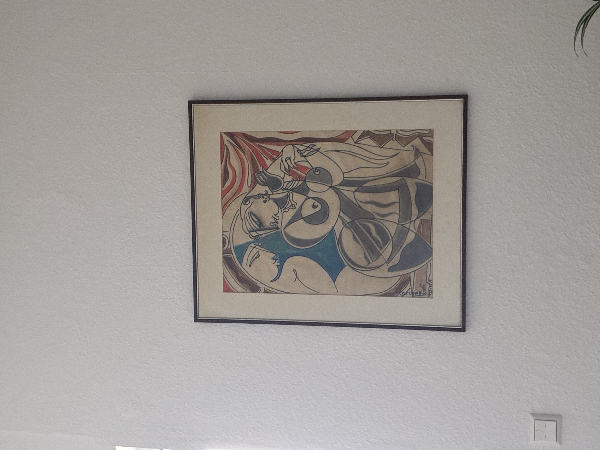

Hii hapa ni mfululizo mzima wa maswali yangu kuhusu tabia ya aina ya Darwin katika fizikia ya quantum, nimeyapanga vizuri. Nini maana halisi ya entanglement na nini haiwezi kufanya, kwa nini upimaji na decoherence vinaonekana kama uteuzi, ni zipi degrees of freedom zinazoweza kuwa entangled, nuclear spin inakaa wapi, na kipimo cha uhakika zaidi cha utaratibu wa aina ya Darwin kinaonekanaje. Utaratibu huo tayari una jina, nao ni Quantum Darwinism.

## Maswali yangu, kwa mpangilio

Nilikuwa najaribu kuunda picha moja ya Darwin ya fizikia ya quantum, na nilikuwa na maswali tisa. Matatu ya kwanza yalikuwa kuhusu entanglement yenyewe, kisha la nne na la tano kuhusu uthibitisho na spin, la sita kuhusu quantum computing, la saba na la nane kuhusu fizikia ya nyuklia na ulimwengu mzima, na la mwisho lilikuwa hitimisho.

Ilianza hivi. Entanglement inaonekana kama muunganisho uliopo mbali. Kama mifumo A na B ziko entangled, basi A ikibadilika, B inajisasisha, hata kama ziko mbali sana. Na kama B inajisasisha, B inapaswa kuathiri mazingira yake, kwa sababu katika fizikia halisi vitu kama spin, polarization, frequency na energy hubadilisha jinsi kitu kinavyoingiliana na kile kinachokizunguka. Kwa hiyo nikauliza, kama entanglement inaisasisha B, mazingira ya B hayapaswi kuitikia? Lakini kila mtu anasema entanglement haiwezi kutuma ushawishi au taarifa yoyote, nami nilishuku mipaka hii inaweza kuwa si sahihi, kwa sababu sasisho hilo linaonekana kuwa la kweli.

Kisha nilitaka kujua tunathibitishaje entanglement. Je, tunahitaji kupima pande zote mbili kwa wakati mmoja? Je, tunahitaji kubadilisha A na B pamoja ili ziendelee kuwa entangled, au tunaweza kufanyia kazi upande mmoja tu? Na je, entanglement ni kuhusu spin na 0 na 1 pekee, au kuna sifa nyingine zilizounganishwa, labda zile za kifizikia zaidi, ambazo huathiri mazingira kwa njia tofauti?

Quantum computing ni ngumu kwa sababu kuitazama hali yake huibadilisha na makosa yapo kila mahali. Niliuliza kama hiyo ni aina ya ushindani kati ya hali tofauti, ambapo uwezekano mwingi hupambana na mmoja husalia, jambo ambalo linafanana sana na Darwin. Kisha fizikia ya nyuklia. Spin ni muhimu katika chaneli za miitikio ya fusion na fission, kwa hiyo je, kubadilisha spin katikati ya mchakato kunaweza kuleta njia tofauti za miitikio, na je, entanglement pamoja na miitikio ya nyuklia inaweza kutengeneza utaratibu wa uteuzi wa aina ya Darwin? Na tukivuta picha pana hadi ulimwengu mzima, tukiwa na black holes, upanuzi na uumbaji wa mada, je, mitandao mikubwa ya entanglement inaweza kutengeneza machafuko mahali pengine, kama ushawishi wa Darwin katika fizikia?

Hitimisho lilikuwa swali moja. Ni majaribio gani ya karibu zaidi, na jaribio la kimawazo la karibu zaidi, ambapo fizikia ya quantum inatenda kama Darwin kweli, na nini kingehesabika kama uthibitisho? Sehemu iliyobaki ya post hii inajibu yote hayo na inabaki na wazo la Darwin, lakini inatenganisha correlation na sababu.

## Entanglement ni correlation na siyo rimoti ya kudhibiti

Entanglement inakupa correlation imara kati ya matokeo wakati A na B zinapimwa na matokeo kulinganishwa baadaye. Kama A na B ziko entangled na unapima kitu kilekile pande zote mbili, unapata matokeo kama up-down, up-down, au up-up, down-down, katika muundo mkali sana. Ni imara zaidi kuliko chochote ambacho mbegu ya random ya classical inaweza kuzalisha.

Ambacho entanglement haikupi ni hiki. Ninachagua kitendo kwenye A, na hiyo inalazimisha mabadiliko kwenye B ambayo B inaweza kuyatambua kienyeji, na hivyo pia katika mazingira ya B, bila ishara yoyote ya kawaida. Hii ndiyo kanuni ya no-signaling au no-communication, na inasema vitendo vya kienyeji kwenye A haviwezi kutumika kutuma taarifa inayoweza kudhibitiwa kwenda B. Taarifa safi ni no-communication theorem, mara nyingi huwasilishwa kama no-signaling principle, na kuna muhtasari mzuri katika [ukurasa wa Wikipedia kuhusu no-communication theorem](https://en.wikipedia.org/wiki/No-communication_theorem).

Kwa hiyo hatua yangu ya "B lazima iathiri mazingira yake" haifuati mantiki hiyo. Nilikuwa nikifikiria kuwa A inaisasisha B, B imekaa katika mazingira, kwa hiyo mazingira yanapaswa kuitikia kwa njia tofauti. Lakini sasisho unalopata kutoka entanglement ni hasa sasisho la uhusiano, correlations, na inakuwa muhimu tu baada ya matokeo kulinganishwa. Kienyeji, B bado inaonekana ileile katika takwimu zake hadi B ipate taarifa ya kawaida kutoka A, na hiyo ni classical communication kwa mwendo wa mwanga. Sasisho ni la kweli katika takwimu za pamoja, lakini halijawahi kuwa msukumo wa kienyeji unaoweza kudhibitiwa kwenye B.

Pia nilisema kuwa hata bila kupima tunaweza kujua kihisabati kuwa hali ya pamoja ilibadilika, kwa hiyo B inabadilika. Toleo safi linaweka wazo hilo na kurekebisha hitimisho. Nadharia ya quantum inakuruhusu kuelezea hali ya jumla ya A-B na pia maelezo ya kienyeji ya B pekee. Kutenda kwenye A kunaweza kubadilisha correlations za jumla. Lakini maelezo ya kienyeji ya B, sehemu ambayo huamua jinsi B inavyoingiliana na vitu vilivyo karibu, haibadiliki kwa njia inayoweza kudhibitiwa eti tu kwa sababu ulifanya kitu kwenye A. Kwa hiyo "B ilibadilika" ni kweli kwa muundo wa jumla wa correlation na ni uongo kwa tabia unayoweza kuigundua kienyeji kwenye B.

Neno la kiufundi nililokuwa nikitafuta, kwa mifumo miwili ya mbali ambapo mabadiliko hapa yanabadilisha kile tunachoweza kusema kuhusu upande mwingine, ni entanglement, kumaanisha shared nonclassical correlations. Neno lingine linalolingana ambalo wakati mwingine linafaa katika intuition ni quantum steering. Kwa kuchagua kile unachopima kwenye A, unaweza kuongoza conditional ensemble ambayo ungeikabidhi kwa B. Lakini B bado haiwezi kujua iko katika ensemble ipi bila taarifa za classical kutoka A, kwa hiyo hakuna rimoti ya kudhibiti. Entanglement ndilo neno kuu na steering ni ufafanuzi wa ziada.

## Tunathibitishaje entanglement

Katika maabara, kiwango cha dhahabu ni kupima A na B katika settings kadhaa na kuonyesha kuwa correlations zinavunja Bell inequality, mara nyingi ile ya CHSH. Jaribio linalojulikana la Bell lisilo na mianya (loophole-free) ni [Hensen et al. 2015 katika Nature](https://www.nature.com/articles/nature15759).

Hatuhitaji muda uleule katika maana ya kila siku. Lakini katika vipimo safi vya Bell, chaguzi za setting ni huru na hufanywa baadaye, na matukio ya upimaji yametenganishwa kianga (spacelike separated), kwa hiyo ishara za kawaida haziwezi kuratibu matokeo. Hiyo inaondoa uratibu wa classical kama sababu ya jinsi correlations hizo zilivyo imara.

Na hatuhitaji kufanyia kazi pande zote mbili ili kudumisha entanglement. Unaweza kufanya operesheni nyingi upande mmoja, unitaries na rotations, na entanglement inabaki. Upimaji upande mmoja mara nyingi hubadilisha entanglement kuwa classical correlation, kwa sababu upimaji hutengeneza rekodi kamili ya matokeo. Kwa hiyo unaweza kutenda upande mmoja, lakini huwezi kutumia hiyo kulazimisha mabadiliko yanayoweza kudhibitiwa upande mwingine ambayo mtu huko anaweza kuyaona.

Entanglement pia siyo spin na 0 na 1 pekee. Spin ndiyo hadithi rahisi zaidi. Unaweza kufanya entanglement ya degrees of freedom nyingi, kama photon polarization, path au njia ipi, time-bin kama mapema au kuchelewa, frequency na energy, orbital angular momentum na vibrational au collective modes. Na mifumo haihitaji kuwa na level mbili tu. Qubits zina level mbili kwa sababu hiyo ni rahisi, lakini qudits zenye d levels zipo na vivyo hivyo continuous-variable entanglement. Kwa hoja yangu, hii inamaanisha degrees of freedom tofauti zinaweza kuathiri mazingira yao ya kienyeji kwa njia tofauti, lakini hakuna hata moja inayomruhusu A kudhibiti takwimu za kienyeji za B kutoka mbali. No-signaling bado inatumika.

## Kwa nini kompyuta ya quantum inahisi kama Darwin

Nimeona uhusiano kati ya mambo mawili. Kwenye kompyuta ya quantum, kuitazama hali fulani kunaibadilisha, na kelele pamoja na *decoherence* huleta makosa, kwa hivyo ni vigumu kuhifadhi *superpositions*. Hii inafanana na aina fulani ya uteuzi. Kuna uwezekano mwingi wa quantum, mazingira yanapenda kuharibu *superpositions* dhaifu, na mifumo thabiti hudumu kwa muda mrefu. Lakini huu si Darwinism wa kibiolojia. Hakuna ubadilikaji usio na mwisho, hakuna idadi ya viumbe inayobadilika, na hakuna muundo unaojijenga. Hata hivyo, hisia hii inaelekea kwenye fizikia halisi, kwa sababu mazingira hufuatilia mfumo na kuchuja hali zake. Na hilo linatuelekeza moja kwa moja kwenye mfumo mkuu unaofanana na wa Darwin katika misingi ya quantum, ambao ni *Quantum Darwinism*.

*Quantum Darwinism*, wazo lililoanzishwa na Zurek na wenzake, linasema mazingira hufanya mambo mawili yaliyounganishwa. La kwanza ni uteuzi, unaoitwa *einselection*. Mwingiliano na mazingira huchagua *pointer states* ambazo ni thabiti na zinazoweza kuhimili kufuatiliwa. La pili ni *replication*, yaani uwezo wa kumbukumbu kujirudia. Taarifa kuhusu *pointer states* hizo hunakiliwa kwenye sehemu nyingi tofauti za mazingira, kwa hivyo wachunguzi wengi wanaweza kusoma sehemu tofauti na bado wakakubaliana kwenye ukweli mmoja wa *classical*. Karatasi ya msingi ni [Zurek 2009, Quantum Darwinism](https://arxiv.org/abs/0903.5082). Mfano rahisi na mazingira ya kawaida, ambapo fotoni zilizotawanyika huunda *redundancy* kubwa, ni [Riedel na Zurek 2010 katika PRL](https://link.aps.org/doi/10.1103/PhysRevLett.105.020404). Na ufafanuzi wa kiutendaji na uchambuzi wa *redundancy* unapatikana katika [Zwolak na Zurek 2017 katika PRA](https://link.aps.org/doi/10.1103/PhysRevA.95.030101).

Hii inafaa zaidi kwa mlinganisho wa Darwin kuliko *entanglement* pekee. *Variants* ni njia mbadala za quantum zilizopo kwenye *superposition*. Shinikizo la uteuzi ni *decoherence*, mazingira yanayofuatilia mfumo. Walionusurika ni *pointer states* zinazobaki thabiti chini ya shinikizo hilo. Na *replication* ni sehemu nyingi za mazingira zinazorekodi taarifa ileile ya *pointer*. Hiyo ndiyo hasa hadithi ya aina ya Darwin niliyokuwa naitafuta, si ushawishi wa mbali. Ni uteuzi wa ndani na kunakili taarifa kwenye mazingira yanayokuzunguka.

## Jaribio la kufikiria lenye mabawa mawili

Nilitaka *entanglement*, mifumo miwili ya mbali, kila moja ikiwa katika mazingira yake yenyewe, mazingira yanayotenda kwa njia ya Darwin, na njia wazi ya kuijaribu. Hili hapa ni toleo safi zaidi linalohifadhi yote hayo na bado linaheshimu *no-signaling*, na ninaliita *two-wing Quantum Darwinism*.

Kwanza, unaandaa mifumo miwili, A na B, katika hali ya *entanglement*. Kisha unakipa kila mfumo mazingira yake. A inashirikiana ndani ya eneo lake na mazingira E_A yaliyoundwa na vipande vingi, kama vile *ancilla qubits* nyingi au *photon modes* nyingi, na B inashirikiana ndani ya eneo lake na mazingira E_B ambayo pia yana vipande vingi. Hakuna mwingiliano wa kuvuka kati ya mabawa hayo mawili, ni A↔E_A na B↔E_B pekee. Kisha unayaacha mazingira yafuatilie sifa inayopendekezwa. Mwingiliano hupima sifa fulani kila upande, *pointer property*, na hiyo inakandamiza *superpositions* dhaifu, ambayo ndiyo uteuzi. Kisha rekodi zinasambaa. Matokeo ya *pointer* yananakiliwa kwenye vipande vingi vya kila mazingira, na wachunguzi wengi huru wanaweza kuchukua sampuli ya vipande tofauti na kufikia hitimisho moja, ambayo ndiyo *replication* na *objectivity*.

Kwa hivyo ulitumia *entanglement*, wazo langu la muunganiko, lakini sehemu inayofanana na Darwin inatokea ndani ya eneo husika. Mazingira huchagua na mazingira hunakili rekodi. Kile usichokipata ni A kuyafanya mazingira ya B yatende tofauti, kwa sababu hiyo ingekuwa udhibiti wa mbali na ingevunja *no-signaling*. Badala yake, unapata kitu cha hila zaidi na kilicho karibu na picha yangu ya Darwin. Mahusiano ya quantum yapo duniani kote, lakini uhalisia wa *classical* unajitokeza ndani ya maeneo husika kupitia uteuzi na kunakili taarifa kwenye mazingira.

## Ni nini kingehesabika kama uthibitisho

Niliuliza kuhusu uwezekano wa jaribio la kulithibitisha. *Quantum Darwinism* ni zaidi ya *decoherence*, na madai yake makuu unayoweza kuyaona ni kwamba rekodi zinazojirudia zipo. Vipande vingi tofauti vya mazingira kila kimoja kinabeba, kwa upande wake, taarifa karibu sawa ya *classical* kuhusu *pointer state* ya mfumo.

Njia rahisi zaidi ya uthibitisho haihitaji hesabu nzito. Unafanya majaribio mengi, na katika kila jaribio unaandaa mfumo, unauacha ushirikiane na mazingira yake kisha unapima sehemu ndogo tu ya vipande vya mazingira. Ikiwa sehemu ndogo tayari zinaonyesha matokeo ya *pointer* kwa uhakika, na sehemu nyingi tofauti zinafanya hivyo kwa kujitegemea, basi mazingira yanashikilia nakala nyingi, na hiyo ndiyo *redundancy*. Kwenye karatasi hizi, hii inaonyeshwa kwenye grafu za kiasi cha taarifa unachopata dhidi ya ukubwa wa sehemu ya mazingira unayokamata, kukiwa na kupanda kwa kasi na uwanda mpana, *redundancy plateau*. Riedel na Zurek 2010 na Zwolak na Zurek 2017 wanazungumzia aina hii ya alama, kwenye [karatasi ya PRL](https://link.aps.org/doi/10.1103/PhysRevLett.105.020404) na [karatasi ya PRA](https://link.aps.org/doi/10.1103/PhysRevA.95.030101).

Pia kuna jaribio la kudhibiti kwa ajili ya uteuzi. Unarudia ukaguzi uleule wa *redundancy* kwa sifa tofauti ambayo haiendani na ya kwanza. Utabiri ni kwamba *redundancy* ina nguvu kwa taarifa za *pointer* na ni dhaifu kwa *observables* zisizoendana, kwa sababu mazingira huchagua ni taarifa ipi itanusurika na kunakiliwa.

Na hii imeshafanyika katika maabara halisi. Jaribio la hivi karibuni linaripoti kuona alama za *Quantum Darwinism* kwa kutumia *superconducting circuits*, Zhu et al. 2025, "Observation of quantum Darwinism and the origin of classicality with superconducting circuits" katika *Science Advances*, kwenye [science.org](https://www.science.org/doi/10.1126/sciadv.adx6857) na upatikanaji huria kwenye [PMC](https://pmc.ncbi.nlm.nih.gov/articles/PMC12315987/). Kwa swali langu kuhusu uthibitisho, hili ni muhimu kwa sababu linaonyesha kuwa programu ya *redundancy* na kusambaa kwa rekodi inafanya kazi katika mifumo iliyotengenezwa. Toleo langu la mabawa mawili, ambapo unaanza na A–B *entanglement*, unayaacha mabawa yote yasambaze rekodi ndani ya maeneo yake na kufuatilia jinsi mahusiano yanavyokuwa rekodi za ukweli, ni rahisi kama dhana lakini ni ngumu zaidi katika utekelezaji, kwa sababu inahitaji *qubits* na *modes* zaidi, *calibration* zaidi na vipimo zaidi.

Sehemu ya mwisho ni *spin*. Niliuliza kama *spin* ina umuhimu wowote wa kifizikia, kwa mfano katika *fusion* na *fission*, na ikiwa *entanglement* pamoja na *spin* vinaweza kubadilisha njia za mmenyuko. *Spin* ina umuhimu ndani ya uwezekano wa mmenyuko wa nyuklia, na ndiyo, kupanga *spins* kunaweza kubadilisha njia za mmenyuko zinazopendekezwa. Mfano halisi ni *spin-polarized D–T fuel*. Mapitio na hesabu zinasema kuwa kupanga *spins* za D na T kunaweza kuongeza *D–T fusion cross section* kwa takriban *factor* ya 1.5, yaani takriban 50% zaidi, chini ya mawazo bora ya *polarization*. Chanzo ni [Heidbrink et al. 2024 katika Frontiers in Physics](https://www.frontiersin.org/journals/physics/articles/10.3389/fphy.2024.1355212/full), na [PDF](https://juser.fz-juelich.de/record/1026967/files/fphy-12-1355212.pdf) inataja *factor* hiyo ya 1.5.

Katika toleo la kwanza la chapisho hili sehemu zilikuwa zimepewa namba 0 hadi 11, zikiwa na 10 na 11 mwishoni, na sehemu ndogo 1.1 na 1.2 na 1.3 na 4.1 na 4.2 na 4.3 na 7.1 na 7.2 na 11.1 zote bado zipo hapa kwa mpangilio uleule.
