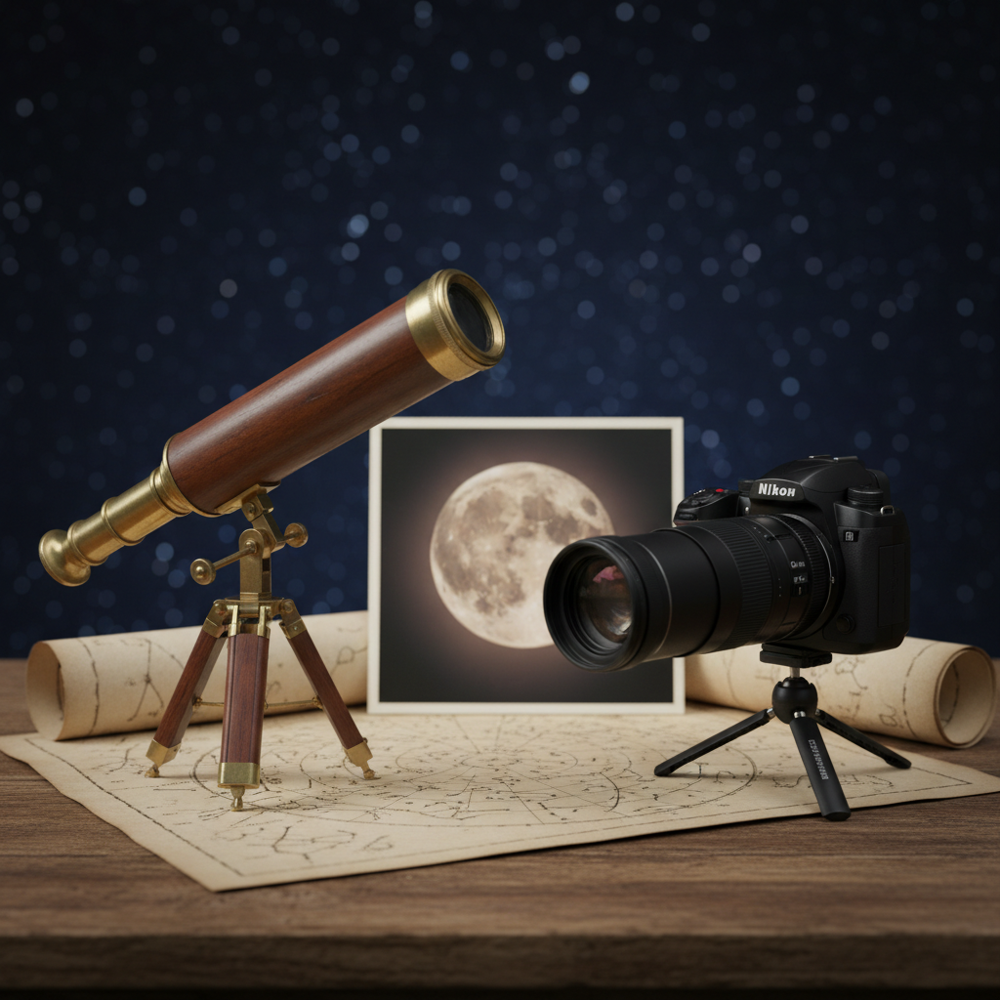

Mwaka 1609, Galileo Galilei hakuelekeza tu mrija wa kioo angani. Alielekeza mbinu fulani huko. Kwa kutumia darubini ya kurefusha (refracting telescope) aliyotengeneza mwenyewe na kuiboresha zaidi ya zile za Kiholanzi, aliona vitu kisha akathubutu kuvichapisha. Mambo hayo yalifanya "mbingu kamilifu" zionekane zenye fujo na za kifizikia. Milima mwezini, mabadiliko ya maumbo ya Zuhura, na miezi minne midogo inayozunguka Mshtarii.

Miaka mia nne baadaye, Nikon Coolpix P1000 (ya mwaka 2018) si darubini ya anga hata kidogo. Ni kamera ya daraja (bridge camera), iliyojengewa wanyamapori, michezo, na zile "nataka kile kitu kilichoko mbali sana kule". Lakini zoom yake kali ya 24-3000mm, uwezo wa kuzuia mitikisiko (stabilization), na uwezo wa kupiga picha kidijitali papo hapo, inawaruhusu watu wa kawaida kupiga picha za Mwezi na sayari angavu kwa njia ambayo ingeonekana kama uchawi mwaka 1610.

Sasa, itakuwaje tukizichukulia hizi kama majibu mawili kwa hamu moja ya kibinadamu ya kusogeza anga karibu, na tukazilinganisha kwa uaminifu?

## Darubini ya Galileo

Galileo hakuvumbua darubini. Hilo lilifanywa na watengenezaji wa miwani wa Kiholanzi mnamo 1608. Lakini aliendelea kuiboresha, tena na tena, mpaka ikawa kifaa imara kwa ajili ya unajimu.

Darubini "bora" ya kawaida ya kigalileo iliyokuwepo mwanzoni mwa 1610 ilikuwa ya kurefusha yenye lenzi mbonyeo mbele na lenzi mbinuko (eyepiece) nyuma. Lenzi ya mbele ilikuwa na upana wa takriban 37 mm (rekonstrukshoni zilizopo zinatofautiana kidogo), ilikuza mara 20 na urefu wa fokasi (focal length) ulikuwa takriban mita moja.

Na ilikuwa ngumu kutumia. Lenzi za zamani zilikuwa na viputo, maeneo yasiyolingana, na mikondo mingi ya rangi. Eneo unaloweza kuona lilikuwa dogo sana, kwa hiyo kufuatilia kitu ilikuwa kama kuangalia kupitia tundu la ufunguo. Na hakukuwa na upigaji picha, kwa hiyo kila uchunguzi ulibidi uchorwe, uelezewe, na kisha ubishiwe.

Kilichoifanya kuwa ya kihistoria ni kwamba madai yake yangeweza kuthibitishwa. Mtu yeyote mwenye darubini kama hiyo angeweza kujionea mwenyewe kuwa Mwezi una milima na mabonde (unaona hivyo kupitia vivuli na mstari uliopo kati ya mwanga na giza), kuwa Mshtarii una miezi inayohama kila usiku, na kuwa Zuhura inabadilika maumbo, jambo linalounga mkono wazo kuwa sayari zinazunguka Jua.

Darubini haikushinda kwa sababu ilikuwa kamilifu. Ilishinda kwa sababu iliiacha asili izungumze kwa sauti kubwa kuliko mamlaka.

## Nikon P1000

P1000 ni kamera yenye kihisi (sensor) kidogo na zoom ndefu ya ajabu. Hiyo inasikika kama toy mpaka utakapoziona inavyokupa picha za vitu angavu angani. Ina kihisi cha 16 MP cha aina ya 1/2.3", lenzi inayotoka 24 hadi 3000mm (zoom ya 125× ya macho), aperture kutoka f/2.8 kwa upana wa juu hadi f/8 kwa zoom kamili, pamoja na VR stabilization ya macho na vipimo vya kisasa vya mwanga na exposure.

Kwa zoom kamili, urefu halisi wa fokasi ni takriban 539 mm. Kwa f/8 upande mrefu, ufunguo wa lenzi unakuwa na upana wa takriban 67 mm. Kwa hiyo inakusanya mwanga mwingi zaidi kuliko ile lenzi ya Galileo ya 37 mm.

Kuna changamoto zake. Kihisi ni kidogo, kwa hiyo unapata kelele (noise) haraka ukiwa na ISO ya juu kwenye vitu hafifu. Kwa sayari, kikomo mara nyingi huwa ni hewa, kile ambacho wanaastronomia wanaita *seeing*, na si ukali wa lenzi. Ni ya ajabu kwa Mwezi na sayari angavu, lakini haijajengewa astrofotografia ya anga za mbali sana (deep-sky).

Bado, unaweza kupiga picha, kuikagua, kuituliza, na kushiriki picha ya karibu ya Mwezi ndani ya dakika chache, na hilo ndilo linaloiweka mikononi mwa kila mtu.

## Kuzilinganisha kwa uaminifu

Darubini ni kitu unachokiangalia kupitia, kwa hiyo ni suala la ukuzaji (magnification). Kamera inatengeneza picha, kwa hiyo ni suala la azimio (resolution), sampling na usindikaji. Kwa hiyo badala ya vita feki ya "×", ni bora zaidi kulinganisha vitu vinavyoamua unachoweza kuona au kurekodi. Hizi ni namba za makadirio, si uuzaji.

| Kigezo | Galileo (c. 1610) | Nikon P1000 (2018) | Maelezo |
|---|---:|---:|---|
| Lenzi ya mbele / mwanya wa kuingia mwanga | ~37 mm | ~67 mm (kwa tele kamili) | Ukusanyaji mwanga huongezeka kulingana na eneo. |
| Ukuzaji / ukubwa wa picha | ~20× ya kuona | 539 mm urefu halisi wa fokasi (3000mm equiv.) | Aina tofauti, kamera hutumia sampling ya kihisi. |
| Kikomo cha diffraction (kinadharia) | ~3-4 arcsec | ~1.7 arcsec (67 mm @ 550 nm) | Uhalisia ni mbaya zaidi kwa sababu ya optiki + *seeing*. |
| Eneo la kuona & ergonomics | finyu, ya mikono | pana-hadi-finyu, imetulia, LCD/EVF | P1000 inashinda sana kwenye urahisi wa matumizi. |
| Kurekodi | michoro ya mkono | faili za 16 MP, video, bursts | Kudumu kwa kidijitali kunabadilisha kila kitu. |

## Kila moja inafundisha nini

Darubini ya Galileo, au nakala yake nzuri ya kisasa, inakufundisha jinsi uvumbuzi unavyotokea. Inakuonyesha nyakati "kubwa" kama mabadiliko ya maumbo ya Zuhura na miezi ya Mshtarii, na inafanya anga ionekane ya kifizikia bila teknolojia yoyote.

P1000 inafanya Mwezi uwe rahisi, tena na tena. Inafanya "ushahidi" uonekane wa kawaida kwa sababu una picha na video. Na unajifunza kwa kujaribu, ukiwa na Settings, focus na exposure, badala ya kubishana.

Nguvu halisi ya Galileo haikuwa ule mrija. Ilikuwa ni kwamba aliendelea na akachapisha. Aliangalia tena na tena, akachora kwa makini na akaandika kwa njia iliyowalazimisha watu wajadili jambo hilo.

Nguvu ya P1000 ni tofauti. Inaondoa umbali kati ya kuwa na udadisi na kuwa na ushahidi. Huhitaji mfadhili, karakana, au mtambo wa kuchapisha. Unahitaji usiku usio na mawingu na betri.

Na zote mbili zina adui mmoja wa mwisho, hewa iliyo juu ya kichwa chako.

Kwenye urefu wa fokasi uliokithiri, msukosuko wa hewa hufanya maelezo yafubae, bila kujali vifaa vyako ni vya kisasa kiasi gani. Kwa namna ya kishairi, anga inaiweka nafasi iwe mbali kidogo na sisi, kwa hiyo tunaendelea kujaribu.

## Ipi inashinda

Kama lengo ni "nionyeshe Mwezi kwa karibu usiku huu", Nikon Coolpix P1000 inashinda bila huruma. Inang'aa zaidi upande mrefu, ni rahisi sana kuitumia, na inarekodi inachokiona.

Kama lengo ni "nikumbushe jinsi ilivyokuwa wakati ulimwengu ulipobadilika", hakuna kitu kinachoweza kuchukua nafasi ya darubini ya Galileo. Huo ndio wakati ambapo kuangalia kwa makini kuliacha kuwa mapambo na kuwa hoja.

Usiku ujao ukiwa safi, elekeza chochote ulichonacho kwenye Mwezi, P1000, darubini za kishika-mkono au darubini ya bei rahisi, na utakuwa sehemu ya utamaduni uleule. Ushahidi kwanza, mshangao daima.

## Vyanzo

- Galileo Galilei, *Sidereus Nuncius* (1610)
- Museo Galileo (Florence), muktadha wa kihistoria na rekonstrukshoni za vifaa
- Nikon technical specifications for the Coolpix P1000 (lens range, aperture, sensor)
