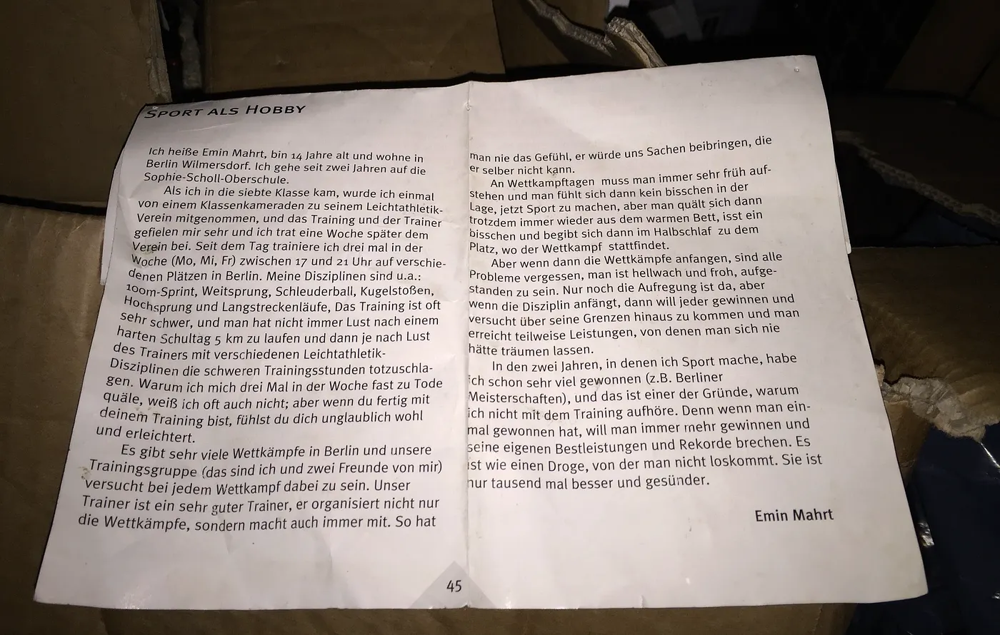

## Mimi ni Emin Mahrt, nina miaka 14 na ninaishi Wilmersdorf, Berlin. Nimesoma katika shule ya Sophie-Scholl-Oberschule kwa miaka miwili sasa.

Nilipoanza kidato cha saba, rafiki yangu mmoja alinipeleka kwenye klabu yake ya riadha. Nilivutiwa sana na mazoezi pamoja na kocha mwenyewe, basi wiki moja baadaye nikajiunga rasmi na klabu hiyo. Tangu wakati huo, nafanya mazoezi mara tatu kwa wiki (Jumatatu, Jumatano na Ijumaa), kuanzia saa kumi na moja jioni hadi saa moja usiku kwenye viwanja mbalimbali hapa Berlin. Mambo ninayofanya ni pamoja na mbio za mita 100, kuruka mbali, kurusha tufe, kurusha mpira, kuruka juu na mbio ndefu. Mazoezi mara nyingi huwa magumu sana. Si kila siku unajisikia kukimbia kilomita 5 baada ya siku ndefu ya shule, halafu uendelee na mazoezi mazito kulingana na maelekezo ya kocha. Hata mimi mwenyewe mara nyingi najiuliza kwa nini najitesa hivi mara tatu kwa wiki, lakini ukimaliza mazoezi unajisikia vizuri sana na unafurahi kwamba umemaliza.

Kuna mashindano mengi sana Berlin na sisi kikundi chetu (mimi na marafiki zangu wawili) tunajaribu kushiriki kwenye kila mashindano. Kocha wetu ni mzuri sana. Yeye haaandaa mashindano tu, bali anashiriki nasi pia. Hivyo, unapata hisia kwamba anajaribu kutufundisha vitu ambavyo hata yeye mwenyewe bado anavifanyia kazi.

## Siku za mashindano

Siku za mashindano lazima uamke mapema sana na unakuwa huna kabisa hamu ya kufanya mchezo wowote. Lakini unajilazimisha kutoka kwenye kitanda cha joto, unakula kidogo, halafu unakwenda uwanjani ukiwa bado unasinzia.

Lakini mashindano yakianza tu, matatizo yote yanasahaulika. Unakuwa macho kabisa na unafurahi kwamba uliamka. Kinachobaki ni ile hali ya msisimko tu. Mashindano yakianza, kila mtu anataka kushinda na anajaribu kuvuka mipaka yake. Wakati mwingine unafanya mambo ambayo hukudhani kama unaweza kuyafanya.

Katika miaka hii miwili ya kufanya michezo, nimeshinda tuzo nyingi (kwa mfano ubingwa wa Berlin). Hiyo ni moja ya sababu kwa nini siachi mazoezi. Ukishashinda mara moja, unataka kushinda zaidi na zaidi, na unataka kuvunja rekodi zako mwenyewe. Ni kama kitu ambacho huwezi kukiacha. Ila hii ni bora mara elfu na ina afya zaidi.

*Emin Mahrt
Mwaka: 2000*
