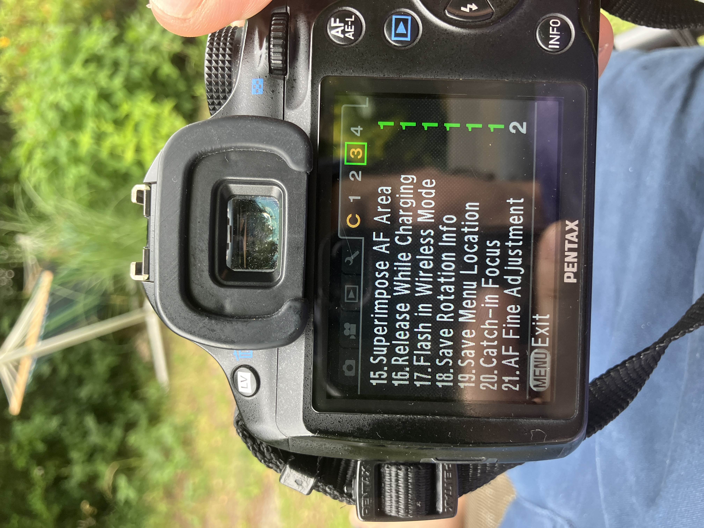

Unajipanga kupiga picha, alama ya fokus inawaka kijani na kamera inakuambia picha imekaa vizuri. Unabonyeza kitufe cha shutter, unajisikia poa alafu unaendelea na mambo yako. Ukifika nyumbani, unazoom, mara unaona macho hayajakaa kwenye fokus.

Eneo halisi la fokus limepata kope, sikio, kola, au mahali fulani mbele kidogo au nyuma kidogo ya pale ulipolenga. Kamera ilisema ndio, lakini ilikosea.

Ile tofauti kati ya kamera inaposema kila kitu kiko safi na uhalisia wa picha kutokuwa safi, ndio kazi ya AF Fine Adjustment. Ni moja ya vitu vinavyoeleweka vibaya kwenye Settings za DSLR, kwanza kwa sababu jina lake linafanya ionekane kama kifaa cha kiufundi cha wataalamu tu, na pili kwa sababu kamera haikuambii hata kidogo kuwa inahitaji kurekebishwa.

Basi, hivi ndivyo inavyofanya kazi, kwa nini tatizo hili hutokea, na jinsi ya kuiseti bila kupoteza mchana kutwa.

## Kwa nini kamera hukosea

Kamera nyingi za DSLR zinatumia sensor tofauti ya phase detection AF iliyo chini ya kioo cha kamera ili kufocus. Mwanga hupiga kioo kikuu, unapita kwenye kioo kingine kidogo, na kuangukia kwenye hiyo sensor. Inapima fokus kwa kulinganisha picha mbili za eneo unalolenga.

Ni ya haraka na inafanya kazi vizuri, lakini njia ya mwanga huo ni tofauti na ile inayopiga sensor ya picha yenyewe.

Na kwa sababu ni njia tofauti, lazima ikalibiwe ili 'safi' kwa ajili ya sensor ya AF iwe pia 'safi' kwa ajili ya sensor ya picha. Watengenezaji hufanya hivi kiwandani, lakini huwa si kamilifu na inaweza kupoteza usahihi baada ya muda. Kuna mambo matatu yanayosababisha hili.

Kwanza, ni tofauti ndogo ndogo za mwili wa kamera yako na lensi yako husika. Mara nyingi hizi hufutana, lakini wakati mwingine zinaongezeka kwa mwelekeo mmoja na hapo ndipo unapokosa kila wakati.

Pili, kutumia lensi za manual kwenye kamera iliyotengenezwa kwa ajili ya autofocus. Hili ni tatizo kubwa kwa lensi za zamani au zile zilizoadaptiwa. Taa ya kuthibitisha fokus bado inawaka unapofocus kwa mkono, lakini inaendeshwa na ile ile sensor ya AF iliyokalibiwa kwa ajili ya lensi za mtengenezaji mwenyewe. Kwa hivyo, kwa lensi ya manual, inaweza kuthibitisha mapema kidogo au kuchelewa kidogo, kila wakati.

Tatu, kupiga picha ukiwa umefungua aperture kubwa (wide open). Hili halina shida ukiwa f/8, ambapo depth of field ni kubwa kiasi cha kuficha makosa madogo. Lakini ukiwa f/1.4 au f/1.8, eneo lililo safi ni la milimita chache tu, na ule mwanya mdogo uliokuwa hauonekani hapo awali sasa unaonekana wazi kuwa umekosa.

## Thibitisha kosa kwanza

Ishara kuwa fine adjustment inaweza kusaidia ni pale unapokosa kwa staili ile ile kila wakati. Ikiwa kila mara picha inafocus mbele ya lengo, hapo una front focus. Ikiwa kila mara inafocus nyuma ya lengo, hapo una back focus. Mchepuko wa mara kwa mara ambao unaweza kuurudia ndio hasa kitu ambacho seti hii inarekebisha.

Kukosa ovyo, mara mbele mara nyuma, ni tatizo lingine. Hilo mara nyingi linatokana na mbinu zako za kufocus, mada iliyosogea, au taa ya kuthibitisha ambayo imefika kikomo cha uwezo wake, na hapo fine adjustment haitakusaidia.

Kwa hivyo, usirekebishe kwa kubahatisha. Tumia dakika kumi kuthibitisha kuwa kosa ni la kweli, linafanana kila wakati, na linaelekea upande mmoja. Jaribio la kawaida hufanyika hivi:

1. Weka rula, tepi ya kupimia, au safu ya vitu kwenye meza, kwa pembe ya nyuzi 45 kuelekea mbali na wewe.
2. Weka kamera kwenye tripod ikiwa unayo, ili wewe usihusike kwenye picha. Kushika kwa mkono kunawezekana pia, lakini uwe makini.
3. Fungua lensi kwenye aperture yake kubwa zaidi, ambapo kosa linaonekana vizuri.
4. Chagua alama moja, tuseme mstari wa 20cm, na uifocus hapo. Kwenye autofocus weka alama hapo na iache ijifunge. Kwenye lensi ya manual focus kwa jicho, au kwa taa ya kuthibitisha, kwenye sehemu hiyo hasa.
5. Piga picha chache na ufocus upya kila wakati.
6. Zoom kwenye matokeo na uangalie mstari ulio safi kabisa uko wapi. Uko kwenye alama yako, mbele, au nyuma?

Ikiwa mstari ulio safi uko mbele ya lengo lako kwenye kila picha, una front focus na unapaswa kurekebisha kuelekea nyuma. Ikiwa uko nyuma kila wakati, una back focus na unapaswa kurekebisha kuelekea mbele. Ikiwa picha zimetofautiana kila wakati, acha hapo hapo, kwa sababu fine adjustment siyo zana sahihi kwa tatizo hilo.

## Settings ziko wapi

Kipengele hiki kipo kwenye menyu ya custom settings. Majina na mahali vilipo hutofautiana kwa kila kampuni, lakini mantiki ni ile ile kila mahali. Pentax wanaita AF Fine Adjustment na ipo kwenye menyu za Custom (C).

Canon wanaita AF Microadjustment, kwenye menyu za autofocus custom. Nikon wanaita AF Fine-tune, kwenye menyu ya setup.

Kawaida unapata aina mbili. Apply All (au Adjust All) ni marekebisho ya jumla kwa kila lensi utakayotumia. Apply One, ile ya kila lensi, inahifadhi thamani kwa kila lensi na inaitumia tena kamera ikitambua lensi hiyo.

Kurekebisha kila lensi peke yake ni bora zaidi ikiwa inafanya kazi, kwa sababu kila lensi inaweza kuwa na mchepuko wake tofauti.

Lakini inahitaji lensi iweze kuambia mwili wa kamera ni nini kupitia mfumo wa elektroniki. Lensi za manual na zile zilizoadaptiwa mara nyingi haziwezi kufanya hivyo, kwa hivyo kwa hizo unatumia ile ya jumla, Apply All. Na hiyo inamaanisha inabadilisha kalibresheni ya kila kitu, ikiwemo lensi zako za autofocus.

Ikiwa unabadilishana kila mara kati ya lensi zilizoadaptiwa na lensi za AF, kumbuka hili, kwa sababu thamani ya jumla uliyoweka kwa ajili ya lensi ya manual inaweza kuharibu fokus ya lensi zako za AF.

## Ugeuze upande gani

Marekebisho yenyewe ni kama mizani, kawaida kuanzia −10 hadi +10 na zero katikati. Mwelekeo ndio kitu ambacho kila mtu anachanganyikiwa nacho, kwa hivyo kumbuka hivi:

Ikiwa picha zako zina front focus, yaani eneo safi liko karibu sana na wewe, sogea kuelekea plus ili kusukuma fokus nyuma. Ikiwa zina back focus, yaani eneo safi liko mbali sana, sogea kuelekea minus ili kuvuta fokus mbele.

Badilisha hatua chache, usibadilishe kila kitu mara moja, piga tena jaribio la nyuzi 45, angalia tena, na urudie. Unatafuta thamani ambapo eneo safi linakaa sawa kwenye mstari ule ambao kamera ilithibitisha.

Inachukua mizunguko michache, zaidi kama mara tatu au nne kuliko kubahatisha mara moja na kupatia. Unapokaribia, rekebisha hatua moja moja.

## Jinsi ya kurekebisha focus kwenye Pentax K-50

Hii hapa ni njia mahususi ya kufanya marekebisho kwenye K-50 ukitumia zile lenzi mbili tunazozizungumzia: Cosinon-S 50mm f/1.8 (K-mount, inakaa moja kwa moja) na Super-Takumar 50mm f/1.4 (M42, inatumia adapta). Zote ni za manual kabisa, kwa hiyo kamera haijirekebishi yenyewe.

Unapozungusha pete kwa mkono, lile nukta la kijani la kuhakiki focus kwenye K-50 huwaka pale AF sensor inapoona umepata. Lakini nukta hilo mara nyingi hukudanganya; linakupa "ok" wakati focus imetua mbele kidogo au nyuma kidogo ya kitu unachopiga picha ukiwa umefungua aperture yote (wide open).

Kwenye K-50, bonyeza **MENU** kisha nenda kwenye **Custom Setting menus**. Hapo utapata **C3**, namba **21**, **AF Fine Adjustment**. Iweke kwenye **On**, kisha chagua **Apply All**.

Chagua **Apply All** badala ya *per lens*, kwa sababu Cosinon na Takumar ni za manual na haziiambii kamera ni lenzi gani, hivyo haiwezi kuhifadhi thamani tofauti kwa kila moja.

Hapa tunafanya *global correction*. Kwenye kipimo cha −10 mpaka +10, isogeze hatua chache kuelekea upande wa plus (+).

Kwa nini plus? Kwa sababu focus ilikuwa inatua mbele kidogo ya pale nukta lilipothibitisha (front focus). Kusukuma thamani kuelekea plus kunaisogeza sehemu ya uthibitisho nyuma, na ile sehemu kali (sharp plane) inasogea nyuma mpaka kwenye kitu chako. Anza na kitu kama +3 au +4, kisha fanya majaribio na urekebishe.

Piga picha tena ya ule mtaala wa digrii 45 ukiwa umefungua aperture yote (f/1.8 kwa Cosinon na f/1.4 kwa Takumar), kisha angalia mstari mkali ulipo hasa. Sogeza hatua moja au mbili mpaka lile nukta la uthibitisho na sehemu kali ya picha zikubaliane.

Kuna mambo mawili ya kuzingatia na K-50:

Hii ni *global setting*, kwa hiyo inabadilisha lenzi zote, hata lenzi yoyote ya autofocus utakayoweka baadaye. Ukishairekebisha kwa zile lenzi manual za 50mm kisha ukaweka lenzi ya AF, ule upungufu utaendelea kuwepo, kwa hiyo irudishe kwenye 0 utakaporejea kwenye AF glass na kuona inavurunda.

Na marekebisho haya yanarekebisha tu *front focus* inayotokea kila wakati. Takumar ina adapta kama kigezo cha ziada; unene wake unaweza kubadilisha mahali ambapo focus inatua na inaweza hata kukufanya ushindwe kabisa kupata focus ya mbali (*infinity focus*). Kwa hiyo, kama Takumar bado inakosea baada ya kuikadiria, lawama iende kwenye adapta na siyo kamera.

Kama unataka kuwa na uhakika kabisa ukiwa umefungua aperture yote na lenzi yoyote, njia ya dharura ni moja: Weka kwenye **Live View**, zoom mpaka 100% kisha fanya focus kwa jicho kwenye kitu unachopiga.

Hiyo inasoma focus moja kwa moja kutoka kwenye sensor ya picha na inapuuza lile nukta la AF, kwa hiyo hakuna cha kukadiria hapo.

## Wakati fine adjustment siyo zana sahihi

*Fine adjustment* inarekebisha upungufu unaotokea kila wakati, na ina mipaka yake. Kuna kesi mbili zinahitaji njia nyingine:

Ya kwanza ni pale focus inapokosea ovyo. Kama picha zako za majaribio zinatawanyika, mara mbele, mara nyuma, mara imepatia, hakuna namba moja inayoweza kurekebisha hiyo. Mara nyingi ni suala la mbinu, kama kusogeza focus kisha ukatunga picha upya, au kitu unachopiga kimesogea, au lile taa la uthibitisho haliendani na lenzi yako. Suluhisho ni kupiga picha kwa umakini na siyo kupoteza muda kwenye menu.

Ya pili ni lenzi za manual unazotaka ziwe kali kabisa ukiwa umefungua aperture yote. Njia ya uhakika zaidi ni kuruka kabisa lile sensor la *phase detection*. Tumia **Live View**, zoom picha mpaka 100% kisha fanya focus kwa jicho kwenye picha halisi inayotoka kwenye sensor.

Unatazama picha halisi ya sensor, kwa hiyo hakuna pengo la makadirio, na kinachonekana kikali ndicho kilicho kikali kweli.

Ni polepole na inahitaji kamera isitetemeke, lakini kwa glasi za zamani unazotumia na adapta kwa f/1.4, hivyo ndivyo watu wengi wanavyopata matokeo mazuri. *Fine adjustment* inaboresha utendaji wa viewfinder na lile taa la uthibitisho, lakini *Live View* ukiwa umezoom inamaliza tatizo zima unapohitaji uhakika.

Na kuna chaguo la tatu, rahisi: punguza aperture (*stop down*). Kwenye f/2.8 mpaka f/4, kina cha uwanja (*depth of field*) kinakuwa kikubwa kiasi cha kumeza makosa madogo ya focus.

Kama picha inaruhusu, kufunga aperture kwa hatua moja au mbili ndiyo suluhisho la haraka kuliko yote, bila menu wala majaribio.

## Kwa kifupi

Kwa hiyo, lile nukta la kijani ni makadirio na siyo ahadi. Kwa baadhi ya kamera na lenzi, hasa lenzi za manual kwenye miili iliyoundwa kwa ajili ya autofocus, makadirio hayo yanakuwa yamepinda kidogo. *AF Fine Adjustment* inakuruhusu kurudisha makadirio hayo kwenye ukweli.

Kwa kifupi: unathibitisha kuwa kosa hilo linatokea kila wakati na unajua mwelekeo wake kwa kutumia mtaala wa digrii 45, ukiwa umefungua aperture yote. Unafungua kipengele hicho na kuchagua *per lens* kama lenzi inajitambua kielektroniki, la sivyo unatumia *global*.

Unasogeza kuelekea plus kwa *front focus* na kuelekea minus kwa *back focus*, hatua chache kwa wakati mmoja.

Unajaribu tena na kurudia mpaka ile sehemu kali ya picha itue pale kamera ilipothibitisha. Kwa glasi ya manual unayotaka iwe *perfect* ukiwa umefungua aperture yote, unaweza kuruka yote hayo na ukafanyia focus kwenye *Live View* iliyozoomiwa, au punguza tu aperture na uache *depth of field* ikufunike.

Fanya hivyo mara moja kwa kila lenzi inayokupa shida, na kamera inayokudanganya kimyakimya kuhusu focus itakuwa kamera unayoweza kuiamini tena kupitia viewfinder.

