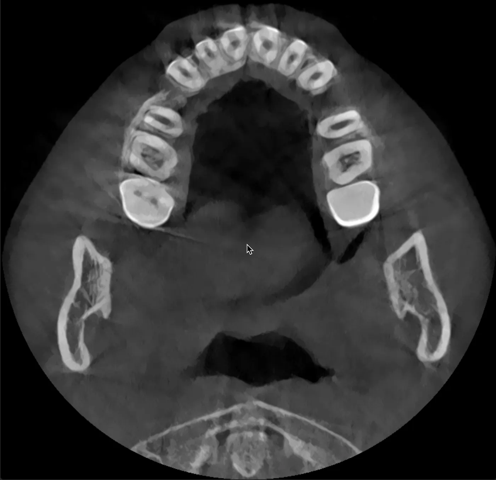

Nimeandika hapa hatua kwa hatua jinsi tulivyotumia Claude AI kuchambua scan za CBCT za meno ya Raha, jinsi tulivyowachunguza madaktari wa meno (orthodontists), tukajiandaa kwa ajili ya ushauri wa kitaalamu, na hatimaye kufikia uamuzi wa matibabu tunaouelewa.

Na yote haya yalitokea kuanzia Arusha, Tanzania hadi Nairobi, Kenya.

## Kisa chenyewe

Raha ana meno ya juu ya pembeni (canines) ambayo hayajachomoza vizuri pande zote mbili, au angalau ndivyo tulivyodhani. Zaidi ya hapo, ana meno manne ya mbele (premolars) yaliyotolewa kutokana na matibabu yaliyokwama, na meno yamekaa vibaya bila uangalizi kwa miezi 13.

Madaktari wawili wa meno wa jumla kule Arusha, Tanzania walijaribu kutumia braces na wote walifeli. Meno yalizidi kuharibika kuliko yalivyokuwa mwanzo.

Hatukuwa na mpango wa matibabu, hatukuwa na mtaalamu, na hatukuwa na wazo lolote la nini cha kufanya.

Tulikuwa na OPG (picha ya eksirei ya kinywa) kutoka Berlin, scan ya kidijitali ya iTero, na pia simulation ya Invisalign ambayo daktari mmoja alikuwa ameipendekeza. Tulichokosa ni mtu mwenye sifa stahiki anayeweza kusoma hayo yote na kutuambia ukweli wa kinachoendelea.

Kwa hiyo, nilianza kuongea na Claude.

## Kwanza, picha kamili ya hali ya kliniki

Jambo la kwanza, AI ilipanga kila kitu tulichokijua katika picha kamili ya kliniki.

Nilipakia picha, OPG kutoka Berlin, na nikaihadithia kisa chote cha matibabu. Kutokana na hayo, ikatoa muhtasari wa tatizo.

Iliweka muda wa kung'olewa meno (Septemba na Oktoba 2024), muda ambao braces ziliwekwa (miezi saba kwa madaktari wawili tofauti), na dalili tulizokuwa nazo, kama meno ya mbele kulegea, maumivu wakati wa kutafuna mahali meno yalipong'olewa, na ile breki ya miezi 13 bila matibabu.

Pia ilibainisha mambo kadhaa mara moja, mambo ambayo madaktari wa meno wa awali walikuwa wameyapuuza au kuyakosa.

Kwenye ile OPG kutoka Berlin, ilionekana kama meno ya pembeni (canines) hayakushuka vizuri kwenye mstari wa meno.

Kama hiyo ingekuwa kweli, basi tatizo lilikuwa kubwa sana kwa madaktari wa meno ya kawaida na kungehitajika upasuaji wa kuyaweka sawa (surgical exposure) na vifaa maalumu, siyo tu Aligner au braces za kawaida.

AI ilikuwa wazi: “Invisalign pekee haitoshi kwa kesi hii. Mnahitaji scan ya CBCT ili kuona meno ya pembeni katika 3D, na mtaalamu wa orthodontics, siyo daktari wa jumla.”

## Kupata mtaalamu sahihi

Kisha tulihitaji orthodontist kule Afrika Mashariki anayeweza kushughulikia kesi ngumu kama hii ya meno yaliyokwama na nafasi zilizoachwa wazi, huku mgonjwa akiwa anaishi umbali wa saa sita kwa basi.

AI ilitusaidia kutafuta wataalamu Nairobi na ikaangalia sifa zao, sio tu maoni ya Google.

Hapo ndipo tulipompata Kenya Orthodontics na Dk. Wandia Mwangi-Evans.

Ana ushirika (Fellowship) kutoka Royal College of Surgeons of England na MSc katika Orthodontics kutoka Chuo Kikuu cha Cardiff kwa heshima (distinction), na ameshughulikia kesi zaidi ya 8,000 na ana uzoefu wa zaidi ya miaka 20.

Kliniki inafanya kazi kwa mfumo wa Shared Care, jambo ambalo lilitufaa sana sisi kutoka Tanzania, kwa sababu mtaalamu ndiye anayepanga mpango, anamuona mgonjwa kila baada ya wiki sita hadi nane, na daktari wa hapa nyumbani anafanya marekebisho ya kati.

AI kisha ikaandika hati nzima ya ushauri, ikiwa na sehemu tisa: historia ya kliniki, matokeo ya eksirei, maswali ya kumuuliza mtaalamu, na alama za tahadhari. Na ikaandaa barua ya rufaa ambayo tungeweza kupeleka kwenye miadi.

## Scan ya CBCT Nairobi

Tulikuwa Nairobi karibu na Karen, kwa hiyo AI ilisaidia kupata Karen Dental Clinic katika Zamani Business Park, ambao wana mashine ya Carestream CS 8200 3D CBCT.

Tulithibitisha vifaa hivyo kupitia picha nilizotuma, na AI ilinielekeza nini cha kuomba: scan kamili ya CBCT ya taya ya juu na ya chini, kupewa faili za DICOM, na kuhakikisha faili hizo zimetumwa kwa barua pepe kwetu na kwa orthodontist.

Scan hiyo ilitoa picha 651 za DICOM katika mfululizo mbili, ujazo wa kawaida na nyingine iliyopunguza athari za vyuma. Kliniki ilisema tunahitaji programu maalumu ili kuzitazama.

AI ilipendekeza Falcon (zamani Horos Mobile), ambayo ni DICOM viewer ya bure kwa iPhone. Niliiweka programu hiyo, nikaingiza picha zote 651, na ghafla nikaweza kuona sehemu za fuvu la Raha kwenye simu yangu.

## AI ilipokosea

Hapa ndipo ilipokuwa kuvutia, na hapa ndipo AI ilikosea, jambo ambalo lilikuwa na mafunzo sawa na vile ilivyopatia.

Nilirekodi video ya skrini yangu wakati nikipitia picha za CBCT kwenye Falcon na nikapakia video hiyo. AI ilichambua picha 192 moja baada ya nyingine na kutafuta alama za anatomia kwenye picha hizo.

Ikaashiria kile ilichodhani ni meno ya pembeni yaliyokwama pande zote mbili, yakiwa juu sana kwenye kaakaa, mbali na mstari wa meno.

Ikapima umbali wa wima na kuhitimisha kuwa meno hayo yalikuwa yamekwama sana na yangehitaji upasuaji.

Hiyo ililingana na kile ambacho OPG ya Berlin ilikuwa imependekeza.

Lakini AI ilikuwa makini na ikaweka tahadhari: “Ninasoma picha za video zilizobanwa kutoka kwenye skrini ya simu. Hii ni ramani ya awali tu. Mtaalamu mwenye faili halisi za DICOM kwenye programu ya kitaalamu ataona maelezo zaidi mara kumi.”

Tahadhari hiyo ilikuwa muhimu sana mwishoni.

## Mtaalamu alisema nini

Tulienda Kenya Orthodontics na nyaraka zote. Timu ya Dk. Wandia, madaktari kadhaa na orthodontist, walimfanyia Raha uchunguzi wa kina.

Walichora ramani ya kila jino, walipima nafasi za meno yaliyotolewa (4.5 mm upande wa kulia na 5 mm upande wa kushoto), waligundua tatizo la rangi ya meno kutokana na maji ya Arusha, walipima uti wa taya (TMJ), wakaangalia mchato wa meno, na wakatazama CBCT kwenye programu yao ya kitaalamu.

Tathmini yao ilikuwa kwamba tatizo lilikuwa “rahisi kiasi.” Inakadiriwa miezi 18 ya kutumia braces. Hakukuwa na hata mazungumzo ya upasuaji wa meno ya pembeni.

Hiyo ilipingana na tathmini ya CBCT ya AI. Aidha timu ya wataalamu ilikuwa imekosa kuona meno hayo yaliyokwama (jambo lisilowezekana kwa kuwa walikuwa na mgonjwa na faili za DICOM), au tathmini ya awali ya AI kutoka kwenye video ilikuwa makosa.

## Kujithibitishia mwenyewe

Sikutaka kuamini jibu moja kati ya hayo mawili kwa upofu, kwa hiyo nilitumia AI kunielekeza kupitia CBCT ili kupata mantiki ya utambuzi.

Falcon ina hali ya 2D-MPR inayoonyesha picha za pembeni (axial, sagittal, na coronal) kwa wakati mmoja, na nilitumia hiyo kubofya moja kwa moja kwenye nafasi za meno ya pembeni kwenye taya ya juu.

AI iliniongoza: “Bofya kwenye nafasi ya jino la pembeni la juu kulia kwenye mwonekano wa axial. Screenshot. Sasa bofya jino la kushoto. Screenshot.” Kila bofya ilionyesha sehemu hiyo hiyo ya anatomia kutoka pembe tatu kwa wakati mmoja.

Matokeo yalikuwa wazi. Picha zote mbili za sagittal zilionyesha meno yenye mizizi mirefu iliyoingia ndani ya mfupa wa taya, na hicho ndicho umbo la meno ya pembeni yaliyochomoza vizuri. Taji ziko chini kwenye mstari wa meno, mizizi inaelekea juu. Nafasi ya kawaida. Hayakukwama.

Kile ambacho AI ilidhani ni taji zilizokwama kwenye video ilikuwa kweli mizizi ya meno ya pembeni, ikionekana kwa mtiririko wa axial kwenye tabaka za juu.

Meno ya pembeni yana mizizi mirefu zaidi kuliko meno mengine yote, ndiyo maana unaona kama duara kwenye picha za axial juu ya mstari wa kutafunia. Kwenye video ya simu iliyobanwa, zinaonekana kama taji zilizokwama.

AI ilikubali kosa mara moja: “Tathmini yangu ya awali ya video ya CBCT ilikuwa makosa. Mtaalamu aliyekuwa na mgonjwa na programu ya DICOM alikuwa sahihi.”

## Mpango wa matibabu

Baada ya tatizo la jino la mshipa (canine) kutatuliwa, mpango wa matibabu ulikuwa wazi.

Tutatumia braces za kudumu na siyo Aligner, kwa sababu kwenye kesi ngumu kama hii braces zinatabirika zaidi. Na kwa sababu fluorosis inafanya brackets zishindwe kushika vizuri, tutatumia mabendi kwenye magego.

Matibabu yenyewe yatachukua miezi 18, na tutakuwa na appointment kila baada ya wiki sita hadi nane kwa ajili ya marekebisho. Baada ya hapo, kutakuwa na retainers za kudumu na za kutoa, pamoja na ukaguzi wa retainers kwa mwaka mzima.

Yote haya yanagharimu takriban 483,000 KES, yaani kama 3,400 € au 3,700 USD, na tutakuwa tunalipa kwa kila appointment. Tarehe 13 Machi ni usafi na kuweka separator, na tarehe 24 Machi wataweka braces.

Timu hiyo ilituambia wazi kuhusu chaguzi zote mbili, braces na Invisalign, wakazungumzia kuhusu fluorosis na wakapendekeza braces moja kwa moja. Sababu ni kwamba orthodontist anakuwa na udhibiti kamili wa jinsi meno yanavyosonga, na hiyo ni ya uhakika zaidi kuliko Aligner ambazo zinategemea nidhamu ya mgonjwa, hasa kwa kesi yenye historia kama hii.

## Niliyojifunza

Nimejifunza nini? AI ilisaidia sana pale ilipokusanya historia ya matibabu iliyotawanyika na kutupa picha kamili, na kuona kwamba kesi hii inahitaji mtaalamu bingwa na siyo daktari wa meno wa kawaida.

Iliifanya utafiti wa madaktari kwa kuangalia sifa zao za kweli na siyo marketing, ikaandaa hati za mashauriano ili tuende kwenye appointment tukiwa tumejiandaa, na muda wote ilikuwa inafafanua maneno ya kitaalamu kwa lugha rahisi.

Iliniongoza kwenye software ya CBCT ambayo sikuwahi kuitumia, ilinionyesha jinsi ya kutumia MPR-views kuangalia swali fulani la anatomia, na ikatupa mwongozo wa maswali ya kuuliza na alama za tahadhari za kuangalia.

Ilikosea kwenye uchambuzi wa CBCT kutokana na picha za video zilizobanwa kutoka kwenye simu, ambapo ilidhani mizizi ya jino la mshipa ni taji zilizohama. Na ilikuwa na uhakika kupita kiasi kwenye matokeo ya awali ya X-ray, ingawa yenyewe ilikuwa inatoa tahadhari mara kwa mara.

Somo kubwa kwangu ni kwamba uchambuzi wa AI wa picha za kimatibabu kutoka vyanzo visivyo vya moja kwa moja, kama vile skrini zilizorekodiwa au faili zilizobanwa, ni mzuri kwa ajili ya kuelewa mambo kwa ujumla, lakini haufai kwa ajili ya utambuzi (diagnosis).

Mtaalamu aliye na mgonjwa kwenye kiti, mikono yake ndani ya mdomo, na faili za DICOM kwenye software iliyosawazishwa, atashinda mara zote AI inayosoma video ya simu.

Tumieni AI kwa maandalizi, kwa ajili ya kujifunza, na kuuliza maswali mazuri, lakini mwacheni mwanadamu aliyehitimu ndiye afanye utambuzi.

## Hatua saba zilizotufanyia kazi

Kama unakabiliwa na hali ngumu ya meno au taya, na hasa kwenye maeneo ambayo ni vigumu kupata wataalamu, haya ndiyo yale yaliyotufanyia kazi sisi.

Kwanza, kukusanya kila kitu. OPG, picha, scan za kidijitali na historia ya matibabu yenye tarehe. Pakia kila kitu na uiache AI ikipange.

Pili, elewa kesi yako kabla ya kwenda kwenye mashauriano. AI inaweza kufafanua meno ya mshipa yaliyohama ni nini, kuondolewa kwa meno ya premolar kunamaanisha nini kwenye nafasi ya meno, kwa nini CBCT ni muhimu, na ni maswali gani ya kuuliza. Mashauriano yanaleta maana zaidi ukiwa unaelewa kinachoendelea.

Tatu, fanya vipimo sahihi vya picha. OPG ya 2D haitoshi kwa kesi ngumu; CBCT inakupa taarifa za pande tatu. Sisitiza kupewa faili za DICOM ili uwe na umiliki wa data zako.

Nne, angalia sifa za madaktari na siyo urahisi wa kufika. Angalia elimu yao ya uzamili, usajili wao kama wataalamu, na ni kesi ngapi wameshafanya. AI inaweza kukusaidia kufanya utafiti huu. Na kama madaktari wawili wa kawaida wameshindwa kesi hiyo hiyo, jua kuna shida.

Tano, andaa hati za mashauriano. Briefing kama hii inasaidia kuokoa muda na kuhakikisha hakuna kinachosahaulika wakati wa appointment. Mtaalamu anaona mamia ya wagonjwa, kwa hiyo mrahisishie kuelewa historia yenu haraka.

Sita, hakiki kila kitu na usiamini kwa upofu. Wakati uchambuzi wa awali wa AI ulipopingana na maoni ya mtaalamu, hatukuchagua jibu moja tu. Tulitumia MPR-viewer kuangalia kwa umakini.

Mtaalamu alikuwa sahihi, lakini kitendo cha kuhakiki kilitufundisha mengi zaidi kuhusu kesi hiyo kuliko maoni ya upande mmoja.

Saba, miliki faili zako. Faili za CBCT-DICOM, intraoral STL-scans, na picha za OPG, tunza kopi za kila kitu. Hiyo ni data yako ya kimatibabu, na unaweza kuzihitaji kwa maoni ya pili, kwa bima, au kwa ajili ya madaktari wengine baadaye.

## Kwa namba

Kwa namba, mambo yalikuwa hivi. Kuanzia mazungumzo ya kwanza na AI hadi kufikia uamuzi wa matibabu, ilichukua siku mbili. Tulitafiti madaktari kadhaa na tukachagua mmoja kulingana na sifa zake.

Tabaka 651 za CBCT zilichambuliwa na picha 192 za video zilitolewa na kuhakikiwa, na kwa uthibitisho kulikuwa na screenshots sita za MPR.

CBCT na mashauriano kwa pamoja viligharimu kama 55 €, na matibabu yenyewe yanagharimu kama 3,400 € kwa kipindi cha miezi 18.

Kabla ya hapa, kulikuwa na matibabu mawili yaliyoshindikana, na kwa sababu ya makosa hayo ya matibabu, meno manne ya premolar yamepotea kabisa, yameshaondolewa na hayawezi kurudishika.

## AI inawafanya wagonjwa kuwa washirika

Teknolojia hii ipo leo, hivyo kila mtu mwenye simu janja anaweza kupata maoni ya pili yaliyo sahihi, kuelewa vipimo vyake vya kimatibabu, kukagua wataalamu hata nje ya mipaka ya nchi, na kwenda kwenye mashauriano akiwa amejiandaa.

Haitachukua nafasi ya mikono na elimu ya daktari wa meno. Lakini inarekebisha usawa wa taarifa ambao kihistoria ulikuwa unawaacha wagonjwa, hasa kwenye maeneo yenye huduma duni, wakiwa wamefungwa na yeyote yule anayepatikana karibu nao.

Katika saa 48, tumetoka kwenye hali ya “Sijui shida ni nini na sijui niamini nani” kwenda kwenye “Ninaelewa kesi yangu, nimehakiki utambuzi, na nina imani na mpango wa matibabu.”

Hii siyo AI inayochukua nafasi ya tiba. Hii ni AI inayowafanya wagonjwa kuwa washirika bora zaidi katika utunzaji wa afya zao wenyewe.
