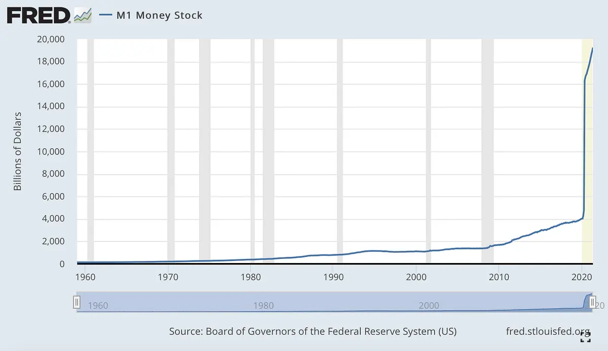

Şunu merak ediyor olabilirsin: **Bu bülteni neden alıyorum?** Kısaca: Seninle (Emin Mahrt, [www.emin.de](http://www.emin.de)) son 10-15 yılda girişimlerimden birinde yollarımız kesişti. **Bugün Crypto üzerine bir YouTube kanalı açıyorum** ve bunu seninle paylaşmak istedim. **Daha fazla güncelleme almak istemiyorsan**, lütfen bu e-postanın altındaki kısımdan **listeden çık (unsubscribe)**.

Bitcoin nedir? Bu videoda Bitcoin'i teknik olmayan bir dille anlatıyorum.

[Videoyu YouTube'da izle](https://www.youtube.com/watch?v=IfyZReFeDNQ)

Her şeyi daha iyi anlamanı sağlayacak basit bir dil ve örnekler kullanacağım.

Bitcoin, 2008 finansal krizi sırasında Satoshi Nakamoto adında bir kişi veya grup tarafından ortaya atıldı. 9 sayfalık bir PDF dosyasında Bitcoin'in nasıl çalıştığını, onu neyin özel ve hepimiz için önemli kıldığını anlattılar.

Whitepaper'ın her detayına girmeyeceğim ama Bitcoin'in en önemli özelliklerini açıklamaya çalışacağım.

Bitcoin: Eşten eşe (peer-to-peer) elektronik nakit sistemi.

Bununla başlayalım. Hepiniz nakitin ne olduğunu biliyorsunuz. Bazılarımız hala günlük alışverişlerinde kullanıyor; madeni paralar ve banknotlar kullanıyoruz. Nakiti birine verdiğimizde artık o para bizde kalmıyor ve aynı parayı bir başkasına veremiyoruz. Buraya kadar her şey tamam. Bir kişi diğerine nakit verirse, buna eşten eşe diyebilirsin. Bir taraf diğerine nakiti aktarır. İşte bu kadar basit. Bu işlemi doğrulamak için arada bir aracıya veya bankaya ihtiyaç yok.

Bitcoin'in özü de tam olarak bu, sadece elektronik hali. Tıpkı nakit gibi Bitcoin'i de bir kişiden diğerine gönderebilirsin. En güzeli de bunu yapmak için bir banka, PayPal veya Visa gibi aracı bir kuruma ihtiyacın yok. Bunu elektronik olarak, eşten eşe yapabilmek Bitcoin'in belki de en büyük ve en önemli özelliği. Ayrıca bu, Bitcoin'i dirençli ve sağlam kılıyor. Bitcoin'ini saklamak veya ağı çalıştırmak için kimseye güvenmek zorunda değilsin. "Güven gerektirmeyen" (trust-less) denmesinin nedenlerinden biri de bu. Bitcoin'i kontrol eden merkezi bir otorite olmadığı için Bitcoin kapatılamaz. Bitcoin'in yok olması için tek yol, onu kullanan herkesi vazgeçmeye ikna etmek olurdu. Bugün dünya genelinde on binlerce bilgisayardan ve şirketten bahsediyoruz. Hepsi birlikte merkeziyetsiz eşten eşe Bitcoin ağını oluşturuyor. Bitcoin'i kapatmanın tek yolu interneti kapatmak olurdu ki bu da, artık dünyanın her köşesine uydularla erişilebilen bir çağda pek mümkün görünmüyor.

Erişim konusu da Bitcoin için çok önemli. Az önce anlattığım gibi, Bitcoin ağı merkezi bir otorite veya aracı olmadan çalışan merkeziyetsiz bir ağdır. Her şey her an herkese açıktır; her işlem ve Bitcoin gönderip almak için kullanılan her adres (genellikle cüzdan veya kimlik denir). Daha da önemlisi, herkes izin istemeden Bitcoin'e dahil olabilir. Bunu halka açık bir park gibi düşün; herkes girebilir, kimseye sorman gerekmez. İşte bu yüzden Bitcoin'e "herkese açık" (public) ve "izinsiz" (permission-less) denir. Bitcoin herkes içindir, tek ihtiyacın olan bir internet bağlantısı ve bir akıllı telefon ya da bilgisayar.

Bitcoin'e başlamanın en kolay yolu bir Bitcoin cüzdanı edinmektir. Cebindeki fiziksel cüzdanın tıpkısı ama uygulama olarak akıllı telefonunda veya bilgisayarında. Kurduktan sonra bir adresin ve genellikle 12-24 İngilizce kelimeden oluşan bir anahtarın olur. Anahtar, şifren gibidir; sadece sen bilirsin ve Bitcoin'lerine sadece bu anahtarla erişebilirsin. Anahtarını kaybedersen, Bitcoin'lerini de kaybedersin. Eğer birisi anahtarını ele geçirirse, Bitcoin'lerine ulaşabilir. Bu yüzden anahtarını çok güvenli bir yerde saklaman ve kimseye göstermemen tavsiye edilir. Tıpkı fiziksel bir kasanın anahtarı gibi düşün, iyi koru!

İstediğin kadar adres oluşturabilirsin; tamamen ücretsizdir, herkese açıktır ve izinsizdir. Dünyadaki herkes için, hükümetin izin verip vermediği umurunda değil; Bitcoin gerçekten herkes içindir. Kimse dışlanamaz, tıpkı karşında durup sana nakit veren birinden nakit alırken dışlanamayacağın gibi.

Eğer cüzdanının anahtarı sadece sendeyse, kendi bankan olmuşsun demektir.

Bitcoin'lerin üzerinde tam kontrol ve mülkiyet sahibisin; rızan olmadan veya daha doğrusu anahtarın olmadan kimse onlara erişemez. Ölürsen ve anahtarı birine devretmezsen, Bitcoin'lerin sonsuza kadar kaybolur. Bitcoin sana güçlü bir kontrol ve sahiplik verir ama beraberinde kişisel sorumluluğu da getirir. Anahtarını kaybettiğinde veya Bitcoin'lerini başka bir adrese gönderdiğinde onları geri almanın bir yolu yoktur.

Kulağa korkutucu geliyor olabilir ama bu Bitcoin'in çok önemli bir özelliğidir. Ayrıca Bitcoin transferleri geri döndürülemezdir; gönderdiğin an onları geri alamazsın ya da birini arayıp iptal ettiremezsin (unutma: aracı yok, eşten eşe). Gönderdiğin Bitcoin'i geri alamaman, aynı Bitcoin'i birden fazla kişiye gönderemeyeceğini de garanti eder. Tekrar nakit örneğine dönelim: Birine bir banknot verirsen, o para artık sende değildir. Onu iki kez harcayamazsın. Bitcoin de "çift harcanamaz" (double spend). Eğer Bitcoin'i aldıysan ve cüzdanının anahtarı sendeyse, o Bitcoin'ler sadece senin erişimindedir.

Bitcoin özeldir. Kimsenin hangi adresin kime ait olduğunu bilme şansı yok. Adreslere bu yüzden "kimlik" deniyor. İstersen her işlem için yeni bir kimlik oluşturabilirsin; bir adresi tekrar kullanmak zorunda değilsin. Bu, Bitcoin'i çok gizli kılıyor. On farklı kişi sana Bitcoin göndermek isterse, her birine farklı bir adres verebilirsin. İşte anonim ve gizli kalmanın yolu bu. Bitcoin gerçek ismini veya pasaportunu sisteme kaydetmeni gerektirmediği için gerçek hayattaki kimliğinle bir bağlantısı yoktur. Wikileaks gibi platformların Bitcoin ile bağış kabul etmesinin veya dark web'in bunu kullanmasının nedenlerinden biri bu. Bitcoin nakit gibidir; sokakta birine nakit verirsen, ikinizin de birbirini tanımasına gerek kalmadan işlemi gerçekleştirebilirsiniz.

Tabii ki işin içinde daha fazlası var. Öncelikle, dünyada sadece 21 milyon adet Bitcoin olacak. Her bir Bitcoin yüz milyon parçaya bölünebilir; bir Bitcoin'in en küçük parçasına "satoshi" denir. Bir satoshi, Bitcoin'in 100 milyonda biridir. USD ile kıyaslarsak; bir dolar 100 cent'e bölünür, yani 1 cent doların yüzde biridir.

Ama USD veya Euro'nun aksine, Bitcoin yoktan var edilemez, toplam miktar 21 milyonla sınırlıdır.

Peki, nasıl Bitcoin alırsın?

Bitcoin, ağın güvenliğini sağlayarak ve çalıştırarak kazanılabilir. Bu kısım biraz teknik ve zordur, o yüzden bu videoda anlatmayacağım.

Bitcoin sahibi olmanın daha kolay yolu, başka bir para birimiyle takas etmek, birinden satın almak veya örneğin Euro yerine yaptığın işin karşılığını Bitcoin olarak almaktır. Bitcoin'i Euro, USD veya başka bir para birimiyle takas edebilirsin; tıpkı USD'yi GBP ile takas edebileceğin gibi.

Bitcoin neden değerli?

Dürüst olmak gerekirse, Bitcoin'den önce paranın neden belli bir değeri olduğunu hiç düşünmemiştim. Nereden geldiği hakkında hiçbir fikrim yoktu (devlet mi? hükümet mi?) ve pek de umurumda değildi. Ama insanlar Bitcoin'i geleneksel nakite bir alternatif olarak görmeye başladıkça, konu hakkında daha fazla şey öğrenmek istedim.

Bir ürünün değerini kullanım öneminin belirlediğini söyleyebilirsiniz. Yani bir şey çok işe yarıyorsa, birçok farklı amaçla kullanılabiliyorsa çok değerlidir diyebilirsiniz. Fakat bu argüman pek işlemiyor. Su olmadan hayat olmaz ama yine de su, elmastan çok daha ucuz.

Kıtlık da önemli. Kıtlık, yani dünyada ne kadar elmas olduğu ve kaç kişinin onu istediği işin önemli bir parçası. İster bir şişe şarap olsun, ister bir Picasso tablosu. Marx bir keresinde değerin, onu üretmek için harcanan emekten geldiğini söylemişti. Domates yetiştirmek inek yetiştirmekten kolay, o yüzden dana eti domatesten daha pahalı.

Fakat tüm bunlar bana Bitcoin'in değerini tam anlatamadı, o yüzden USD'ye baktım. Dolar ismi, ilk gümüş paraların basıldığı bir yerden geliyor. Joachims-thal denen bir vadi, paradan da Thaler deniyor, zamanla Thaler olmuş sana Dolar. İşte böyle. İlk dolarlar gümüş paralardı.

200 küsur yıl önce dolar ilk çıktığında, aslında altın için bir sertifika gibiydi. İstediğin an bankaya veya devlete gidip dolarını verip altınını alabiliyordun. Altın o zaman da kıttı, bugün de kıt. Ciddi bir kıtlığı var ama bugün Bitcoin'den daha kıt hiçbir şey yok. Düşünsene, toplamda sadece 21 milyon Bitcoin olacak.

Konuya dönelim. Avusturya ekolünün dediği gibi, "iyi para" havadan sudan gelmez. Neden herkes Pablo Picasso tablolarını sever? Neden bunun için bir sürü dolar veya Bitcoin öder? Kimse bilmiyor, önemi de yok zaten. Bitcoin çok rahat para olabilir. Kıtlık önemli ve Bitcoin'den daha kıt bir şey bulmak acayip zor.

Bugün dolar, euro ve aslında tüm devlet paraları merkezi bir şekilde planlanıp yönetiliyor. Devletler istedikleri an havadan para basabiliyor. Bizim de elimizden bir şey gelmiyor. Mal ve hizmet almak için paraya ihtiyacımız var, devletin de paraya ihtiyacı olduğunda, mesela bir pandemiyle savaşmak için, hop para basıyorlar.

Ama bu işin sonu sıkıntı. Paranın dengede olması lazım. Bedava para olmaz, olsa herkes istediği kadar alır ve paranın değeri tamamen sıfırlanır. Hiperenflasyon başlar.

1974'te ekonomi dalında Nobel alan Hayek, paranın değerini zaman üzerinden tanımlamıştı. İki tip insan vardır derdi; parası olanlar ve paraya ihtiyacı olanlar. Çok yüksek zaman tercihine sahip biri, yani paraya şu an ihtiyaç duyan biri; kulüpte şampanya patlatmak ya da iş kurmak için parayı hemen ister. Bu insanlar parayı genellikle düşük zaman tercihine sahip, yani parasını kenara atan kişilerden, bankalar üzerinden borç alır. İstedikleri faiz, bu iki taraf arasındaki dengedir. "Bana borç vereceğin parayı hangi faiz oranıyla verirsin?" İşte Hayek bu çalışmasıyla Nobel aldı. Doğal faiz oranı, düşük ve yüksek zaman tercihleri arasındaki o denge noktasıdır.

Bugün para olayı tamamen çığırından çıktı. Bankadan bedavaya borç alabiliyorsun, üstelik bir sınırı da yok. Bitcoin'in aksine, dolar veya diğer fiat paraların sayısı sonsuz ve bu sayı inanılmaz bir hızla artıyor.

Devletlerin para basması büyük sorun. Bugüne kadar üretilen tüm dolarların neredeyse yüzde 80'i son bir buçuk yıl içinde basıldı. 229 yılda 4000 milyar dolar (%21) üretilmişken, son 16 ayda (Ocak 2020-Mayıs 2021) 19.200 milyar dolarlık (%79) devasa bir artış oldu.

Bitcoin'i hayal etmek cidden zor. Enflasyonu da öyle. Merkezi otoritelerin enflasyona yol açmayacağına güveniyoruz. Bitcoin'in merkezi bir otoritesi yok, arzı net bir şekilde sınırlı ve önceden belli.

Dünya tarihinde hiç bu kadar insan, paranın ne olduğunu; merkez bankalarının nasıl çalıştığını veya paranın nasıl yaratıldığını düşünmemişti.

Fiat paranın ve merkez bankalarının sonsuza kadar var olacağını sanmıyorum. Bitcoin, herhangi bir kitaptan daha fazla insana ekonomi öğretti. Ve daha yolun başındayız.

Bitcoin iyi paradır. Dünyadaki herkes için halka açık, izne ihtiyaç duymayan, eşler arası (peer-to-peer) bir ağ üzerinden erişilebilir. Bitcoiner ol, kendini geliştirmeye devam et, başkalarıyla konuş ve sorular sor. Pişman olmayacağına söz veriyorum.

Kaynaklar

- <https://fred.stlouisfed.org/series/M1SL>
- <https://blog.trezor.io/austrian-economics-and-bitcoin-a-virtuous-cycle-9bf89ca6a7cc>
- <https://bitcoin.org/bitcoin.pdf>
